# ARCHITECTURE — MeshForge Compute Fabric

> **Status:** v1 — *Proposed, pending team approval* (2026-09-15)
> **Codename:** `MeshForge` (working name; package `meshforge`, CLI `compute`). Renaming later is a mechanical change.
> **Reads with:** [`PROJECT_BRIEF.md`](PROJECT_BRIEF.md) (what & why) → **this file** (how) → [`DEVELOPMENT_ROADMAP.md`](DEVELOPMENT_ROADMAP.md) (in which order) → [`STATUS.md`](STATUS.md) (where we are).
> Diagrams are Mermaid: they render as images on GitHub and remain readable as text for agents.

---

## Contents
1. [Architecture at a glance](#1-architecture-at-a-glance)
2. [Design principles](#2-design-principles)
3. [Runtime components & process layout](#3-runtime-components--process-layout)
4. [The three planes: control, data, GPU](#4-the-three-planes-control-data-gpu)
5. [Execution modes mapped onto the architecture](#5-execution-modes-mapped-onto-the-architecture)
6. [Workload model: two request kinds](#6-workload-model-two-request-kinds)
7. [Planner architecture & cost models](#7-planner-architecture--cost-models)
8. [Mode 1 — Job Offloading flow](#8-mode-1--job-offloading-flow)
9. [Mode 3 — Task Splitting flow](#9-mode-3--task-splitting-flow)
10. [Mode 2 — Remote GPU flow](#10-mode-2--remote-gpu-flow)
11. [Mode 4 — Combined GPU flow](#11-mode-4--combined-gpu-flow)
12. [State machines](#12-state-machines)
13. [Failure model, retries, idempotency](#13-failure-model-retries-idempotency)
14. [Data plane: content-addressed storage & caching](#14-data-plane-content-addressed-storage--caching)
15. [Execution environments](#15-execution-environments)
16. [Security model & pairing](#16-security-model--pairing)
17. [Telemetry & benchmarking pipeline](#17-telemetry--benchmarking-pipeline)
18. [ML subsystem](#18-ml-subsystem)
19. [Data model](#19-data-model)
20. [API surfaces](#20-api-surfaces)
21. [Repository structure](#21-repository-structure)
22. [Technology stack](#22-technology-stack)
23. [Deployment topology (lab)](#23-deployment-topology-lab)
24. [Cross-platform strategy](#24-cross-platform-strategy)
25. [Observability](#25-observability)
26. [Honest limits](#26-honest-limits)
27. [Open questions](#27-open-questions)

---

## 1. Architecture at a glance

One **controller** coordinates a set of **node agents** (one per laptop, including the controller's own laptop). Users interact through the **CLI**, the **dashboard**, or the **Python SDK** inside their own programs. A single **planner** decides, for every request, *where and how* to run it.


**In one sentence:** the controller *decides and records*; agents *execute and report*; bulk data and GPU traffic flow *directly between laptops*, never bottlenecked through the controller unless necessary.

---

## 2. Design principles

| # | Principle | Consequence |
|---|---|---|
| P1 | **Plan ≠ execute.** | Planner produces an `ExecutionPlan`; separate executors carry it out. Planner never contains execution logic. |
| P2 | **One planner, all modes.** | Local, Mode 1–4 are candidate plan types in the same pipeline, compared by predicted cost. |
| P3 | **Extend, don't duplicate.** | Mode 3 reuses Mode 1 machinery; Mode 4 reuses Mode 2's GPU runtime; Mode 3 and Mode 4-inference share one work-queue abstraction. |
| P4 | **Controller is the source of truth for state; agents are the source of truth for reality.** | On reconnect, agents report what is actually running; controller reconciles. |
| P5 | **Control plane small, data plane direct.** | gRPC carries commands/status only; bytes move over HTTP between nodes; GPU tensors move node-to-node. |
| P6 | **Content-addressed everything.** | Code, data, models, environments are identified by SHA-256 → caching, dedup, integrity for free. |
| P7 | **Explicit states, explicit failures.** | Every job/attempt/session has a state machine and a typed `failure_type`. |
| P8 | **Telemetry from day one.** | Every attempt records phase timings + resource/network snapshots; this is the ML training set. |
| P9 | **Deterministic fallback always.** | Rule-based policies stay available; ML only adjusts cost predictions and falls back when uncertain. |
| P10 | **Secure by construction.** | Node identity keypairs exist from V0.3; mTLS + enrollment in V0.7; workloads always sandboxed. |
| P11 | **Honest scope.** | Mode 2/4 target PyTorch workloads; Mode 3 targets declared-divisible tasks. Documented, measured, not faked. |

---

## 3. Runtime components & process layout

| Component | Runs on | Process | Responsibilities |
|---|---|---|---|
| **Controller** | one laptop (the one that ran `compute fabric create`) | 1 asyncio Python process | REST/WS API, agent gRPC, job manager, planner, dispatcher, blob index, telemetry, benchmarks, ML, CA/enrollment |
| **PostgreSQL** | controller host | DB server (Docker in dev; managed install in product) | durable state + telemetry |
| **Node agent** | every laptop | long-running Python service (systemd / Windows service) | identity, hardware discovery, resource monitor, session with controller, job execution, blob cache + peer blob server, network probes, GPU-service supervision |
| **GPU service** | every NVIDIA-GPU laptop | separate process spawned by agent, own venv with PyTorch+CUDA | Mode 2 / Mode 4 sessions: tensors, modules, calls, collectives |
| **Job sandboxes** | executing laptop | Docker container or isolated venv process per attempt | run user code with limits |
| **CLI** | any laptop | short-lived | submit, inspect, logs, fabric management |
| **SDK** | inside user program | library | remote GPU, combined GPU, planner requests |
| **Dashboard** | browser; static files served by controller | React SPA | operation & observability UI |

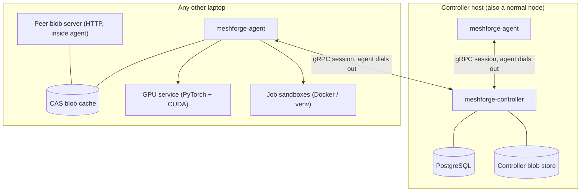

**Why the GPU service is a separate process:** it imports PyTorch/CUDA (large, crash-prone, version-sensitive). Isolating it keeps the agent small and stable, lets it be restarted independently, and lets its Python/CUDA environment differ from the agent's.

---

## 4. The three planes: control, data, GPU

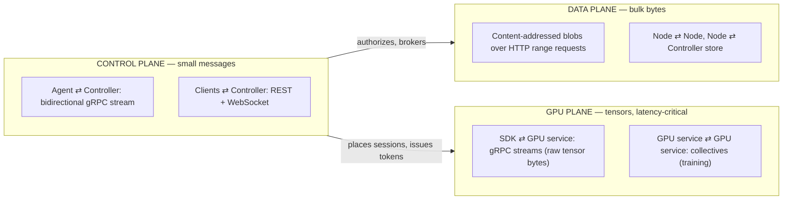

| Plane | Transport | Why |
|---|---|---|
| Control | gRPC bidi stream (agent-initiated), REST/WS | typed contracts, streaming, works through NAT/firewalls because agents dial out |
| Data | HTTP/1.1+ range GET with auth token | resumable, cacheable, simple, fast; gRPC is poor for multi-GB payloads |
| GPU | gRPC streaming with raw bytes (upgrade to raw TCP only if V0.2 spike S3 shows need) | low overhead, same tooling; tensors never pickled |

---

## 5. Execution modes mapped onto the architecture

|  | **One laptop** | **Many laptops** |
|---|---|---|
| **Task is sent away** | **Mode 1 — Job Offloading** → `JobOffloadExecutor` | **Mode 3 — Task Splitting** → `TaskSplitExecutor` (N × Mode-1 attempts over a work queue) |
| **Program stays on my laptop** | **Mode 2 — Remote GPU** → SDK + 1 GPU session | **Mode 4 — Combined GPU** → SDK + N GPU sessions + work queue / collectives |

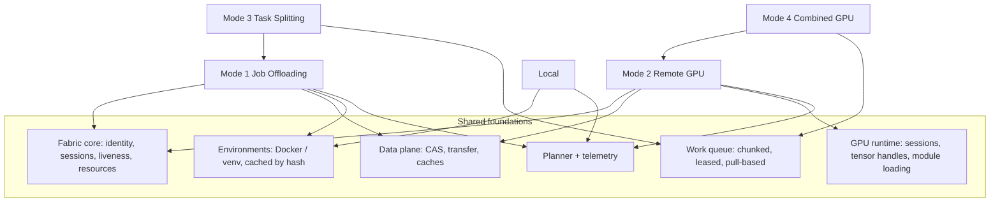

---

## 6. Workload model: two request kinds

A planner cannot move the GPU calls of an arbitrary script to another machine without the script's cooperation. So the fabric has **two request kinds** that feed **one planner**:

| Request kind | Created by | Describes | Candidate plans |
|---|---|---|---|
| **JobRequest** | `compute run`, dashboard, REST | a whole program: source tree + manifest | Local · Mode 1 (per node) · Mode 3 (per node-set, if `split:` declared) |
| **AcceleratorRequest** | the SDK inside a running program | "I need GPU capacity for this model/work" | Local GPU/CPU · Mode 2 (per GPU node) · Mode 4 (per GPU-set) |

### 6.1 Job manifest (`compute.yaml`) — illustrative

```yaml
name: image-classify
entrypoint: python classify.py --in {inputs} --out {output}
env:
  python: "3.11"
  requirements: requirements.txt
  base: cuda-pytorch          # or: python-cpu
resources:
  gpu: preferred              # required | preferred | none
  vram_gb: 4
  ram_gb: 8
inputs:
  - path: data/
outputs:
  - results/
split:                        # present → Mode 3 becomes a candidate
  over: data/*.jpg
  chunk: auto                 # planner decides
  combine: concat             # concat | merge-csv | merge-json | script:combine.py
limits:
  timeout: 2h
```
A project without a manifest still runs (entrypoint inferred: `main.py`/`__main__`); the manifest only adds precision.

### 6.2 SDK — illustrative

```python
import meshforge as mf

# Mode 2: one remote GPU (or "auto": planner may return local GPU)
gpu = mf.remote_gpu("auto")
rmodel = gpu.module(model, example_inputs=(x,))
y = rmodel(x)                                   # computed remotely

# Mode 4: all GPUs as one
pool = mf.combined_gpu(nodes="auto")
preds = pool.map(model, dataset, batch_size=64) # inference, ordered results
pool.train(model, dataset, optimizer=opt, loss_fn=loss, epochs=10)
```

---

## 7. Planner architecture & cost models

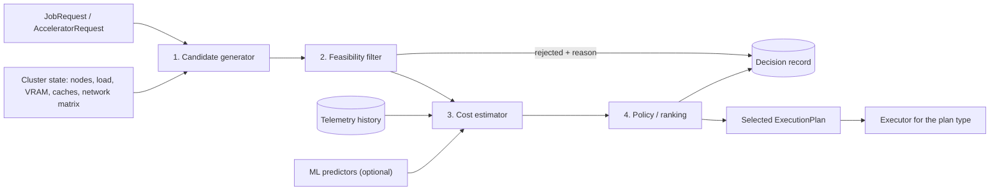

**Policies** (selectable globally or per request; all kept as baselines): `random`, `round_robin`, `least_loaded`, `strongest_suitable`, `resource_score`, `cache_affinity`, `cost_model` (analytical), `cost_model_ml` (analytical + ML components), `oracle` (benchmark-only: best measured).

**Cost decomposition** — analytical where physics is known, learned where it isn't:

| Plan | Predicted completion time |
|---|---|
| Local | `T_env(cache) + T_compute(local)` |
| Mode 1 on node *n* | `T_queue(n) + missing_bytes(n)/bw(A→n) + T_env(n, cache) + T_compute(n) + out_bytes/bw(n→A)` |
| Mode 3 on set *S* | `T_split + max_{n∈S}( T_stage(n) + T_env(n) + share_n / rate_n ) + T_combine`, shares chosen so all finish together |
| Mode 2 on node *g* | `T_session + model_bytes/bw (if not cached) + N_calls × ( RTT + (in+out bytes)/bw + t_call(g) )` |
| Mode 4 inference on set *S* | `T_setup + N_items / Σ_{g∈S} min( rate_g , bw_g / bytes_per_item )` |
| Mode 4 training on set *S* | `per step: max_g( b_g / r_g ) + T_allreduce(grad_bytes, min bw, size of S)`, with `Σ b_g = global batch` |

- `bw`, `RTT` come from the **measured network matrix** (agent probes).
- `T_compute`, `rate_g`, `t_call`, `T_env` come from **history** (per workload fingerprint × node), then from **ML predictors** (V0.15) using hardware scores + load + workload features.
- `failure_risk` (from node reliability history) is converted into an expected-time penalty.
- Every decision is stored with **all candidates, rejections with reasons, predicted breakdowns, and later the actual outcome** → explainability and training data.

---

## 8. Mode 1 — Job Offloading flow

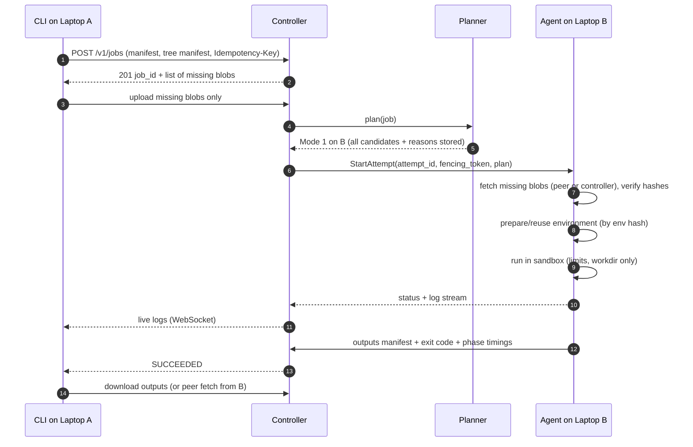

---

## 9. Mode 3 — Task Splitting flow

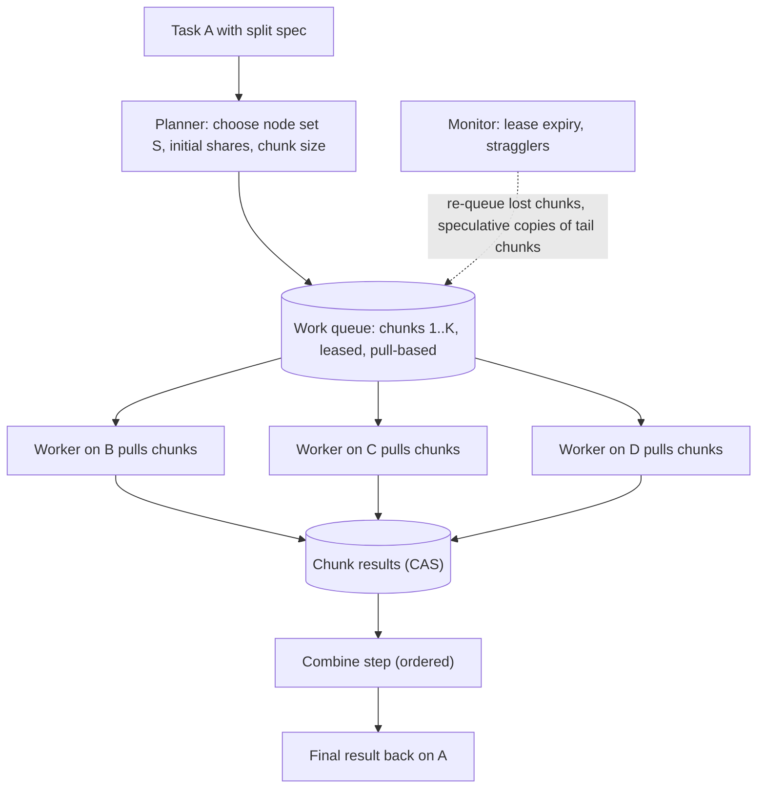

**Why pull-based chunks, not fixed shares:** a faster laptop simply pulls more chunks, so heterogeneity and stragglers balance automatically; the planner's share estimate sets *chunk size and participants*, not a brittle static split. Each node prepares its environment **once** and then runs many chunks.

---

## 10. Mode 2 — Remote GPU flow

```mermaid
sequenceDiagram
    autonumber
    participant App as User program on A (SDK)
    participant C as Controller
    participant G as GPU service on B
    App->>C: AcceleratorRequest (model size, expected calls, bytes per call)
    C-->>App: placement = B (or local), session token, reasons
    App->>G: OpenSession(token)
    App->>G: LoadModule(exported-program blob id)
    G->>G: fetch blob if not cached; load weights into VRAM
    loop every call
        App->>G: Call(module, input tensors as raw bytes)
        G-->>App: output tensors (or remote handles)
    end
    App->>G: CloseSession (or lease expiry frees VRAM)
```

**Key design choices**
- **Model shipping via `torch.export`** (ExportedProgram: graph + weights, no pickled code) → safe, portable, cacheable by hash.
- **Resident state:** weights and large tensors stay in remote VRAM behind **handles**; only inputs/outputs cross the network.
- **Call pipelining:** SDK overlaps upload of call *k+1* with compute of call *k*.
- **Transparency ladder:** L1 predefined ops → L2 remote tensors/handles → L3 `RemoteModule` API → L4 `torch.compile` backend shipping FX graphs (stretch). CUDA-API interception (L5) is out of scope.
- **Admission control:** VRAM reservations per session; max sessions per GPU; the laptop owner can cap sharing.

---

## 11. Mode 4 — Combined GPU flow

### 11.1 Inference (`pool.map`)
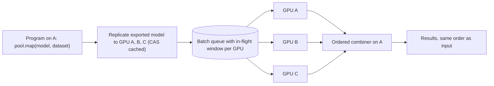
Uses the **same work-queue abstraction as Mode 3**, at batch granularity. A GPU whose link makes it net-negative is dropped by the planner.

### 11.2 Training (`pool.train`) — data parallel
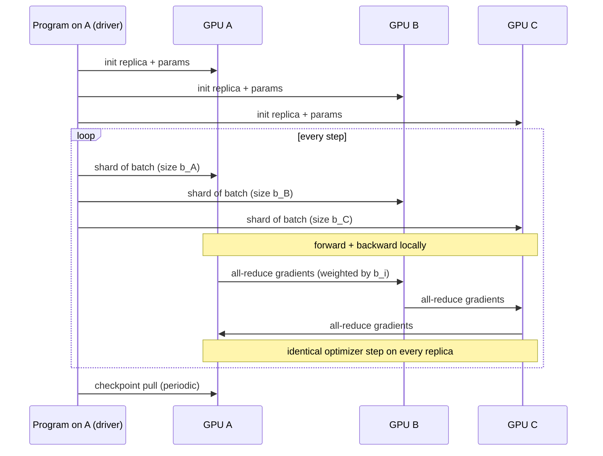
- Batch shares `b_i` ∝ measured throughput; gradients averaged **weighted by samples** so results match single-GPU training with the same global batch.
- All-reduce: v1 coordinator-reduce → v2 ring over TCP (or `torch.distributed` gloo if the V0.2 cross-OS spike passes); optional fp16 gradient compression.
- Failure: checkpoint on A, continue with remaining members.

### 11.3 Model splitting (bonus stage)
Profile per-block time/memory per GPU → dynamic-programming partition minimising the slowest stage subject to VRAM → pipeline execution with activation transfer and micro-batching. For models larger than any single GPU.

---

## 12. State machines

### 12.1 Job
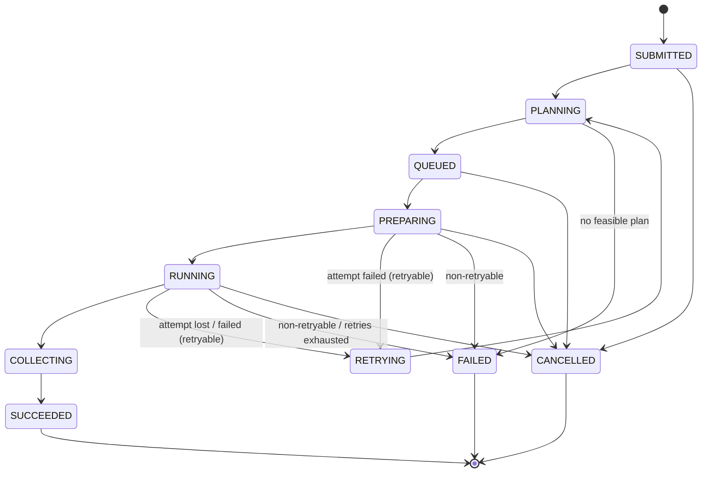
Mode 3 jobs additionally track chunk states (`PENDING → LEASED → DONE | FAILED`), with lease expiry returning chunks to `PENDING`.

### 12.2 Attempt (one execution of a job/chunk on one node)
`ASSIGNED → STAGING → ENV_READY → RUNNING → UPLOADING → DONE` · failures: `FAILED(failure_type)` · `LOST` (node vanished) · `FENCED` (superseded; late reports rejected).

### 12.3 Node liveness
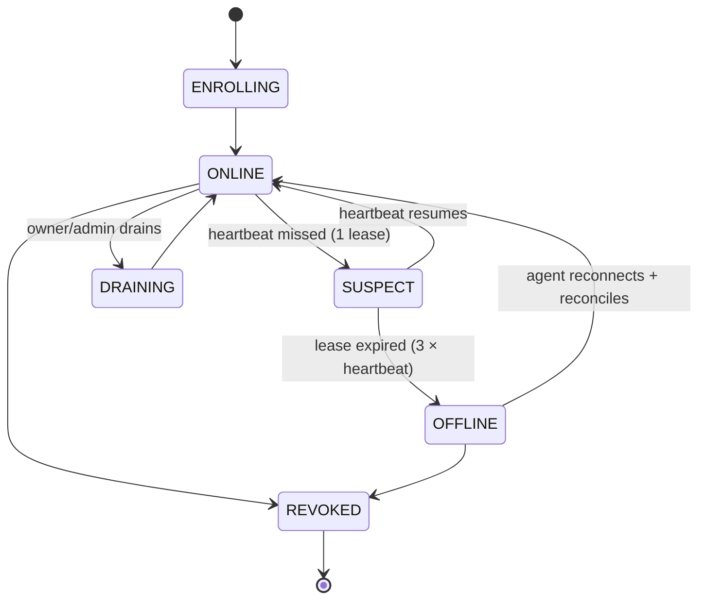

---

## 13. Failure model, retries, idempotency

| Failure | Detection | Response |
|---|---|---|
| Agent/laptop disappears | lease expiry | attempts → `LOST`; retry elsewhere per policy; chunks re-queued |
| Controller crashes | agents lose stream | agents keep running attempts, buffer reports, reconnect with backoff; controller rebuilds from DB + agent reconciliation |
| Network partition | lease + stream error | as above; fencing prevents two live copies from both committing |
| Partial / corrupted transfer | range resume; SHA-256 verify | resume from last good chunk; corrupted blob discarded |
| Process crash / non-zero exit | exit code | `FAILED(user_error)` — not retried by default |
| OOM / VRAM OOM | exit signal / CUDA error | `FAILED(oom)`; planner learns; optional retry on larger node |
| Env build failure | builder error | `FAILED(env_error)`, cached as known-bad for that env hash |
| Disk full | pre-check + error | `FAILED(disk_full)`; GC triggered |
| GPU session loss | stream error / lease | typed exception in SDK; Mode 4 reassigns in-flight batches |
| Duplicate submission | `Idempotency-Key` unique constraint | returns the existing job |
| Duplicate command delivery | command IDs, agent dedupe | at-least-once delivery, exactly-once effect |
| Zombie attempt after reassignment | **fencing token** (monotonic attempt epoch) | controller rejects stale reports |

Retry policy is per failure type (`retryable` vs not), with max attempts and backoff. All failures carry a typed `failure_type` for telemetry and ML.

---

## 14. Data plane: content-addressed storage & caching

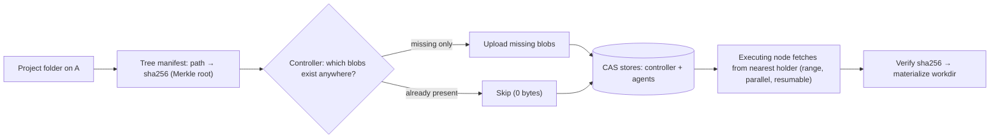

- **Blob** = immutable bytes named by SHA-256; large files chunked (e.g. 8 MiB) for parallel/resumable transfer.
- **Cache index:** agents report held blobs and environments; the controller keeps a location index used by the planner (`cache_affinity`, `missing_bytes`).
- **Named inputs:** datasets and models can be registered once and referenced by name@hash.
- **GC:** LRU with per-node quota; pinned items (base images, registered datasets) exempt.

---

## 15. Execution environments

| Runtime | Default when | Isolation | Notes |
|---|---|---|---|
| **Docker** | Linux nodes; Windows nodes with Docker Desktop | container: CPU/RAM/pids limits, workdir-only mounts, no privilege | GPU via NVIDIA Container Toolkit / Docker Desktop WSL2 backend |
| **venv (uv)** | Docker unavailable; also used by GPU service | restricted process + workdir; weaker than containers (documented) | fast env creation; cached by env hash |

**Env hash** = `sha256(base image id + python version + resolved lockfile)`. Built once per node, reused forever (until GC). Base images `python-cpu` and `cuda-pytorch` can be pre-pulled (`compute node prepare`).

---

## 16. Security model & pairing

**Threat model (summary):** devices are owned by trusted people, but the network is not trusted, and a mistake must not let an outsider run code. Workloads are semi-trusted: they are sandboxed so they cannot trivially damage the host. A process with Docker-socket access has root-equivalent power — the agent is therefore a privileged component and is kept small and audited.

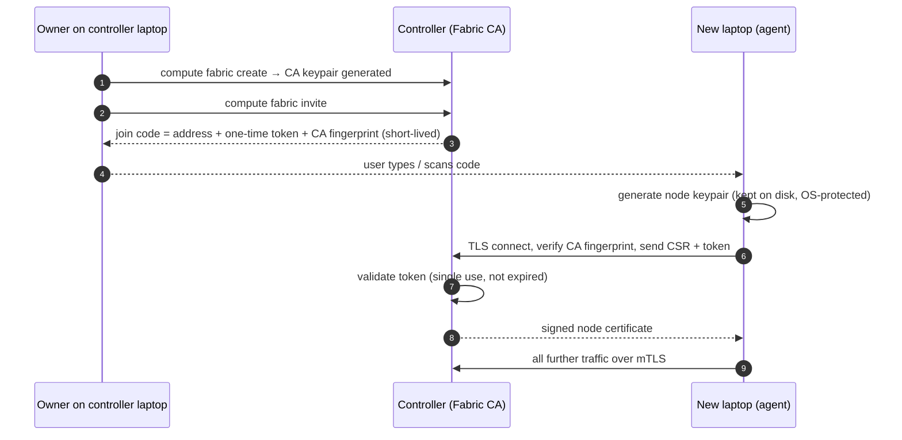

- mTLS on agent gRPC; node-cert auth on peer blob servers and GPU services; short-lived session tokens for GPU sessions and blob fetches.
- User auth on REST (local admin credential; tokens for CLI).
- Revocation list checked on every session; cert rotation supported.
- Per-node owner settings: accept jobs / accept GPU sessions / resource caps.

---

## 17. Telemetry & benchmarking pipeline

```mermaid
flowchart LR
    subgraph RUN["Every execution (normal or benchmark)"]
        S1["Resource snapshot at start"]
        S2["Network matrix at start"]
        S3["Cache state"]
        S4["Phase timings: queue, stage, env, load, compute, result"]
        S5["Outcome: success / failure_type / exit code"]
    end
    RUN --> TT[("Telemetry tables (PostgreSQL)")]
    CAMP["Benchmark campaigns: workload families × params × conditions × forced strategies"] --> JOBS["Normal job/SDK path (tagged benchmark)"]
    JOBS --> RUN
    COND["Condition controllers: load generators, cache warm/cold, network shaping, Wi-Fi vs Ethernet"] --> CAMP
    TT --> EXP["Export: Parquet datasets + labels (best measured plan per group)"]
    EXP --> ML["ML training & evaluation"]
    ML --> REG[("Model registry")]
    REG --> PLANNER["Planner cost estimator"]
```

Benchmarks run through **the same code paths as users** — so benchmark data reflects the real system, and the benchmark system doubles as an end-to-end test harness.

---

## 18. ML subsystem

- **Formulation:** *predict cost components per candidate plan*, then rank. Not a direct "which mode" classifier (kept only as an experimental comparison).
- **Targets:** compute time per (workload, node); env setup time; per-mode overhead residuals (actual − analytical); failure probability.
- **Features:** workload fingerprint features (type, sizes, params, batch, sequence length, declared resources), **measured hardware scores** (CPU GFLOPS, memory bandwidth, GPU TFLOPS, VRAM) rather than model names, live load, network metrics, cache state.
- **Models compared:** linear/ridge, decision tree, random forest, gradient boosting (XGBoost, LightGBM), kNN; quantile variants for uncertainty.
- **Evaluation:** group-wise splits by workload family (no leakage); MAPE for predictions; **decision regret vs oracle** for the planner; baselines = all rule policies + analytical model.
- **Safety:** out-of-distribution or high-uncertainty → fall back to analytical/rules; every decision records which predictor version was used.

---

## 19. Data model

```mermaid
erDiagram
    FABRIC ||--o{ NODE : contains
    NODE ||--o{ RESOURCE_SNAPSHOT : reports
    NODE ||--o{ NETWORK_LINK : "probes from"
    NODE ||--o{ NODE_BLOB : caches
    BLOB ||--o{ NODE_BLOB : "held by"
    NODE ||--o{ NODE_ENV : "has built"
    JOB ||--|| EXECUTION_PLAN : "decided by"
    EXECUTION_PLAN ||--o{ PLAN_CANDIDATE : evaluates
    JOB ||--o{ WORK_CHUNK : "split into"
    JOB ||--o{ ATTEMPT : "executed as"
    WORK_CHUNK ||--o{ ATTEMPT : "executed as"
    ATTEMPT }o--|| NODE : "runs on"
    ATTEMPT ||--o{ PHASE_TIMING : records
    ATTEMPT ||--o{ ARTIFACT : produces
    GPU_SESSION }o--|| NODE : "hosted on"
    GPU_SESSION ||--o{ GPU_CALL_STAT : records
    BENCHMARK_CAMPAIGN ||--o{ BENCHMARK_RUN : contains
    BENCHMARK_RUN ||--o| JOB : uses
    ML_MODEL ||--o{ EXECUTION_PLAN : "informs"
    ENROLLMENT_TOKEN }o--|| FABRIC : "issued by"
```
Schema is managed with SQLAlchemy 2.0 + Alembic migrations. Large logs and outputs live in the blob store, not in PostgreSQL. Resource snapshots are downsampled (e.g. 2 s live → 1 min history).

---

## 20. API surfaces

**gRPC (internal)**
- `AgentControl.Session(stream AgentMessage) → stream ControllerMessage` — Hello/Reconcile, Heartbeat, ResourceUpdate, CacheReport, NetProbeResult, AttemptStatus, LogChunk ⇄ StartAttempt, CancelAttempt, ProbeRequest, PrepareEnv, GC, Ack.
- `GpuService` (on GPU nodes) — `OpenSession`, `PutTensor(stream)`, `LoadModule`, `Call`, `GetTensor(stream)`, `Free`, `TrainStep`, `AllReduce*`, `CloseSession`.

**REST (external, versioned `/v1`)** — `nodes`, `jobs` (POST with `Idempotency-Key`), `jobs/{id}` `/plan` `/logs` (WebSocket) `/cancel` `/outputs`, `blobs` (has/upload), `accelerator-requests` (SDK placement), `benchmarks`, `telemetry/export`, `fabric` (create/invite/join/revoke), `auth`.

**CLI** — `compute status | nodes | run | jobs | logs | cancel | get | explain | fabric create|invite|join|revoke | node prepare|drain | bench run|status`.

**SDK** — `mf.remote_gpu()`, `mf.combined_gpu()`, `RemoteModule`, `RemoteTensor`, `Pool.map/train/step`.

Contracts live in `proto/` (source of truth) and OpenAPI generated from FastAPI.

---

## 21. Repository structure

```text
.
├── CLAUDE.md                     agent operating guide
├── README.md
├── pyproject.toml                uv project; extras: controller, agent, gpu, dev
├── proto/meshforge/v1/           common.proto · agent.proto · gpu.proto
├── src/meshforge/
│   ├── common/                   config · ids · logging · hashing · errors · generated protos
│   ├── controller/
│   │   ├── app.py                process entry: FastAPI + gRPC in one event loop
│   │   ├── api/                  REST + WebSocket routes
│   │   ├── rpc/                  AgentControl service, session manager
│   │   ├── registry/             nodes, liveness, reconciliation
│   │   ├── jobs/                 job/attempt/chunk state machines, dispatcher
│   │   ├── planner/              generators · feasibility · estimators · policies · explain
│   │   ├── blobs/                controller CAS + location index
│   │   ├── telemetry/            recording, export
│   │   ├── benchmarks/           campaigns, samplers, condition controllers
│   │   ├── ml/                   datasets, training, registry, predictors
│   │   ├── security/             CA, enrollment, authz
│   │   └── store/                SQLAlchemy models, Alembic migrations
│   ├── agent/
│   │   ├── main.py
│   │   ├── session/              gRPC client, reconnect, command dedupe
│   │   ├── identity/  hw/  monitor/  netprobe/
│   │   ├── runtime/              docker.py · venv.py (common interface)
│   │   ├── executor/             attempt lifecycle, work-queue worker
│   │   ├── blobs/                CAS cache + peer HTTP server
│   │   └── gpu/                  GPU-service supervisor
│   ├── gpu_service/              server · sessions · tensors · modules · collectives
│   ├── sdk/                      remote_gpu · combined_gpu · workqueue client
│   └── cli/
├── dashboard/                    React + TypeScript + Vite
├── workloads/                    example + benchmark workload families
├── lab/                          multi-laptop scripts, spikes, checklists, inventory
├── deploy/                       docker-compose.dev.yml · systemd · windows · installers
├── tests/                        unit · component · cluster · lab · gpu · e2e
└── docs/                         brief · architecture · roadmap · status · adr · LAB.md
```
**One Python package, several entry points** — simpler than a multi-repo, still clean boundaries enforced by import rules (`common` ← everything; `controller` and `agent` never import each other; `sdk` imports only `common`).

---

## 22. Technology stack

| Area | Choice | Why / note |
|---|---|---|
| Language | Python 3.12 (native extensions only if profiling proves need) | team preference; ecosystem |
| Packaging | **uv** | fast, lockfiles, also used for workload venvs |
| Internal RPC | gRPC (`grpcio`, `grpc.aio`) + Protocol Buffers | preference; streaming; typed |
| External API | FastAPI + Pydantic v2 | preference; OpenAPI |
| DB | PostgreSQL 16 + SQLAlchemy 2.0 (async) + Alembic | preference (fixed) |
| Logging | structlog (JSON) | structured logs from day one |
| Monitoring | psutil, nvidia-ml-py (NVML) | preference |
| Containers | Docker Engine / Docker Desktop, NVIDIA Container Toolkit | preference |
| Deep learning | PyTorch (`torch.export`, optional `torch.distributed` gloo) | Mode 2/4 |
| ML | scikit-learn, XGBoost, LightGBM | compared, not assumed |
| Discovery | zeroconf (mDNS) | LAN controller discovery |
| CLI | Typer + Rich | ergonomic, testable |
| Frontend | React + TypeScript + Vite, TanStack Query, Tailwind + Radix primitives, Recharts | professional, restrained UI |
| Testing | pytest, pytest-asyncio, testcontainers, Toxiproxy (fault injection), Playwright (UI e2e) | real behaviour over mocks |
| Quality | ruff, mypy, pre-commit, GitHub Actions (Linux + Windows runners) | agent-safe guardrails |
| Metrics (later) | Prometheus exporter + Grafana | optional |

---

## 23. Deployment topology (lab)

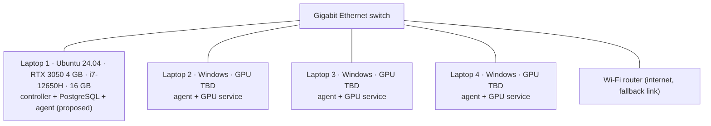
The controller role is proposed for Laptop 1 (native Linux, simplest to keep running); final choice after hardware inventory (V0.2).

---

## 24. Cross-platform strategy

- **Agent runs natively on Windows** (not inside WSL) — avoids WSL2 NAT/inbound problems; psutil, NVML, gRPC, PyTorch all work natively. Windows service in product; background task in dev.
- **Workloads on Windows** run in Docker Desktop (Linux containers, GPU through WSL2 backend) when available, else native venv.
- **Agents dial out** to the controller → no inbound port needed for the control plane. Peer blob servers and GPU services need inbound ports → firewall rules created by installer (documented manual step before V0.17).
- CI runs unit tests on both Linux and Windows.

---

## 25. Observability

- Structured JSON logs with `job_id`, `attempt_id`, `node_id`, `session_id` correlation fields.
- Dashboard: live node metrics, job timelines, planner explanations, benchmark results.
- Metrics (optional, later): Prometheus endpoint on controller (queue length, RPC latency, transfer rate, decision latency, failure rate).

---

## 26. Honest limits

- Combined GPU never equals the full sum of GPUs; gain depends on work type and network. Measured and reported, not promised.
- Mode 2/4 support PyTorch workloads via SDK/`torch.export`; arbitrary CUDA programs are out of scope.
- Mode 3 requires the task to be declared divisible.
- The fabric depends on the controller laptop being on; controller failover is future work.
- venv runtime isolation is weaker than containers (documented; Docker preferred).
- Network shaping for benchmarks is easiest on Linux (`tc netem`); Windows conditions rely on real Wi-Fi/Ethernet variation.

---

## 27. Open questions

| # | Question | Resolved by |
|---|---|---|
| Q1 | Hardware of laptops 2–4 (GPUs, VRAM, Windows version) | team → `docs/LAB.md` (V0.2) |
| Q2 | gRPC vs raw TCP for tensor transport | spike S3 (V0.2) |
| Q3 | `torch.distributed` gloo across Windows↔Linux usable? | spike S5 (V0.2) |
| Q4 | Docker Desktop GPU reliability on team Windows laptops | spike S6 (V0.2) |
| Q5 | Agent access for AI agents to Windows laptops (SSH / Claude Code / human relay) | team |
| Q6 | Final product name | team (any time) |
