# ARCHITECTURE — MeshForge Compute Fabric

> **Status:** v1 — *Accepted by team* (2026-09-15)
> **Codename:** `MeshForge` (working name; package `meshforge`, CLI `compute`). Renaming later is a mechanical change.
> **Reads with:** [`PROJECT_BRIEF.md`](PROJECT_BRIEF.md) (what & why) → **this file** (how) → [`DEVELOPMENT_ROADMAP.md`](DEVELOPMENT_ROADMAP.md) (in which order) → [`STATUS.md`](STATUS.md) (where we are).
> Diagrams are Mermaid: they render as images on GitHub and remain readable as text for agents.

---

## Contents
1. [Architecture at a glance](#1-architecture-at-a-glance)
2. [Design principles](#2-design-principles)
3. [Runtime components & process layout](#3-runtime-components--process-layout)
4. [The three planes: control, data, GPU](#4-the-three-planes-control-data-gpu)
5. [Execution modes mapped onto the architecture](#5-execution-modes-mapped-onto-the-architecture)
6. [Workload model: two request kinds](#6-workload-model-two-request-kinds)
7. [Planner architecture & cost models](#7-planner-architecture--cost-models)
8. [Mode 1 — Job Offloading flow](#8-mode-1--job-offloading-flow)
9. [Mode 3 — Task Splitting flow](#9-mode-3--task-splitting-flow)
10. [Mode 2 — Remote GPU flow](#10-mode-2--remote-gpu-flow)
11. [Mode 4 — Combined GPU flow](#11-mode-4--combined-gpu-flow)
12. [State machines](#12-state-machines)
13. [Failure model, retries, idempotency](#13-failure-model-retries-idempotency)
14. [Data plane: content-addressed storage & caching](#14-data-plane-content-addressed-storage--caching)
15. [Execution environments](#15-execution-environments)
16. [Security model & pairing](#16-security-model--pairing)
17. [Telemetry & benchmarking pipeline](#17-telemetry--benchmarking-pipeline)
18. [ML subsystem](#18-ml-subsystem)
19. [Data model](#19-data-model)
20. [API surfaces](#20-api-surfaces)
21. [Repository structure](#21-repository-structure)
22. [Technology stack](#22-technology-stack)
23. [Deployment topology (lab)](#23-deployment-topology-lab)
24. [Cross-platform strategy](#24-cross-platform-strategy)
25. [Observability](#25-observability)
26. [Honest limits](#26-honest-limits)
27. [Open questions](#27-open-questions)

---

## 1. Architecture at a glance

One **controller** coordinates a set of **node agents** (one per laptop, including the controller's own laptop). Users interact through the **CLI**, the **dashboard**, or the **Python SDK** inside their own programs. A single **planner** decides, for every request, *where and how* to run it.

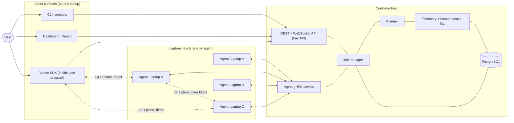

**In one sentence:** the controller *decides and records*; agents *execute and report*; bulk data and GPU traffic flow *directly between laptops*, never bottlenecked through the controller unless necessary.

---

## 2. Design principles

| # | Principle | Consequence |
|---|---|---|
| P1 | **Plan ≠ execute.** | Planner produces an `ExecutionPlan`; separate executors carry it out. Planner never contains execution logic. |
| P2 | **One planner, all modes.** | Local, Mode 1–4 are candidate plan types in the same pipeline, compared by predicted cost. |
| P3 | **Extend, don't duplicate.** | Mode 3 reuses Mode 1 machinery; Mode 4 reuses Mode 2's GPU runtime; Mode 3 and Mode 4-inference share one work-queue abstraction. |
| P4 | **Controller is the source of truth for state; agents are the source of truth for reality.** | On reconnect, agents report what is actually running; controller reconciles. |
| P5 | **Control plane small, data plane direct.** | gRPC carries commands/status only; bytes move over HTTP between nodes; GPU tensors move node-to-node. |
| P6 | **Content-addressed everything.** | Code, data, models, environments are identified by SHA-256 → caching, dedup, integrity for free. |
| P7 | **Explicit states, explicit failures.** | Every job/attempt/session has a state machine and a typed `failure_type`. |
| P8 | **Telemetry from day one.** | Every attempt records phase timings + resource/network snapshots; this is the ML training set. |
| P9 | **Deterministic fallback always.** | Rule-based policies stay available; ML only adjusts cost predictions and falls back when uncertain. |
| P10 | **Secure by construction.** | Node identity keypairs exist from V0.3; mTLS + enrollment in V0.7; workloads always sandboxed. |
| P11 | **Honest scope.** | Mode 2/4 target PyTorch workloads; Mode 3 targets declared-divisible tasks. Documented, measured, not faked. |

---

## 3. Runtime components & process layout

| Component | Runs on | Process | Responsibilities |
|---|---|---|---|
| **Controller** | one laptop (the one that ran `compute fabric create`) | 1 asyncio Python process | REST/WS API, agent gRPC, job manager, planner, dispatcher, blob index, telemetry, benchmarks, ML, CA/enrollment |
| **PostgreSQL** | controller host | DB server (Docker in dev; managed install in product) | durable state + telemetry |
| **Node agent** | every laptop | long-running Python service (systemd / Windows service) | identity, hardware discovery, resource monitor, session with controller, job execution, blob cache + peer blob server, network probes, GPU-service supervision |
| **GPU service** | every NVIDIA-GPU laptop | separate process spawned by agent, own venv with PyTorch+CUDA | Mode 2 / Mode 4 sessions: tensors, modules, calls, collectives |
| **Job sandboxes** | executing laptop | Docker container or isolated venv process per attempt | run user code with limits |
| **CLI** | any laptop | short-lived | submit, inspect, logs, fabric management |
| **SDK** | inside user program | library | remote GPU, combined GPU, planner requests |
| **Dashboard** | browser; static files served by controller | React SPA | operation & observability UI |

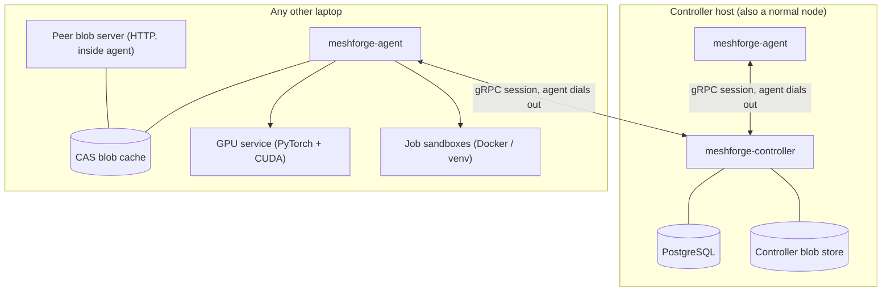

**Liveness is decided in memory; the database is the record (V0.3 G2).** The controller's session reader tasks and the single lease-timer task never await a database write: every persistence call is enqueued on a per-session ordered write chain (`controller/session/writer.py`) drained by its own task, so a slow or unreachable PostgreSQL cannot make a heartbeating node look OFFLINE. State transitions, heartbeats and RTT are applied to in-memory `LeaseTracker`s first and written behind.

**Why the GPU service is a separate process:** it imports PyTorch/CUDA (large, crash-prone, version-sensitive). Isolating it keeps the agent small and stable, lets it be restarted independently, and lets its Python/CUDA environment differ from the agent's.

---

## 4. The three planes: control, data, GPU

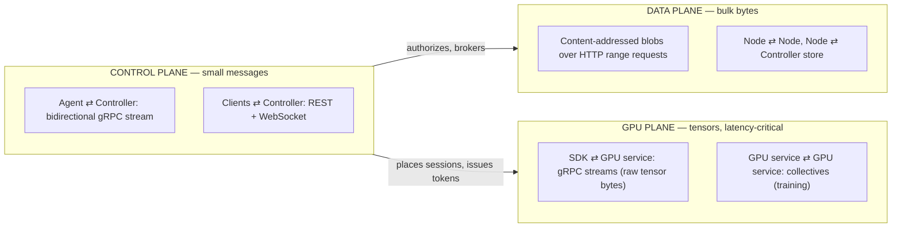

| Plane | Transport | Why |
|---|---|---|
| Control | gRPC bidi stream (agent-initiated), REST/WS | typed contracts, streaming, works through NAT/firewalls because agents dial out |
| Data | HTTP/1.1+ range GET with auth token | resumable, cacheable, simple, fast; gRPC is poor for multi-GB payloads |
| GPU | gRPC streaming with raw bytes (upgrade to raw TCP only if V0.2 spike S3 shows need) | low overhead, same tooling; tensors never pickled |

---

## 5. Execution modes mapped onto the architecture

|  | **One laptop** | **Many laptops** |
|---|---|---|
| **Task is sent away** | **Mode 1 — Job Offloading** → `JobOffloadExecutor` | **Mode 3 — Task Splitting** → `TaskSplitExecutor` (N × Mode-1 attempts over a work queue) |
| **Program stays on my laptop** | **Mode 2 — Remote GPU** → SDK + 1 GPU session | **Mode 4 — Combined GPU** → SDK + N GPU sessions + work queue / collectives |

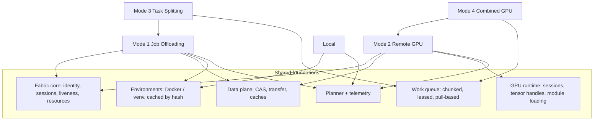

---

## 6. Workload model: two request kinds

A planner cannot move the GPU calls of an arbitrary script to another machine without the script's cooperation. So the fabric has **two request kinds** that feed **one planner**:

| Request kind | Created by | Describes | Candidate plans |
|---|---|---|---|
| **JobRequest** | `compute run`, dashboard, REST | a whole program: source tree + manifest | Local · Mode 1 (per node) · Mode 3 (per node-set, if `split:` declared) |
| **AcceleratorRequest** | the SDK inside a running program | "I need GPU capacity for this model/work" | Local GPU/CPU · Mode 2 (per GPU node) · Mode 4 (per GPU-set) |

### 6.1 Job manifest (`compute.yaml`) — illustrative

```yaml
name: image-classify
entrypoint: python classify.py --in {inputs} --out {output}
env:
  python: "3.11"
  requirements: requirements.txt
  base: cuda-pytorch          # or: python-cpu
resources:
  gpu: preferred              # required | preferred | none
  vram_gb: 4
  ram_gb: 8
inputs:
  - path: data/
outputs:
  - results/
split:                        # present → Mode 3 becomes a candidate
  over: data/*.jpg
  chunk: auto                 # planner decides
  combine: concat             # concat | merge-csv | merge-json | script:combine.py
limits:
  timeout: 2h
```
A project without a manifest still runs (entrypoint inferred: `main.py`/`__main__`); the manifest only adds precision.

### 6.2 SDK — illustrative

```python
import meshforge as mf

# Mode 2: one remote GPU (or "auto": planner may return local GPU)
gpu = mf.remote_gpu("auto")
rmodel = gpu.module(model, example_inputs=(x,))
y = rmodel(x)                                   # computed remotely

# Mode 4: all GPUs as one
pool = mf.combined_gpu(nodes="auto")
preds = pool.map(model, dataset, batch_size=64) # inference, ordered results
pool.train(model, dataset, optimizer=opt, loss_fn=loss, epochs=10)
```

---

## 7. Planner architecture & cost models

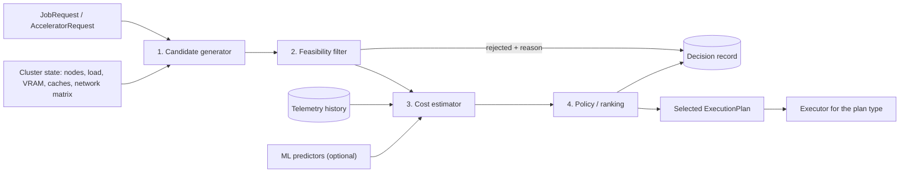

**Policies** (selectable globally or per request; all kept as baselines): `random`, `round_robin`, `least_loaded`, `strongest_suitable`, `resource_score`, `cache_affinity`, `cost_model` (analytical), `cost_model_ml` (analytical + ML components), `oracle` (benchmark-only: best measured).

**Cost decomposition** — analytical where physics is known, learned where it isn't:

| Plan | Predicted completion time |
|---|---|
| Local | `T_env(cache) + T_compute(local)` |
| Mode 1 on node *n* | `T_queue(n) + missing_bytes(n)/bw(A→n) + T_env(n, cache) + T_compute(n) + out_bytes/bw(n→A)` |
| Mode 3 on set *S* | `T_split + max_{n∈S}( T_stage(n) + T_env(n) + share_n / rate_n ) + T_combine`, shares chosen so all finish together |
| Mode 2 on node *g* | `T_session + model_bytes/bw (if not cached) + N_calls × ( RTT + (in+out bytes)/bw + t_call(g) )` |
| Mode 4 inference on set *S* | `T_setup + N_items / Σ_{g∈S} min( rate_g , bw_g / bytes_per_item )` |
| Mode 4 training on set *S* | `per step: max_g( b_g / r_g ) + T_allreduce(grad_bytes, min bw, size of S)`, with `Σ b_g = global batch` |

- `bw`, `RTT` come from the **measured network matrix** (agent probes).
- `T_compute`, `rate_g`, `t_call`, `T_env` come from **history** (per workload fingerprint × node), then from **ML predictors** (V0.15) using hardware scores + load + workload features.
- `failure_risk` (from node reliability history) is converted into an expected-time penalty.
- Every decision is stored with **all candidates, rejections with reasons, predicted breakdowns, and later the actual outcome** → explainability and training data.

*Amended 2026-10-05 (V0.6 G2, D102-D107, D109, D112) - the planner as built (Local + Mode 1).* **Package** `controller/planner/`, **pure and synchronous** (no database, no asyncio, no clock; an AST test pins its imports to the stdlib, `common` and itself): `plan(request, snapshot, policy, now) -> Decision`. `types.py` (frozen `PlanRequest`, `NodeSnapshot`, `ClusterSnapshot`, `Decision`), `feasibility.py`, `estimator.py`, `policies.py`, `plan.py`, `inputs.py` (stored rows -> snapshot: hardware JSON, D105 slots, scores, workload fingerprint), `decision_json.py`. The dispatcher's glue `controller/jobs/planning.py` (`DispatchPlanner`) builds the snapshot **once per dispatch tick** inside the dispatch transaction (node rows and slot use from PostgreSQL - `controller/jobs/queue_reads.py`; liveness, the latest resource sample and the cache index's trust from this process; patched as the tick creates attempts) and maps the decision to the store's action. **1. Candidates:** every node in node-id order - the one named by the job's `submitter_node_id` is **Local** (ARCHITECTURE §5: a baseline candidate, not a separate path), every other is **Mode 1**; a pinned job (`placement.node_id`) has a candidate set of one. **2. Feasibility**, one `(code, text)` per rejected node (`RejectCode`, stored values, never renamed): *static* = what the node is - `revoked`, `not_exec`, `no_gpu`, `no_gpu_runtime`, `no_gpu_slots`, `no_cpu_slots` (owner settings), `vram_short`, `ram_short`, `cpus_short`, `no_runtime_for_base` (`cuda-pytorch` on a venv-only node); *live* = the moment - `not_online`, `no_session`, `env_known_bad` (D116), `node_cap` (`[controller.jobs] max_attempts_per_node`, default 8 since V0.6), `slots_full`, `disk_short` (the largest free disk of the last sample < what the node would fetch). A value the node did not report is never held against it. **Slots (D105):** `Hello.max_cpu_jobs` / `max_gpu_jobs` (an older agent: 1 CPU slot, 1 GPU slot only with `exec-gpu`); `gpu: required` takes a GPU slot, `preferred` a GPU slot when one is free and the node can pass a GPU, else a CPU slot, `none` a CPU slot; use = live attempts per `attempt.slot`, counted in the dispatch transaction (no in-memory counter; a restarted controller sees what runs). **One job per GPU** (G2 fix round 1): the GPU indices named in live attempts' start snapshots are read in the same transaction; a GPU slot is free only while a GPU no live attempt holds is (and, with `resources.vram_gb`, one large enough), and the attempt gets the largest such GPU - so `max_gpu_jobs` above the GPU count never puts two jobs on one GPU. **Serialised ticks:** the dispatch transaction's first statement is `pg_advisory_xact_lock(hashtextextended('meshforge.dispatch', 0))`, so two overlapping dispatchers (an old controller process still draining beside its successor) never both read the same free slot; taken before any row lock, it cannot deadlock, and the next holder's reads see the attempts the previous tick committed. One global lock rather than one per node: the planner compares every node, so per-node locks would have to be all of them (in node-id order) anyway. **3. Estimate v0** (until V0.6 G4): `queue` 0 (`measured`: a feasible node has a free slot), `transfer` = bytes of the job's trees the node does not hold whole (cache index; the project tree counts as held on a *seeded* Local candidate, D109) / `default_bw_bytes_s` (`assumed`; 0 s `measured` when nothing moves), `env` = `default_env_s` (`assumed`), `compute` = median `run` phase of the same workload fingerprint on that node (`history`), else the fastest other node's median scaled by the CPU/GPU score ratio (`scaled`) or as is (`history`, `scaled: false`), else `default_compute_s` (`assumed`), `output` 0 (`assumed`). **4. Policies (D107)**, each a sort key ending in the node id (deterministic): `random` (seeded from job id + attempt number), `round_robin` (cursor in the dispatcher's memory), `least_loaded` (used slots, then live CPU %), `strongest_suitable` (GPU score for a GPU slot, CPU score otherwise; unmeasured last), `resource_score` (weighted free RAM GiB + free slots + score normalised to the best; `[controller.planner] resource_weights`), `cache_affinity` (bytes already held; ties least-loaded), `cost_model` (lowest predicted total; **default**, `[controller.planner] default_policy`). A job's policy: `POST placement.policy` (`compute run --policy`) > manifest `policy:` > the default. **Outcomes:** chosen -> attempt (+ slot) and its `plan_decision` row in **one** transaction; auto job with every candidate rejected statically -> `FAILED(no_feasible_plan)` (D104); otherwise it waits and its decision is recorded once per distinct reason set. **Local seeding (D109):** `compute run` copies the project's verified blobs and tree manifest into its own agent's `<data dir>/cas` (+ GC index rows) and submits `seeded: true` (`cli/transfer.py seed_local`); the agent finds them with its normal cache lookup. Not built yet: Mode 3 candidates (V0.10), `cost_model_ml` (V0.15), `oracle`.

*Amended 2026-10-06 (V0.6 G4, D108, D111) - estimator v0 and the network matrix.* `planner/estimator.py` replaces the G2 stub. Each term carries `source` ∈ `measured`/`history`/`scaled`/`assumed` and is **no better than its weakest input** (`weakest()`: a measured byte count over an assumed bandwidth is `assumed`). **transfer** = bytes of the job's trees the node does not hold whole (cache index; seeded Local holds the project) over the best inbound bandwidth known for the node: a **fresh** network-matrix link `n <- h` from a node `h` that holds one of the missing trees (`measured`; `detail.bw_from`, `link_age_s`, `rtt_ms`) or the controller -> n bandwidth from transfer history (`history`), whichever is faster (the agent fetches from all sources at once), else `[controller.planner] default_bw_bytes_s` (`assumed`); links older than `[controller.network] stale_after_s` (1 h) are ignored and named (`stale_links_ignored`); staleness is judged against `plan(..., now)` (no `now` = no link counts). **env** = 0 s `measured` when the env hash the workload's latest attempt on that node reported (`attempt.env_hash`, migration 0014) is in the node's cache index; else the median build time for the job's `env.base` (env phases >= 1 s, `history`); else `default_env_s` (`assumed`). **compute** as G2 (own history / scaled by the hardware-score ratio / assumed). **output** = the fingerprint's median uploaded bytes (`attempt.output_bytes` = bytes the attempt's upload grant stored, written on DONE) over the controller link read as symmetric (`history`), else `default_bw_bytes_s` (`assumed`); no output history = 0 s `assumed`. **One read per tick, bounded** (`jobs/queue_reads.read_fabric`): run-time medians, output medians and env hashes per fingerprint of the batch, env holdings for those hashes, env build history per base of the batch, every `network_link` row (<= 10 000) and the controller links (newest 5 000 controller transfers, index `ix_transfer_event_source_id`) - the statement count does not grow with jobs or nodes (component test). `cache_affinity` also counts the bytes of the job's built environment still held by the node. Criterion 4 is tested on the pure planner and through the real dispatch tick (`tests/component/controller/test_v06_g4_criterion4.py`). **Network matrix** (D111): `controller/network/` - `scheduler.ProbeScheduler` (pure, injected clock: each ordered pair at most once per `probe_interval_s` 900 s, a node in at most one probe at a time, at most `probe_budget_bytes_per_min` (48 MiB) per sliding 60 s counting every in-flight probe at its worst case `probe_bytes + probe_max_bytes`, never a node holding a GPU for a live attempt or above `busy_cpu_percent` 80 %, one probe started per `probe_gap_s` 15 s x [1 - jitter, 1 + jitter], a probe without result after `probe_timeout_s` is given up; oldest pair first, ties on `(src, dst)`), `service.NetworkProber` (the controller task: sends `ProbeRequest`, validates `NetProbeResult` against the probe in flight - right node, right target - and queues the sample; failures remembered per pair in memory), `store.NetworkStore` (EWMA upsert computed in SQL, α `ewma_alpha` 0.3; a stale row restarts from the new sample).

*Amended 2026-10-07 (V0.6 G4 fix round 1, D130-D132) - supersedes the transfer and compute sentences above where they differ.* **transfer is per missing tree (D131):** each **distinct** tree of the job the node does not hold whole (by tree id: a tree named twice is moved and billed once, as in `feasibility.missing_bytes` and `cache_affinity`) is costed by **its own** best source - a fresh network-matrix link from a node that holds *that* tree (`measured`; equal links break on the holder's node id), or the controller -> n transfer history when it is faster (`history`), else `default_bw_bytes_s` (`assumed`) - and the times are **summed**; the term's `source` is the weakest one used. `detail` names the source of the whole term when every tree shares it (`bw_source`, `bw_from`), `bw_source: "probe"` + `bw_holders` for several probed holders, else `bw_source: "mixed"`; with more than one missing tree it carries one `items` entry per tree (`tree`, `bytes`, `seconds`, `source`, `bw_from`...; at most 16, the rest counted in `items_omitted`), and `compute explain` prints every distinct source (`from controller (last transfer 2h ago) + 1a2b3c4d`) - a holder of one small tree is never credited with bytes only the controller can serve. A `history` controller link has **no staleness rule**; its detail carries `last_transfer_age_s` (the newest transfer behind the median) and explain shows it. The output term still reads the controller link as symmetric (flagged). **Always finite (D131):** a probe result below `[controller.network] min_bw_bytes_s` (1024 B/s) is refused at ingestion (failure `bw_below_floor`, shown by `compute network`, never stored); the estimator never divides by less than that floor (a slower or non-finite stored value is raised to it, `bw_clamped: true`, explain: `at the bandwidth floor`) and caps every term at 1e9 s; `decision_json.json_safe` replaces any non-finite number by `null`, and each `plan_decision` row is written inside a **savepoint** - a row PostgreSQL refuses is dropped alone (`controller.jobs.plan_decision_not_recorded`), the job's dispatch and the rest of the tick still commit. **scaled compute (D131):** among the other nodes with a usable (finite, positive) score the one whose median **normalised by its score** (seconds x score) is smallest is scaled to this node - 10 s on a score-100 node loses to 11 s on a score-10 node; without usable scores the fastest other median is used as is (`history`, `scaled: false`). **Prober (D130 + fix round 1):** the schedule is seeded from `network_link.measured_at` at start; `stale_after_s` must be at least 1.5 x `probe_interval_s` and `probe_bytes` at least 1 (settings validation); an `ok` result is charged at least `probe_bytes` against the budget whatever it claims; a node whose latest resource sample is older than `cpu_sample_max_age_s` (30 s) has an unknown load and is not probed (a node that never sent a sample still is); a failed read of the GPU-busy nodes gives the tick up for one whole gap (`controller.network.busy_read_failed`, no traceback, counted in `prober.busy_read_failures`). The agent bounds a whole probe by `[agent.probe] deadline_s` (default 2 x `request_timeout_s`; failure `deadline`), so a dripping target cannot hold its one probe slot. **Retry exclusion label (D129):** a node that failed a job in several ways carries its strongest reason (the tier lifted last: `disk_full`, `vram_oom`, transfer/integrity, lost/timeout), not the oldest. **Lab ledger check (D132):** `lab/sched_check.py check` - the same attempt id with two `end` lines is a duplicate execution; a job meant to succeed that is not `succeeded` is lost; a committed job without ledger evidence, or a run file with no jobs, makes criterion 1 `INCONCLUSIVE` (exit 4), never PASS; record-identical ledger lines (one file copied under two names) count once.

---

## 8. Mode 1 — Job Offloading flow

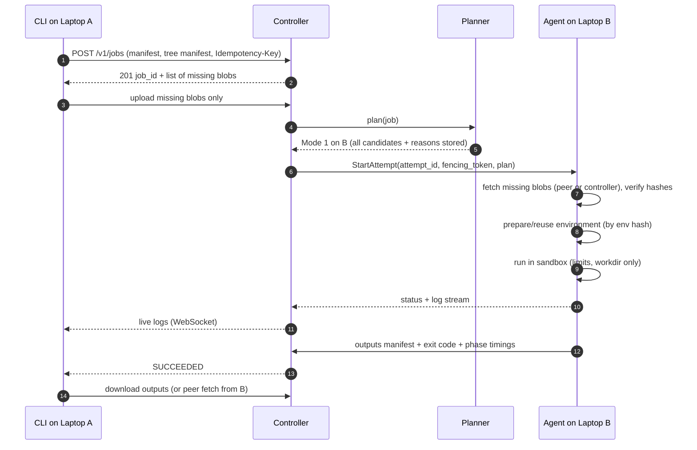

---

## 9. Mode 3 — Task Splitting flow

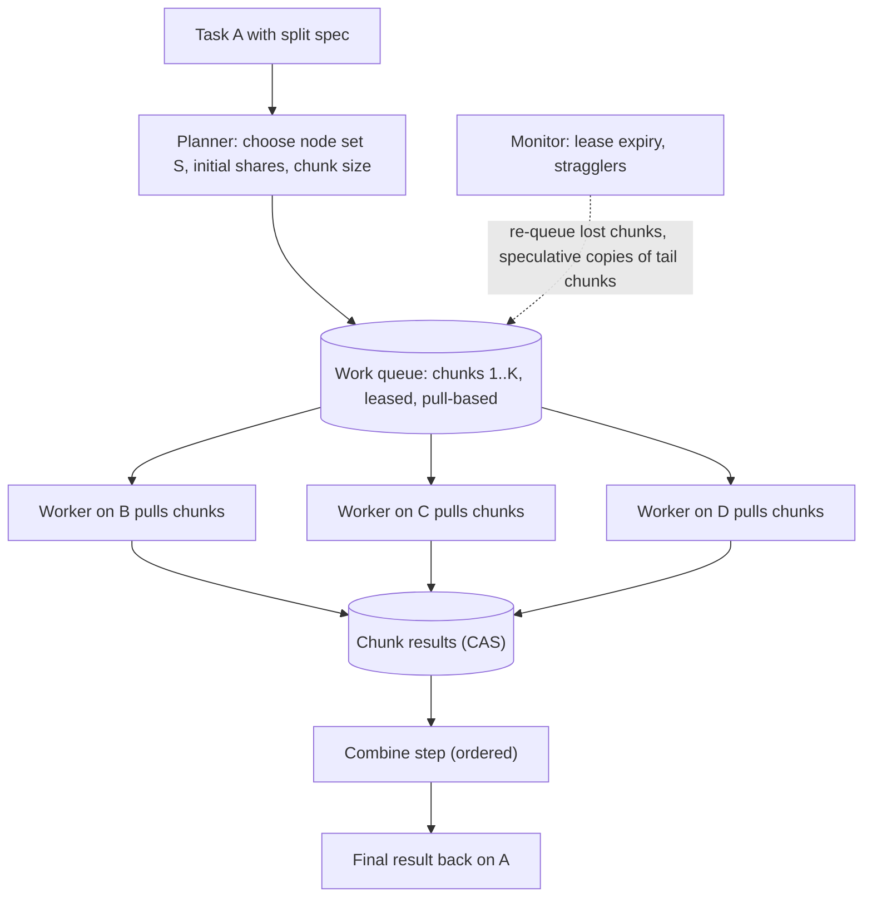

**Why pull-based chunks, not fixed shares:** a faster laptop simply pulls more chunks, so heterogeneity and stragglers balance automatically; the planner's share estimate sets *chunk size and participants*, not a brittle static split. Each node prepares its environment **once** and then runs many chunks.

---

## 10. Mode 2 — Remote GPU flow

```mermaid
sequenceDiagram
    autonumber
    participant App as User program on A (SDK)
    participant C as Controller
    participant G as GPU service on B
    App->>C: AcceleratorRequest (model size, expected calls, bytes per call)
    C-->>App: placement = B (or local), session token, reasons
    App->>G: OpenSession(token)
    App->>G: LoadModule(exported-program blob id)
    G->>G: fetch blob if not cached; load weights into VRAM
    loop every call
        App->>G: Call(module, input tensors as raw bytes)
        G-->>App: output tensors (or remote handles)
    end
    App->>G: CloseSession (or lease expiry frees VRAM)
```

**Key design choices**
- **Model shipping via `torch.export`** (ExportedProgram: graph + weights, no pickled code) → safe, portable, cacheable by hash.
- **Resident state:** weights and large tensors stay in remote VRAM behind **handles**; only inputs/outputs cross the network.
- **Call pipelining:** SDK overlaps upload of call *k+1* with compute of call *k*.
- **Transparency ladder:** L1 predefined ops → L2 remote tensors/handles → L3 `RemoteModule` API → L4 `torch.compile` backend shipping FX graphs (stretch). CUDA-API interception (L5) is out of scope.
- **Admission control:** VRAM reservations per session; max sessions per GPU; the laptop owner can cap sharing.

---

## 11. Mode 4 — Combined GPU flow

### 11.1 Inference (`pool.map`)
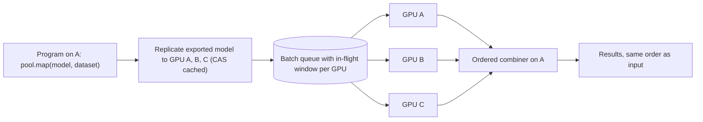
Uses the **same work-queue abstraction as Mode 3**, at batch granularity. A GPU whose link makes it net-negative is dropped by the planner.

### 11.2 Training (`pool.train`) — data parallel
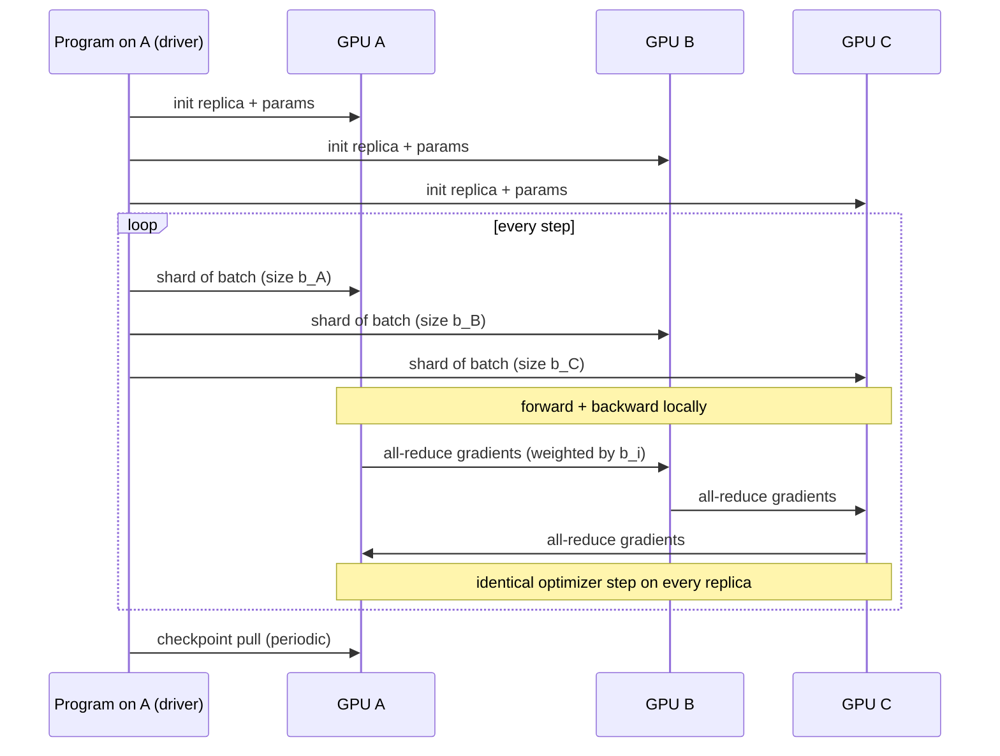
- Batch shares `b_i` ∝ measured throughput; gradients averaged **weighted by samples** so results match single-GPU training with the same global batch.
- All-reduce: v1 coordinator-reduce → v2 ring over TCP (or `torch.distributed` gloo if the V0.2 cross-OS spike passes); optional fp16 gradient compression.
- Failure: checkpoint on A, continue with remaining members.

### 11.3 Model splitting (bonus stage)
Profile per-block time/memory per GPU → dynamic-programming partition minimising the slowest stage subject to VRAM → pipeline execution with activation transfer and micro-batching. For models larger than any single GPU.

---

## 12. State machines

### 12.1 Job
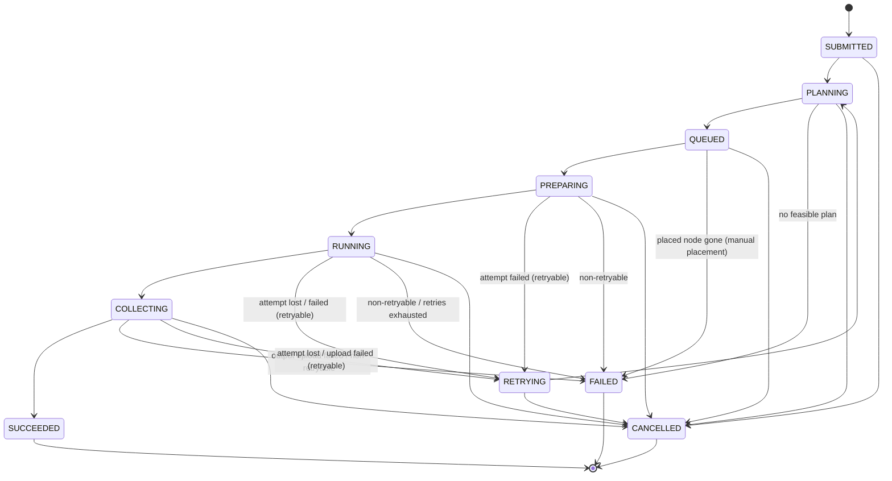
*Amended 2026-09-28 (V0.4 brief D55): `COLLECTING → FAILED`, `PLANNING → CANCELLED`, `RETRYING → CANCELLED` added — a cancel or an output-upload failure can happen in those states and the original diagram had no arrow for them.* *Amended again 2026-09-28 (V0.4 G4, D69): `COLLECTING → CANCELLED` — D69 lets a user cancel a job whose attempt is uploading its outputs; the agent's `FAILED(cancelled)` report must be able to land. And `QUEUED → FAILED` (D65): with manual placement there is no planner to re-place a job whose chosen node went OFFLINE or stopped accepting jobs, so the job fails `node_lost`/`no_feasible_plan` instead of waiting forever; V0.6's planner turns this into re-planning.*

*Amended 2026-10-05 (V0.6 G2, D103-D106).* `PLANNING` stays a recorded pass-through at submit: the submit-time pass only checks that **some** enrolled node could ever run an automatically placed job (static rules, liveness and load ignored; none -> `409 no_feasible_plan` with every node's reason and no row), and the live planner runs at **dispatch**, from `QUEUED`. `QUEUED -> FAILED` now also ends an *auto* job when every node is rejected for a static reason (`no_feasible_plan`; e.g. its only capable node was revoked) - the D65 arrow, no new one; a job that only has to wait stays `QUEUED`. **Queue order (D106):** effective priority `LEAST(10, priority + floor(wait / priority_aging_s))` descending, then `queued_at` (set when the job enters `QUEUED`); `not_before` (retry backoff, G3) skipped; a job that cannot be placed never blocks the jobs behind it in the batch (`dispatch_batch`). *G2 fix round 1, narrowed in G3 (reviewer N-1):* a queued row that is itself unusable (it cannot be read, or its stored manifest / ids no longer validate: `ValidationError`, `ManifestError`, `InvalidIdError`) goes `QUEUED -> FAILED(internal_error)` on its own, logged once (`controller.jobs.unplannable_job` / `unreadable_job`, type only), and the rest of the batch dispatches. **Any other** exception while planning one job is our fault, not the job's: the job stays `QUEUED` (no decision row), the dispatcher's `planning_errors` counter rises and `controller.jobs.planning_error` is logged with the traceback once per (job, error type) - a planner bug can never wipe the queue. A database error still rolls the whole tick back (D112).

*Amended 2026-10-05 (V0.6 G3, D110/D115/D117, ADR-0015) - retries.* `COLLECTING -> RETRYING` is new: an attempt can be lost (or fail with a retryable `output_error`) while uploading, and it is retried exactly like one lost while running. **One transaction:** whenever an agent report or the controller (OFFLINE, orphan sweep, acked-not-held Reconcile, backstop, upload deadline) ends a job's **current** attempt with a failure or a loss, the same transaction that writes the attempt's end decides the job (`controller/jobs/retry.py`, pure): retry -> `RETRYING -> PLANNING -> QUEUED` (all three arrows recorded) with `not_before = now + backoff_s * 2^(n-1)` (cap 300 s; `queued_at` keeps its first value), else `FAILED(<the attempt's failure type>)` - with `retries_exhausted after N attempts: ...` in the detail when the job had used `retry.max_attempts`. A crash cannot leave the attempt ended and the job neither failed nor queued (tested by terminating the PostgreSQL connection between the statements). Rules in order: `cancelled` (or any failure after a cancel request) is never retried; a **loss** (`LOST`, or an agent-reported `node_lost` such as `agent_shutdown`) is retried unless the manifest says `retry: {on_lost: false}`; otherwise the failure's own `retryable` flag decides (`Failure.retryable`, per instance), falling back to the §13 default. **Placement of a retry:** a pinned job retries on its node only (and D65's `QUEUED -> FAILED` still applies); an auto job's planner request carries `excluded` nodes (`planner/retry_exclusion.py`): the node of a `node_lost` / `transfer_error` / `integrity_error` / `timeout` attempt for `[controller.planner] retry_exclude_s` (600 s), and for `vram_oom` every node whose largest GPU is no larger than the one that ran out. An excluded node is rejected `retry_excluded` (a live code: the job waits for another node) - **unless no other node could ever run the job** (all others rejected statically), then exclusions are lifted by the **D129 rule** (§13; V0.6 G4) - per failure type, only onto a node that would take the job now, `disk_full` never early - so a one-laptop fabric retries where it failed once that node is usable again. Every retry is a new attempt with the next fencing token; the job's history keeps all attempts. **Fencing on a retried job:** a report may move the job only if its attempt is the job's current one (`attempt.fencing_token = job.attempt_epoch`) - the superseded attempt is already terminal, so this is defence in depth. **Logs across a retry:** the log WebSocket (`compute run -f`, `compute logs -f`) follows the job, not one attempt: when the followed attempt ends and the job was retried it sends `{"retry": true, attempt_id, fencing_token, previous_attempt_id, previous_state, previous_failure_type}` and continues with the new attempt's log from offset 0; the end frame comes when the job ends (§20). **Restart (D115):** jobs stored `PLANNING`/`RETRYING` (impossible by the above; written by hand or another version) are put back to `QUEUED` when the dispatcher starts (`requeue_stranded`).

Mode 3 jobs additionally track chunk states (`PENDING → LEASED → DONE | FAILED`), with lease expiry returning chunks to `PENDING`.

### 12.2 Attempt (one execution of a job/chunk on one node)
`ASSIGNED → STAGING → ENV_READY → RUNNING → UPLOADING → DONE` · failures: `FAILED(failure_type)` · `LOST` (node vanished) · `FENCED` (superseded; late reports rejected).

*Amended 2026-09-28 (V0.4 G4, D52/D65–D69) — how the arrows are driven.* The agent reports every state in an `AttemptStatus` (buffered, replayed, acked **only once stored**); the controller walks the happy path from the stored state to the reported one (a report dropped from the agent's ring still records every arrow), treats an equal/earlier state as a duplicate, and drops (counts `fenced`, answers `CancelAttempt`) a stale fencing token or a report contradicting an attempt it already ended. `ENV_READY` and `RUNNING` are reported together when the runtime starts the workload (image pull and requirements install are the runtime's `env` phase). Job arrows follow: `RUNNING` → job `RUNNING`, `UPLOADING` → `COLLECTING`, `DONE` → `SUCCEEDED`, `FAILED` → `FAILED` (or `CANCELLED` when `failure_type = cancelled`), `LOST` → `FAILED(node_lost)` (no retry until V0.6; **since V0.6 G3 a failure or loss is retried per §12.1**). **Reconciliation (D66):** every accepted stream starts with `Reconcile.running_attempts` = every attempt the agent holds (running, or ended with its final report not yet acked). For the node's live attempts: held → continue; not held and `StartAttempt` never acked (`attempt.start_acked_at` NULL) → re-send the same attempt/token (the agent dedupes on `(attempt_id, fencing_token)`); not held but acked → `LOST` (`agent_lost_attempt`) — re-running could duplicate an execution. **OFFLINE** caused by the agent (lease expiry, Goodbye) → its live attempts `LOST`; SUSPECT and a controller shutdown never do. After a controller restart, attempts of nodes that do not reconnect within `[controller.jobs] reconnect_grace_s` are lost. **Backstop (D69):** RUNNING longer than the job's limit + `backstop_grace_s` → `FAILED(deadline_exceeded, controller_backstop)` + `CancelAttempt`. **Upload deadline (V0.5 G3, D94):** UPLOADING longer than `[controller.jobs] upload_deadline_s` (empty = `upload_deadline_base_s` + `max_output_bytes` / `upload_min_rate_bytes_s`, default 2648 s), measured from the job's persisted `COLLECTING` transition (a controller restart keeps it) → `FAILED(output_error, upload_deadline_exceeded)`, upload grant and fetch token revoked, `CancelAttempt`. **Phases (D68):** the terminal transaction writes all five `attempt_phase` rows; a phase that never ran is `duration_ms = 0, skipped = true`.

*Amended 2026-09-29 (V0.4 G5, D71–D75).* **`UPLOADING`** is real now: after a successful run the agent uploads the two final logs and the packed declared outputs with the attempt's **upload grant**, then reports `DONE{output_digest, missing_outputs, stdout_log, stderr_log}`; an upload failure is `FAILED(output_error)` (§12.1 `COLLECTING → FAILED`). The controller accepts an `output_digest` or a log digest **only if this attempt's grant stored and verified that blob** — an unverified output digest turns the report into `FAILED(output_error)`, an unverified log digest is dropped (the live copy stays). `collect` = exit → terminal report, uploads included. **Lost terminal reports (D75):** the agent holds an ended attempt (and its workdir) until its terminal status is acked and **re-sends** that status every `[agent.execution] terminal_resend_s` (5 s) and after every Reconcile — the same buffered message while the replay ring holds it, a new one once evicted — so a dropped `DONE` lands long before the backstop could mislabel the attempt. A report for an attempt the controller already ended, or does not know, is **acked** and answered `CancelAttempt{release}` (stop if running, then free it and its workdir without waiting for an Ack); a Reconcile entry that is not live on the controller gets the same release. A report whose handler fails with anything but a database error is acked after 3 failures of the same `(attempt_id, state)` and logged `controller.jobs.status_poisoned` (type only) — acked, **not applied**: a poisoned `DONE` never makes the job `SUCCEEDED`. The agent frees the attempt once acked, so it ends by another path: the next Reconcile (acked but not held → `LOST`, job `FAILED(node_lost)`), an agent OFFLINE (`LOST`), or, while it is still stored `RUNNING`, the backstop (`FAILED(deadline_exceeded, controller_backstop)`). The backstop covers `RUNNING` only, so an attempt stored `UPLOADING` waits for the next Reconcile/OFFLINE. **Live logs (D71/D72)** travel as `LogChunk` (offset-addressed, never buffered, replayed or acked; own bounded queue on the agent's single writer) into the controller's log hub, which appends by offset, records (never fills) gaps, drops stale tokens/unknown attempts, and fans out to WebSocket followers; at the attempt's end the verified final log replaces the live file. The hub's one writer queue is bounded: `[controller.jobs] log_queue_chunks` live chunks (past it a chunk is dropped = a gap) plus `MAX_PENDING_FINALS` (4096) queued attempt ends (past it an end is applied at once without the final copy; followers still get their end frame).

*Amended 2026-10-01 (V0.5 stabilisation, D95) — `STAGING` across a controller restart.* Fetch tokens live only in the controller's memory (never persisted, so a restart cannot leak them from disk) and die with the process. **Controller:** on Reconcile, a held attempt whose stored state is `ASSIGNED`/`STAGING` (the store is never ahead of the agent) and that has no live fetch token in this process gets `RefreshFetchToken{attempt_id, fencing_token, fetch_token, blob_url, blob_port}` (`ControllerMessage` payload 18): a new download-only token with exactly the original scope (the job's `bundle_digest` — the bundle, or the tree manifest which grants that tree's blobs) and where this controller serves blobs now; a token the old process minted stays refused (`401`). If no session can carry it, the minted token is revoked so the next Reconcile refreshes again. **Agent:** while staging, `transfer_error`/`timeout` (controller unreachable) is retried with backoff (0.25 s doubling to 5 s) and `unauthorized` (old token refused) waits for the refresh; a refresh for another fencing token, an ended attempt or a malformed token/URL/port is ignored. A tree job resumes from the chunks it already verified (G1's resumable parts); a bundle is fetched again whole. Past `[agent.execution] staging_retry_s` (default 60 s; `0` = no retry, the first error is reported as is) the attempt fails `transfer_error` (retryable) naming the last cause. Upload grants were not refreshed in V0.5; V0.6 G1 refreshes them (D114, next paragraph).

*Amended 2026-10-05 (V0.6 G1, D114) — `UPLOADING` across a controller restart.* Upload grants, like fetch tokens, live only in memory. **Controller:** on Reconcile, a held attempt (any live stored state - reports may still wait for their replay) gets `RefreshUploadGrant{attempt_id, fencing_token, upload_token, blob_url, blob_port}` (`ControllerMessage` payload 19) when this process has no live grant for it, **or** when the last message that carried its grant (a `StartAttempt`, including a re-send, or a refresh) was never acked - a broken stream may have taken it along (`dispatcher._grant_unacked`, cleared only by the Ack of that same message id or the attempt's end). The new grant has the StartAttempt's quota (`max_output_blobs` / `max_output_bytes`) and keeps what an earlier grant of the attempt *in this process* stored; one that no session can carry is revoked so the next Reconcile tries again. **Resumable uploads:** the part routes (`GET .../parts`, `PUT .../parts/{i}`, `POST .../complete`, §20) accept an attempt's upload grant; the first part reserves the whole blob against the quota (a later part declaring another blob size is refused), and `complete` credits the blob to the grant only when **that call** assembled and verified it - a blob already stored before (by anyone, or by this attempt under a grant a restarted controller forgot) answers `credited: false` and the agent proves it with a plain `PUT` under the grant. Parts are files on the controller's disk and survive the restart; which credential sent each part is not recorded (the bytes are verified against the digest at `complete`). **Agent:** a blob of at most one part (`[agent.execution] upload_part_bytes`, 8 MiB) is one verified `PUT`; a larger one sends only the parts the controller lacks, in the controller's chunk size. A refused grant (`401`) waits for the refresh; an unreachable controller is retried with backoff (0.25 s doubling to 5 s); both for at most `[agent.execution] upload_retry_s` (120 s; `0` = no retry) counted from the outputs' **first failed upload** (checked before every retry, a refreshed grant included), then `FAILED(output_error)` retryable. The best-effort final logs (uploaded first) have their **own** budget `log_upload_retry_s` (10 s, both logs together), so a log outage neither uses up the outputs' retries nor delays the final report long; past it a log is reported without a digest. `403` (the attempt ended) and `411/413` (quota) are final. A refresh for another fencing token, an ended attempt or a malformed token/URL/port is ignored; a re-sent `StartAttempt` of an attempt the agent already runs is not run again but its fetch token and upload grant replace the held ones (the controller revoked them). The upload deadline (D94) still bounds the whole `UPLOADING`. An upload still in flight under a grant that a refresh replaced is credited to the new grant when it finishes - only within the new grant's quota (a re-mint does not carry in-flight reservations; over the quota it is not credited and a `DONE` naming it fails `output_error`), never after a revoke. **Accepted risks (V0.6 G1 review):** (1) parts are **not attributed to their sender** - any holder of a usable grant may complete a part upload whose parts someone else sent and be credited for it (the bytes are verified at `complete`, so nothing corrupt is ever stored, but an attempt could claim an in-progress upload it did not produce); `GET .../parts` with a grant also reveals whether a blob is stored. Fix before V0.7 authorization (record the uploading credential per part upload). (2) The D95 fetch-token refresh has the gap D114 closed for grants: a `RefreshFetchToken` (or a re-sent `StartAttempt`) lost with a broken stream is not re-sent while the token is live in this process, so a staging attempt can wait out `staging_retry_s` and fail `transfer_error`; fix by tracking unacked fetch-token messages like `_grant_unacked`. **Not covered:** an upload credited under the old grant whose terminal `DONE` was not yet stored when the controller died - the replayed `DONE` names a digest the new process cannot attribute to the attempt, so it ends `FAILED(output_error)` (and an unverified final log digest is dropped); see V0.6 G3 (crash recovery, D115).

*Amended 2026-10-05 (V0.6 G1, D116, D59) — how a failure gets its type.* The runtime's own result is refined with evidence (`agent/execution/failure_evidence.py`): a non-zero exit whose stderr tail (last 64 KiB, kept in memory) holds a CUDA out-of-memory marker -> `vram_oom` (retryable); a final Python `MemoryError` line, a `SIGKILL` the agent did not send while the kernel's `oom_kill` counter moved, Windows `STATUS_NO_MEMORY`/`STATUS_COMMITMENT_LIMIT`, or Docker's `OOMKilled` -> `oom`; `ENOSPC`/`EDQUOT` while staging, building the env (or the installer saying so) or packing outputs -> `disk_full`; the workload over its own limit -> `deadline_exceeded`; an infrastructure step over its budget -> `timeout`; an env build failure -> `env_error`. The terminal `AttemptStatus` carries the resolved `env_hash` (field 16); on an applied `env_error` the controller remembers `(node, env key)` as known-bad for `[controller.jobs] env_bad_ttl_s` (3600 s, in memory, at most `known_bad_envs_max`), queryable by the planner (`known_bad_envs.is_bad`). **Process containment (D59, Linux):** the subprocess runtime starts each workload in its own process group with a double-forked group watchdog (ignores TERM/INT/HUP, waits on a pidfd) that `SIGKILL`s the group when the workload's main process exits - so no grandchild outlives an agent killed with `SIGKILL`, and a background child holding stdout no longer keeps a finished job running until its time limit. A process that calls `setsid()` escapes the group (cgroup v2 containment is a follow-up); on Windows the kill-on-close job object already covers the tree.

### 12.3 Node liveness
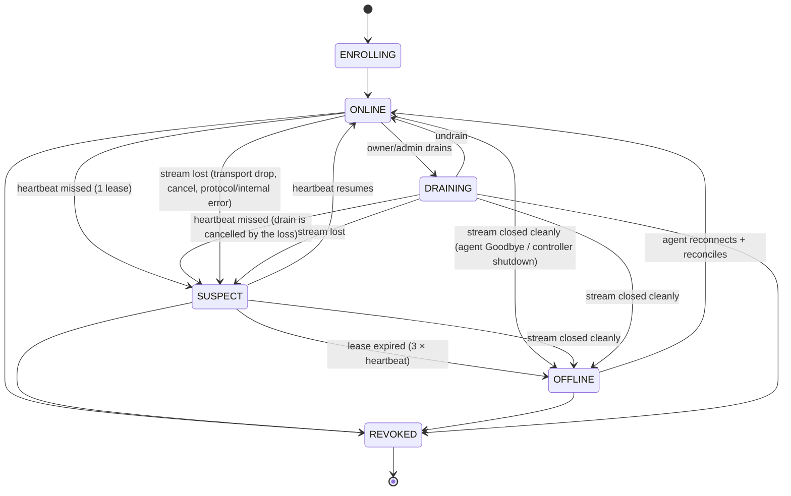
*Amended 2026-09-20 (V0.3 G1 review):* a draining node can still lose its lease, and revocation must be possible from every live state — the original diagram had no arrows for either. A `Hello` that arrives while the node is `SUSPECT` (agent reconnected before the lease expired) is handled as `RECONNECTED`, i.e. the same arrow as from `OFFLINE`; both land in `ONLINE`. The code table in `controller/liveness.py` must match this diagram exactly (V0.3 G2 extends it; the G1 table implements the arrows that existed before this amendment).

*Amended 2026-09-24 (V0.3 G6, fixes NB-G5-1 — decisions D19/D20 in `docs/briefs/V0.3-fabric-core.md` §5f):* before this, a session that ended any way other than lease expiry never moved `node.state`, so a laptop that shut down cleanly read `ONLINE` until the controller restarted. How a session ends now decides the arrow:

| Session end | Event | Arrow | Why |
|---|---|---|---|
| Agent sent `Goodbye` with its session's id (V0.4 D40, amended 2026-09-28 — the **only** evidence of a clean close; decided on receipt, never acked) | `STREAM_CLOSED` | `ONLINE/SUSPECT/DRAINING → OFFLINE` now | the agent said it is leaving |
| Controller graceful shutdown | `STREAM_CLOSED` | same | matches the start-up sweep; no controller = no liveness claim |
| Any stream end **without a prior Goodbye** — request iterator ended (half-close), transport drop, call cancelled, protocol error (incl. a Goodbye whose detail breaks its bound), internal error (end reason `stream_lost`; protocol/internal keep their own reasons) | `STREAM_LOST` | `ONLINE/DRAINING → SUSPECT` now; the lease **keeps running** on a lingering entry and `LEASE_EXPIRED → OFFLINE` fires at the normal edge (measured from the last contact) unless a new `Hello` arrives first | **`OFFLINE` is what V0.6 turns into "attempts `LOST`, retry elsewhere" (§13).** A TCP blip the agent survives in ~1 s must not cause duplicate execution, nor count as a false OFFLINE in the soak (V0.3 criterion 5) |
| Lease expired | (already `LEASE_EXPIRED`) | none extra | already `OFFLINE` |
| Superseded by a newer epoch | **none** | — | the new session's `Hello` owns the state |

*Amended 2026-09-28 (V0.4 G1, decision D40 in `docs/briefs/V0.4-remote-execution.md` §2a) — explicit `Goodbye` replaces the timing inference.* grpc.aio ends the server's request iterator **normally** for a half-close **and** for a cancelled call, a closed channel or a killed client process (measured on grpcio 1.84; the canary is `tests/component/controller/test_stream_end_liveness.py`), so a normal end proves nothing. V0.3 G6 inferred a clean close from "the call was not cancelled within 0.25 s" (`HALF_CLOSE_CONFIRM_S`); that rule is **deleted**, with no fallback. Now the agent's last message on a requested stop is `Goodbye{reason, detail}` (`AgentMessage` payload 21), after which it half-closes and waits for the status; the controller ends the session `agent_closed` when the Goodbye arrives and stops reading the stream. A Goodbye carrying another session's id is a stale message (dropped, counted), so a zombie stream cannot close its successor. An agent that stops without a Goodbye (an old agent, a crash) degrades to `SUSPECT → OFFLINE` at the lease edge — the safe direction: OFFLINE late never duplicates work, OFFLINE early does once V0.6 retries on it. The protocol version was not bumped (the scheme has no minor number; the change is an additive oneof member).

`STREAM_CLOSED` and `STREAM_LOST` are self-loops from `OFFLINE` and `REVOKED` (and `STREAM_LOST` from `SUSPECT`), so close/expiry ordering can never raise `InvalidTransitionError`. A `Hello` while an entry is lingering is `RECONNECTED` from the lingering state and ends the linger without writing `OFFLINE`; epoch fencing counts the lingering epoch as "highest seen".

**Fenced state writes (D20).** Every node-state write that comes from a session is `UPDATE node SET state = … WHERE node_id = :n AND last_session_id = :s`. Writes are ordered *within* a session by its write chain, but nothing orders an old session's late write against a new session's admission (which updates the row directly, not on a chain). Without the fence, a backlogged `OFFLINE` from the old session could land after the reconnect's `ONLINE` and leave a connected node reading `OFFLINE` indefinitely: heartbeats are self-loops, so nothing would ever rewrite it. A fenced write that matches 0 rows was superseded; it is logged, not an error.

---

## 13. Failure model, retries, idempotency

| Failure | Detection | Response |
|---|---|---|
| Agent/laptop disappears | lease expiry | attempts → `LOST`; the job is retried in the same transaction (V0.6 G3, §12.1): auto jobs avoid that node for `retry_exclude_s`, pinned jobs wait for it; `on_lost: false` fails instead; chunks re-queued |
| Agent process killed (`SIGKILL`) while a subprocess job runs (V0.6 D59) | the group watchdog sees the workload's main process exit | the whole process group is `SIGKILL`ed - no grandchild survives (Linux; `setsid()` escapes, cgroup v2 later; Windows: job object) |
| Controller crashes | agents lose stream | agents keep running attempts, buffer reports, reconnect with backoff; controller rebuilds from DB + agent reconciliation; an attempt still staging retries its fetch and gets a fresh fetch token after Reconcile (D95, §12.2) - with its peer sources re-minted (V0.5 G4) - up to `staging_retry_s` (checked before every retry), then `FAILED(transfer_error)`; peer tokens stay valid across the restart (the signing key persists); an attempt uploading resumes its parts under a fresh upload grant after Reconcile (D114) up to `upload_retry_s`, then `FAILED(output_error)` |
| Network partition | lease + stream error | as above; fencing prevents two live copies from both committing. **At-least-once execution, exactly-once commit (ADR-0015, D117):** the partitioned agent keeps running; the retry elsewhere commits; when the old agent reconnects its Reconcile/reports name an attempt stored `LOST` whose job has a newer attempt -> fenced, `CancelAttempt{release}`, counted `execution_overlaps` and logged `controller.jobs.execution_overlap` once per attempt |
| Partial / corrupted transfer | range resume; SHA-256 verify | resume from last good chunk; corrupted blob discarded |
| A blob rots on the controller's disk (V0.5 G5) | the rate-limited scrub (suspects first: a tree whose attempt failed `integrity_error`); a manifest that does not hash to its name when read | evicted, never served again; `have` reports it missing so the next upload replaces it |
| GC would evict what a starting attempt needs (V0.5 G5, D91) | lease (SQLite, cross-process) taken before the cache is looked at; eviction removes inside the same index transaction | whichever commits first wins: leased -> not evicted; evicted first -> the attempt fetches/builds it again. A process that dies releases its leases (owner lock) |
| A peer blob source fails, times out, refuses its token, serves corrupt bytes or is much slower than the others (V0.5 G4, D89) | per request: HTTP status, transport error, per-chunk SHA-256, measured rate vs the median | that peer is **dropped for the transfer at once** (a 404 only for that blob); its units go back to the shared queue and the other sources - the controller always among them, never dropped for slowness - finish; no verified chunk is fetched again; a peer's refusal never waits for a controller refresh |
| Cache report lost or out of order (V0.5 D101) | `seq` gap / a delta before the session's snapshot | the delta is dropped and the node's location index is marked **stale** until its next snapshot (every Hello and every `[agent.cache] snapshot_interval_s`); a stale or missing index only costs peer listings, never correctness |
| Process crash / non-zero exit | exit code | `FAILED(user_error)` — not retried by default |
| OOM / VRAM OOM | evidence (V0.6 D116, §12.2): kernel `oom_kill` counter + a SIGKILL the agent did not send, a final `MemoryError` line, Windows `STATUS_NO_MEMORY`, Docker `OOMKilled`; a CUDA OOM marker in the stderr tail | `FAILED(oom)` (host RAM) or `FAILED(vram_oom)` (GPU); planner learns; retry on a node with more memory |
| Env build failure | builder error | `FAILED(env_error)` with the `env_hash`; the controller remembers `(node, env)` as known-bad for `env_bad_ttl_s` (D116; in memory) |
| Disk full | pre-check + `ENOSPC`/`EDQUOT` in staging, env build or output packing (D116) | attempt `FAILED(disk_full)`; GC frees space on its next pass. *V0.6 D126:* an **auto-placed** job is retried and avoids that node for `retry_exclude_s` (soft, like `node_lost`); a **pinned** job fails `disk_full` (its one node would fail it again) |
| GPU session loss | stream error / lease | typed exception in SDK; Mode 4 reassigns in-flight batches |
| Duplicate submission | `Idempotency-Key` unique constraint | returns the existing job |
| Duplicate command delivery | command IDs, agent dedupe | at-least-once delivery, exactly-once effect |
| Zombie attempt after reassignment | **fencing token** (monotonic attempt epoch) | controller rejects stale reports |
| Outputs cannot be collected/uploaded (V0.4 G5) | agent: link/escape/quota/upload error, or a listed output swapped before it was packed (the open descriptor is checked: `O_NOFOLLOW`, `O_NONBLOCK`, `fstat` regular file with the listed `(st_dev, st_ino)` - the Windows equivalent of `O_NOFOLLOW`); controller: digest not uploaded under the attempt's grant | `FAILED(output_error)`; the Failure's `retryable` says whether a retry may help |
| Final status lost (dropped, evicted from the ring) (D75) | no Ack within `terminal_resend_s` | the agent re-sends it until acked; the controller acks + releases anything it already ended |
| Log chunks dropped (flood, disconnect) (D71) | offset jump | gap recorded, never filled; the final log upload replaces the live copy |
| Controller cannot write a live log file (disk full, permissions, symlink planted at the path) (D71) | `OSError` on open (`O_NOFOLLOW`) or write | never raised out of the log writer: logged `controller.logs.write_failed` (cause + errno, no bytes/paths, once per failing run), counted, handle closed, the unwritten range recorded as a gap; the next chunk retries; other attempts unaffected; the final log still replaces the live file |

Retry policy is per failure type (`retryable` vs not), with max attempts and backoff. All failures carry a typed `failure_type` for telemetry and ML. *V0.6 G3 (D110):* the manifest's `retry: {max_attempts 1-10 (3), backoff_s 0-300 (5, doubling, cap 300), on_lost (true)}` applies; the instance's `Failure.retryable` wins over the default column below; exclusion and the one-transaction rule are in §12.1. *D127:* once a cancel was requested, an attempt that then ends failed or `LOST` ends the job `CANCELLED` (detail `cancelled by request (the attempt ended <type>: ...)`), never retried and never `FAILED(node_lost/timeout/...)` - decided in the same transaction. *D128:* a pinned job whose node is `OFFLINE` when its attempt is lost is retried in that transaction (a pinned job keeps its node), then the next planning pass fails it `node_lost` (`placed_node_offline`) once that node is neither connected nor lingering past `reconnect_grace_s` - it does not wait for a node that left. Accepted as-is (one extra RETRYING/PLANNING/QUEUED arrow in the history). *D129 (V0.6 G4, replaces G3's all-or-nothing lift) - lifting retry exclusions.* While any node **outside** a retry's excluded set could ever run the job (passes the static rules), every exclusion stands and the job waits for that node. When none can (every capable node is excluded - a one-laptop fabric, or several nodes failing at once), the planner lifts exclusions **one failure-type tier at a time**: `node_lost`/`timeout` (transient) first, then `transfer_error`/`integrity_error`, `vram_oom` last - and only for the nodes of that tier that would take the job **right now** (every live rule but the exclusion passes: online, connected, a free slot, not known-bad...); the first tier with such a node wins. `disk_full` is **never lifted early**: the node's disk sample is its largest disk, not its workdir, so nothing says the space is back - its `retry_exclude_s` window is the signal. Nothing usable -> the exclusions stand and the job stays `QUEUED` (`retry_excluded` / `not_online` in its decision) until a node recovers or the earliest exclusion expires. Attempts are never burned on a node that would fail the job again for the same reason (chaos seed 22: three `node_lost` nodes offline + one full node -> the job waited instead of exhausting its attempts on the full node). Pure and deterministic (`planner/plan.py _with_exclusion`, `retry_exclusion.LIFT_ORDER`/`NEVER_LIFTED`; tests `tests/unit/controller/test_v06_g4_lift_rule.py`). A job that fails after a retry keeps its root cause: when the first failed attempt's type differs from the final one (the attempt's end or the planner's refusal), `failure_detail` starts `first failure: <type>; ...`. The dispatcher counts `retries_scheduled` / `retries_exhausted` and logs `controller.jobs.retry_scheduled` / `controller.jobs.retries_exhausted` after the commit. **Chaos suite (D118, `tests/cluster/chaos/`, tier `chaos`, `--run-chaos`, Linux):** seeded agent SIGKILL / SIGSTOP / link blackhole / controller SIGKILL / disk full (a namespaced tmpfs workdir, real `ENOSPC`) over N ledger jobs; after quiescence it asserts: every job terminal; a succeeded job has exactly one `done` attempt (its last) whose side effect appears once; no retryable failure with attempts left; no live attempt row; concurrent runs (ledger `overlap`) only where a partition hit; uncommitted completed runs only on faulted nodes. `MESHFORGE_CHAOS_SEEDS`, `MESHFORGE_CHAOS_JOBS`, `MESHFORGE_CHAOS_REPORT`.

**Command delivery audit (V0.6 G1, D113) - at-least-once delivery, exactly-once effect, shown per command.** Every `ControllerMessage` carries a `message_id` (a ULID): that is the command id. Layer 1: the agent keeps the last 10 000 command ids of its process (`RecentIds`) - a repeated id is **acked again but never applied again** (the controller may have missed the first Ack). Layer 2: a command that arrives again in a **new** envelope (Reconcile re-sends, a new agent process) is idempotent by its own key. Re-delivery is either **Reconcile-driven** (attempt commands: the controller decides on every accepted stream what still matters, D66) or a **controller re-send on a missing Ack** (`[controller] command_resend_s` 10 s, at most `command_resend_tries` 5 re-sends of the same envelope, then logged `session.command_unacked`; driven by the lease timer). A stream that ends takes its pending commands with it; the next session's Hello/Reconcile re-sends what matters.

| Command | Effect idempotent by | Re-delivery trigger | Test |
|---|---|---|---|
| `StartAttempt` | `(attempt_id, fencing_token)`: a held or recently finished (4096) attempt is not started again (a held, unended one adopts the copy's new fetch token and upload grant, D114) | Reconcile: live on the controller, not held, `start_acked_at` NULL -> same attempt/token, new envelope | `tests/unit/agent/test_executor.py::test_a_duplicate_start_while_running_runs_once`, `::test_state_order_and_release_after_ack`; `tests/component/agent/test_exec_e2e.py::test_start_attempt_delivered_twice_and_after_a_reconnect_runs_once`, `::test_commit_without_send_is_resent_on_reconnect_and_runs_once` |
| `CancelAttempt` | attempt + token: a stop that is already stopping is a no-op; `release` frees once | Reconcile (held + cancel requested -> sent again); a fenced/unknown report -> `release` | `tests/unit/agent/test_v06_g1_command_dedupe.py::test_a_cancel_in_new_envelopes_stops_once_and_reports_once` |
| `RefreshFetchToken` | `(attempt_id, fencing_token)`, newest applied (the last one sent wins; attempt commands are never re-sent with an old envelope, and a stream is FIFO) | Reconcile: held `ASSIGNED`/`STAGING` with no live token in this process (D95) | `test_v06_g1_command_dedupe.py::test_a_refresh_in_new_envelopes_applies_the_newest` |
| `RefreshUploadGrant` (D114) | `(attempt_id, fencing_token)`, newest applied; ignored once the attempt ended | Reconcile: held with no live grant in this process, or the last grant-carrying message (start, re-sent start, refresh) never acked | `test_v06_g1_command_dedupe.py::test_an_upload_grant_refresh_in_new_envelopes_applies_the_newest`; `tests/unit/controller/test_v06_g1_upload_grant_refresh.py`; `tests/component/agent/test_v06_g1_upload_across_restart.py` |
| `GcRequest` | `set_pins`: replaces the whole set, newest wins even when two requests overlap (generation + FIFO lock); `run_now`: the command id (a new request is a new pass) | controller re-send on a missing Ack; pins also after every Hello | `test_v06_g1_command_dedupe.py::test_overlapping_pin_requests_newest_wins`; `tests/component/agent/test_v06_g1_command_resend_e2e.py` (Ack dropped -> re-sent -> one pass) |
| `PrepareEnv` | `request_id` (a known request only re-reports its status) | controller re-send on a missing Ack; resent on Reconcile while pending (V0.5 G5 N2) | `tests/unit/agent/test_node_prepare.py::test_env_built_then_hit_and_a_replayed_request_runs_once` |
| `ProbeRequest` ("ProbeLink", V0.6 G4, D111) | `probe_id`: a known id is never measured again - a finished probe re-sends its result, one running is ignored (`agent/peer/probe.py`, last 256 ids); the controller counts a result only for the probe in flight from that node (a duplicate result is dropped) | controller re-send on a missing Ack | `tests/unit/agent/test_v06_g4_probe_service.py::test_a_replayed_probe_id_is_not_measured_again`; `tests/unit/controller/test_v06_g4_network_prober.py::test_a_duplicate_result_counts_once` |
| any command, same envelope twice | the command id (`RecentIds`, per process) | - | `test_v06_g1_command_dedupe.py::test_a_repeated_message_id_reaches_the_handler_once`; controller side `tests/unit/controller/test_v06_g1_command_resend.py` |

**Failure taxonomy** (`meshforge.common.errors.FailureType`; value = lowercase name). Values are permanent — they are DB columns and ML labels, so never rename, only add. The proto `FailureType` mirrors this list 1:1 (parity test in 0.1.5).

| `failure_type` | Meaning | Default retryable |
|---|---|---|
| `user_error` | workload crashed / exited non-zero | no |
| `oom` | host RAM exhausted | no (planner may pick a larger node) |
| `vram_oom` | GPU memory exhausted | yes (node with more VRAM) |
| `env_error` | image/venv could not be built | no |
| `disk_full` | no disk for staging/env/results | no (`DEFAULT_RETRYABLE`); the retry engine decides by placement (D126): auto job yes (node excluded), pinned job no; the instance flag is not read |
| `node_lost` | node vanished (lease/stream lost) | yes |
| `gpu_session_lost` | remote/combined GPU session dropped | yes |
| `transfer_error` | blob/data transfer failed | yes |
| `integrity_error` | SHA-256 mismatch | yes (re-fetch) |
| `fenced` | report from a superseded attempt | no |
| `cancelled` | cancelled by user/controller | no |
| `timeout` | infrastructure operation timed out | yes |
| `deadline_exceeded` | workload hit its own time limit | no |
| `resource_busy` | node/GPU temporarily at capacity | yes |
| `no_feasible_plan` | no node/mode can run the workload | no |
| `network_error` | transient connectivity problem | yes |
| `config_error` | invalid/missing configuration | no |
| `invalid_input` | malformed request/ID/manifest | no |
| `unauthorized` | authn/authz failed | no |
| `not_found` | referenced entity missing | no |
| `conflict` | illegal state transition / duplicate | no |
| `internal_error` | bug / unexpected condition | no |
| `output_error` | declared outputs could not be collected/uploaded, or a reported output digest was not uploaded under the attempt's grant (V0.4 G5, D74; proto value 23, migration 0008) | no (per instance: an upload blip is marked retryable) |

---

## 14. Data plane: content-addressed storage & caching

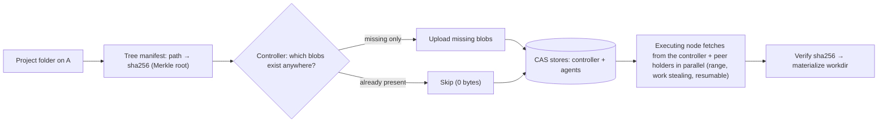

- **Blob** = immutable bytes named by SHA-256; large files chunked (e.g. 8 MiB) for parallel/resumable transfer.

**Built in V0.5 wave 1 (G1, brief D79-D84):**
- **CAS** (`common/cas.py`, one module for controller and agents): whole-file blobs at `<root>/sha256/<aa>/<bb>/<hex>`, written to `<root>/tmp/*.part`, verified, fsync'ed, renamed and made read-only; admission checks `max_blob_bytes`, an optional quota and a free-disk floor before any write; the V0.4 one-level layout is migrated at start (files are **moved, not re-hashed** - they were verified when V0.4 stored them; a blob corrupted since is caught by the receiver's verification). Default `max_blob_bytes` is **64 GiB** on both sides (the tree limit), so one multi-GB dataset file fits. **Chunks are transfer units, not stored objects** (D80): a `ResumablePart` writes verified chunks at their offsets and records them in a bitmap sidecar (`tmp/resume-<hex>.part.chunks`, written after the chunk's fsync) so a crash keeps what was verified; the assembled file is hashed whole before it becomes a blob. While chunks land, the free-disk floor is re-checked every 64 MiB against the bytes still to come (on the controller, on **every part** written, since each part request opens its own writer). At most 64 resumable transfers are in progress per store (`resource_busy` beyond; counted in memory since G4 - listed once at start, never on the hot path); transfers untouched for a day are swept at start and, on the controller, at most hourly from the part-upload path.
- **Tree manifest** (`common/tree.py`, D81; two additions to the brief's shape: a top-level `chunk_size`, needed to read the chunk lists, and symlink / empty-folder entries, so projects with internal links keep working as they did with bundles): canonical JSON `{"chunk_size", "entries", "v": 1}` (sorted keys, no spaces, UTF-8), entries sorted by POSIX path bytes - files `{path, sha256, size, exec[, chunks]}`, symlinks `{path, link}`, empty folders `{path, dir: true}`; no timestamps/owners, so the same folder gives the same `tree_id = sha256(manifest bytes)` on Linux and Windows (golden test). Built with the bundle's walk (`common/walk.py`: ignore rules and path refusals shared, not copied); parsed as hostile input (exact shape, canonical form, order, nothing under a file/link, chunk lists vs sizes, `TreeLimits`: 100 000 entries, 4 096-byte paths, 64 GiB, 64 MiB manifest).
- **Upload** (`cli/transfer.py`, D82): `POST /v1/blobs/have` -> the missing digests; one-chunk files are one `PUT`; chunked files go as verified parts (`PUT .../parts/{i}` with the chunk digest, `GET .../parts` to resume, `POST .../complete`); the manifest last. Resubmitting an unchanged project uploads 0 bytes; one changed file uploads that file.
- **Jobs reference the tree** (D83): `POST /v1/jobs {tree_id}`; the controller checks the manifest and every blob are stored. `ExecutionSpec.tree_id` (15) and `sources` (16, `BlobSource{url, token, node_id}` - the controller, then peers since G4). The attempt's fetch token names the tree manifest and therefore reads exactly that tree's blobs. The controller parses a tree once and keeps its member set beside it (an LRU bounded by total entries, 500 000; stored non-trees are remembered too), so an authorised `GET`/`HEAD` costs one set lookup per root the token names. Paths and link targets that are not valid UTF-8 (e.g. a lone surrogate) are refused.
- **Agent** (`agent/cas/`, D84): fetches the manifest and missing blobs into `<data dir>/cas` (one-chunk files by `GET`, larger ones by `Range` chunk, each chunk verified against the manifest, re-asked twice on corruption from the controller; resumable; from several sources since G4, below), then **copies** them into the workdir (reflink where the file system can, never a hard link), hashing while copying. A blob found corrupt (in the cache during the copy, or after assembly in flight) is evicted and fetched again **once per blob, at most 3 per staging**; past that budget the attempt fails `integrity_error`. Symlinks are created last; free disk is checked first.

**Built in V0.5 wave 2 (G4, brief D88-D90, D96-D101):**
- **Explicit tree path.** A tree job is named only by `tree_id`: `ExecutionSpec.bundle_digest` is empty for it (the wave-1 reuse of that field for the manifest is gone), the controller's fetch token is scoped by `fetch_scope()` (tree job -> the tree, bundle job -> the bundle) for StartAttempt and every RefreshFetchToken alike, and the agent's plan carries `tree_id` or the bundle digest, never both. V0.4 bundle jobs run unchanged.
- **Peer blob server** (`agent/peer/`, D97): asyncio streams + `h11`, no framework. `GET`/`HEAD` `/v1/blobs/<64 hex>` only, one `Range: bytes=a-b|a-|-n` (`206`; two ranges or bad syntax `400`; outside the blob `416` with `Content-Range: bytes */size`); other methods `405`, other paths `404`, a request body `400`. Files come only from the agent's CAS (path built from the validated hex, `O_NOFOLLOW`, regular files only). Bounds (`[agent.peer]`): request head <= `header_bytes` (counted exactly, `431`), the whole head within `idle_timeout_s` (slowloris) and idle keep-alive closed after it, `max_connections` (one more gets `503`), `max_requests_per_conn`, and a send deadline of `idle_timeout_s + size / min_send_rate_bytes_s`. **Off until `bind` is set**; a wildcard bind needs `allow_any_bind`. **Delayed ACK (D97):** `TCP_NODELAY` on every connection, responses up to 256 KiB written as one buffer, larger bodies via `loop.sendfile`. The same stall existed on the controller: its REST listener socket was created with protocol 0, accepted sockets inherit it and asyncio turns `TCP_NODELAY` on only for `IPPROTO_TCP` sockets - every small response waited for the client's delayed ACK (43 ms median for a small authorised GET on loopback); created with `IPPROTO_TCP` it is ~1.6 ms (Laptop 1, not a benchmark claim).
- **Peer tokens** (`common/peer_token.py`, D98): the controller signs `base64url(canonical JSON {att, exp, hold, req, tree, v:1}) . base64url(Ed25519 sig)` with `<data dir>/controller/peer_signing.key` (created once, `0600`, refused when loose/garbage/not Ed25519 - the `fabric.token` rules); its public key goes to every agent in `HelloAck.peer_token_key`. The holder checks size (<= 512 chars), the signature (before parsing), canonical form, `hold == its node_id`, expiry (30 s skew, never more than 600 s ahead) with the key of its **current** session only, and that the digest is the tree or one of its members - the manifest is read from its own CAS and parsed, with the member set built in the worker thread (LRU by entries); no manifest -> `404`. Missing token `401`, any refusal `403`, no key yet `503`. Never logged; never persisted (the key is).
- **Where peers are** (D99): `Hello.peer_endpoint` = `host:port` (the bind IP, or for a wildcard bind the local address facing the controller, or `[agent.peer] advertise_host`). The controller keeps it on the live session only when the host is the address the session comes from (or `[controller] trust_peer_endpoints`), the port is 1-65535 and it is <= 64 chars; otherwise it is ignored (logged), never an admission failure. REST node detail shows it.
- **Cache reports and the location index** (`agent/cache/`, `controller/cache_index.py`, D90/D100/D101): the agent's `CacheInventory` mirrors what it holds - CAS blobs (a start-up scan, then the CAS's `on_change` observer), complete trees (reported after a staging verified the manifest and every member; withdrawn as soon as any member or the manifest is evicted; remembered in `<data dir>/cas/trees.idx` and fully re-checked at start), built environments (`envs/{venv,subprocess}/<hash>` markers) and env images (Docker label `meshforge.env_hash`) rescanned every `rescan_s`. After every Reconcile it sends a paged snapshot (<= 1024 items per `CacheReport`), then deltas every `flush_s`, and a full snapshot again every `snapshot_interval_s`; `seq` is monotonic per agent process. The controller validates each report (kinds, key shapes, bounds), runs a per-node state machine for the current session (`await_snapshot -> collecting -> live`, `stale` after a gap or a bad report) and writes on the session's write chain, fenced by `FOR SHARE` on the node row with `last_session_id` - a superseded session's write can never land after the new snapshot. This is how `env_hash` / env-cache presence reaches the controller (G2 follow-up); V0.6's planner reads the same table.
- **Multi-source parallel fetch** (`agent/cas/fetcher.py`, D89): the dispatcher lists the controller first, then up to `max_peer_sources` (4) ONLINE nodes with an accepted endpoint that hold `tree <tree_id>`, never the target, newest index row first, each with its own peer token (`controller/jobs/peers.py`; a failed index read means controller only). The agent turns every missing blob into units (a one-chunk file = one unit, a chunked file = one unit per missing chunk of its resumable part) on one shared queue; each source runs `[agent.fetch] per_source` (2) workers, so a faster source takes more units (work stealing). With nothing left to start, an idle source re-asks a unit in flight elsewhere for longer than `endgame_after_s`; the first verified answer wins and the other request is cancelled. Failure rules are in §13: peers are dropped, the controller is the last resort, a unit nobody can serve fails with the controller's typed error. Requests of a failing blob that are already under way are let finish first, so every chunk that arrived is kept for the resume. `FetchStats.sources` = bytes / request time / units / failures / drop reason per source (logged with `agent.cas.staged`; persisted as telemetry in G5).
- **Staging retries** (D95 + G4): only the *controller's* 401/403 waits for `RefreshFetchToken`; the refresh carries the source list re-minted (controller first with the new token, then the peers). The `staging_retry_s` deadline is checked before every retry, a refreshed one included. Refreshed sources apply to the **next** fetch attempt of the staging (a new fetcher with the new list), never to requests already in flight: a peer whose token expires mid-transfer answers `403`, is dropped for that transfer and the rest comes from the remaining sources; the next retry starts with the re-minted peer tokens (G4 reviewer note, documented in G5).
- *Known limit:* peer tokens live 10 minutes: a staging that outlasts them loses its peers (dropped on the `403`) and finishes from the controller - a token refresh during a long transfer is not built (follow-up).

**Built in V0.5 wave 2 (G5, brief D91-D93, roadmap 0.5.6, 0.5.8 controller part, 0.5.9, 0.5.10):**
- **Fetcher layout.** `agent/cas/fetcher.py` is a facade over `sources.py` (source identity, per-source stats, typed `FetchError`, the `Range` GET), `manifest.py` (the manifest GET; a manifest over 64 KiB is hashed and parsed in a worker thread, never on the loop) and `scheduler.py` (units, queue, work-stealing workers, failure rules).
- **GC index** (`common/gc_index.py`, one module for agents and controller): stdlib SQLite (WAL) at `<data dir>/gc/gc.sqlite` (agent) / `<data dir>/controller/gc/gc.sqlite` (controller): `item(kind, key, size, last_use)` (kinds `blob` and `env`; env keys `venv/<hash>`, `subprocess/<hash>`, `image/<hash>`), `tree_member` + `tree_known` (members recorded from a verified manifest), `pin(kind, key)`, `lease(owner, lease_id, kind, key)` + `owner`. Every process registers an owner and holds `gc-owners/<owner>.lock` for life; leases of an owner whose lock can be taken (a dead process) are reaped, so a lease held by **another process** on the same data dir is honoured and a crashed one never pins forever. Every write is one `BEGIN IMMEDIATE` transaction; an eviction batch selects **and removes** its victims inside one transaction, so it is strictly ordered against a lease taken by a starting attempt (lease first -> not a victim; eviction first -> the attempt finds the item gone and fetches/builds it). A crash mid-batch rolls the rows back; the next start reconciles rows with the disk (each item present-and-verifying or gone, never half). **Victim cost (fix round 1, G5-T4):** `blob_lru(key, last_use, held)` mirrors the blob rows of `item` by triggers; `held` is set when a lease/pin is added and recomputed for the affected blobs when one goes, and victims walk a partial index over `held = 0` only - one batch costs ~ms whatever the size of pinned/leased trees (a 100 000-file pinned input used to cost ~0.23 s per 256-victim batch); each candidate is still re-checked against `lease`/`pin`/`tree_member` in the batch transaction, so `held` never weakens the lease ordering. The cost moved to protection changes (pin/release of a 100 000-file tree ~0.3-0.4 s, once). **Corrupt or foreign index (G5-T1, fix round 2 G5-R2-1/2):** a file that is not SQLite, fails `quick_check`, or is valid SQLite but not this schema (unknown tables/columns/objects, a `user_version` other than 0 = pre-`blob_lru` or the current one) is renamed to `gc.sqlite.corrupt-<time>-<rand>` (log `gc.index_quarantined`) and recreated - it is derived data: the start pass reconciles items from disk (LRU history and `min_age_s` restart), pins come back from the controller (agent: re-sent after every Reconcile; controller: from PostgreSQL before every pass), members are re-recorded when a tree is staged or pinned. **Never under a live owner:** opens are serialised by `gc.open.lock` and an owner takes its lock only after its connection is open, so if any *other* `gc-owners/*.lock` is held the file is left in place and `open()` raises `GcIndexBusyError` (log `gc.index_unusable_in_use`); the agent/controller then run **without GC for that process** (`agent.gc.unavailable` / `controller.gc.unavailable`, no eviction; agent leases are no-ops) and the next start quarantines once the other process is gone - another process's leases are never dropped.
- **Agent GC** (`agent/gc/`, D91): a pass at start, every `[agent.gc] interval_s` (600 s), after every staging (a cheap pass without the disk scan) and on `GcRequest{run_now}`. Per kind, LRU victims are evicted while usage > quota (`cas_bytes` 20 GiB, `envs_bytes` 30 GiB - dir envs and env images together; 0 = none), skipping anything used within `min_age_s` (300 s), leased or pinned; nothing evictable left -> `agent.gc.over_quota` (warning). **Leases:** the executor leases each tree (manifest + recorded members) **before** staging it and holds it for the whole attempt; the env builder and the Docker runtime lease `env <kind>/<hash>` **before** the readiness check (a context variable carries the attempt's leases), so GC can never remove what a running job uses; a lease that cannot be recorded fails the attempt `internal_error/gc_lease_failed`. While any leased tree's members are not recorded yet (its manifest is being fetched) no blob is evicted. **Removal:** a blob is one `unlink` (the CAS observer sends the cache-report `removed` delta and withdraws every `tree` it completed, D100); a dir env is renamed `<hash>.gc-<id>` inside the transaction under its build lock (taken without waiting: a busy env is skipped) and deleted after; an env image is `docker image rm` without force; base images are never items. **Pins:** the controller sends the pinned named-input trees (`GcRequest{set_pins, pinned_trees}`) after every Reconcile and on every change; a pinned tree's manifest and members are never evicted.
- **Controller GC + scrub** (`controller/gc.py`): the same LRU pass over the blob store (`[controller.gc] cas_bytes` 100 GiB, `min_age_s` 1 day - an upload, a `have` answer and a download count as use, which covers a client between have/need and its submit). Before every pass the pins are recomputed from PostgreSQL: tree, bundle, outputs and final logs of every **non-terminal** job, those jobs' input trees, every pinned named input. The pass holds `BlobStore.gc_guard` **exclusively**; a job submission (tree check -> job row) and a named-input push hold it **shared** (concurrent with each other; a waiting pass blocks new holders so it is never starved). The **scrubber** re-hashes stored blobs at `scrub_bytes_per_s` (32 MiB/s) in cycles `scrub_interval_s` apart, suspects first: the members of a tree whose attempt failed `integrity_error` (dispatcher hook). A blob that does not match its name is evicted (`controller.blobs.scrub_corrupt`) - never served again, `have` reports it missing so the next upload replaces it. A stored manifest whose bytes do not hash to its name is evicted the moment the controller reads it.
- **Named inputs** (`controller/named_inputs.py`, `/v1/data`, `compute data push|ls|show|pin|rm`, D92): a folder is uploaded as a tree (same have/need path as `compute run`) and registered as `name@<version>` (versions count up per name; the same tree again returns its version). A manifest names inputs `{ref: name@<version>|name@sha256:<tree>, mount: <folder>}` (<= 16, plain relative folders, not under `.meshforge`, no mount inside another). At submit the controller resolves every ref (`not_found` otherwise), refuses a mount that overlaps any project path (`invalid_input`), checks each input tree is stored and records `job_input` rows in the job's transaction. The attempt's fetch token covers the project tree **and** every input tree; `ExecutionSpec.inputs` lists each input with its own sources (the controller, then peers holding *that* tree with tree-scoped peer tokens); `RefreshFetchToken.inputs` re-mints them. The agent stages each input after the project like any tree (cache, peers, verified chunks, leased), refuses a mount that goes through a project file or link or meets project files, copies it to `<workdir>/<mount>` and makes it **read-only** (files `0444`, folders `0555`: the job cannot change or add files there - the cache itself is protected by the copy, D84). `rm` is refused (`conflict`, naming the jobs) while a non-terminal job uses that version.
- **Transfer telemetry** (D93): the terminal `AttemptStatus` carries one `TransferSummary` per staged tree (hits and their bytes, fetched blobs and bytes, chunks resumed, corrupt refetches, manifest hit, staging duration, and per source bytes / request time / units / failures / drop reason). The controller validates it (<= 17 trees x 17 sources, canonical node ids, finite durations, counts < 2^31) and writes `transfer_event` rows in the same transaction as the terminal transition: per tree a `cache` row (hits) plus one row per source, unique per `(attempt, tree, source)` so a replayed report never doubles them. `GET /v1/jobs/{id}` (`attempts[].transfers`, `inputs`) and `compute jobs JOB_ID` show them.
- **Cache index (planner):** V0.6 reads `cache_location` for `cache_affinity` / `missing_bytes`, and `transfer_event` for measured source throughput.

---

## 15. Execution environments

| Runtime | Default when | Isolation | Environment (V0.5 D85-D87) |
|---|---|---|---|
| **Docker** | Linux nodes; Windows nodes with Docker Desktop | container: CPU/RAM/pids limits, workdir-only mounts, no privilege, read-only root fs | image `meshforge-env:<env hash>` = pinned base + requirements in `/env` (on `PYTHONPATH`) |
| **venv (uv)** | Docker unavailable and `allow_unsandboxed`; also used by GPU service | **none** (runs as the agent's user, like subprocess; documented) | a uv venv `envs/venv/<hash>` (the job's `env.python`, only its packages) |
| **subprocess** | last resort, `allow_unsandboxed` | none | the agent's interpreter + a `--target` dir `envs/subprocess/<hash>` on `PYTHONPATH` |

Selection order is **docker > venv > subprocess** (`agent/execution/selection.py`); venv and subprocess are both unsandboxed, they differ in which Python and packages a job sees. **Bases:** the venv runtime provides only `python-cpu` (a clean interpreter + the job's requirements, like the `python-cpu` image); a `cuda-pytorch` job is promised PyTorch and never goes to venv - Docker runs it in the `cuda-pytorch` image, the subprocess runtime on the agent's own environment (`uv sync --extra gpu`), as in V0.4; an explicit controller request for venv with that base is `no_feasible_plan`. A job that imports torch must therefore declare `env.base: cuda-pytorch` (on `python-cpu` it fails in Docker and venv alike). The agent's start-up (`agent/execution/offer.py`) creates one `EnvBuilder` per agent and passes it to every runtime; with `allow_unsandboxed` it also probes and offers the venv runtime (capability `exec-venv`). The controller accepts `"venv"` as `AttemptStatus.runtime` (migration 0010 widens the `attempt.runtime` CHECK). The V0.4 per-job `setup_argv` install remains only as the path of a runtime constructed without a builder (used by the V0.4 runtime-contract/sandbox tests).

**Env hash** (D85, `agent/envs/hash.py`) = `sha256` of canonical JSON `{v:3, runtime_kind, base, python, requirements_sha256, platform, source}`: `base` is the pinned base image's `sha256:` digest (Docker) or the interpreter (`cpython-3.12.3`); `platform` the local base image's `os/arch` or the interpreter's `sysconfig` platform; `source` the sha256 of the node's package sources (`[agent.envs]` index_url, no_index, and the file names + sizes of a find_links wheelhouse - not its path), `""` for the default index; requirements are **normalised, not resolved** (comments, blank lines, order, duplicates, CRLF/BOM ignored; since format v2: project names/extras per PEP 503 and no whitespace inside version specifiers, so `Requests == 2` = `requests==2` - any version change changes the hash). Lines the hash cannot cover (`-r`/`-c`/`-e`, local paths, `file:` URLs, any `name @ ...` direct reference that is not `http(s)://` or a VCS URL over a network scheme - `git+https/ssh/git://`; `git+file://`, `git+/path` are local and refused; likewise `--index-url`/`-i`, `--extra-index-url`, `--find-links`/`-f` must be http(s) URLs - one shared rule, `envs.hash.is_remote_url`) are refused (`env_error/requirements_rejected`); size and line count are bounded (`[agent.envs]`). Per-requirement options (`--hash=sha256:...` from `pip-compile --generate-hashes`) are kept, separated and sorted, and are part of the hash. No lockfile resolution in V0.5.

**Build once per node** (D86, `agent/envs/builder.py`): under `envs/locks/<hash>.lock` (a file lock: one build per hash across processes and attempts; a waiter reuses the result), a build goes into `<hash>.building`, is size-checked (`max_env_bytes`), gets a marker naming its hash plus an integrity summary (entry count, bytes, sha256 of the sorted path/type/size listing - one `lstat` per file, ~6 ms for a 1,000-file numpy venv on Laptop 1; same-size in-place edits are not caught; only `*.pyc` directly in a `__pycache__` folder and the root marker are left out), is made **read-only** and only then renamed into place; before every reuse the summary is re-checked (`check_s` logged with the cache result) and a mismatch is logged (`agent.envs.cache_damaged`), evicted - renamed `<hash>.evicted-<time>-<id>` so a job still running in it is not pulled from under, deleted by a later build after `[agent.envs] evicted_keep_s` (1 day) - and rebuilt; never used. The committed env image gets its base's Cmd/WorkingDir/User back and the build container's cleanup labels blanked (Docker merges container labels into a commit and cannot delete one), so it carries `meshforge.env_hash` + `meshforge.base`. A Docker env image is trusted by its `meshforge.env_hash` label: its layers are content-addressed and verified by the daemon, so the agent does not re-check them; free disk below `free_disk_floor_mb` refuses it, and ENOSPC/EDQUOT during a build ends it, as `disk_full` (other filesystem errors: `env_error/build_io_failed`). A failed, cancelled or killed build leaves nothing visible (`env_error`/`timeout`). The installer is `uv pip install --link-mode copy` (never hardlinks into the uv cache) on the host; in Docker the base image's own `pip install --target /env` runs in an `envbuild` container (same hardening, writable root fs, network off with `no_index`) that is committed to the env image - the agent's `uv` binary is host-OS-specific and cannot run inside a Linux container on Windows. Build output goes to the triggering job's log. The runtime reports `env_hash` and `env_cache` (`hit`/`waited`/`built`, i.e. warm vs cold) with the `env` phase timing; they are logged (`agent.execution.env_ready`) - sending them to the controller is G4's telemetry work (D93).

**Base images** (D87) `python-cpu` and `cuda-pytorch` are pinned by digest in `[agent.execution.images]` (an unpinned value is refused by the settings, and by the Docker runtime before any pull: `config_error/unpinned_base`). `meshforge-agent prepare` pre-pulls them locally and prints sizes and times. **`compute node prepare NODE_ID|--all [--image BASE] [--envs FILE]`** (V0.5 G5, controller-driven): `POST /v1/nodes/{id}/prepare` sends `PrepareEnv{request_id, base_images, envs}`; the agent (`agent/envs/node_prepare.py`) validates it (<= 8 known bases, <= 32 envs, requirements within `max_requirements_bytes` and normalised, local paths refused), pulls the bases with the same code as the local command and builds each env through the runtime a job would use (`prepare_env()` on the Docker and subprocess/venv runtimes: the G2 build path, so the job then finds it `hit`), one request at a time, reporting `PrepareEnvStatus` (a report: acked, replayed) per item: `hit` / `pulled` / `built` / `failed` with a typed `failure_type` + reason (`docker_unavailable`, `runtime_unavailable` (`no_feasible_plan`), `pull_timeout`, `pull_failed`, `requirements_rejected`, `setup_failed`, ...). A replayed `request_id` never runs twice. The controller keeps the newest 256 requests **in memory** (`GET /v1/nodes/{id}/prepare/{request_id}`; a restart forgets them - the work on the node is not lost); the CLI waits, prints each item and exits 1 if any failed. A node that goes OFFLINE (lease expired, Goodbye) ends its unfinished requests `failed` / `node_lost` / `node_offline`; a new session of the node (its Reconcile) gets its unfinished requests re-sent with the same `request_id` (a running agent re-reports, a restarted one re-runs - idempotent), and a re-send that cannot be queued ends `node_lost` / `resend_failed` (G5 fix round 1, N2); a request is sent at most once per session, so a repeated Reconcile in one session queues no extra copies (fix round 2, G5-R2-3). `compute node gc --all` and `node prepare --all` with no connected node print a message and exit 6 (`UNAVAILABLE`).

---

## 16. Security model & pairing

**Threat model (summary):** devices are owned by trusted people, but the network is not trusted, and a mistake must not let an outsider run code. Workloads are semi-trusted: they are sandboxed so they cannot trivially damage the host. A process with Docker-socket access has root-equivalent power — the agent is therefore a privileged component and is kept small and audited.

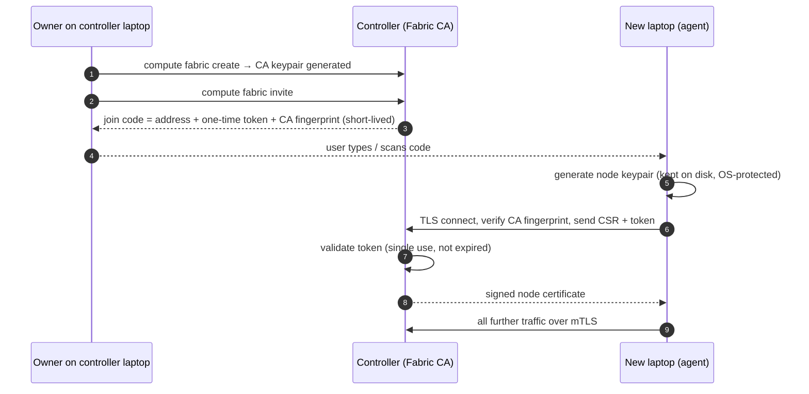

- Node identity: an **ECDSA P-256** keypair and a ULID `node_id`, minted once at first agent start and stored OS-protected in the agent data dir ([ADR-0013](adr/0013-node-identity-storage.md)); pairing signs its CSR with that same key. Until pairing exists (V0.7) the controller trusts `Hello.node_id` on the trusted LAN only — one marked trust point in the code.
- mTLS on agent gRPC; node-cert auth on peer blob servers and GPU services; short-lived session tokens for GPU sessions and blob fetches.
- User auth on REST (local admin credential; tokens for CLI).
- Revocation list checked on every session; cert rotation supported.
- Per-node owner settings: accept jobs / accept GPU sessions / resource caps.

**V0.7 (ADR-0016) — where it stands.** The threat model with every row's test is [`THREAT_MODEL.md`](THREAT_MODEL.md).
*Shipped in G1 (0.7.1, 0.7.2, D133/D134):* `meshforge-controller fabric create [--force]` (controller host only - it needs the CA key file) makes the **fabric CA**: a self-signed ECDSA P-256 root, 10 years, `fabric_id` (`fab_<ULID>`) in its subject (`OU`), `BasicConstraints(ca, path_length=0)`, no intermediate. It also issues the **controller server certificate** (fresh P-256 key, 1 year, SANs = the fixed name `meshforge-controller` + the `grpc_bind`/`http_bind` hosts (wildcards skipped) + the `advertise_url` host + `[controller.tls] extra_sans`, EKU serverAuth). Every controller start re-checks it and re-issues it with a new key when it is missing, unreadable, from another CA, outside its validity window, its SANs differ from the settings, or two thirds of its life have passed. `fabric show [--json]` prints the fabric id, the CA's SHA-256 fingerprint and its first 128 bits (the **join fingerprint** that join codes will carry, D135), validity and the server cert. A CA that exists but cannot be trusted (missing half, loose permissions, garbled, not a CA, key/cert mismatch, expired) stops the controller with `config_error`; **no CA at all is still allowed in G1**. Node certificates (G2) will carry exactly one SAN URI `meshforge://fabric/<fabric_id>/node/<node_id>` and no DNS/IP names, EKU clientAuth+serverAuth, 30 days; the CSR checks they need already exist in `common/pki.py` (P-256 only, SHA-256, valid signature, exactly one SAN naming the node and fabric, ≤ 4 KiB; nothing but the public key is copied from a CSR).
*Shipped in G2 (0.7.3, 0.7.4, D135/D136/D150/D151) - pairing:*
- **Join code** (`common/join_code.py`): `mf1-` + base32 of `version | host (IPv4/IPv6/name) | port | 128-bit token | 128-bit CA pin | 4-byte SHA-256 checksum`, grouped by 5 (≈ 89 characters for IPv4; case, spaces and the look-alikes 0/1/8 are forgiven; a typo fails the checksum on the laptop). Made by `meshforge-controller fabric invite [--ttl] [--replace NODE_ID] [--address HOST:PORT] [--json]` (controller host, DB) or `compute fabric invite` (REST `POST /v1/fabric/invites`, fabric token = interim admin until G4); listed/revoked by `fabric invites [--revoke ID]`. Table `join_token` keeps only SHA-256(token); created/expires on the **database clock**; TTL 15 min (1 min-24 h). Every invite/enrol/revoke/refusal that names an invite writes an `audit_event` row (never a token).
- **Interim enrolment listener** (`controller/enrollment/listener.py`, `[controller.enroll]`, default `<grpc host>:47101`): TLS with the server certificate, presenting `server.crt + ca.crt`, no client cert; service `meshforge.v1.Enrollment/Enroll` only; per-source token bucket before any DB work (IPv4 per address, IPv6 per /64, unparseable peers share one bucket - D152), 16 KiB requests, 16 concurrent RPCs. Started only when a CA exists; its bound port is logged in `controller.listening` (`enroll=`). G3 kept it (see the G3 deviation below).
- **Enrol** (`controller/enrollment/service.py`): CSR verified first (no DB); then one transaction - redeem the token (single-use `UPDATE … RETURNING`), a `--replace` invite enrols only its node, lock/insert the node row (`enrolling` if never seen; its first Hello makes it `online`, §12.3), refuse a revoked node or **another key** for an enrolled `node_id` (unless replace), issue the node cert (30 d, SAN URI `meshforge://fabric/<fabric_id>/node/<node_id>`, EKU client+server), store `cert_serial`/`cert_fingerprint`/`cert_not_after`/`public_key_fingerprint` on `node`, audit. Any refusal rolls back: **the code is spent only if a certificate is issued**. Refusals = gRPC status + trailing `meshforge-reason` (`token_unknown|used|revoked|expired`, `csr_<pki reason>`, `replace_mismatch`, `node_key_conflict`, `node_revoked`, `rate_limited`, `unavailable`, `malformed_request`). `GET /v1/nodes` shows each node's `certificate`.
- **Agent** (`agent/enrollment.py`, `meshforge-agent join [CODE|-] [--force]`; `compute fabric join` runs it with the code on stdin): decode → refuse locally if already enrolled without `--force` → verify-off TLS handshake to read the presented chain (Python 3.12: `SSLSocket._sslobj.get_unverified_chain()`, public from 3.13) → keep the self-signed CA matching the 128-bit pin that issued the server cert, **else stop having sent nothing** → CSR from the ADR-0013 key → `Enroll` over a channel verifying against that CA only (name `meshforge-controller`) → check the returned cert (pinned CA, our key, our node/fabric, valid) → store `ca.crt` then `node.crt` beside `node.key` under `identity.lock` (`0600`/owner ACL; `--force` deletes `node.crt` first). `identity show` prints `enrolled`, `fabric_id`, expiry, fingerprints; `identity reset` deletes the certificates too.

*Shipped in G3 (0.7.5, D137/D139, deliverables 0-4):*
- **`[security] mode`** (shared by controller, agent, CLI): `mtls` (default) or `insecure-dev` (plaintext, `Hello.node_id` trusted) which is refused unless every listener, the agent's controller address (no mDNS), its peer bind and the CLI URL are loopback; a `security.insecure_dev` warning is logged at every start. An `mtls` controller without a CA refuses to start; an `mtls` agent without a valid enrolment stops at once with the `meshforge-agent join` command (`agent/session/tls.py`).
- **Server certificate in use** (`controller/server_tls.py` `ServerTls`): renewed while running every `[controller.tls] check_interval_s` (2/3 life, or re-issue when unusable); gRPC listeners use `dynamic_ssl_server_credentials` (new config once per renewal), the HTTPS listener a remembered `SSLContext` re-loaded in the loop. Open connections keep their certificate.
- **Session port 47100 = mutual TLS**: client cert required (chain + validity by BoringSSL); `NodeCertInterceptor` (`controller/session/peer_cert.py`) refuses any call without an acceptable node cert (our fabric's URI SAN, clientAuth, valid now, serial not revoked); the servicer refuses a Hello whose `node_id` is not the cert's (`UNAUTHENTICATED`/`node_id_mismatch`); admission refuses an older cert of a re-keyed node (`cert_superseded`) and records the cert of a node with none on record. TLS 1.3 is what BoringSSL negotiates (tested on the wire). Agents verify the controller against `ca.crt` and the fixed name `meshforge-controller` whatever address they dialled (node certs carry no DNS SAN, so a laptop cannot pose as the controller).
- **REST/blob port 47110 = HTTPS** (TLS 1.3 only, client cert optional, recorded per connection by `controller/http_tls.py`). Fetch tokens and upload grants are bound to the node they were sent to and accepted only with that node's client certificate (two locks); the fabric token (CLI) needs none. `[controller.api] advertise_url` must be `https://`.
- **Peer port 47120 = TLS 1.3 with the node cert, client cert required** (fabric node, serial not in the revocation set - G3 deliverable 6 fills the set). Fetching agents and probes demand the peer the controller named: the TLS server name `node-<ulid>.node.meshforge` is checked against the cert's node URI right after the handshake, before a byte is sent (`common/fabric_tls.py`, also used for the controller check).
- **CLI**: `https://` only in mtls; trusts `--ca` / `[cli] ca_file` / the local agent enrolment's `ca.crt` / the local controller's CA; log follow uses `wss://`.
- **Deviation (open question):** `Enroll` still has its own TLS listener (47101). grpcio's `require_client_auth=False` does not request a client certificate at all, so one port cannot carry cert-less enrolment and cert-required sessions; old and new join codes both point at 47101.

*Not enforced yet (G3 deliverables 5-8 and later groups):* peer/probe token life is still up to 600 s (D147 = 60 s); no revocation command / `RevocationUpdate` yet (the revoked-serial hooks exist, the set is empty); no plaintext byte recorder yet; peer tokens' `requester` is not yet bound to the client cert's node; per-user tokens G4. A leaked CA key is recovered only by `fabric create --force` + every laptop re-joining (CA rotation is V0.17).

---

## 17. Telemetry & benchmarking pipeline

```mermaid
flowchart LR
    subgraph RUN["Every execution (normal or benchmark)"]
        S1["Resource snapshot at start"]
        S2["Network matrix at start"]
        S3["Cache state"]
        S4["Phase timings: queue, stage, env, load, compute, result"]
        S5["Outcome: success / failure_type / exit code"]
    end
    RUN --> TT[("Telemetry tables (PostgreSQL)")]
    CAMP["Benchmark campaigns: workload families × params × conditions × forced strategies"] --> JOBS["Normal job/SDK path (tagged benchmark)"]
    JOBS --> RUN
    COND["Condition controllers: load generators, cache warm/cold, network shaping, Wi-Fi vs Ethernet"] --> CAMP
    TT --> EXP["Export: Parquet datasets + labels (best measured plan per group)"]
    EXP --> ML["ML training & evaluation"]
    ML --> REG[("Model registry")]
    REG --> PLANNER["Planner cost estimator"]
```

Benchmarks run through **the same code paths as users** — so benchmark data reflects the real system, and the benchmark system doubles as an end-to-end test harness.

*V0.6 G4 (D108, D111) - what is recorded today for the estimator and V0.15:* per attempt the five phase timings (`attempt_phase`), per tree and source the transfer (`transfer_event`), and since migration 0014 the agent's `env_hash` and the `output_bytes` its upload grant stored; per node pair the network matrix (`network_link`: EWMA RTT and throughput from peer probes, `samples`, `measured_at`); per decision every candidate's predicted terms with their `source` (`plan_decision`), joined to the actual phases through `attempt_id`. Probe traffic is itself bounded telemetry (≤ 48 MiB/min fabric-wide by default) and the controller -> node links reuse transfer history at no traffic cost.

---

## 18. ML subsystem

- **Formulation:** *predict cost components per candidate plan*, then rank. Not a direct "which mode" classifier (kept only as an experimental comparison).
- **Targets:** compute time per (workload, node); env setup time; per-mode overhead residuals (actual − analytical); failure probability.
- **Features:** workload fingerprint features (type, sizes, params, batch, sequence length, declared resources), **measured hardware scores** (CPU GFLOPS, memory bandwidth, GPU TFLOPS, VRAM) rather than model names, live load, network metrics, cache state.
- **Models compared:** linear/ridge, decision tree, random forest, gradient boosting (XGBoost, LightGBM), kNN; quantile variants for uncertainty.
- **Evaluation:** group-wise splits by workload family (no leakage); MAPE for predictions; **decision regret vs oracle** for the planner; baselines = all rule policies + analytical model.
- **Safety:** out-of-distribution or high-uncertainty → fall back to analytical/rules; every decision records which predictor version was used.

---

## 19. Data model

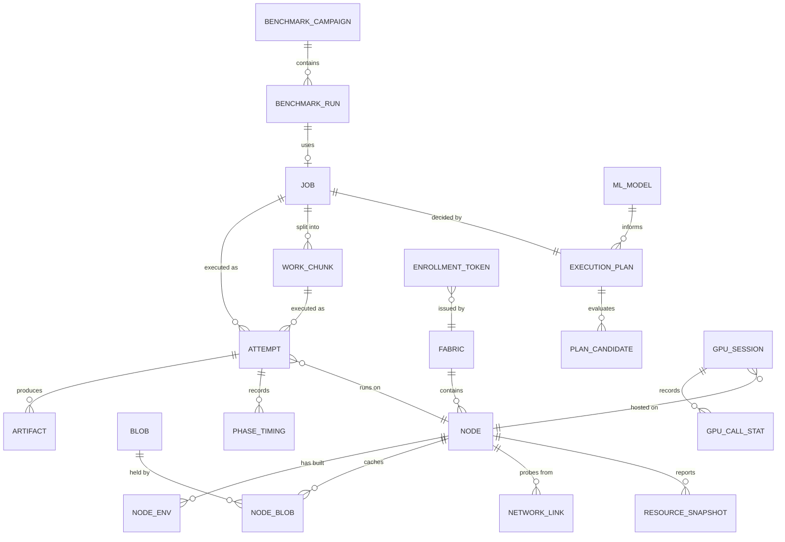
Schema is managed with SQLAlchemy 2.0 + Alembic migrations. Large logs and outputs live in the blob store, not in PostgreSQL. Resource snapshots are downsampled (e.g. 2 s live → 1 min history): the controller keeps the last few minutes per node in memory (`controller.resources.live_ring_size`, default 150 samples) and writes only **closed** 1-minute buckets (mean/max per metric, plus the sample count) to `resource_snapshot` — a bucket closes `controller.resources.bucket_grace_s` (default 20 s: one lease + criterion 2's 10 s restore + the replay) after it ends, so a reconnect's replayed samples still land in it; a sample later than that stays in the live ring, is left out of history (never merged into a stored row — after a controller restart the dedupe cursor is gone and a replay would be merged twice) and is counted and logged `controller.resources.sample_late` (G6, D26) — which a periodic sweep deletes after `controller.resources.retention_days` (default 7). Plain rows with a `(node_id, bucket_start)` primary key — partitioning is premature at this fleet size, and the key makes a re-flush an idempotent upsert.

**Cache locations (V0.5 G4, migration `0011`, D101).** `cache_location(node_id -> node ON DELETE CASCADE, kind ∈ {blob, tree, env, image}, key, size, last_seen)`, primary key `(node_id, kind, key)`, index `(kind, key)` for "who holds tree X" (one row per holder, no per-blob join). Keys: `sha256:<hex>` for blob/tree/image, the env hash (64 hex) for env. A node's rows are replaced by the first page of each snapshot and changed by deltas (§14); the controller's clock stamps `last_seen`.

**Named inputs and transfer telemetry (V0.5 G5, migration `0012`, D92/D93).** `named_input(name, version, tree_id, size, files, pinned, created_at)`, primary key `(name, version)`, unique `(name, tree_id)` (pushing the same tree returns its version), CHECKs on the name pattern (`[a-z0-9][a-z0-9._-]{0,63}`), `version >= 1` and the digest shape, index on `tree_id`. `job_input(job_id -> job ON DELETE CASCADE, mount, ref, name, version, tree_id)`, primary key `(job_id, mount)`, indexes `(name, version)` (the `rm` check) and `tree_id`; written in the job's own transaction. `transfer_event(id identity, attempt_id -> attempt ON DELETE CASCADE, job_id, tree_id, source, bytes uint64, duration_ms, units, failures, resumed_chunks, dropped, recorded_at)`, unique `(attempt_id, tree_id, source)`, index `job_id`; `source` = `cache` (hits), `controller` or a peer's node id. The GC indexes are **not** in PostgreSQL: each process keeps its own SQLite file next to its CAS (§14).

**Planner (V0.6 G2, migration `0013`, D103-D112).** `job` gains `priority` (-10..10), `policy` (one of the seven, NULL = the controller's default), `max_attempts` (1-10) / `retry_backoff_s` (0-300) / `on_lost_retry` (manifest `retry:`, used from V0.6 G3), `submitter_node_id` (not a foreign key: an unknown id only means no Local candidate) + `submitter_seeded`, `not_before`, `queued_at` (partial index where `state = 'queued'`; existing queued jobs backfilled with `created_at`), `input_bytes` (the project's unique tree bytes or the bundle) and `fingerprint` (D108 workload fingerprint, indexed). `node` gains `cpu_slots` / `gpu_slots` (the latest Hello's; NULL = not said). `attempt` gains `slot` (`cpu`/`gpu`; NULL = before V0.6, counted as CPU). Slot use and the GPUs held (`attempt.start_snapshot->'gpu_indices'`) are read from live attempts under the dispatch advisory lock (§7). `plan_decision(id identity, job_id -> job ON DELETE CASCADE, attempt_no, attempt_id -> attempt ON DELETE CASCADE NULL, outcome ∈ {dispatched, waiting, failed}, policy, chosen_node_id, created_at, snapshot_digest, reason_key, candidates JSONB)` - CHECKs: `dispatched` ⇔ `attempt_id` set, `candidates` an array of at most 64, known outcome/policy; index `(job_id, id)`. A `dispatched` row is written in the transaction that creates its attempt; the actual phases are joined through `attempt_id` (never copied).

**Network matrix and estimator inputs (V0.6 G4, migration `0014`, D108/D111).** `network_link(src_node_id, dst_node_id -> node ON DELETE CASCADE, rtt_ms >= 0, bw_bytes_s > 0, samples >= 1, measured_at)`, primary key `(src_node_id, dst_node_id)`, CHECK `src <> dst`; a row = `src` downloaded from `dst`'s peer server (data flows dst -> src); EWMA in the upsert statement; failed probes write nothing. `attempt.env_hash` (64 lowercase hex, CHECK) and `attempt.output_bytes` (uint64) written in the attempt's terminal transaction. Index `ix_transfer_event_source_id (source, id)` for the newest controller transfers. Downgrade drops all of it.

**Jobs and attempts (V0.4, migration `0006`, brief D49).** `job` (id, name, `state` ∈ §12.1, canonical `manifest` JSONB, `bundle_digest` (nullable since migration `0009`), `tree_id` (V0.5 D83, migration `0009`; a CHECK requires one of the two), `placement` JSONB `{mode: local|offload, node_id}`, `idempotency_key` UNIQUE NULL + `request_hash`, `attempt_epoch` = last fencing token issued, terminal `failure_type`/`failure_detail`), `job_transition` (job_id, seq, from/to state, `at`: the full state history - queue time and other job-level phases are read from it; an addition to D49's three tables), `attempt` (id, job_id, node_id → `node`, `fencing_token` UNIQUE per job starting at 1, `state` ∈ §12.2, failure_type, detail, exit_code, output_digest, start_snapshot JSONB, started/ended_at) and `attempt_phase` (attempt_id, phase, started_at, duration_ms; PK (attempt_id, phase), so a replayed phase report is ignored). State/failure columns are text with a CHECK over frozen value lists. **One writer** (`controller/jobs/store.py` `JobStore`) applies every change as a compare-and-set `UPDATE … WHERE id AND state = :expected` (attempts also `AND fencing_token`) with the target taken from the pure tables in `controller/jobs/transitions.py`; two racing transitions on one row cannot both win.

---

## 20. API surfaces

**gRPC (internal)**
- `AgentControl.Session(stream AgentMessage) → stream ControllerMessage` — Hello/Reconcile, Heartbeat, ResourceUpdate, CacheReport, NetProbeResult, AttemptStatus, LogChunk ⇄ StartAttempt, CancelAttempt, RefreshFetchToken (V0.5 D95), ProbeRequest, PrepareEnv, GC, Ack.
- *V0.5 G4 additions (field numbers fixed by D98/D99/D101):* `Hello.peer_endpoint = 10` (`host:port` of the agent's peer server, empty = none; D99 validation, §14); `HelloAck.peer_token_key = 8` (raw 32-byte Ed25519 public key); `CacheReport{seq = 1 (monotonic per agent process), snapshot = 2, snapshot_last = 3, added = 4, removed = 5, page = 6}` (`page`: additive in G4 fix round 2, `optional` since fix round 3 - the page's index in its snapshot; only page 0 starts a snapshot; a snapshot page without it (an older agent) is accepted only as a whole single-page snapshot, a multi-page one leaves the node stale, logged `unpaged`) + `CacheItem{kind = 1 (BLOB/TREE/ENV/IMAGE), key = 2, size = 3}`, <= 1024 items per message, a report (buffered, replayed, acked); `RefreshFetchToken.sources = 6` (the whole source list re-minted). `ExecutionSpec.bundle_digest` is empty for a tree job; `ExecutionSpec.sources` lists the controller first, then peers.
- *V0.5 G5 additions:* `GcRequest{run_now = 1, set_pins = 2, pinned_trees = 3}` (was a reserved placeholder); `PrepareEnv{env_hash = 1 (V0.1 placeholder, ignored), request_id = 2, base_images = 3, envs = 4}` + `EnvSpecRequest{base, python, requirements (bytes), runtime}`; `AgentMessage.prepare_env_status = 22` (`PrepareEnvStatus{request_id, done, items: PrepareItem{kind, name, state, failure_type, reason, detail, key, size_bytes, duration_s}}`, a report: acked, replayed); `ExecutionSpec.inputs = 17` and `RefreshFetchToken.inputs = 7` (`InputTree{tree_id, mount, ref, sources}`); `AttemptStatus.transfers = 15` (`TransferSummary{tree_id, blobs_hit, bytes_hit, blobs_fetched, bytes_fetched, chunks_resumed, corrupt_refetches, manifest_hit, duration_s, sources: TransferSource{node_id, bytes, duration_s, units, failures, dropped}}`, terminal reports only).
- *V0.6 G4 additions (D111; the V0.1 placeholders, names kept):* `ProbeRequest` ("ProbeLink") `{probe_id = 1, target_node_id = 2, endpoint = 3 (the target's peer endpoint), token = 4 (probe token), rtt_samples = 5, bytes = 6, max_bytes = 7, fast_s = 8}`; `NetProbeResult{probe_id = 1, target_node_id = 2, ok = 3, rtt_ms = 4, bw_bytes_s = 5, bytes = 6, duration_s = 7, error = 8}` - a report (buffered, replayed, acked). **Peer HTTP** gains `GET`/`HEAD /v1/probe?bytes=N` (N <= `[agent.peer] probe_max_bytes`, 8 MiB, else `400`): N zero bytes, only with a **probe token** - a second token kind in `common/peer_token.py` (`{exp, hold, kind: "probe", req, v}`, <= 60 s, same Ed25519 key; each verifier refuses the other kind's payload, so a blob token cannot probe and a probe token cannot read blobs).
- *V0.6 G2 additions:* `Hello.max_cpu_jobs = 11`, `Hello.max_gpu_jobs = 12` (`optional uint32`; D105 slots from `[agent.execution]`; absent = an older agent; above 64 ignored and logged `session.hello_slots_ignored`).
- **Peer blob HTTP** (agent, V0.5 G4, D97/D98; default port 47120, off until `[agent.peer] bind`): `GET`/`HEAD /v1/blobs/{sha256 hex}` with `Authorization: Bearer <peer token>` and an optional single `Range` - nothing else (§14). **Requester binding is advisory until V0.7:** a peer token names its requester (`req`), but the holder cannot authenticate who connects - any LAN host that obtains a token (it is a bearer token) can use it until it expires (<= 10 min) for that tree only. Binding `req` to the caller needs mutual TLS (node certificates, ADR-0008, V0.7); the token format does not change then, the holder only adds `req == peer certificate's node_id`.
- `GpuService` (on GPU nodes) — `OpenSession`, `PutTensor(stream)`, `LoadModule`, `Call`, `GetTensor(stream)`, `Free`, `TrainStep`, `AllReduce*`, `CloseSession`.

**REST (external, versioned `/v1`)** — `nodes`, `jobs` (POST with `Idempotency-Key`), `jobs/{id}` `/plan` `/logs` (WebSocket) `/cancel` `/outputs`, `blobs` (has/upload), `accelerator-requests` (SDK placement), `benchmarks`, `telemetry/export`, `fabric` (create/invite/join/revoke), `auth`.

*Shipped in V0.3 (roadmap 0.3.12), read-only and unauthenticated (see `docs/OPERATIONS.md` §0):*
`GET /healthz` · `GET /v1/nodes?limit=` · `GET /v1/nodes/{node_id}` (V0.5 G4 adds `peer_endpoint` and `cache: {kind: {count, bytes}}`) · `GET /v1/nodes/{node_id}/resources?since=&until=&limit=&live_limit=` · `GET /v1/sessions?node_id=&limit=`.
Every list endpoint has a documented default and maximum `limit` (nodes 500/5000, sessions 50/500, resource history 240/10080, live samples 30/1000) and no offset or cursor pagination yet (V0.8); every failure returns one envelope `{"error": {"code", "message"}}` whose `code` is a `FailureType` value. The OpenAPI schema is served at `/v1/openapi.json` (Swagger UI and ReDoc stay off — they load assets from a public CDN an isolated lab LAN cannot reach). Node liveness is three separate fields — `state` (persisted, §12.3), `connected` (a live stream in *this* controller process) and `sample_age_s` (monotonic staleness of the newest resource sample) — which legitimately disagree and must never be collapsed into one boolean.
Node payloads also carry `scores` (roadmap 0.3.4, brief §5g D37/D38): `status` is `measured` (a validated `HardwareScores` run for the node's current hardware), `pending` (the agent advertises the `hardware-scores` capability but has not reported a run for this hardware yet) or `none` (it never will — scoring off or unsupported); a `measured` set lists each metric with its own status, and a metric that could not be measured is `unavailable`/`failed` with a reason, never a `0`.

*Added in V0.4 (brief D44/D48/D50) - these need `Authorization: Bearer <fabric token>` (ADR-0014; every non-GET/HEAD call app-wide, plus every `/v1/jobs*` read; missing/wrong → `401 unauthorized`, `WWW-Authenticate: Bearer`). The D14 node/session GETs above stay open.*
`POST /v1/jobs` `{manifest, bundle_digest, placement: {node_id, local?}}` + optional `Idempotency-Key` (1-128 printable ASCII) → `201 {job_id, state: "queued", created: true}`; same key + same canonical request → `200` with that job (`created: false`), same key + different request → `409 conflict`; bundle not in the blob store → `409 conflict` naming the digest; unknown node → `404`; node not online / no live session / no `exec` capability / GPU, VRAM, RAM or CPUs short → `409 no_feasible_plan`; body over `[controller.jobs] max_request_bytes` (256 KiB) → `413`. A refused request writes no row; an accepted one records `submitted → planning → queued` with timestamps. An accepted job wakes the dispatcher (V0.4 G4, D65), which starts it on the placed node when that node is ONLINE and free (one attempt per node in V0.4). · `POST /v1/jobs/{job_id}/cancel` (D69, token, idempotent): no live attempt (queued/planning/retrying) → `cancelled` at once; a running attempt → `CancelAttempt`, the job becomes `cancelled` when the agent reports it stopped; `202 {job_id, state, cancel_requested}` either way, `200` unchanged for a job already ended. · `GET /v1/jobs?limit=&state=` (50/500, newest first) · `GET /v1/jobs/{job_id}` (manifest, transitions, attempts).
`PUT /v1/blobs/{sha256}` (streamed, verified, then renamed; `201` = this request wrote the blob (concurrent identical uploads may each report `201`) / `200` = already present when the upload started - clients must not treat `201`/`created` as a uniqueness signal / `400 integrity_error` / `413` over `[controller.blobs] max_blob_bytes` (64 GiB since V0.5; was 2 GiB)) · `HEAD` · `GET`. Blob calls also accept a per-attempt **fetch token** — **download-only**, only its digests and, for a digest that is a tree manifest, the blobs that tree lists (V0.5 D83) (D73) — which never opens `/v1/jobs`; and `PUT` accepts the attempt's **upload grant** (D73): at most `[controller.jobs] max_output_blobs` (3) blobs and `max_output_bytes` (2 GiB) reserved from `Content-Length` (`411` without it, `413` over the quota), free re-upload of a digest it already stored, `403` once the attempt ended. The store admits `[controller.blobs] max_concurrent_uploads` (8) uploads at once (`503 resource_busy` after `upload_wait_s`) and refuses an upload that would leave less than `free_disk_floor_mb` (1 GiB) free (`507 disk_full`, insufficient storage).

*Added in V0.5 G1 (D82/D83, fabric token):* `POST /v1/jobs` also takes `{tree_id}` instead of `bundle_digest` (exactly one; `compute run` sends `tree_id`): the tree manifest must be stored and valid (`409` absent, `400` invalid) and so must every blob it lists (`409` naming up to 20 missing digests). · `POST /v1/blobs/have` `{"digests": ["sha256:..."]}` (at most 10 000, body at most 1 MiB; `413` beyond) -> `{"missing": [...]}`. · `PUT /v1/blobs/{sha256}/parts/{index}` with `X-MeshForge-Blob-Size`, `X-MeshForge-Chunk-Size` (64 KiB-64 MiB) and `X-MeshForge-Chunk-Sha256`, exact `Content-Length` (`411` without): `201` stored / `200` already there / `400 integrity_error` (nothing kept). · `GET /v1/blobs/{sha256}/parts` -> `{size, chunk_size, received, complete}` (`404` none in progress; `complete: true` once stored). Fetch tokens never reach the part routes; since V0.6 G1 (D114) an attempt's **upload grant** may use all three: the first part reserves the whole blob against the grant's quota (`413` over it; `400` for a part declaring another blob size than the one reserved), `403` once the attempt ended, `401` unknown/expired. Concurrent duplicate `complete` calls all succeed once the blob is stored. · `POST /v1/blobs/{sha256}/complete` -> `201`/`200` `{digest, size, created, credited}`; `409` parts missing; `400 integrity_error` (the upload starts over). `credited` (D114): true for the fabric token, or when this call assembled and verified the blob under the caller's grant (or the grant already holds it); false when the blob was already stored - the grant holder then proves it with a plain `PUT`. · `GET /v1/blobs/{sha256}` honours `Range: bytes=a-b` (`206`). Job views add `tree_id` (`bundle_digest` is `null` for a tree job).

*Added in V0.6 G2 (fabric token; D103, D104, D112):* `POST /v1/jobs` `placement` is `{node_id?, local?, policy?}` plus top-level `submitter_node_id?` (canonical node id) and `seeded?` (needs `submitter_node_id`; `local` needs `node_id`). `node_id` given = **pinned** (the V0.4 checks above, unchanged); omitted = **auto**: `409 no_feasible_plan` when no enrolled node passes the planner's static rules, with `error.rejections = [{node_id, reject_code, reject_text}]` (<= 64; the only extra key of the error envelope so far), and no row. The manifest's `priority`, `policy` and `retry` keys are validated with bounds and left out of the canonical form at their defaults (pre-V0.6 request hashes unchanged); job views add `priority`, `submitter_node_id` and `placement: {mode: local|offload|auto, node_id, policy?}`. · `GET /v1/jobs/{job_id}/decisions?attempt=&limit=` (50/500): the job's planner decisions oldest first, each `{id, attempt_no, attempt_id, outcome, policy, chosen_node_id, created_at, snapshot_digest, candidates: [{node_id, mode, feasible, slot, reject_code, reject_text, estimate: {total_s, terms: {queue|transfer|env|compute|output: {seconds, source, detail}}}, score, rank}], actual: {attempt_id, node_id, state, failure_type, phases_ms} | null}`.

*Added in V0.6 G4 (open, like the node reads):* `GET /v1/network` -> `{now, stale_after_s, links: [{src_node_id, dst_node_id, rtt_ms, bw_bytes_s, samples, measured_at, age_s, stale, source: "measured", last_failure?}], controller_links: [{node_id, bw_bytes_s, samples, last_at, age_s, source: "history"}], failures: [pairs whose probes failed and that have no row], prober: {enabled, started, measured, failed, timed_out, dropped, in_flight, budget_bytes_per_min, budget_used_bytes}}`.

*Added in V0.5 G5 (fabric token):* `POST /v1/data` `{name, tree_id, pinned?}` (`201` a new version / `200` the version that already names this tree; the tree and every blob must be stored) · `GET /v1/data` · `GET /v1/data/{name}` · `PATCH /v1/data/{name}/{version}` `{pinned}` · `DELETE /v1/data/{name}/{version}` (`409` naming the unfinished jobs that use it). `POST /v1/jobs` manifests may carry `inputs` (resolved at submit: `404` unknown ref, `400` a mount overlapping project paths or on a bundle job). `GET /v1/jobs/{id}` adds `inputs` and `attempts[].transfers`. `POST /v1/nodes/{id}/gc` -> `202` (the node runs a GC pass now: `GcRequest{run_now}`; `409` not connected) · `POST /v1/nodes/{id}/prepare` `{images, envs: [{base, python?, requirements (text), runtime?}]}` -> `202 {request_id}` (`409` node not connected; <= 8 images, <= 32 envs, requirements <= 64 KiB) · `GET /v1/nodes/{id}/prepare/{request_id}` (items + `done`/`ok`; `404` unknown or forgotten by a restart).

*Added in V0.4 G5 (D72, fabric token):* `GET /v1/jobs/{job_id}/logs?stream=stdout|stderr|both&attempt=` — the persisted bytes of the latest (or named) attempt; `both` = stdout then stderr with `X-MeshForge-Stdout-Bytes` marking the split (no invented separator), plus `X-MeshForge-Attempt` and `X-MeshForge-Log-Gaps`. · **WebSocket** `/v1/jobs/{job_id}/logs/ws?stream=&stdout_offset=&stderr_offset=` — token in the handshake `Authorization` header only (else `403`); sends persisted bytes from the offsets, then live data, then one end frame `{"end": true, state, attempt_state, exit_code, failure_type, gaps, final}` once the attempt is terminal **and** its final logs are in. JSON text frames `{"stream", "offset", "data": base64}` (offset = position in the persisted file, so a client can resume). Close codes: `4008 slow_consumer` (a follower that reads too slowly is dropped, the writer never waits), `4029` over `max_log_subscribers` (8) per job, `4404` unknown job, `4400` bad id. Attempt views add `missing_outputs` and `logs` (`{stream: {digest, bytes, truncated}}`). *V0.6 G3:* when the followed attempt ends and the job is retried, a `{"retry": true, attempt_id, fencing_token, previous_attempt_id, previous_state, previous_failure_type}` frame follows and the stream continues with the new attempt from offset 0 (the offsets in the query apply to the first attempt followed); the end frame is sent when the **job** is terminal.

**CLI** — `compute status | nodes | run | jobs | logs | cancel | get | explain | fabric create|invite|join|revoke | node prepare|drain | bench run|status`.

*Shipped in V0.7 G1 (D134), controller host only:* `meshforge-controller fabric create [--force]` (exit 5 `CONFLICT` when a CA exists; `--force` replaces it and warns on stderr that every node must re-join) and `meshforge-controller fabric show [--json]` (`fabric_id`, `ca_fingerprint_sha256`, `join_fingerprint` (128 bits), `ca_not_before/after`, `server_cert {fingerprint_sha256, not_after, sans, renewal_due}` or `{problem}` or null, `tls_enforced: false`; exit 4 when there is no CA). Nothing secret is printed. These need the CA key file, so they are controller commands, not `compute` (REST) commands; *Shipped in V0.7 G2 (D135/D151):* `meshforge-controller fabric invite [--ttl 15m] [--replace NODE_ID] [--address HOST:PORT] [--json]` (stdout: the code only; stderr: invite id, address, CA pin, expiry; JSON: `code, invite_id, address, ca_pin, expires_at, replace_node_id`; exit 4 no CA / no usable address, 2 bad TTL or node id) and `fabric invites [--revoke INVITE_ID] [--json]` (exit 5 already used/revoked). REST (fabric token): `POST /v1/fabric/invites` `{ttl_s?, replace_node_id?}` -> 201 same JSON; `GET /v1/fabric/invites` -> `{invites: [{id, state: pending|used|revoked|expired, created_by, created_at, expires_at, used_at, used_by_node, revoked_at, replace_node_id}]}` (never a code); `POST /v1/fabric/invites/{id}/revoke`; 409 when the controller has no CA. `compute fabric invite|invites|join`. gRPC `meshforge.v1.Enrollment/Enroll(EnrollRequest{join_token, csr_pem}) -> EnrollResponse{node_cert_pem, ca_cert_pem, fabric_id, node_id}` on the enrolment listener (`proto/meshforge/v1/enroll.proto`). Agent: `meshforge-agent join [CODE|-] [--force] [--timeout S]` (exit 2 bad code, 5 already enrolled, 6 unreachable, 1 refused/pin mismatch, 4 storage), `identity show` adds `enrolled`, `fabric_id`, `cert_not_after`, `cert_expired`, `cert_fingerprint_sha256`, `ca_fingerprint_sha256` (or `enrollment_problem`, exit 4).

*Shipped in V0.3:* `compute status [--json]` and `compute nodes [NODE_ID] [--json] [--watch]`, both over REST only — the CLI never touches PostgreSQL or gRPC (`[cli] controller_url`, `MESHFORGE_CLI__CONTROLLER_URL`). An unreachable or timed-out controller exits `ExitCode.UNAVAILABLE` (6). `compute nodes` shows a compact `SCORES` column; `compute nodes NODE_ID` the full score table. Scores are measured locally by `meshforge-agent hardware score [--json] [--force]` (a second concurrent scorer exits `ExitCode.BUSY` (7)) or automatically once per hardware fingerprint after the agent's first ONLINE.

*Shipped in V0.4 G5 (D76):* `compute run [PATH] (--node ID | --local) [-f] [--name] [--idempotency-key K]` (reads the manifest, packs, `HEAD`/`PUT`s the bundle, submits with a generated key printed to stderr, optionally follows over the WebSocket), `compute jobs [--state] [--limit] [--json]`, `compute logs JOB [-f] [--stream]`, `compute cancel JOB`, `compute get JOB [--dest] [--force]` (download, SHA-256 check, hostile-input-safe unpack into `./outputs/<job_id>/`; all of it in a temp folder next to the destination, which is renamed into place only on success, so a failure never touches an existing folder; `--force` is refused (exit 2) for the working directory, its ancestors, the home folder and a filesystem root). `run -f` exits with the job: `0` succeeded; `user_error` → the workload's exit code clamped to 1–125; `ExitCode.JOB_FAILED` (126) any other failure; `JOB_CANCELLED` (128); `INTERRUPTED` (130) on Ctrl-C, which only detaches.

*Shipped in V0.6 G2:* `compute run [PATH] [--node ID | --local] [--policy P] [--priority N]` - no `--node`/`--local` = automatic placement; the laptop's own enrolled node (from `node.json`) is sent as `submitter_node_id` and, when the job may run here, the project is first copied into that agent's cache (`seeded`; `[cli] seed_local / seed_max_bytes / seed_free_disk_floor_mb`; one stderr line says whether and why not); a `409 no_feasible_plan` prints each node's reason. `compute explain JOB [--attempt N] [--json]` - per decision: every candidate (rank, node, local/offload, slot, score, predicted total, or the rejection code and reason), the predicted terms with their source, and predicted vs actual phase times once it ran. `compute jobs` shows `auto` for an automatically placed job.

*Shipped in V0.6 G4:* `compute network [--json]` - the matrix (FROM downloads from TO: `<bandwidth> <rtt> <age>`, `(stale)`, `fail:<code>`), the controller links from transfer history, and the prober's status line.

*Shipped in V0.5 G5:* `compute jobs JOB_ID [--json]` (one job: attempts, named inputs, transfer rows per tree and source), `compute data push NAME DIR [--pin]` / `ls` / `show NAME` / `pin NAME@VERSION [--off]` / `rm NAME@VERSION`, `compute node prepare NODE_ID|--all [--image BASE]... [--envs FILE] [--timeout S]` (waits; exit 1 if any item failed), `compute node gc NODE_ID|--all` (a GC pass now). Every controller string reaches the terminal through `_cell` (control characters flattened).

**SDK** — `mf.remote_gpu()`, `mf.combined_gpu()`, `RemoteModule`, `RemoteTensor`, `Pool.map/train/step`.

Contracts live in `proto/` (source of truth) and OpenAPI generated from FastAPI.

---

## 21. Repository structure

```text
.
├── CLAUDE.md                     agent operating guide
├── README.md
├── pyproject.toml                uv project; extras: controller, agent, gpu; dependency group: dev
├── proto/meshforge/v1/           common.proto · agent.proto · gpu.proto
├── src/meshforge/
│   ├── common/                   config · ids · logging · hashing · errors · generated protos
│   ├── controller/
│   │   ├── app.py                process entry: FastAPI + gRPC in one event loop
│   │   ├── api/                  REST + WebSocket routes
│   │   ├── rpc/                  AgentControl service, session manager
│   │   ├── registry/             nodes, liveness, reconciliation
│   │   ├── jobs/                 job/attempt/chunk state machines, dispatcher
│   │   ├── planner/              generators · feasibility · estimators · policies · explain
│   │   ├── blobs/                controller CAS + location index
│   │   ├── telemetry/            recording, export
│   │   ├── benchmarks/           campaigns, samplers, condition controllers
│   │   ├── ml/                   datasets, training, registry, predictors
│   │   ├── security/             CA, enrollment, authz
│   │   └── store/                SQLAlchemy models, Alembic migrations
│   ├── agent/
│   │   ├── main.py
│   │   ├── session/              gRPC client, reconnect, command dedupe
│   │   ├── identity/  hw/  monitor/  netprobe/
│   │   ├── runtime/              docker.py · venv.py (common interface)
│   │   ├── executor/             attempt lifecycle, work-queue worker
│   │   ├── blobs/                CAS cache + peer HTTP server
│   │   └── gpu/                  GPU-service supervisor
│   ├── gpu_service/              server · sessions · tensors · modules · collectives
│   ├── sdk/                      remote_gpu · combined_gpu · workqueue client
│   └── cli/
├── dashboard/                    React + TypeScript + Vite
├── workloads/                    example + benchmark workload families
├── lab/                          multi-laptop scripts, spikes, checklists, inventory
├── deploy/                       docker-compose.dev.yml · systemd · windows · installers
├── tests/                        unit · component · cluster · lab · gpu · e2e · soak · chaos (tier = folder; chaos lives in cluster/chaos/ - V0.6 G3; see roadmap test rules)
└── docs/                         brief · architecture · roadmap · status · adr · LAB.md
```
**One Python package, several entry points** — simpler than a multi-repo, still clean boundaries enforced by import rules (`common` ← everything; `controller` and `agent` never import each other; `sdk` and `gpu_service` import only `common`; `agent` never imports `gpu_service` — it launches it as a separate process and talks to it over gRPC with stubs from `common`; `cli` imports `common` + `sdk` and talks to the controller over REST, never importing controller/agent internals). Enforced by import-linter contracts in `pyproject.toml` plus the completeness guard `tests/unit/_import_guard.py` (`ALLOWED_DEPS`) — update both when adding a subpackage; `pytest` is the gate, `lint-imports` alone does not check completeness.

---

## 22. Technology stack

| Area | Choice | Why / note |
|---|---|---|
| Language | Python 3.12 (native extensions only if profiling proves need) | team preference; ecosystem |
| Packaging | **uv** | fast, lockfiles, also used for workload venvs |
| Internal RPC | gRPC (`grpcio`, `grpc.aio`) + Protocol Buffers | preference; streaming; typed |
| External API | FastAPI + Pydantic v2 | preference; OpenAPI |
| DB | PostgreSQL 16 + SQLAlchemy 2.0 (async) + Alembic | preference (fixed) |
| Logging | structlog (JSON) | structured logs from day one |
| Monitoring | psutil, nvidia-ml-py (NVML) | preference |
| Containers | Docker Engine / Docker Desktop, NVIDIA Container Toolkit | preference |
| Deep learning | PyTorch (`torch.export`, optional `torch.distributed` gloo) | Mode 2/4 |
| ML | scikit-learn, XGBoost, LightGBM | compared, not assumed |
| Discovery | zeroconf (mDNS) | LAN controller discovery |
| CLI | Typer + Rich | ergonomic, testable |
| Frontend | React + TypeScript + Vite, TanStack Query, Tailwind + Radix primitives, Recharts | professional, restrained UI |
| Testing | pytest, pytest-asyncio, testcontainers, fault-injecting TCP proxy (Toxiproxy's fault vocabulary, in-process asyncio implementation — V0.3 G6 D23), Playwright (UI e2e) | real behaviour over mocks; the proxy needs no download or Docker host networking, so the cluster tier runs after a plain `uv sync` |
| Quality | ruff, mypy, pre-commit, GitHub Actions (Linux + Windows runners) | agent-safe guardrails |
| Metrics (later) | Prometheus exporter + Grafana | optional |

---

## 23. Deployment topology (lab)

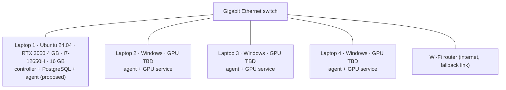
The controller role is proposed for Laptop 1 (native Linux, simplest to keep running); final choice after hardware inventory (V0.2).

**Ports & directories** (V0.3; every value is a setting, these are the defaults)

| What | Default | Setting / owner |
|---|---|---|
| Controller gRPC (`AgentControl`, agents dial out to it; **mutual TLS** since V0.7 G3, node cert required) | `127.0.0.1:47100` — give the controller laptop's LAN IP to serve other laptops | `[controller] grpc_bind` |
| Controller REST (`/healthz`, `/v1/*`; **HTTPS, TLS 1.3** since V0.7 G3, client cert optional - agents present theirs on `/v1/blobs`; mutations, jobs and blobs need the fabric token, schema at `/v1/openapi.json`) | `127.0.0.1:47110` | `[controller] http_bind` |
| Wildcard / public bind | refused | `[controller] allow_any_bind = true` (or `--allow-any-bind`) |
| Agent identity (`node.key`, `node.json`, `identity.lock`; ADR-0013) | `<data dir>/identity` — Linux `~/.local/share/meshforge/identity`, Windows `%LOCALAPPDATA%\MeshForge\identity` | `data_dir` (`common.config`) |
| Fabric token (D44, ADR-0014; `0600` / owner-only ACL, created on first start, refuses to start if loose or malformed) | `<data dir>/controller/fabric.token` (+ `fabric.token.lock`) | `[controller] token_file`; `meshforge-controller token show\|rotate` |
| Controller blob store (D48; V0.5 D79 two-level CAS layout) | `<data dir>/controller/blobs/sha256/<aa>/<bb>/<64 hex>` (read-only files; the V0.4 `sha256/<aa>/<hex>` layout is moved at start), one-shot uploads in `…/blobs/tmp/*.part` (swept at start), resumable part uploads in `…/blobs/tmp/resume-<hex>.part` + `.part.chunks` (kept across restarts, swept after 24 h) | `[controller.blobs] dir / max_blob_bytes` |
| Agent blob cache (V0.5 D79/D84) | `<data dir>/cas/sha256/<aa>/<bb>/<64 hex>` (read-only), `cas/tmp/` for writes and resumable fetches, `cas/trees.idx` (V0.5 G4: complete trees, one id per line, re-checked at start); free-disk floor 1 GiB; quota enforced by GC passes (`[agent.gc]`, V0.5 G5). V0.6 D109: `compute run` on the same laptop (same user, same `data_dir`) also writes here - verified blobs via the same `CasStore`, and `blob` rows in `<data dir>/gc/gc.sqlite`; it never creates the folder (no agent cache = no seeding) | `agent/cas/store.py` defaults; `[agent.cache] page_items / flush_s / snapshot_interval_s / rescan_s / max_trees`; `[agent.fetch] per_source / slow_source_factor / slow_min_units / endgame_after_s / request_timeout_s` |
| **Agent peer blob server** (V0.5 G4, D97; **TLS 1.3 with the node cert, client cert required** since V0.7 G3) | TCP **47120**, **off until `bind` is set**; must be a LAN/loopback IP (wildcard refused unless `allow_any_bind`). Open it on the **LAN firewall profile only** (OPERATIONS §0d) | `[agent.peer] bind / port / allow_any_bind / advertise_host / max_connections / max_requests_per_conn / header_bytes / idle_timeout_s / min_send_rate_bytes_s / tree_cache_entries` |
| Network probes (V0.6 G4, D111) | the peer port **47120** (`GET /v1/probe`, probe token); controller schedule in memory, seeded from `network_link.measured_at` when the prober starts (the per-pair interval holds across a controller restart), results in `network_link`; at most 48 MiB/min of probe traffic fabric-wide, each pair every 15 min | `[controller.network] enabled / probe_interval_s / probe_gap_s / probe_jitter / probe_budget_bytes_per_min / probe_bytes / probe_max_bytes / probe_fast_s / rtt_samples / probe_timeout_s / token_ttl_s / busy_cpu_percent / cpu_sample_max_age_s / min_bw_bytes_s / ewma_alpha / stale_after_s (>= 1.5 x probe_interval_s) / transfer_min_bytes / transfer_history`; agent `[agent.peer] probe_max_bytes`, `[agent.probe] enabled / request_timeout_s / deadline_s` |
| **Fabric CA** (V0.7 G1, D134; ECDSA P-256, 10 y) | `<data dir>/controller/ca/ca.key` + `ca.crt` (folder `0700`, files `0600` / owner-only ACL; the pair is installed by renaming a fully written hidden folder `.ca.new-*` into place, a replaced one goes aside as `.ca.old-*` and is deleted; leftovers swept at the next create), `<data dir>/controller/ca.lock`. Never leaves the controller host; back it up offline | `meshforge-controller fabric create [--force]` / `fabric show [--json]` (no setting: always under `data_dir`) |
| **Controller server certificate** (V0.7 G1, D134; served on 47100/47101/47110 since G3, renewed while running) | `<data dir>/controller/tls/server.key` + `server.crt` (same folder rules and swap as the CA), `<data dir>/controller/tls.lock`; issued at `fabric create` and checked at every start (re-issued with a fresh key when missing, unusable, from another CA, SANs changed, or ≥ 2/3 of its life used) | `[controller.tls] extra_sans` (≤ 32 host names / IPs, no wildcards) / `server_cert_days` (365, 1-825) / `check_interval_s` (3600, 1-86400; G3) |
| **Security mode** (V0.7 G3, D139) | `[security] mode = "mtls"` (default) or `"insecure-dev"` (plaintext, loopback-only, warning banner) - one key for controller, agent and CLI; CLI trust `[cli] ca_file` / `compute --ca` | `[security] mode`, `[cli] ca_file` |
| **Enrolment listener** (V0.7 G2, D150; kept in G3 - see §16 deviation) | TCP **47101** (TLS, server cert + CA chain, no client cert; only `Enrollment/Enroll`; started only when a CA exists) | `[controller.enroll] bind` (default `<grpc_bind host>:47101`, LAN/loopback rule), `advertise` (host:port written into codes), `invite_ttl_s` (900, 60-86400), `rate_per_minute` (10) / `rate_burst` (5) / `max_tracked_sources` (4096), `enabled` |
| **Node enrolment** (V0.7 G2, D136) | agent: `<data dir>/identity/node.crt` + `ca.crt` beside `node.key` (`0600` / owner-only ACL, written under `identity.lock`); controller: `join_token`, `audit_event`, `node.cert_*` (migration 0015) | `meshforge-agent join`, `identity show|reset`; `meshforge-controller fabric invite|invites`, `compute fabric invite|invites|join` |
| Peer-token signing key (V0.5 G4, D98) | `<data dir>/controller/peer_signing.key` (Ed25519 PKCS#8 PEM, `0600` / owner-only ACL, created on first start, refuses to start if loose or malformed; + `.lock`). Keep it: deleting it invalidates every peer token in flight (peers then 403 and the controller serves) | `[controller] peer_key_file`; `[controller.jobs] max_peer_sources / peer_token_ttl_s`; `[controller] trust_peer_endpoints` |
| Controller attempt logs (V0.4 G5, D71) | `<data dir>/controller/logs/<attempt_id>.{stdout,stderr}` (folder `0700`): the live bytes appended by offset, replaced by the verified final log at the attempt's end; `<attempt_id>.gaps` (V0.5 G3, D94): JSON record of the live gaps, rewritten atomically on each new gap and at the attempt's end (removed when no un-replaced stream has a gap), read back after a controller restart. GC (D94): every `log_gc_interval_s` the files of attempts whose job is terminal and unchanged for `log_retention_s` (7 d) are deleted, plus stale `.*.tmp`; a non-terminal job's files never | `[controller.jobs] max_log_bytes / log_queue_chunks / log_subscriber_queue / max_log_subscribers / log_retention_s / log_gc_interval_s / log_gc_batch` |
| Upload grants and blob-store admission (D73) | in memory, per attempt (a controller restart invalidates them; V0.6 D114: re-minted after Reconcile and the upload resumes - agent retry budget `[agent.execution] upload_retry_s` 120 s, part size `upload_part_bytes` 8 MiB) | `[controller.jobs] max_output_bytes / max_output_blobs`, `[controller.blobs] max_concurrent_uploads / upload_wait_s / free_disk_floor_mb` |
| Agent live-log queue and caps (D71/D75) | in memory: `[agent] log_queue_chunks` (256 x <= 64 KiB, separate from the replay ring); per-stream log cap `[agent.execution] max_log_bytes` (64 MiB, then a marker line); final status re-send `terminal_resend_s` (5 s) | `[agent]`, `[agent.execution]` |
| `compute get` destination (D74) | `./outputs/<job_id>/` (refuses a non-empty folder without `--force`; `--force` swaps in atomically after a verified download and refuses cwd/ancestors/home/root) | `compute get --dest` |
| `compute` fabric token (never logged, never in a URL) | `--token-file` > `[cli] token` / `MESHFORGE_CLI__TOKEN` > `[cli] token_file` > the local controller's own `fabric.token` | `[cli]` |
| Agent hardware scores (roadmap 0.3.4; brief §5g D34/D35) | `<data dir>/scores.json` (last `ScoreSet` + fingerprint inputs, atomic write; corrupt ⇒ warning + re-score) and `<data dir>/scores.lock` (one scorer at a time; never deleted). Measured by `python -m meshforge.agent.benchmarks.child` processes at lowered priority - no port | `[agent.scores] enabled / start_delay_s / budget_s / case_timeout_s / cache_poll_s`; `meshforge-agent hardware score [--force]` |
| Agent → controller target | `[agent] controller_address = "host:port"`; empty = mDNS discovery | `[agent] controller_address` (or `meshforge-agent run --controller`) |
| Controller discovery (mDNS/DNS-SD, roadmap 0.3.9) | UDP `5353` multicast (`224.0.0.251` / `ff02::fb`), service type `_meshforge-ctl._tcp.local.`, TXT `node=controller`; the record carries the gRPC bind IP + port. Agents accept only LAN/loopback addresses from records | `[controller.discovery] advertise` (default true), `[agent.discovery] enabled / timeout_s / service_type` |
| PostgreSQL (dev) | `127.0.0.1:5432` | `[database]` |
| Dev background-service assets (roadmap 0.3.13) | `deploy/systemd/*.service` (systemd **user** units), `deploy/windows/meshforge-agent-task.xml` (Task Scheduler). Installed by hand only — `scripts/print_service_setup.py` *prints* the commands and changes nothing (D17) | [`docs/OPERATIONS.md`](OPERATIONS.md) |
| Agent attempt workdirs (V0.4 G4, D63-2/D67) | `<data dir>/work/<attempt_id>/` (root and each dir `0700`; logs in `.meshforge/{stdout,stderr}.log`, requirements in `.meshforge/deps`); deleted after the final status is acked, leftovers removed at agent start | `[agent.execution] workdir_root / keep_workdirs` |
| Job containers (D51/D63-6) | labels `meshforge.managed=1`, `meshforge.agent=<node_id>`, `meshforge.attempt_id`, `meshforge.role` (`setup`/`run`/`probe`/`envbuild`); containers with this agent's label are swept at its start | `docker ps -a --filter label=meshforge.managed=1` |
| Cached job environments (V0.5 G2, D86) | `<data dir>/envs/{venv,subprocess}/<env hash>/` (read-only), builds in `<hash>.building`, `locks/<hash>.lock`, `staging/`, `uv-cache/` (root `0700`); Docker: images `meshforge-env:<env hash>` (labels `meshforge.env_hash`, `meshforge.base`). No GC before V0.5 G5 | `[agent.envs] dir / max_env_bytes / free_disk_floor_mb / find_links / no_index / index_url`; `meshforge-agent prepare` |
| GC index, pins and leases (V0.5 G5, D91) | agent `<data dir>/gc/gc.sqlite` (+ `gc-owners/<owner>.lock`, one per running process); controller `<data dir>/controller/gc/gc.sqlite` | `[agent.gc] enabled / cas_bytes (20 GiB) / envs_bytes (30 GiB) / interval_s (600) / min_age_s (300) / batch`; `[controller.gc] enabled / cas_bytes (100 GiB) / min_age_s (1 day) / interval_s (3600) / batch / scrub_bytes_per_s (32 MiB/s) / scrub_interval_s (1 day)` |
| Env removed by GC (V0.5 G5) | `envs/{venv,subprocess}/<hash>.gc-<id>` (renamed aside, deleted at once; a leftover is swept by the next pass) | - |
| `compute node prepare` scratch (V0.5 G5) | `<data dir>/prepare/<id>/requirements.txt`, deleted after each env | - |
| Named inputs in a job's folder (V0.5 G5, D92) | `<data dir>/work/<attempt_id>/<mount>` read-only (files `0444`, folders `0555`); the workdir is removed with a remover that restores write bits | manifest `inputs` |
| Blob URL agents fetch from (D67) | `http://<host the agent dialled>:<REST port>` unless set | `[controller.api] advertise_url` |
| Agent log file on Windows (Task Scheduler has no console) | `%LOCALAPPDATA%\MeshForge\agent.log`, set in the task's command line; not rotated in V0.3 | `docs/OPERATIONS.md` §3 |

Spike ports (V0.2) live in 472xx–473xx and never collide with these.

---

## 24. Cross-platform strategy

- **Agent runs natively on Windows** (not inside WSL) — avoids WSL2 NAT/inbound problems; psutil, NVML, gRPC, PyTorch all work natively. Windows service in product; background task in dev.
- **Workloads on Windows** run in Docker Desktop (Linux containers, GPU through WSL2 backend) when available, else native venv.
- **Agents dial out** to the controller → no inbound port needed for the control plane. Peer blob servers and GPU services need inbound ports → firewall rules created by installer (documented manual step before V0.17).
- CI runs unit tests on both Linux and Windows.

---

## 25. Observability

- Structured JSON logs with `job_id`, `attempt_id`, `node_id`, `session_id` correlation fields.
  An event carries the ids that *exist* when it is logged: `controller.jobs.placement_refused` has `node_id` but no `job_id` - a refused submission never creates a job (D50), so there is no id to correlate on (V0.4 D62-5).
- Dashboard: live node metrics, job timelines, planner explanations, benchmark results.
- Metrics (optional, later): Prometheus endpoint on controller (queue length, RPC latency, transfer rate, decision latency, failure rate).

---

## 26. Honest limits

- Combined GPU never equals the full sum of GPUs; gain depends on work type and network. Measured and reported, not promised.
- Mode 2/4 support PyTorch workloads via SDK/`torch.export`; arbitrary CUDA programs are out of scope.
- Mode 3 requires the task to be declared divisible.
- The fabric depends on the controller laptop being on; controller failover is future work.
- venv runtime isolation is weaker than containers (documented; Docker preferred).
- Network shaping for benchmarks is easiest on Linux (`tc netem`); Windows conditions rely on real Wi-Fi/Ethernet variation.

---

## 27. Open questions

| # | Question | Resolved by |
|---|---|---|
| Q1 | Hardware of laptops 2–4 (GPUs, VRAM, Windows version) | team → `docs/LAB.md` (V0.2) |
| Q2 | gRPC vs raw TCP for tensor transport | spike S3 (V0.2) |
| Q3 | `torch.distributed` gloo across Windows↔Linux usable? | spike S5 (V0.2) |
| Q4 | Docker Desktop GPU reliability on team Windows laptops | spike S6 (V0.2) |
| Q5 | Agent access for AI agents to Windows laptops (SSH / Claude Code / human relay) | team |
| Q6 | Final product name | team (any time) |
