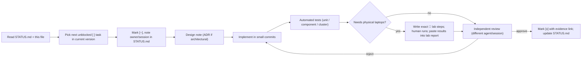
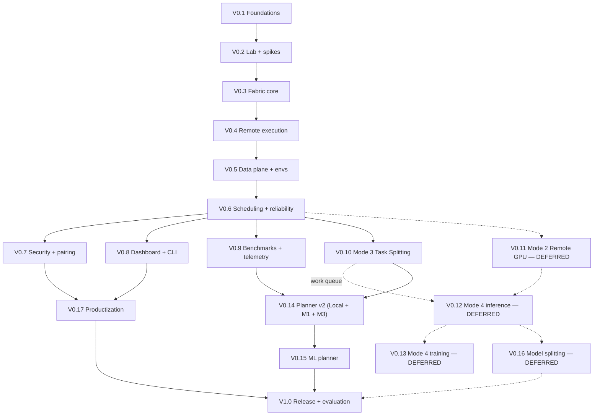

# DEVELOPMENT ROADMAP — MeshForge Compute Fabric

> **Status:** v1 — **Approved by team** (2026-09-15)
> **Nature:** a living plan and progress tracker — **not** a rigid spec. When reality disagrees, update this file (and log it in [Design change log](#design-change-log)).
> **Reads with:** [`PROJECT_BRIEF.md`](PROJECT_BRIEF.md) · [`ARCHITECTURE.md`](ARCHITECTURE.md) · [`STATUS.md`](STATUS.md) · [`adr/`](adr/)
> **Budget (2026-09-20):** ~**10 weeks**, one Claude account, ~9 sessions/week → **~90 sessions**. Scope is set by
> [ADR-0012](adr/0012-scope-ship-mode3-complete.md): **ship Mode 3 complete and production-grade** (Mode 1 is its
> foundation), with the AI planner, telemetry, security and dashboard **in full**. Mode 2 and Mode 4 are **deferred**.
> Superseded: the original "no deadline, scope is never cut for time" rule. Quality bar is *polished, finished, really working*.

---

## Live status

| Field | Value |
|---|---|
| **Current version** | **V0.3 — started 2026-09-20 (group G1: 0.3.1, 0.3.2, 0.3.7 logic)** while V0.2 waits on 🧑 lab runs; V0.2 — in progress (started 2026-09-15); V0.1 code-complete, awaiting 🧑 GitHub CI proof (0.1.4, 0.1.10) |
| **Current task** | **All V0.2 agent-side spike code is complete** (S1, S2, S3, S6, S7 — each tester PASS + reviewer APPROVE; **0.2.13 `[x]`** — report CLIs merge instead of overwriting prose). Everything now waits on 🧑 lab runs. **0.2.8 (S4) / 0.2.9 (S5) deferred with Mode 2 — [ADR-0012](adr/0012-scope-ship-mode3-complete.md).** Next agent-side work is **V0.3**, blocked on the 🧑 inventory of laptops 2–4. |
| **Parallel human tasks** | hardware inventory of laptops 2–4 (**blocking**) · approve ADR-0012 · GitHub push + CI proof · buy Ethernet switch · decide ADR-0011 |
| **Blockers** | See [Blockers & problems](#blockers--problems-discovered) |
| **Next recommended task** | 🧑 `lab/inventory.py` on laptops 2–4 (confirms the hardware ADR-0012 rests on) · 🧑 team approval of [ADR-0012](adr/0012-scope-ship-mode3-complete.md) · 🧑 GitHub push + CI proof. Agent-side (0.2.10 and 0.2.13 closed): the S3-review follow-up (promote `spikes._s1.protocol` into `_harness/`), then 0.2.12 **once real lab data lands**, then **V0.3**. |

**Legend:** `[ ]` not started · `[~]` in progress · `[x]` completed (**only** after tests + success criteria pass, with evidence) · `[-]` dropped (reason logged) · 🧑 = requires a human on physical hardware · 🔬 = spike / measurement.

---

## Contents
- [How agents use this roadmap](#how-agents-use-this-roadmap)
- [Milestones & dependency graph](#milestones--dependency-graph)
- [Quality gates (apply to every version)](#quality-gates-apply-to-every-version)
- **M1 — Foundation:** [V0.1](#v01--foundations--engineering-system) · [V0.2](#v02--lab-setup--feasibility-validation) · [V0.3](#v03--fabric-core-controller--agent)
- **M2 — Mode 1 product:** [V0.4](#v04--remote-execution-core-mode-1-foundation) · [V0.5](#v05--data-plane--environments) · [V0.6](#v06--scheduling--reliability--mode-1-complete) · [V0.7](#v07--security--pairing) · [V0.8](#v08--dashboard--cli-v1) · [V0.9](#v09--benchmark--telemetry-system-v1)
- **M3 — Parallel:** [V0.10](#v010--mode-3-task-splitting) *(V0.11/V0.12/V0.13 deferred — ADR-0012)* · [V0.11](#v011--mode-2-remote-gpu) · [V0.12](#v012--mode-4-combined-gpu--inference) · [V0.13](#v013--mode-4-combined-gpu--training)
- **M4 — Intelligence:** [V0.14](#v014--unified-planner-v2) · [V0.15](#v015--ml-planner)
- **M5 — Product:** *(V0.16 deferred — ADR-0012)* [V0.16](#v016--model-splitting-mode-4-stage-3) · [V0.17](#v017--productization) · [V1.0](#v10--release-hardening--final-evaluation)
- [Cross-cutting tracks](#cross-cutting-tracks) · [Risk register](#risk-register) · [Blockers](#blockers--problems-discovered) · [Design change log](#design-change-log)

---

## How agents use this roadmap



**Rules**
1. Work top-down within a version; tasks may run in parallel when they have no dependency.
2. Never start a version before the previous version's **success criteria** are re-checked (or the dependency graph explicitly allows parallel work).
3. `[x]` requires **evidence**: test run output, CI link, or lab report path (`lab/reports/…`). No evidence → not done.
4. Every 🧑 task must state: which laptops, exact commands, expected output, and what to paste back.
5. Implementers never approve their own work.
6. Architectural decisions → `docs/adr/`. Scope/order changes → this file's [Design change log](#design-change-log).
7. Success thresholds marked *(calibrate)* are initial targets; revise them once V0.2 measurements exist, and log the change.

---

## Milestones & dependency graph

| Milestone | Versions | Outcome |
|---|---|---|
| **M1 Foundation** | V0.1–V0.3 | Repo, lab, measured constraints, live fabric of real laptops |
| **M2 Mode 1 product** | V0.4–V0.9 | Finished Job Offloading: fast, cached, reliable, secure, UI, benchmark data flowing |
| **M3 Parallel** | V0.10 | **Task Splitting (Mode 3)** — the shipped mode. V0.11–V0.13 (Mode 2, Mode 4) **deferred, ADR-0012** |
| **M4 Intelligence** | V0.14–V0.15 | Cost-based planner over Local + Mode 1 + Mode 3, then **ML-assisted** |
| **M5 Product** | V0.17–V1.0 | Installers, hardening, final evaluation. V0.16 (model splitting) **deferred, ADR-0012** |


After V0.6, up to four tracks can proceed in parallel (security, UI, benchmarks, Mode 3/Mode 2) — useful when several agent sessions work at once.

---

## Scope & budget (ADR-0012, 2026-09-20)

**Decision:** ship **Mode 3 (Task Splitting)** complete and production-grade — nothing stubbed. Mode 1 ships with it,
because Mode 3 is Mode 1 extended from one laptop to many. The **AI planner, telemetry, security and dashboard are kept
in full**. **Mode 2 (V0.11) and Mode 4 (V0.12/V0.13/V0.16) are deferred** and revisited once Mode 3 is finished.

**Budget:** ~10 weeks × ~9 sessions × 5 h ≈ **90 sessions**; realistic capacity **140–180 tasks** (measured rate, with
the token-efficiency rules below). **Target ≈ 1.5 tasks per session.**

| # | Block | Tasks | Running |
|---|---|---|---|
| 1 | V0.3 fabric core (controller ⇄ agent) | 15 | 15 |
| 2 | V0.4 remote execution core (Mode 1) | 15 | 30 |
| 3 | V0.5 data plane & environments — full | 11 | 41 |
| 4 | V0.6 scheduling & reliability (Mode 1 complete) | 13 | 54 |
| 5 | **V0.9 telemetry & benchmarks** *(pulled before V0.10)* | 10 | 64 |
| 6 | **V0.10 Mode 3 task splitting** | 10 | 74 |
| 7 | V0.14 planner v2 (Local + M1 + M3) | 8 | 82 |
| 8 | **V0.15 ML planner** | 10 | 92 |
| 9 | V0.7 security & pairing — full | 11 | 103 |
| 10 | V0.8 dashboard & CLI v1 — full | 10 | 113 |
| 11 | V0.17 productization | 8 | 121 |
| 12 | V1.0 release hardening & final evaluation | 8 | **129** |

**129 tasks against 140–180 capacity — 11–51 tasks of margin**, deliberately held for lab-coordination delays,
hardware failures and the ML planner needing more telemetry than expected.

**Why V0.9 moves before V0.10:** V0.15 needs thousands of telemetry runs to train on. Built late, there is no training
data at the end. Built early, data accumulates throughout Mode 3 development.

**If the budget collapses toward ~5 weeks**, cut in this fixed order: V1.0 → V0.17 → thin V0.8 to a read-only
dashboard → drop V0.5 polish (0.5.6 named inputs, 0.5.9 GC). **V0.10, V0.15 and V0.9 are never cut — they are the
project.** If margin survives instead, the stretch is **V0.11 (Mode 2)**.

**Token-efficiency rules (half the reason this fits):** one *coherent group* per implementer run, not one task ·
front-load each brief with the standing objection checklist so reviews pass in 1–2 rounds · the Lead makes doc edits
and small mechanical fixes directly, with no subagent · run the ~6-minute component suite once per task group, not
once per agent.

---

## Quality gates (apply to every version)

A version is **complete** only when all apply:

```text
[ ] all tasks [x] (or [-] with logged reason)
[ ] lint + type-check clean; CI green on Linux and Windows
[ ] unit + component tests pass; coverage of new core logic ≥ 80 %
[ ] cluster tests pass (multi-process local fabric with fault injection) where relevant
[ ] 🧑 lab test on real laptops passes where relevant; report saved in lab/reports/
[ ] failure behaviour exercised (not just the happy path)
[ ] logs verified (correlation IDs present, no secrets)
[ ] telemetry recorded for new execution paths
[ ] docs updated (ARCHITECTURE, ADRs, user-facing docs, STATUS)
[ ] every success criterion below demonstrated with evidence
```

**Test tiers:** `unit` (pure logic) · `component` (real gRPC/DB/Docker, one process each) · `cluster` (controller + N agents as local processes, Toxiproxy faults) · `lab` 🧑 (real laptops) · `gpu` (needs NVIDIA GPU) · `e2e` (UI, Playwright) · `soak` / `chaos` (long-running).
**Test rules (0.1.8):** a test's tier = its first folder under `tests/` (auto-marked; mismatch or missing tier fails collection) · `lab`, `gpu`, `soak`, `chaos` run only with `--run-<tier>` · Docker-dependent tests use the `docker` marker / `docker_available` fixture and skip cleanly without Docker · Postgres tests use the shared `pg_settings` fixture (one container per session, fresh database per test) · all warnings are errors; default timeout 300 s.

---

# M1 — FOUNDATION

## V0.1 — Foundations & engineering system

**Objective:** a repository where AI agents can work safely and consistently: tooling, CI, conventions, contracts, dev database, docs.

**Concepts introduced:** monorepo package layout · lockfiles · protobuf contracts & codegen · schema migrations · structured logging · test tiers · CI on two OSes.
**Dependencies:** Git, GitHub, uv, Python 3.12, Docker (for Postgres), grpcio-tools, ruff, mypy, pytest.
**Prerequisites:** team approval of ARCHITECTURE + this roadmap.

**Tasks**
- [x] **0.1.1** `git init`, `.gitignore`, `.gitattributes` (LF), README, license decision 🧑(team decided 2026-09-15: no license file for now; private GitHub repo, human pushes) — *evidence: commit `chore(0.1.1)`, reviewer APPROVE; git check-ignore/check-attr verified*
- [x] **0.1.2** `pyproject.toml` with uv; extras `controller`, `agent`, `gpu`; dev tools as uv dependency group `dev`; Python 3.12 pinned — *evidence: commit `build(0.1.2)`, tester PASS (fresh `uv sync --locked`, extras resolve incl. Windows, py3.11/3.13 rejected), reviewer APPROVE*
- [x] **0.1.3** package skeleton `src/meshforge/{common,controller,agent,gpu_service,sdk,cli}`; entry points `compute`, `meshforge-controller`, `meshforge-agent` — *evidence: commit `feat(0.1.3)`, tester PASS (48 tests incl. clean base-only install), reviewer APPROVE*
- [~] **0.1.4** import-boundary check (controller ⟂ agent; sdk → common only) enforced in CI — *check done (commit `test(0.1.4)`, tester PASS, reviewer APPROVE after fix round); stays [~] until the 0.1.10 CI job runs it*
- [x] **0.1.5** `proto/meshforge/v1/{common,agent,gpu}.proto` skeletons + codegen script; generated code reproducible — *evidence: commit `feat(0.1.5)`, tester PASS (determinism incl. CRLF/space paths, real grpc.aio bidi session + GPU unary on localhost, base-install import, FailureType parity 22/22), reviewer APPROVE after fix round*
- [x] **0.1.6** `common/`: config (pydantic-settings: TOML + env), IDs (ULID), structlog JSON logging with correlation fields, error base classes, SHA-256 helpers — *evidence: commit `feat(0.1.6)`, tester PASS round 3 (334 unit tests in tests/unit/common incl. redaction attack + linear-time perf gates), reviewer APPROVE round 3*
- [x] **0.1.7** `deploy/docker-compose.dev.yml` (PostgreSQL 16) + SQLAlchemy base + Alembic baseline migration — *evidence: commit `feat(0.1.7)`, tester PASS (README flow verbatim, 13 component tests on real PG 16 incl. upgrade→downgrade→re-upgrade, offline --sql, special-char passwords), reviewer APPROVE*
- [x] **0.1.8** pytest config with markers (`unit component cluster lab gpu e2e`), testcontainers fixture for Postgres — *evidence: commits `test(0.1.8)` + `fix(0.1.8)`; tester PASS (fresh copy + plain `uv sync` → `pytest -m unit` 594–604 passed / 0 failed; Docker-less full run 0 failed; import guard, gpu/slow rules; DEFECT-0.1.8-01 container leak fixed: SIGINT ×1/×2, SIGTERM, SIGKILL, pytest-timeout signal+thread, next-run sweep — no leaked containers), reviewer APPROVE (2 rounds)*
- [x] **0.1.9** ruff + mypy (strict on `common`, `controller`, `agent`) + pre-commit — *evidence: commit `build(0.1.9)`, tester PASS (pre-commit rejected lint/type/boundary/private-key/large-file/CRLF bad commits in scratch repo; good commit passes), reviewer APPROVE*
- [~] **0.1.10** GitHub Actions: lint, types, unit (Linux + Windows), component (Linux) — *workflow done: local tester PASS (every ci.yml step reproduced in fresh copy; SHA pins verified; bad lint/type/boundary each fail their step), reviewer design OK; stays [~] until 🧑 first real GitHub run is green incl. Windows*
- [x] **0.1.11** `CONTRIBUTING.md` for agents: task template, commit convention, PR/review checklist, evidence rules — *evidence: commit `docs(0.1.11)`, reviewer APPROVE (docs-only, commands reconciled with 0.1.8–0.1.10)*
- [x] **0.1.12** docs scaffold: `STATUS.md`, `adr/README.md` + initial ADRs, `LAB.md` template — *evidence: commit `docs(0.1.12)`, reviewer APPROVE (docs-only, tester skipped per CLAUDE.md §4b)*

**Testing:** CI pipeline itself; smoke test `compute --version`; migration up/down on empty DB.
**Success criteria**
1. Fresh clone → `uv sync` → `pytest -m unit` passes on Linux **and** Windows.
2. CI green on `main`; a deliberately bad commit (lint/type/import-boundary) is rejected.
3. `alembic upgrade head` and `downgrade base` succeed on a clean PostgreSQL.
4. Proto codegen is deterministic (regenerating produces no diff).

**Deliverable:** clean skeleton repository with guardrails.
**Unlocks:** V0.2 (lab scripts live in `lab/`), V0.3 (contracts + config + DB ready).

---

## V0.2 — Lab setup & feasibility validation

**Objective:** make the four laptops a controlled lab and **measure the real constraints** before committing to designs that depend on them.

**Concepts introduced:** bandwidth/latency measurement · experiment reproducibility · GPU driver/CUDA stack · container GPU access · tensor serialization cost · collectives.
**Dependencies:** NVIDIA drivers, PyTorch CUDA builds, Docker / Docker Desktop, NVIDIA Container Toolkit, iperf3, gigabit switch + cables.
**Prerequisites:** V0.1 (repo for `lab/` scripts).

**Tasks**
- [~] **0.2.1** 🧑 Fix NVIDIA driver on Laptop 1 (Secure Boot MOK enrollment); verify `nvidia-smi` + `torch.cuda.is_available()` — *driver fixed 2026-09-19: `nvidia-smi` → RTX 3050 Laptop GPU, driver 595.91.07, 4096 MiB, compute cap 8.6, Secure Boot still enabled; `torch.cuda.is_available()` pending torch install (ADR-0011 / 0.2.3)*
- [~] **0.2.2** `lab/inventory.py` — cross-platform hardware/software inventory → JSON; 🧑 run on all 4 laptops → `docs/LAB.md` — *code done: commit `feat(0.2.2)`, tester PASS round 2 (798 unit; lab unit+component 234 passed incl. adversarial tree-kill, privacy, 60 s run budget), reviewer APPROVE; stays [~] until 🧑 runs on all 4 laptops (JSON in `lab/reports/inventory/`) incl. Windows tree-kill check*
- [ ] **0.2.3** 🧑 GPU stack on every NVIDIA laptop: driver, PyTorch CUDA wheel check (decide per-platform torch index via `[tool.uv.sources]` — PyPI Windows torch is CPU-only; add ADR + startup CUDA check), Docker (Desktop on Windows) + GPU container test `docker run --gpus all … nvidia-smi`
- [ ] **0.2.4** 🧑 Network: switch + cables, DHCP reservations/hostnames, Windows firewall profile set to Private; record link speeds
- [~] **0.2.5** 🔬 **S1** network matrix: iperf3 all pairs (Wi-Fi and Ethernet), RTT, jitter, loss → `lab/reports/YYYY-MM-DD-S1-network.md` — *code done: `lab/spikes/s1_network.py` + shared `_harness/` (commit `feat(0.2.5)`); tester PASS round 2, reviewer APPROVE after fix round 3 (312 unit, 52 component S1 tests); stays [~] until 🧑 Wi-Fi + Ethernet matrices are run on all 4 laptops (needs 0.2.4 switch)*
- [~] **0.2.6** 🔬 **S2** cross-OS reachability: native Windows Python gRPC + HTTP server reachable from Linux and vice-versa, without WSL — *code done: `lab/spikes/s2_crossos.py` (serve / client / report) + `_s2/` + `S2.md` + `lab/README.md` S2 subsection (commits `wip(0.2.6)` ×8, `feat(0.2.6)` `633d474`); tester round 1 pinned 6 defects (port sharing via SO_REUSEPORT, start/stop race, warmup errors demoting verdicts, NaN blob size, serve Ctrl-C exit code, malformed case entries), round 2 confirmed the fixes and found 1 shared-harness crash (`_harness/report.py`, fixed, covered in `test_spike_report.py`); reviewer REQUEST_CHANGES ×4 (a loopback run rendered as a real cross-OS row → `⚠ same machine` marker + caveats + outbound-only TBD; idle death time measured when noticed not when it happened → `failed_at` stamp; operator declaration phrased as measurement → reworded, `client_listens`/`basis`; every result-file field guarded against corrupt shapes) then APPROVE on pass 5 (1033 unit, 42 S2 component, whole lab suite 226 component green); real loopback runs recorded in `S2.md` §5 — loopback bounds the tool, not the question; stays [~] until 🧑 two-laptop runs Windows↔Linux, both directions, Wi-Fi **and** Ethernet (procedure in `lab/spikes/S2.md` §3, incl. the Windows second-`serve` check)*
- [~] **0.2.7** 🔬 **S3** transport throughput: gRPC bytes streaming vs raw TCP vs HTTP range, 1 MB → 2 GB → decides tensor/data transport (update ADR-0003/0005) — *code done: `lab/spikes/s3_transport.py` + `_s3/` + `S3.md` + `lab/README.md` S3 subsection (commits `wip(0.2.7)` ×3, `feat(0.2.7)` `81d620f`); tester PASS (24 adversarial tests), reviewer APPROVE on the second pass after 3 blocking fixes (245 unit, 62 component); real loopback run verified end to end (exit 0, report renders, limit probe correct) — loopback bounds the tool, not the link; stays [~] until 🧑 two-laptop runs on Wi-Fi **and** Ethernet (procedure in `lab/spikes/S3.md` §2; needs 0.2.4 switch for the Ethernet half)*
- [ ] ~~**0.2.8**~~ **DEFERRED (ADR-0012, with Mode 2)** — 🔬 **S4** `torch.export` round-trip: export ResNet-50 / BERT-base on one laptop, load and run on another laptop's GPU; verify equality; measure per-call latency vs payload
- [ ] ~~**0.2.9**~~ **DEFERRED (ADR-0012, with Mode 2)** — 🔬 **S5** collectives: `torch.distributed` gloo all-reduce Windows↔Linux; if unusable, minimal TCP ring prototype; measure 10 MB / 100 MB all-reduce
- [~] **0.2.10** 🔬 **S6** environments: Docker Desktop GPU PyTorch container on Windows; uv venv creation time with/without cache — *code **done** 2026-09-20: `lab/spikes/s6_environments.py run|report` + `_s6/` + `lab/spikes/S6.md`; commits `f7b094c` `f3364b8` `bfce2fa` `fb9376a`; **tester PASS (no defects, 16 adversarial tests)**, **reviewer APPROVE (no blocking findings)**. Cases: docker-facts (pre-case block) · docker-start · docker-pull-cold · docker-gpu-smi · docker-gpu-torch · venv-cold · venv-warm · venv-start. Real Laptop 1 (Linux) run in `lab/reports/2026-09-20-S6-environments.md`: GPU **is** visible in a container (nvidia-smi 361 ms), cold pull 9.7 s, venv cold 3.56 s vs warm 0.10 s — every §5 number cross-checked byte-for-byte against the raw JSON. **Stays `[~]`:** `docker-gpu-torch` was skipped as typed `insufficient_disk` (5.8 GB free, image ~3.7 GB), so `torch-cuda-in-container` is **TBD on every laptop**, Q4 is unanswered, and Windows/Docker Desktop has **zero** evidence. Closes when the 🧑 Windows runs on Laptops 2–4 and a Laptop 1 re-run with ≥ ~11 GB free are pasted back (procedure: `lab/spikes/S6.md` §2)*
- [~] **0.2.11** 🔬 **S7** hardware scores: CPU GFLOPS, memory bandwidth, GPU fp32/fp16 TFLOPS micro-benchmarks per laptop — *code done: `lab/spikes/s7_hardware.py` + `_s7/` + `S7.md` (commit `feat(0.2.11)`); tester PASS (69 adversarial tests), reviewer APPROVE after one fix round (280 unit, 29 component); GPU/torch paths covered only by fake-torch tests until ADR-0011 torch install; stays [~] until 🧑 real runs on all 4 laptops (check `threads_effective == cpu count` for memory-bandwidth and `allow_tf32 == false` for gpu-float32)*
- [x] **0.2.13** Spike report CLIs must not destroy hand-written prose: `report --out <existing file>` rewrites the whole file from `TEMPLATE.md`, blanking human sections (Goal, Background load, Commands run, Conclusion). Affects all five CLIs — `s6_environments.py:338`, `s2_crossos.py:581`, `s7_hardware.py:325`, and S1/S3 via `atomic_write_text`. Fix once, shared: refuse an existing `--out` without `--force`, or preserve the human-written sections. — *raised by the 0.2.10 reviewer (non-blocking #1); it nearly cost the S6 prose once* — ***done 2026-09-20:** shared `write_report(path, text, force=)` in `_harness/report.py`, called by all five CLIs (all now atomic). An existing `--out` is **merged** (generated regions from the fresh render, human regions from disk, `WriteResult` prints which were kept); a malformed file or another spike's report is **refused** with a typed `ReportMergeError` and left byte-identical; `--force` regenerates. Tester round found 3 defects (glued human table dropped · lone surrogate → traceback · UTF-8 BOM refused forever), all fixed in `2fd3185`; reviewer **APPROVE**, no blocking findings; follow-ups #1/#3 applied by the Lead. Commits `e23d762` `ac5a65f` `2fd3185` + final. Gates: ruff + mypy clean, lab unit **1313 passed**, component suite green (see STATUS). Pure tooling — no 🧑 step. Documented loss: hand-edits *inside* a generated region (e.g. host-table speed/power cells) are replaced (`lab/README.md`).*
- [ ] **0.2.12** Consolidate findings: update ADRs, ARCHITECTURE open questions, and *(calibrate)* thresholds in this roadmap; choose controller laptop

**Testing:** every spike is a script under `lab/spikes/` producing a machine-readable result + markdown report; each run ≥ 5 repetitions with mean/stdev.
**Success criteria**
1. All NVIDIA laptops pass `nvidia-smi`, `torch.cuda.is_available()`, and GPU-in-container checks (or documented exception with fallback).
2. `docs/LAB.md` lists full inventory and the measured network matrix for Wi-Fi and Ethernet.
3. Every open question Q2–Q4 in ARCHITECTURE §27 has a recorded answer and decision.
4. Calibrated thresholds for V0.5, V0.10–V0.13 written into this roadmap.

**Deliverable:** working lab + evidence-based design constraints.
**Unlocks:** V0.3 on real hardware; informs transport, collectives, and all performance targets.

---

## V0.3 — Fabric core: controller ⇄ agent

**Objective:** real laptops form a live fabric — persistent identity, registration, hardware discovery, resource streaming, failure detection, automatic reconnection.

**Concepts introduced:** persistent node identity (keypairs) · bidirectional gRPC streaming · leases & failure detection · exponential backoff with jitter · reconciliation · resource time-series · mDNS discovery.
**Dependencies:** grpcio (aio), psutil, nvidia-ml-py, zeroconf, SQLAlchemy async, Toxiproxy (tests).
**Prerequisites:** V0.1; V0.2 S2 (cross-OS reachability) passed.

**Tasks**
- [~] **0.3.1** `agent.proto`: `Session` bidi stream; messages Hello, Heartbeat, ResourceUpdate, Command, Ack, Reconcile
- [~] **0.3.2** Agent identity: keypair + `node_id` generated on first start, stored in OS-appropriate data dir with restricted permissions
- [ ] **0.3.3** Hardware discovery: CPU model/cores/threads, RAM, disks, OS, GPU(s) via NVML (model, VRAM, driver, compute capability), software versions
- [ ] **0.3.4** Hardware scores from S7 micro-benchmarks, run at first enrollment and on demand
- [ ] **0.3.5** Resource monitor: CPU %, RAM, GPU util, VRAM free, disk free every 2 s; change-threshold reporting
- [ ] **0.3.6** Controller gRPC server (grpc.aio) + session manager; node registry tables; one process hosting FastAPI + gRPC
- [~] **0.3.7** Liveness: heartbeat 2 s, lease 3 × heartbeat; states ONLINE / SUSPECT / OFFLINE per ARCHITECTURE §12.3
- [ ] **0.3.8** Agent reconnect with exponential backoff + jitter; Reconcile message on reconnect
- [ ] **0.3.9** Controller discovery: explicit address in config, fallback mDNS
- [ ] **0.3.10** RTT to controller measured on heartbeat; stored
- [ ] **0.3.11** Persist resource snapshots (live buffer + downsampled history)
- [ ] **0.3.12** REST `GET /v1/nodes`, `/v1/nodes/{id}`; CLI `compute nodes`, `compute status` (Rich tables, `--json`)
- [ ] **0.3.13** Run as background service in dev: systemd user unit (Linux); scheduled task / NSSM (Windows) — documented
- [ ] **0.3.14** Cluster test harness: start controller + N agents as local processes, fault injection (kill, pause, network cut via Toxiproxy)
- [ ] **0.3.15** 🧑 Lab test on 4 laptops (script + checklist in `lab/`)

**Testing:** unit (lease/state logic) · component (real gRPC session) · cluster (5 agents; kill/pause/partition) · lab 🧑 · soak (24 h).
**Success criteria**
1. All 4 laptops appear with hardware matching `docs/LAB.md`.
2. Network cable pulled → node OFFLINE within **≤ 8 s**; restored → ONLINE within **≤ 10 s** with no agent restart.
3. Controller killed and restarted → all agents reconnect within **≤ 15 s**, no manual action.
4. Agent restart keeps the same `node_id`.
5. 24 h soak on Ethernet: zero false OFFLINE events; agent RSS growth < 10 %.

**Deliverable:** `compute nodes` shows a live, self-healing fabric of real laptops.
**Unlocks:** V0.4 (commands can be sent to nodes).

---

# M2 — MODE 1 PRODUCT

## V0.4 — Remote execution core (Mode 1 foundation)

**Objective:** submit a project from one laptop; it runs isolated on a chosen laptop; logs stream live; outputs return.

**Concepts introduced:** job & attempt state machines · manifests · sandboxing · log streaming · idempotent submission · cancellation · phase telemetry.
**Dependencies:** Docker SDK for Python, zstandard, WebSockets (FastAPI), NVIDIA Container Toolkit.
**Prerequisites:** V0.3 complete.

**Tasks**
- [ ] **0.4.1** Manifest schema (`compute.yaml`, Pydantic) with validation, defaults, inferred entrypoint when absent
- [ ] **0.4.2** Source bundling with ignore rules (`.gitignore`, `.computeignore`), deterministic tar + zstd, SHA-256
- [ ] **0.4.3** Upload to controller store (simple path; CAS arrives in V0.5)
- [ ] **0.4.4** Job, Attempt tables + transition module enforcing ARCHITECTURE §12 state machines
- [ ] **0.4.5** `POST /v1/jobs` with `Idempotency-Key`; manual placement `--node`; local placement `--local`
- [ ] **0.4.6** Dispatcher → `StartAttempt` command; agent executor: fetch, unpack, run
- [ ] **0.4.7** Runtime interface + **Docker runtime** (limits: CPU, RAM, pids; workdir-only mount; non-root user) + subprocess fallback
- [ ] **0.4.8** GPU pass-through (`resources.gpu`) via NVIDIA Container Toolkit / Docker Desktop
- [ ] **0.4.9** Log streaming agent → controller → client (WebSocket), persisted log file
- [ ] **0.4.10** Exit code + declared outputs collected, uploaded, downloadable
- [ ] **0.4.11** Cancel (graceful then forced) and timeout enforcement
- [ ] **0.4.12** Phase timings (queue, stage, env, run, collect) + start snapshots recorded per attempt
- [ ] **0.4.13** CLI: `compute run`, `jobs`, `logs -f`, `cancel`, `get`
- [ ] **0.4.14** Example workloads in `workloads/examples/` (CPU script, PyTorch GPU training script)
- [ ] **0.4.15** 🧑 Lab: run examples from Laptop 1 on each other laptop

**Testing:** component (executor + Docker) · cluster · lab 🧑.
**Success criteria**
1. Example CPU and GPU projects run on every node type; outputs byte-identical to local runs (deterministic workloads).
2. Log lines appear on the client **≤ 1 s** after being printed remotely.
3. Cancel stops the workload **≤ 5 s**; timeout enforced within 2 s of limit.
4. Repeated `POST` with the same `Idempotency-Key` → one job, one execution.
5. Sandbox test: workload cannot read/write outside its workdir or see host processes.
6. Every attempt has complete phase timings in the DB.

**Deliverable:** working whole-job offload with manual placement.
**Unlocks:** V0.5 (make it fast), V0.6 (make it automatic and robust).

---

## V0.5 — Data plane & environments

**Objective:** move code, data, and models efficiently and safely; reuse environments; never transfer or build twice.

**Concepts introduced:** content-addressed storage · Merkle tree manifests · have/need negotiation · HTTP range & resumable transfer · peer-to-peer fetch · cache location index · environment hashing · LRU GC.
**Dependencies:** httpx/aiohttp, uv (venv runtime), Docker build cache.
**Prerequisites:** V0.4; S3 transport decision.

**Tasks**
- [ ] **0.5.1** CAS store (controller + agents): write-then-rename, verify on read, chunking for large files
- [ ] **0.5.2** Tree manifests; client uploads only missing blobs (have/need)
- [ ] **0.5.3** Peer blob HTTP server in agent (range GET, short-lived tokens); fetch from nearest holder
- [ ] **0.5.4** Parallel chunked download, resume after interruption, integrity check
- [ ] **0.5.5** Cache reports → controller location index (blobs, envs, images per node)
- [ ] **0.5.6** Named, versioned inputs (datasets/models registered once, referenced by name@hash)
- [ ] **0.5.7** Environment builder: env hash; Docker image per env hash; **venv runtime (uv)** with same interface
- [ ] **0.5.8** Base images `python-cpu`, `cuda-pytorch`; `compute node prepare` pre-pulls
- [ ] **0.5.9** GC: LRU with per-node quota; pinned items
- [ ] **0.5.10** Transfer telemetry (bytes, source node, throughput, cache hit/miss)
- [ ] **0.5.11** 🧑 Lab: multi-GB dataset tests on Wi-Fi and Ethernet

**Testing:** kill transfer mid-way and resume; inject corrupted chunk; cache-hit tests; GC under quota pressure; lab 🧑.
**Success criteria**
1. Resubmitting an unchanged project transfers **0 bytes** of source/data; changing one file transfers only that file.
2. 5 GB transfer on Ethernet reaches **≥ 80 %** of iperf3-measured bandwidth *(calibrate)*.
3. Interrupted transfer resumes without re-sending completed chunks.
4. A corrupted blob is detected and never used.
5. Warm env cache: job start overhead **≤ 3 s** *(calibrate)*; cold build time recorded.
6. Data fetched from a peer when the peer is closer/faster than the controller.

**Deliverable:** fast, cached, integrity-checked Mode 1.
**Unlocks:** V0.6 (cache-aware planning), V0.11 (model blobs for GPU sessions).

---

## V0.6 — Scheduling & reliability — Mode 1 complete

**Objective:** automatic placement across many laptops and robust behaviour under failure; Mode 1 reaches finished functional quality.

**Concepts introduced:** queues & slots · candidate/feasibility/cost/policy pipeline · baseline policies · network matrix probing · fencing tokens · at-least-once + dedupe · crash recovery & reconciliation · failure taxonomy.
**Dependencies:** none new.
**Prerequisites:** V0.5.

**Tasks**
- [ ] **0.6.1** Per-node slots (CPU/GPU concurrency) + global pending queue with priorities
- [ ] **0.6.2** Planner v1 pipeline: candidate generator (Local + Mode 1 per node) → feasibility filter (OS, RAM, VRAM, GPU, disk, runtime, owner settings)
- [ ] **0.6.3** Policies: `random`, `round_robin`, `least_loaded`, `strongest_suitable`, `resource_score`, `cache_affinity`; selectable globally and per job
- [ ] **0.6.4** Analytical estimator v0: missing-bytes/bandwidth, env cache state, history-based compute time
- [ ] **0.6.5** Decision records (candidates, rejections + reasons, estimates) + `compute explain <job>`
- [ ] **0.6.6** Peer network probes (scheduled, rate-limited) → network matrix table
- [ ] **0.6.7** Node loss → attempt LOST → retry per failure-type policy; **fencing tokens** reject stale reports
- [ ] **0.6.8** Controller crash recovery: rebuild from DB + agent Reconcile; running attempts adopted, not duplicated
- [ ] **0.6.9** Command delivery at-least-once with agent-side dedupe
- [ ] **0.6.10** Failure taxonomy (`user_error`, `oom`, `vram_oom`, `env_error`, `disk_full`, `lost`, `timeout`, `infra_error`) everywhere
- [ ] **0.6.11** Local execution path via the submitting laptop's own agent
- [ ] **0.6.12** Chaos suite in cluster harness (random kills, partitions, controller restarts)
- [ ] **0.6.13** 🧑 Lab: 100-job mixed run on 4 laptops with scripted disruptions

**Testing:** unit (policies, feasibility, estimator) · cluster chaos · lab 🧑.
**Success criteria**
1. 100 mixed jobs across 4 laptops with random agent kills: **0 lost, 0 duplicated** executions; all reach correct terminal states.
2. Controller `kill -9` with 20 running jobs → after restart every job reaches the correct state; no duplicate runs.
3. `compute explain` shows every candidate, rejections with reasons, and predicted breakdown.
4. For a tiny job whose transfer dominates, planner selects **Local** (test case).
5. All baseline policies selectable and covered by tests.

**Deliverable:** Mode 1 functionally complete (security in V0.7, UI in V0.8).
**Unlocks:** parallel tracks V0.7 · V0.8 · V0.9 · V0.10 · V0.11.

---

## V0.7 — Security & pairing

**Objective:** only enrolled devices participate; all traffic authenticated and encrypted; workloads constrained.

**Concepts introduced:** PKI / fabric CA · CSR enrollment · one-time join tokens · mTLS · revocation · least privilege · secret handling · threat modelling.
**Dependencies:** `cryptography`, gRPC TLS credentials, TLS for HTTP servers.
**Prerequisites:** V0.6 (identity keypairs from V0.3 already exist).

**Tasks**
- [ ] **0.7.1** `docs/THREAT_MODEL.md`
- [ ] **0.7.2** `compute fabric create` → CA keypair, fabric record
- [ ] **0.7.3** `compute fabric invite` → short-lived single-use join code (address + token + CA fingerprint); QR in dashboard later
- [ ] **0.7.4** `compute fabric join <code>` → CSR → signed node cert; secure storage
- [ ] **0.7.5** mTLS on agent gRPC; TLS + node-cert auth on peer blob servers; scoped short-lived tokens
- [ ] **0.7.6** REST user authentication + CLI credential storage
- [ ] **0.7.7** Revocation + certificate rotation
- [ ] **0.7.8** Owner policy per node: accept jobs / accept GPU sessions / CPU-RAM-GPU caps
- [ ] **0.7.9** Sandbox hardening: no privileged containers, dropped capabilities, read-only base, optional no-network jobs
- [ ] **0.7.10** Job secrets (injected as files/env; redacted in logs)
- [ ] **0.7.11** Security test suite + review against threat model

**Testing:** negative tests (unenrolled/revoked/expired), packet capture check, sandbox escape attempts, log redaction tests.
**Success criteria**
1. Unenrolled agent cannot connect; revoked node rejected within one heartbeat.
2. Join code works once and expires as configured.
3. Packet capture shows no plaintext job data or credentials on any plane.
4. Secrets never appear in logs or telemetry.
5. Security suite green; threat-model review items closed or accepted with rationale.

**Deliverable:** secure fabric with real pairing.
**Unlocks:** V0.11 GPU services inherit mTLS/tokens; V0.17 installers.

---

## V0.8 — Dashboard & CLI v1

**Objective:** a professional, infrastructure-grade UI and polished CLI for operating the fabric.

**Concepts introduced:** SPA served by controller · live updates over WebSocket · design system · e2e testing.
**Dependencies:** React, TypeScript, Vite, TanStack Query, Tailwind + Radix, Recharts, Playwright.
**Prerequisites:** V0.6 (APIs stable); V0.7 for auth screens (can integrate when ready).

**Tasks**
- [ ] **0.8.1** Design system: dark default, neutral grays, one accent, typography scale, status colours, spacing tokens (per brief §24)
- [ ] **0.8.2** App shell, auth, routing, API client (generated from OpenAPI)
- [ ] **0.8.3** Overview page (fabric health, nodes online, active jobs, utilization)
- [ ] **0.8.4** Nodes list + node detail (capabilities, live metrics, network links, caches, owner settings)
- [ ] **0.8.5** Jobs list + job detail (plan explanation table, timeline, terminal-style logs, artifacts, attempts)
- [ ] **0.8.6** Settings (fabric, invite/join code + QR, revoke, policies)
- [ ] **0.8.7** Live updates via WebSocket (≤ 2 s latency)
- [ ] **0.8.8** CLI polish: consistent output, `--json`, shell completion, helpful errors
- [ ] **0.8.9** Playwright e2e suite against a cluster-harness fabric
- [ ] **0.8.10** 🧑 Visual review against brief §24 checklist

**Success criteria**
1. Every Mode 1 operation available from the UI and the CLI.
2. Live metrics update within 2 s; UI remains responsive with 4 nodes × 100 jobs history.
3. e2e suite green; no console errors; keyboard navigation for core flows.
4. 🧑 Team visual review passes (no "AI-dashboard" styling, per brief).

**Deliverable:** dashboard v1 + polished CLI. Later versions add their own pages.
**Unlocks:** V0.10–V0.15 UI pages; V0.17 first-run wizard.

---

## V0.9 — Benchmark & telemetry system v1

**Objective:** automatically generate large, labelled, reproducible performance datasets from real executions.

**Concepts introduced:** experiment design · parameter-space sampling · controlled conditions · forced-strategy runs · measured labels · data quality checks.
**Dependencies:** pandas/pyarrow, numpy; Linux `tc netem` for shaping.
**Prerequisites:** V0.6.

**Tasks**
- [ ] **0.9.1** Finalize telemetry schema (attempt summary, phase timings, start snapshots, network matrix, cache state) + Parquet export
- [ ] **0.9.2** Workload library (parametrized): CPU (matmul, primes, sort, compression, hashing, numerical), memory (arrays, dataframes, copies), GPU (matmul, conv, tensor ops, image processing), ML (CNN inference/training, transformer inference; batch/model/sequence sweeps)
- [ ] **0.9.3** Campaign spec (YAML) + samplers (random, Latin hypercube) over params × conditions × strategies × nodes
- [ ] **0.9.4** Forced-strategy execution via planner override, tagged `benchmark`, randomized order, repetitions
- [ ] **0.9.5** Condition controllers: CPU/GPU load generators, cache warm/cold, queue pressure, network shaping (Linux), Wi-Fi vs Ethernet sessions, node-unavailable scenarios
- [ ] **0.9.6** Automatic labels per group: full measured cost vectors + best measured plan
- [ ] **0.9.7** Unattended, resumable, throttled campaign runner; "don't disturb owner" guard
- [ ] **0.9.8** Data quality report: variance (CV), outliers, missing fields
- [ ] **0.9.9** Benchmarks page in dashboard
- [ ] **0.9.10** 🧑 Overnight campaign on the lab

**Success criteria**
1. Unattended campaign of **≥ 1,000 runs** across 4 laptops with **< 2 %** infrastructure failures.
2. Export reproducible (same campaign ID → same dataset rows).
3. Each configuration has ≥ 3 repetitions and reported CV.
4. Every later mode version adds its benchmark families here (tracked in cross-cutting tracks).

**Deliverable:** benchmark system + first real dataset.
**Unlocks:** V0.14 calibration, V0.15 ML.

---

# M3 — PARALLEL & GPU MODES

## V0.10 — Mode 3 Task Splitting

**Objective:** divide one task into sub-tasks across many laptops, run them, and combine results — correct, balanced, and fault-tolerant.

**Concepts introduced:** work queues with leases · pull-based load balancing · straggler mitigation (speculative execution) · makespan · deterministic combine.
**Dependencies:** none new.
**Prerequisites:** V0.6 (V0.9 recommended for benchmarks).

**Tasks**
- [ ] **0.10.1** `split:` manifest spec (over glob/list/range/dataset shards; chunk size; combine = concat / merge-csv / merge-json / script)
- [ ] **0.10.2** **Shared work-queue module** (chunks, leases, visibility timeout, idempotent completion) — reused by Mode 4
- [ ] **0.10.3** Planner: Mode 3 candidates (node sets), rate estimates, chunk size, "don't split" comparison
- [ ] **0.10.4** Per-node worker: one env prep, many chunks; chunk-level input staging (only needed files)
- [ ] **0.10.5** Stragglers: speculative duplicates of tail chunks; first result wins, idempotent
- [ ] **0.10.6** Lost node → chunk leases expire → re-queued
- [ ] **0.10.7** Ordered, deterministic combine step
- [ ] **0.10.8** Progress per chunk/node (CLI progress bar, dashboard page)
- [ ] **0.10.9** Mode 3 benchmark families
- [ ] **0.10.10** 🧑 Lab: heterogeneous 3–4 laptop runs with a node killed mid-way

**Success criteria**
1. 3,000-image classification split over 3 heterogeneous laptops produces output **identical** to a single-laptop run.
2. Makespan **≤ 1.25 ×** the ideal Σ-throughput bound *(calibrate)*.
3. Speedup vs best single laptop **≥ 2.0 ×** on 3 laptops for CPU/GPU-bound tasks *(calibrate)*.
4. Killing one laptop mid-run still yields correct, complete output.
5. Planner picks "don't split" when splitting is predicted slower (test case).

**Deliverable:** Mode 3 finished.
**Unlocks:** V0.12 (work queue), V0.14.

---

## V0.11 — Mode 2 Remote GPU

> **DEFERRED — [ADR-0012](adr/0012-scope-ship-mode3-complete.md) (2026-09-20).** Not in the 10-week
> plan. Kept in full as the future-work record; architecture and ADRs stay valid. Revisit **first** once Mode 3 is complete and margin remains: Mode 4 extends Mode 2, so this is the step that moves the team's original goal forward. Costs its full 13 tasks (GPU service, tensor codec, `torch.export` path).

**Objective:** a program on one laptop uses another laptop's GPU for real PyTorch computation, efficiently and safely.

**Concepts introduced:** GPU sessions · remote tensor handles & lifetimes · tensor serialization without pickle · `torch.export` · call pipelining · VRAM admission control · typed remote errors.
**Dependencies:** PyTorch (CUDA), torch.export; GPU nodes from V0.2.
**Prerequisites:** V0.5 (model blobs), V0.6; V0.7 for mTLS on GPU plane (can integrate when ready); S3/S4 results.

**Tasks**
- [ ] **0.11.1** GPU service process: managed by agent, own uv venv (torch+CUDA), health checks, crash restart
- [ ] **0.11.2** `gpu.proto`: OpenSession, PutTensor(stream), LoadModule, Call, GetTensor(stream), Free, CloseSession; session leases
- [ ] **0.11.3** Tensor codec: raw bytes + dtype/shape/strides, chunked, optional fp16/bf16 compression; never pickle
- [ ] **0.11.4** Remote handles: refcounts, session GC, VRAM accounting
- [ ] **0.11.5** Module offload via `torch.export` blobs (CAS-cached on GPU nodes)
- [ ] **0.11.6** SDK: `mf.remote_gpu("auto"|node)`, `RemoteModule`, `RemoteTensor`, `.to_local()`; sync + async APIs; call pipelining
- [ ] **0.11.7** AcceleratorRequest → planner placement (local GPU / remote GPU / CPU) with reasons
- [ ] **0.11.8** Admission control: VRAM reservations, max sessions per GPU, owner caps, local-user priority
- [ ] **0.11.9** Errors: remote CUDA OOM → typed exception; disconnect → `SessionLost` with optional reopen; timeouts
- [ ] **0.11.10** Per-call telemetry (bytes in/out, RTT, remote compute time)
- [ ] **0.11.11** Communication-heavy benchmark families
- [ ] **0.11.12** *Stretch:* `torch.compile` backend shipping FX graphs (transparency level 4)
- [ ] **0.11.13** 🧑 Lab: GPU-less/weak laptop drives inference and a training loop on a remote GPU

**Success criteria**
1. ResNet-50 and BERT-base inference via Remote GPU: outputs match local reference (**atol 1e-4**, fp32).
2. Measured call time within **20 %** of the bandwidth+compute model prediction *(calibrate)*.
3. Remote OOM surfaces as a clear typed exception; killing the GPU laptop never hangs the client beyond the configured timeout.
4. Two clients share one GPU safely under VRAM limits.
5. Speedup over local CPU demonstrated for compute-heavy cases; planner keeps small/chatty cases local.

**Deliverable:** Mode 2 finished for PyTorch module-level workloads.
**Unlocks:** V0.12.

---

## V0.12 — Mode 4 Combined GPU — inference

> **DEFERRED — [ADR-0012](adr/0012-scope-ship-mode3-complete.md) (2026-09-20).** Not in the 10-week
> plan. Kept in full as the future-work record; architecture and ADRs stay valid. Requires V0.11 **and** V0.10's work queue — ~87 tasks in total, against Mode 3's ~64. Also bounded by ~4 GB VRAM per card.

**Objective:** a program on one laptop uses all laptops' GPUs as one combined GPU for inference over large inputs.

**Concepts introduced:** multi-session pools · replication · heterogeneous batch sharing · ordered streaming combine · member failure recovery.
**Dependencies:** V0.11 runtime; V0.10 work queue.
**Prerequisites:** V0.11 (V0.10 for the shared queue).

**Tasks**
- [ ] **0.12.1** `mf.combined_gpu(nodes="auto")` pool (includes local GPU as a member)
- [ ] **0.12.2** Parallel model replication (CAS cached)
- [ ] **0.12.3** `pool.map(model, dataset, batch_size)` and batch-split call `pool(model)(big_batch)`
- [ ] **0.12.4** Heterogeneous sharing via shared work queue with per-member in-flight window
- [ ] **0.12.5** Ordered streaming combine
- [ ] **0.12.6** Member failure → in-flight batches reassigned; slow-member demotion
- [ ] **0.12.7** Planner: member selection (drop net-negative links), speedup prediction, single-GPU fallback
- [ ] **0.12.8** Combined GPU dashboard page
- [ ] **0.12.9** Benchmark families
- [ ] **0.12.10** 🧑 Lab: 3–4 GPU runs on Ethernet and Wi-Fi

**Success criteria**
1. Results identical and in order vs single-GPU reference.
2. Throughput with all GPUs on Ethernet **≥ 75 %** of the sum of individually measured throughputs for compute-heavy batch workloads *(calibrate)*.
3. Across the benchmark suite, planner never chooses a pool slower than the best single GPU by more than **10 %**.
4. Killing a member mid-run → job still completes correctly.

**Deliverable:** Combined GPU inference finished.
**Unlocks:** V0.13, V0.16.

---

## V0.13 — Mode 4 Combined GPU — training

> **DEFERRED — [ADR-0012](adr/0012-scope-ship-mode3-complete.md) (2026-09-20).** Not in the 10-week
> plan. Kept in full as the future-work record; architecture and ADRs stay valid. Requires V0.12. The most research-grade work in the plan.

**Objective:** train one model using all laptops' GPUs together, with results equivalent to single-GPU training.

**Concepts introduced:** data parallelism · all-reduce (coordinator, ring) · sample-weighted gradient averaging · gradient compression · checkpoint/resume · synchronization cost modelling.
**Dependencies:** S5 decision (gloo vs custom ring).
**Prerequisites:** V0.12.

**Tasks**
- [ ] **0.13.1** `pool.train(...)` high-level API + `pool.step(batch)` custom-loop API
- [ ] **0.13.2** Replica initialization + parameter broadcast
- [ ] **0.13.3** All-reduce v1 (coordinator reduce) → v2 (ring over TCP, or gloo per S5); optional fp16 gradients
- [ ] **0.13.4** Heterogeneous batch shares with sample-weighted averaging
- [ ] **0.13.5** Periodic checkpoint to Laptop A; resume with remaining members after failure
- [ ] **0.13.6** Sync-overhead telemetry; planner decides when training pool is worthwhile
- [ ] **0.13.7** Benchmark families (models × batch × network)
- [ ] **0.13.8** 🧑 Lab: ResNet-18/CIFAR-10 and a small transformer on Ethernet and Wi-Fi

**Success criteria**
1. Pooled training reaches the same accuracy (**± 1 %**) as single-GPU training with identical global batch/hyperparameters.
2. Step-time speedup on Ethernet ≥ *(calibrate from S5)* for compute-heavy models.
3. Member failure mid-epoch → training continues from last checkpoint automatically.
4. On Wi-Fi where pooling is slower, planner correctly keeps training on a single GPU.

**Deliverable:** Combined GPU training finished.
**Unlocks:** V0.14.

---

# M4 — INTELLIGENCE

## V0.14 — Unified planner v2

> **RE-SCOPED — [ADR-0012](adr/0012-scope-ship-mode3-complete.md) (2026-09-20).** Compares **Local + Mode 1 + Mode 3**
> only, since Mode 2 and Mode 4 are deferred. The `AcceleratorRequest` candidate space (0.14.1) and any
> prerequisite on V0.13 fall away; everything else stands. Prerequisites become **V0.9 + V0.10**.

**Objective:** one planner comparing **every mode this build ships** (Local, Mode 1, Mode 3) with calibrated analytical cost models and clear explanations.

**Concepts introduced:** unified candidate spaces · set enumeration with pruning · model calibration from telemetry · risk-adjusted cost · decision regret · oracle comparison.
**Prerequisites:** V0.9, V0.10, V0.13.

**Tasks**
- [ ] **0.14.1** Unified candidate generation: JobRequest (Local, M1 × nodes, M3 × node-sets) and AcceleratorRequest (local, M2 × GPUs, M4 × GPU-sets)
- [ ] **0.14.2** Pruning (dominated sets, infeasible links) keeping decision latency low
- [ ] **0.14.3** Analytical cost models per ARCHITECTURE §7, parameters calibrated from telemetry
- [ ] **0.14.4** Reliability-based risk penalty
- [ ] **0.14.5** Objectives: min completion time (default), min network usage, prefer-local
- [ ] **0.14.6** Scheduler/decision page: candidate table with predicted breakdown vs actual
- [ ] **0.14.7** Offline evaluator: replay benchmark dataset → regret vs oracle for every policy
- [ ] **0.14.8** 🧑 Lab validation runs with fresh (unseen) workloads

**Success criteria**
1. On held-out benchmark groups, chosen plan within **15 %** of oracle in **≥ 80 %** of cases *(calibrate)*.
2. Mean regret lower than every rule baseline.
3. Decision latency **< 100 ms** for 4 nodes.
4. Every decision explainable in UI and `compute explain`.

**Deliverable:** unified, explainable, cost-based planner.
**Unlocks:** V0.15.

---

## V0.15 — ML planner

**Objective:** machine learning improves cost predictions from real telemetry, measurably beating the analytical planner — with safe fallback.

**Concepts introduced:** supervised regression on tabular data · group-wise cross-validation · leakage prevention · quantile/uncertainty estimation · OOD detection · model registry · online retraining · ablation studies.
**Dependencies:** scikit-learn, XGBoost, LightGBM.
**Prerequisites:** V0.14 + sufficient telemetry (≥ several thousand runs across families).

**Tasks**
- [ ] **0.15.1** Dataset builder from telemetry; group splits by workload family
- [ ] **0.15.2** Feature pipeline (workload, hardware scores, load, network, cache)
- [ ] **0.15.3** Targets: compute time per node, env time, per-mode overhead residuals, failure probability
- [ ] **0.15.4** Model comparison: linear/ridge, tree, random forest, XGBoost, LightGBM, kNN (+ quantile variants)
- [ ] **0.15.5** Uncertainty + OOD detection → fallback to analytical
- [ ] **0.15.6** Planner integration as cost-component predictors; decision records store predictor version
- [ ] **0.15.7** Model registry, versioning, scheduled retraining
- [ ] **0.15.8** Evaluation report: MAPE, regret vs analytical/rules/oracle, ablations, feature importance
- [ ] **0.15.9** Dashboard: predicted vs actual, model versions
- [ ] **0.15.10** Optional experiment: direct strategy classifier vs cost-regression (for the report)

**Success criteria**
1. ML-hybrid planner reduces mean regret vs analytical v2 on held-out workload groups, reported with 95 % confidence intervals.
2. Never worse than fallback beyond a set tolerance on any benchmark family.
3. Retraining automated and reproducible.

**Deliverable:** AI scheduler integrated with real execution telemetry.
**Unlocks:** V1.0 evaluation.

---

# M5 — ADVANCED & PRODUCT

## V0.16 — Model splitting (Mode 4 stage 3)

> **DEFERRED — [ADR-0012](adr/0012-scope-ship-mode3-complete.md) (2026-09-20).** Not in the 10-week
> plan. Kept in full as the future-work record; architecture and ADRs stay valid. Requires V0.12.

**Objective:** run a model larger than any single GPU's memory by splitting its layers across GPUs.

**Concepts introduced:** layer profiling · memory-constrained partitioning (dynamic programming) · pipeline execution · activation transfer · micro-batching.
**Prerequisites:** V0.12.

**Tasks**
- [ ] **0.16.1** Per-block time/memory profiler per GPU
- [ ] **0.16.2** DP partitioner minimising bottleneck stage subject to VRAM and link costs
- [ ] **0.16.3** Pipeline executor across GPU services; micro-batching
- [ ] **0.16.4** Supported family: sequential models, transformer block stacks (incl. common Hugging Face models)
- [ ] **0.16.5** Failure → replan; planner candidate when model > any VRAM
- [ ] **0.16.6** 🧑 Lab: model exceeding the largest single GPU's VRAM

**Success criteria**
1. A model larger than any single available GPU runs across ≥ 2 GPUs with reference-equal outputs.
2. Partitioner beats equal-layer split in throughput on heterogeneous GPUs.

**Deliverable:** model-splitting capability inside Combined GPU.

---

## V0.17 — Productization

**Objective:** installable, self-running software on Windows and Linux with a first-run experience that needs no terminal.

**Concepts introduced:** OS services · installers · bundled runtimes · upgrade/uninstall · first-run UX.
**Prerequisites:** V0.7, V0.8.

**Tasks**
- [ ] **0.17.1** Windows installer: bundled Python runtime, agent as Windows service, firewall rules, NVIDIA/Docker checks
- [ ] **0.17.2** Linux packages (.deb and/or AppImage) + systemd service
- [ ] **0.17.3** Controller install incl. managed PostgreSQL
- [ ] **0.17.4** First-run wizard (create fabric / join fabric with code or QR)
- [ ] **0.17.5** Settings UI: resource caps, GPU sharing, node name
- [ ] **0.17.6** Upgrade path and clean uninstall
- [ ] **0.17.7** User documentation (install, pairing, running workloads, SDK)
- [ ] **0.17.8** 🧑 Fresh-machine install tests

**Success criteria**
1. A fresh Windows laptop goes from download to joined fabric in **< 10 minutes** with no terminal use.
2. Uninstall leaves no running services or firewall rules.
3. Install/upgrade/uninstall tested on fresh machines for both OSes.

**Deliverable:** installable product.

---

## V1.0 — Release hardening & final evaluation

**Objective:** everything re-verified on the release build; the system proven stable, secure, and measurably intelligent.

**Tasks**
- [ ] **1.0.1** Full acceptance re-run of V0.3–V0.17 success criteria on release build
- [ ] **1.0.2** 72 h soak + chaos campaign
- [ ] **1.0.3** Performance profiling & tuning pass
- [ ] **1.0.4** Final security review
- [ ] **1.0.5** Documentation complete (user guide, architecture, API reference, ADRs)
- [ ] **1.0.6** Final evaluation: research question with all baselines, CIs, ablations (report/paper-ready)
- [ ] **1.0.7** Scripted demonstration scenarios for every mode
- [ ] **1.0.8** Release tag + changelog

**Success criteria**
1. All acceptance criteria pass on the release build.
2. 72 h soak: no crashes, leaks, or lost jobs.
3. Evaluation report complete with reproducible experiment scripts.

**Deliverable:** MeshForge v1.0.

---

## Cross-cutting tracks

| Track | Starts | Rule |
|---|---|---|
| **Telemetry** | V0.4 | every new execution path records phase timings + snapshots |
| **Benchmarks** | V0.9 | every mode version adds its benchmark families |
| **Dashboard** | V0.8 | every mode version adds its page |
| **Security** | V0.3 (identity) | every new network endpoint uses mTLS/tokens once V0.7 lands |
| **Docs/ADRs** | V0.1 | architectural change ⇒ ADR; behaviour change ⇒ docs |
| **Testing** | V0.1 | each version extends cluster + lab suites; no regressions allowed |
| **Cross-platform** | V0.1 | CI on Linux + Windows; lab tests always include a Windows node |

---

## Risk register

| # | Risk | Impact | Likelihood | Mitigation | Watch in |
|---|---|---|---|---|---|
| R1 | Too few / weak NVIDIA GPUs in the lab | Mode 2/4 demos weak | Med | inventory early (V0.2); plan around real VRAM; model choice sized to hardware | V0.2 |
| R2 | Windows networking / firewall / Docker Desktop GPU quirks | blocks multi-node work | High | native Windows agent; S2/S6 spikes; documented setup; venv fallback | V0.2–V0.4 |
| R3 | Network too slow for Combined GPU gains | Mode 4 speedup small | Med | Ethernet switch; compression; planner avoids net-negative pools; report honestly | V0.12–V0.13 |
| R4 | `torch.export` fails on some models | Mode 2/4 coverage gaps | Med | supported-model list; fallback to state_dict + registered architectures | V0.11 |
| R5 | Cross-OS collectives (gloo) unusable | training design change | Med | custom TCP ring (S5) | V0.2, V0.13 |
| R6 | Insufficient/noisy telemetry for ML | ML gains unproven | Med | benchmarks from V0.9; repetitions; CV checks; group splits | V0.9, V0.15 |
| R7 | AI-generated code grows opaque | team can't explain system | Med | ADRs, reviews by separate agents, small modules, docs per version | always |
| R8 | Agents can't access Windows laptops directly | slow lab testing | High | SSH/Claude Code on each laptop, or scripted 🧑 steps with paste-back | V0.2 |
| R9 | Controller laptop off/asleep | fabric down | Med | choose always-on laptop; document; failover future work | V0.3 |
| R10 | Docker socket = root-equivalent | security exposure | Med | minimal agent, sandbox hardening, owner policies, threat model | V0.7 |

---

## Blockers & problems discovered

| Date | Item | Status | Owner |
|---|---|---|---|
| 2026-09-15 | Laptop 1 NVIDIA driver not loading (Secure Boot key not enrolled) | **resolved 2026-09-19** (MOK enrolled; driver 595.91.07 works, Secure Boot still on) | team |
| 2026-09-15 | Hardware of laptops 2–4 unknown | open | team |
| 2026-09-15 | AI-agent access to Windows laptops undecided | open | team |
| 2026-09-15 | Ethernet switch not yet purchased | open | team |
| 2026-09-15 | Git repository / GitHub not yet created | local repo created (0.1.1); private GitHub repo + push pending — humans push, agents never push | team |
| 2026-09-15 | Carry-over for V0.3 (from 0.1.7 review): DB statement/lock timeout (`command_timeout`) via `DatabaseSettings`; rule "all DB writes via SQLAlchemy" or `BEFORE UPDATE` trigger for `updated_at`; every `CheckConstraint` needs `name=`; log `store.migrations.failed` with revision; ~~session-scoped Postgres fixture~~ (done in 0.1.8) | open | V0.3 / 0.1.8 |
| 2026-09-15 | Carry-over for V0.3/V0.4 (from 0.1.5): Python `AttemptState` + codec + real parity test (skipped placeholder exists); `MAX_TENSOR_CHUNK_BYTES` constant (V0.11); ~~Hello session epoch~~ (ADR-0002 Updates 2026-09-20) + request_id (V0.3); GPU session_id bound to mTLS peer (V0.11) | open | V0.3 / V0.11 |
| 2026-09-15 | Follow-ups from 0.1.6 (non-blocking): pass scan limit into `redaction._quoted_end`; scrub tracebacks per line / keep tail instead of 64 KiB head; sensitive keys with non-ASCII letters not recognised (xfail pinned); `Authorization=Basic` double `[REDACTED]` cosmetic | open | next logging touch |
| 2026-09-15 | Carry-over for V0.2 (from 0.1.2 review): per-platform torch index — PyPI Windows torch is CPU-only; Linux default pulls CUDA 13 wheels | open | 0.2.3 |
| 2026-09-20 | Follow-ups from the 0.2.10 S6 review (non-blocking, none blocking APPROVE): **(1)** report CLIs overwrite hand-written prose → new task **0.2.13**; **(2)** stronger honesty check than an upper bound on `n` — when a case carries `samples`, cross-check `summary.n == len(samples)` and render INVALID on mismatch (catches a hand-edited `10**9` *and* a truncated sample list, with no arbitrary constant); **(3)** `n_headline`'s `(no valid rows)` branch should also carry the INVALID count, like the mixed branch; **(4)** `TEMPLATE.md:34` hardcodes "n < 5" while all code uses `MIN_VALID_REPS` — wants a placeholder; **(5)** `_s6/run.py` `_cleanup` removes every `s6-` container, so two concurrent S6 runs on one host would kill each other's — a per-run suffix closes it | reviewer APPROVE, 2026-09-20 |
| 2026-09-20 | **ADR-0013** (Proposed): node identity = ECDSA P-256 key + ULID `node_id` minted once, `session_epoch` in the same file, `0700/0600` on POSIX, `icacls` SID-restricted on Windows, partial identity is a fatal error; adds `cryptography` to core deps. P-256 over Ed25519 because grpcio's BoringSSL does not verify Ed25519 certificates by default — a key change at V0.7 would be the redesign ADR-0008 forbids | V0.3 task 0.3.2, prep in `docs/briefs/V0.3-fabric-core.md` D1 | ADR-0013 |
| 2026-09-20 | **ADR-0002 Updates** (Proposed): session epoch fences zombie streams (higher epoch wins, lower/equal rejected), `session_id` on every envelope via `HelloAck`, full-jitter backoff base 0.5 s cap 15 s + gRPC keepalive, bounded replay ring with `Reconcile.replay_from_sequence`, monotonic-clock leases 2 s / 6 s. Closes the 0.1.5 carry-over (Hello session epoch) | V0.3 tasks 0.3.1/0.3.7/0.3.8 | ADR-0002 |
| 2026-09-20 | Follow-ups from the 0.2.13 review (non-blocking, APPROVE): **(1)** ~~`_identity` captured up to the next `·`, so an annotated / re-punctuated meta line was refused as "another spike"~~ **fixed by the Lead** (first token only, message names the `> File:` line); **(2)** a *headerless* `|---|` fragment glued under the last host row makes that row the human table's header, so it appears twice after merge (no loss, cosmetic, stable); **(3)** ~~README silent on the one blind spot~~ **fixed** (blank line before your own table); **(4)** a hand-edited `Author:` on the `> File:` line is reverted every run — consider `--author` on the CLIs; **(5)** CLIs print `cannot write <out>` for every `OSError`, including a read-side `IsADirectoryError` (exit code correct) | reviewer APPROVE, 2026-09-20 |
| 2026-09-20 | Follow-ups from 0.2.6 S2 review (non-blocking, all reviewer passes closed): the server's session hold cap (`MAX_HOLD_S`) ends the stream up to 5 s late because the handler joins its request-reader thread (S2.md §6) — a `done`-aware reader would tighten it; `extra.local` carries no hostname, so same-machine detection compares `host.hostname` with `peer_identity.hostname` (two distinct machines sharing a hostname would be marked same-machine — conservative) | open | 0.2.12 |
| 2026-09-20 | Follow-ups from 0.2.7 S3 review (non-blocking): ~~promote `spikes._s1.protocol` (address rules, framing, `ProtocolError`) into `_harness/`~~ **done 2026-09-20 by the Lead (mechanical move, no behaviour change): `_harness/protocol.py` holds framing + LAN address rules, `_s1/protocol.py` keeps S1's constants and `MeasureError` and re-exports the harness names; S2/S3 import from the harness; `test_harness_protocol_boundary.py` forbids any non-S1 spike importing `spikes._s1`**; prime `payload.crc_of` before `transfers.begin` (a `--warmup 0` run would report a visibly slow first upload); list invalid chunks in `chunk_line`'s "others:" so the sentence and the sweep table agree | open | 0.2.12 |
| 2026-09-15 | Follow-ups from 0.2.2 review (non-blocking): mask UNC / `\\wsl$` user paths in `lab/_inventory/sanitize.py`; `wsl -l -v` decode ignores `WSL_UTF8=1`; runner output cap is post-read (document); pass `_RunState` explicitly if reused as a library (V0.3 agent hardware report); split `probes.py` (801 lines) into hw/sw/collect | open | next lab touch / V0.3 |

---

## Design change log

| Date | Change | Reason |
|---|---|---|
| **2026-09-20** | **Scope set by [ADR-0012](adr/0012-scope-ship-mode3-complete.md): ship Mode 3 complete and production-grade (Mode 1 is its foundation), AI planner + telemetry + security + dashboard in full; **defer Mode 2 (V0.11) and Mode 4 (V0.12/V0.13/V0.16)**; re-scope V0.14 to Local + M1 + M3; move V0.9 before V0.10** | team stated the real constraint (one Claude account, ~10 weeks ≈ 90 sessions). Measured throughput (`git log`: 1.04 tasks/h on V0.1 scaffolding, 0.60 on V0.2 spikes) puts capacity at 140–180 tasks, not 171-and-rising. Mode 3 chosen over the GPU modes because V0.12 requires V0.11 **and** V0.10 (~87 tasks vs ~64), Mode 3 uses the CPU-only Laptop 4, and unequal shares across 2× RTX 3050 + RTX 2050 + CPU give the planner a real optimization problem. Supersedes the "no deadline, never cut scope for time" rule |
| **2026-09-20** | **S4 (0.2.8) and S5 (0.2.9) drop off the critical path**; ADR-0011 no longer gates the plan's spine | both existed for Mode 2 / collectives. torch is still needed for GPU-backed Mode 3 chunks, so ADR-0011 still matters, just not as a blocker |
| 2026-09-15 | Roadmap v1 drafted: 18 versions in 5 milestones | initial plan |
| 2026-09-15 | Four execution modes (1 Job Offloading, 2 Remote GPU, 3 Task Splitting, 4 Combined GPU) replace earlier "ModelPool" framing | team decision (brief §40) |
| 2026-09-15 | Roadmap v1 approved by team; one Claude session per version | team decision |
| 2026-09-15 | Mode 3 and Mode 4-inference share one work-queue abstraction | avoid duplicate logic; natural heterogeneity balancing |
| 2026-09-15 | Team accepted ARCHITECTURE v1 + ADRs 0001–0010; no license file yet; private GitHub repo, agents commit locally, humans push | team decision |
| 2026-09-15 | Dev tools are a uv dependency group `dev`, not an extra | uv-native; synced by default |
| 2026-09-15 | Agent never imports `gpu_service` (separate process, gRPC) — enforced by import-linter + completeness guard `tests/unit/_import_guard.py` | keep torch off the agent; stop silent boundary gaps |
| 2026-09-15 | FailureType = 22 permanent values (adds `vram_oom`, `resource_busy`, `timeout` vs `deadline_exceeded`), mirrored 1:1 in proto with a parity test; BlobRef digest uses `sha256:<hex>` | DB/ML labels are permanent; one text form for digests |
| 2026-09-15 | Log redaction: key-based + value scrubbing (URL creds, Bearer/Basic, key=value) with linear-time scanner and 64 KiB cap, in `common/redaction.py` | secrets never in logs (§16) without log-triggered DoS |
| 2026-09-15 | Test tiers = folders (unit component cluster lab e2e soak chaos); `docker`, `gpu`, `slow` are capability markers; optional-extra imports must follow `pytest.importorskip` | agents can't mis-tier tests; Mode 2/4 tests can be component + gpu; plain `uv sync` must always work |
| 2026-09-15 | Test containers: labelled, atexit + finally cleanup, SIGINT-deferring shield, namespace-safe stale sweep | DEFECT-0.1.8-01 (leak on Ctrl-C); WSL + Windows share one Docker daemon |
| 2026-09-15 | CI: unit job uses plain `uv sync --locked` on Linux + Windows; required check `ci-ok`; actions pinned by commit SHA; Dependabot weekly | criterion 1 honesty; supply-chain safety |
| 2026-09-15 | V0.2 agent-side work (lab scripts, spikes) starts while V0.1 criteria 1–2 wait for the 🧑 GitHub CI run; V0.1 closes when that run is green | lab scripts don't depend on CI; the only V0.1 gap is a human push |
| 2026-09-15 | Lab scripts: stdlib-first, own process group per command + tree kill, one shared run budget (`--timeout`, default 60 s); inventory JSON has a top-level `problems` list for human-actionable issues (probe ok ≠ component healthy) | tester DEFECT-2/3; a broken driver must not hide inside `ok: true` |
| 2026-09-15 | S1 network spike uses a Python TCP/RTT tool as primary (iperf3 optional cross-check) | iperf3 not installed on Laptop 1 and needs a third-party download on Windows; same code path the V0.3 agent network probe can reuse |
| 2026-09-16 | ADR-0011 (Proposed): torch from the official cu126 index on Linux + Windows via `[tool.uv.sources]`; GPU service refuses to start without working CUDA; confirm or move to cu130 in 0.2.12 from inventory | PyPI Windows torch is CPU-only; cu130 needs driver ≥ 580 and drops pre-Turing GPUs; laptops 2–4 unknown → ADR-0011 |

---

## Next recommended task

1. 🧑 Team reviews [ARCHITECTURE.md](ARCHITECTURE.md) and this roadmap; comments → revision v1.1.
2. On approval: start **0.1.1** (repository init) and, in parallel, 🧑 **0.2.1** (driver fix) and **0.2.2** (inventory).
