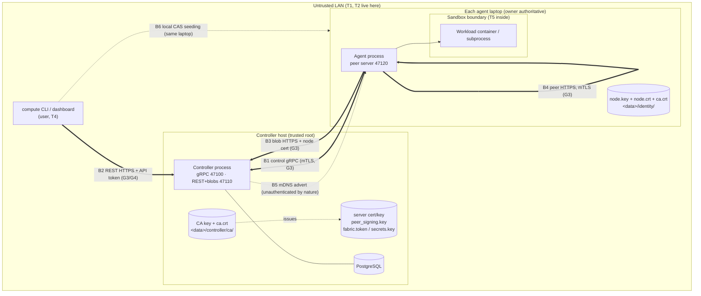

# THREAT MODEL — MeshForge compute fabric

> **Status:** living document, created in V0.7 G1 (roadmap **0.7.1**, decision **D133**, [ADR-0016](adr/0016-v07-security-design.md)).
> Every row below names the **test that proves it** or is marked **accepted** with a reason (V0.7 brief §4 item 21).
> Task **0.7.11** (G7) reviews this file row by row; a row is only `mitigated` once its test exists and passes.
> Design sources: ARCHITECTURE §16, [ADR-0008](adr/0008-pairing-and-mtls.md), [ADR-0013](adr/0013-node-identity-storage.md),
> [ADR-0014](adr/0014-interim-execution-trust.md) (superseded), `docs/briefs/V0.7-security-pairing.md` §2 (D133–D146).

**Status values:** `open (Gn)` = known gap, the named V0.7 group closes it · `mitigated` = the named test exists and
passes today · `accepted` = deliberately not mitigated, with the reason in the row · `decision (Gn)` = needs a Lead /
team decision before that group's code.

The system is **remote code execution by design** (CLAUDE.md §9). The goal of V0.7 is: only enrolled devices take
part, every plane is authenticated and encrypted, users act under their own identity, the laptop owner keeps the final
say over their machine, and workloads are confined — each claim checked by a test, not asserted.

---

## 1. Assets

| ID | Asset | Why it matters | Where it lives |
|---|---|---|---|
| A1 | **The laptops themselves** (CPU/GPU time, the OS accounts the agent runs as) | An attacker who can start a job runs code on someone's laptop | every agent host |
| A2 | **Owners' files** outside the attempt workdir | A workload or a rogue controller must never reach them | every agent host |
| A3 | **Job code and data** (bundles/trees, named inputs, outputs, logs) | Users' intellectual property and results; integrity decides correctness | controller blob store, agent CAS, attempt workdirs, wire |
| A4 | **Secrets in transit/at rest**: fabric token (V0.4–V0.7), API tokens + passwords (G4), job secrets (G6), fetch/peer/probe tokens, upload grants, the DB password | Each grants an action; leaking one in a log or on the wire is a breach | config dirs, DB, process memory, wire, logs |
| A5 | **Keys**: fabric **CA key** (crown jewel), controller server key, node keys (ADR-0013), peer-token signing key (D98), secrets master key (G6) | The CA key can mint any node; the signing key can mint any peer token | `<data>/controller/…`, `<data>/identity/` |
| A6 | **Fabric integrity**: node registry, sessions, job/attempt state, planner decisions, telemetry (feeds the V0.15 ML planner) | Poisoned state misplaces jobs, poisoned telemetry trains a wrong model | PostgreSQL, controller memory |
| A7 | **Availability** of the controller and of each laptop for its owner | The owner's own work comes first | everywhere |

## 2. Actors (who we defend against)

| ID | Actor | Capabilities assumed | Out of scope for them |
|---|---|---|---|
| T1 | **LAN outsider** — any device on the same Wi-Fi/Ethernet, never enrolled | sniff, inject, ARP/mDNS spoof, MITM, connect to every open port, replay captured traffic | physical access to a fabric laptop |
| T2 | **Rogue controller** — a LAN host pretending to be the controller (mDNS record or address takeover) | accept agent connections, send commands, serve REST to the CLI | the real CA key |
| T3 | **Stolen, compromised or revoked laptop** — holds a valid node key + cert until revoked (and keeps them after) | everything an enrolled agent can do; lie in reports; keep using old certs/tokens | the CA key, other nodes' keys |
| T4 | **Malicious-but-enrolled user** — has an account / API token (or, before G4, the fabric token) | submit any job, read anything the API returns to them, guess IDs, brute-force others' credentials | admin role (unless granted) |
| T5 | **Malicious workload** — code inside a job | anything a process in the sandbox can do: syscalls, network if allowed, fill disk, fork, read its own secrets | — |
| T6 | **Other local OS user** on a fabric laptop (added: the private-file rules exist for this actor) | read world/group-readable files, run processes as another user | root / Administrator (root owns the machine; accepted) |

**Explicitly trusted (accepted):** the controller host's root/Administrator and its PostgreSQL superuser; the laptop
owner over their own laptop (D142: the owner is authoritative); the Python/`cryptography`/grpcio/Docker supply chain.

## 3. Trust boundaries

Boundaries: **B1** control gRPC · **B2** REST · **B3** controller blob HTTP · **B4** peer blob HTTP · **B5** mDNS ·
**B6** local files (identity, keys, CAS seeding by the CLI) · **B7** the workload sandbox · **B8** the PKI itself
(added: the CA, certificates and CSRs are an attack surface of their own).

## 4. Honest inventory of V0.6 (found in the code, 2026-10-07)

Every plaintext plane and every place that trusts a claim instead of a proof. Each line maps to a row in §5.

| # | Where | What | Row |
|---|---|---|---|
| P1 | `controller/server.py:407` `add_insecure_port` | control gRPC is plaintext | CG-T1, CG-I1 |
| P2 | `agent/session/client.py:460` `grpc.aio.insecure_channel` | the agent trusts any server at the address | CG-S3 |
| P3 | `controller/server.py` uvicorn without `ssl_*`; `cli/settings.py:44` default `http://127.0.0.1:47110`; `cli/follow.py:40` `ws://` | REST, log WebSocket and the fabric token in `Authorization` are plaintext | RE-I1, RE-S3 |
| P4 | `agent/execution/fetch.py:124` `http://{host}:{blob_port}` | bundles/trees/inputs downloaded in clear; fetch tokens and upload grants sniffable | CB-I1, CB-S1 |
| P5 | `controller/jobs/peers.py:116` `http://{peer_endpoint}`; `agent/peer/probe.py:241` | peer blob + probe traffic in clear | PB-I1 |
| P6 | `controller/session/manager.py:536` `HelloAck.peer_token_key` | the peer-token verification key arrives over plaintext gRPC: a MITM can substitute its own key | CG-T1 |
| C1 | `controller/session/admission.py:91` (marked TRUST POINT) | `Hello.node_id` is a claim; node ids are public (`GET /v1/nodes`), so any LAN host can take over a node's session | CG-S1, CG-S2 |
| C2 | `agent/discovery.py:180` | the agent dials the first LAN-address mDNS record | MD-S1 |
| C3 | `controller/api/job_routes.py:497` `submitter_node_id` | the CLI names "its" node; nothing proves it | RE-T2 |
| C4 | `controller/scores.py:128` | the score fingerprint is whatever the agent reports | CG-T2 |
| C5 | `controller/api/blob_routes.py:186,499` | uploaded parts are not attributed to the sending node (V0.6 G1 follow-up 3) | CB-E1 |
| C6 | `controller/fabric_token.py`, `api/auth.py` | one shared bearer secret = "the user"; no per-user identity or audit | RE-S1, RE-R1 |
| C7 | `controller/store/settings.py:51` | default DB password `meshforge-dev` accepted on any controller | LF-T2 |
| C8 | `cli/transfer.py:227` `seed_local` | the CLI writes into the agent's CAS; ownership when the agent runs as another user (D125) | LF-T1 |
| C9 | revoked-node state exists, no production trigger (STATUS) | a stolen laptop cannot be cut off | CG-E1 |
| C10 | `common/peer_token.py:76` `MAX_TTL_S = 600`; `[controller.jobs] peer_token_ttl_s` 60–600 | a peer token outlives a revocation by up to 10 min (D138 assumed ≤ 60 s) | PB-E1 |

## 5. STRIDE per plane

Columns: **ID** · **S/T/R/I/D/E** · **threat** · **today (V0.6)** · **V0.7 mitigation** · **group** · **test** (file or
"to be written" with its intended home) · **status**.

### 5.1 B1 — Control gRPC (agent ⇄ controller, TCP 47100) and enrollment

| ID | | Threat | Today (V0.6) | V0.7 mitigation | Grp | Test | Status |
|---|---|---|---|---|---|---|---|
| CG-S1 | S | T1 connects and enrolls as a new node with any `node_id` | accepted by `Hello` (C1) | client cert required on `Session`; `node_id` taken from the cert SAN (D136/D137) | G3 | to be written: `tests/security/test_control_plane_auth.py` (no cert, cert from another CA, expired cert → refused) | open (G3) |
| CG-S2 | S | T1 claims an **existing** node's `node_id` and supersedes its session (receives its `StartAttempt`s) | possible: node ids are public (C1) | `Hello.node_id` must equal the cert's node id, else `UNAUTHENTICATED` | G3 | to be written: `tests/security/test_control_plane_auth.py::hello_node_id_mismatch` | open (G3) |
| CG-S3 | S | T2 rogue controller receives agent connections and sends `StartAttempt` → code runs on an execution-enabled laptop | possible (P2, C2); ADR-0014 warned, did not solve | agent verifies the server cert against `ca.crt` pinned at join (D137); `ca.crt` itself checked against the join code fingerprint (D135/D136) | G2, G3 | to be written: `tests/security/test_rogue_controller.py` (server cert from another CA → agent refuses, sends no Hello) | open (G3) |
| CG-S4 | S | T1 enrolls with a stolen/guessed join code | n/a (no enrollment yet) | 128-bit single-use token, stored hashed, TTL 15 min, consumed by one `UPDATE … RETURNING`; per-IP rate limit (D135) | G2 | to be written: `tests/component/controller/test_join_token*.py` (reuse, expiry, race of two consumers, rate limit) | open (G2) |
| CG-S5 | S | T1 serves a fake CA to a joining agent | n/a | agent checks the CA cert's 128-bit SHA-256 fingerprint from the code **before** sending the token (D136); fingerprint helper `short_fingerprint` (G1) | G1, G2 | `tests/unit/common/test_pki.py::test_short_fingerprint_*` (G1); to be written: enrollment wrong-CA test (G2) | open (G2) |
| CG-S6 | S | T3/T4 enrolls a CSR naming another node's `node_id`, or a CSR signed by a different key | n/a | `verify_csr`: signature valid, P-256 only, exactly one SAN URI naming the node; same `node_id` with another key refused unless `invite --replace` (D136) | G1, G2 | `tests/unit/common/test_pki.py::test_verify_csr_*` (G1); to be written: replace-refused test (G2) | open (G2) |
| CG-T1 | T | MITM rewrites `StartAttempt` (manifest, runtime, digests) or substitutes `HelloAck.peer_token_key` (P6) | plaintext (P1) | TLS ≥ 1.2 on gRPC (BoringSSL negotiates 1.3), server + client cert verified (D137) | G3 | to be written: `tests/security/test_plaintext_recorder.py` (D146) + TLS version test | open (G3) |
| CG-I1 | I | T1 sniffs fetch/peer/upload tokens, manifests, live log chunks | plaintext (P1) | TLS (D137); job secrets only inside `StartAttempt` over mTLS (D144) | G3, G6 | to be written: D146 byte recorder asserts markers absent on every link | open (G3) |
| CG-T2 | T | T3 lies in reports: hardware, scores, cache contents, resources | trusted; score fingerprint is a claim (C4) | identity becomes proven (G3); score fingerprint bound to the authenticated node (D145b). **Lies about capacity remain possible**: hashes protect data integrity, a lie only costs time and shows as failed attempts | G5 | to be written: score-binding test (G5) | open (G5) / accepted (residual: an enrolled node can misreport its own capacity) |
| CG-R1 | R | actions cannot be tied to a proven node | session node = claimed node | every session, audit row (D113) and attempt is keyed by the cert-derived `node_id` | G3 | covered by CG-S2 test | open (G3) |
| CG-D1 | D | unauthenticated connection / Hello floods | bounded: `hello_timeout_s`, admission deadline, message size caps, outbound queue (V0.3/V0.4) | TLS handshake before any message; `Enroll` rate-limited per source IP (D135) | G2, G3 | existing: `tests/component/controller/test_session_server_tester.py` (hello timeout), `tests/unit/controller/test_admission_timeout_settings.py`; to be written: enroll rate limit (G2) | open (G2); **accepted** residual: a LAN host can still burn TLS handshakes (LAN DoS is out of scope) |
| CG-E1 | E | a revoked/stolen laptop keeps (or re-opens) its live session | no production trigger (C9) | `compute node revoke` → DB flag checked at handshake/Hello + immediate stream kill with `PERMISSION_DENIED`, measured ≤ 1 heartbeat (D138) | G3 | to be written: `tests/security/test_revocation.py` (live kill time, reconnect refused) | open (G3) |
| CG-E2 | E | T3 reports status/logs for an attempt placed on another node | fencing tokens + session checks (V0.6 §17) | the reporting node is now proven (G3) | G7 | to be written: `tests/security/test_cross_node_reports.py` | open (G7) |
| CG-E3 | E | expired node cert keeps working | n/a | expiry checked at handshake; renewal at ⅔ life over mTLS; expired → explicit re-join message (D140) | G1, G4 | `tests/unit/common/test_pki.py::test_is_expired_*` (G1); to be written: expired-cert handshake + renewal tests (G4) | open (G4) |

### 5.2 B2 — REST API (CLI / dashboard → controller, TCP 47110)

| ID | | Threat | Today (V0.6) | V0.7 mitigation | Grp | Test | Status |
|---|---|---|---|---|---|---|---|
| RE-S1 | S | anyone holding the shared fabric token acts as "the user" | one bearer secret (C6) | per-user accounts, opaque 256-bit API tokens stored hashed, 90 d, revocable; fabric token off by default, deleted V0.8 (D141) | G4 | to be written: `tests/component/controller/test_api_tokens*.py` (unknown/expired/revoked/malformed → 401, one test per branch, item 19) | open (G4) |
| RE-S2 | S | T4/T1 brute-forces a password | n/a | scrypt (n=2^15, r=8, p=1), per-user + per-IP backoff (D141) | G4 | to be written: login backoff test | open (G4) |
| RE-S3 | S | T2 impersonates the controller to the CLI and collects its token | plaintext, unverified (P3) | HTTPS with the controller server cert; CLI trusts only `ca.crt` obtained at `compute login` (fingerprint checked) (D139/D141) | G3, G4 | to be written: CLI refuses a cert from another CA | open (G3) |
| RE-I1 | I | the token travels in clear in `Authorization` (and the WebSocket handshake) | yes (P3) | HTTPS / WSS (D139) | G3 | to be written: D146 recorder (API token marker) | open (G3) |
| RE-I2 | I | open GETs (`/v1/nodes`, `/sessions`, `/network`) disclose hostnames, IPs, hardware and node ids to the LAN | open by D14 | HTTPS hides them on the wire; whether these reads need a user token is **not decided** by D141 | G4 | — | decision (G4) |
| RE-I3 | I | tokens/passwords end up in logs, URLs, errors | header-only, redaction of Bearer/PEM/key=value (existing) | API tokens and passwords get redaction tests that fail when the scrubber is removed (item 20) | G4 | existing: `tests/unit/common/test_common_logging_redaction.py`; to be written: API-token/password mutation tests | open (G4) |
| RE-E1 | E | T4 reads, cancels or downloads another user's jobs/logs/outputs | everyone is one identity | `job.owner_user_id`; users see their jobs, admins all (D141) | G4 | to be written: cross-user access tests (each route) | open (G4) |
| RE-E2 | E | T4 performs admin actions (revoke nodes, invites, users) | `compute` has no admin actions yet | admin role required (D141) | G4 | to be written: role tests | open (G4) |
| RE-T1 | T | hostile request bodies (manifests, ids, Idempotency-Key, paths) | bounded and validated (V0.4 §4 item 9) | unchanged | — | existing: `tests/unit/controller/test_api_g5_adversarial.py` | mitigated |
| RE-T2 | T | the CLI claims a `submitter_node_id` it does not own (C3) | trusted as a placement hint | stays a **hint only**: changes cost estimates, never authority; feasibility + owner policy still apply (D145c) | — | to be written: G7 test that a forged submitter cannot bypass feasibility/policy | accepted (the CLI holds no node cert; the hint grants nothing) |
| RE-R1 | R | who submitted/cancelled is not recorded | no | `owner_user_id`, token `last_used_at`, transitions name the user (D141) | G4 | to be written with RE-E1 | open (G4) |
| RE-D1 | D | request floods / huge bodies | body caps (`413`), list limits, WebSocket subscriber caps | login + enroll rate limits; others stay unlimited | G4 | existing body-cap tests | accepted (authenticated LAN callers; a rate limiter per route is V0.8+ if needed) |

### 5.3 B3 — Controller blob HTTP (`/v1/blobs*` on TCP 47110)

| ID | | Threat | Today (V0.6) | V0.7 mitigation | Grp | Test | Status |
|---|---|---|---|---|---|---|---|
| CB-I1 | I | T1 sniffs job bundles, inputs and outputs | plaintext (P4) | HTTPS (D139) | G3 | to be written: D146 recorder (file-content marker) | open (G3) |
| CB-S1 | S | T1 replays a sniffed fetch token or upload grant | possible while it lives | TLS + node client cert on `/v1/blobs` and the token (two locks); token bound to the cert's node (D139) | G3 | to be written: token + wrong/no client cert → refused | open (G3) |
| CB-T1 | T | tampered or corrupt blobs | SHA-256 verified before any byte is used (V0.5 item 15) | unchanged | — | existing: `tests/unit/common/test_cas.py`, `tests/unit/common/test_tree.py` | mitigated |
| CB-E1 | E | uploaded parts not attributed to the sending node (C5) | yes | parts recorded against the authenticated node (D145a) | G5 | to be written (G5) | open (G5) |
| CB-E2 | E | a fetch token reads outside its tree/digests | scoped (D48/D83) | unchanged | — | existing: `tests/unit/controller/test_fetch_scope_inputs.py` | mitigated |
| CB-D1 | D | disk fill through uploads | quota, upload grant caps, free-disk floor, concurrency limit (V0.5 item 14) | unchanged | — | existing: `tests/unit/controller/test_blobs_v05.py`, `test_blob_upload_auth.py` | mitigated |

### 5.4 B4 — Peer blob HTTP (agent ⇄ agent, TCP 47120, incl. `/v1/probe`)

| ID | | Threat | Today (V0.6) | V0.7 mitigation | Grp | Test | Status |
|---|---|---|---|---|---|---|---|
| PB-I1 | I | T1 sniffs peer blob/probe traffic | plaintext (P5) | TLS with the node cert (D139) | G3 | to be written: D146 recorder | open (G3) |
| PB-S1 | S | any LAN host that captures a peer token uses it (requester binding is advisory, ARCHITECTURE §20) | possible ≤ token life | client cert required; holder checks `req == client cert node_id` (D139) | G3 | to be written: token + other node's cert → 403 | open (G3) |
| PB-S2 | S | an impostor answers at a peer's endpoint | integrity safe (hash checks), wastes time, learns digests | fetching agent checks the server cert SAN `node_id` equals the peer the controller named (D139) | G3 | to be written | open (G3) |
| PB-S3 | S | a node advertises another machine's address as its peer endpoint | host must match the session's source unless `trust_peer_endpoints` (D99) | unchanged; cert check above makes it moot | — | existing: `tests/unit/controller/test_peer_endpoint.py` | mitigated |
| PB-T1 | T | tampered blob bytes from a peer | per-chunk + whole-blob hash verified (V0.5) | unchanged | — | existing: `tests/unit/agent/test_multi_source_fetch.py` | mitigated |
| PB-E1 | E | a revoked node keeps fetching from peers with an unexpired token/cert | tokens live up to 600 s (C10) | `RevocationUpdate{serials}` pushed to every agent, peers refuse those serials; revoked node gets no new tokens (D138). **Finding:** D138 assumes ≤ 60 s token life; peer tokens are 60–600 s — G3 must rely on the serial push or shorten the TTL | G3 | to be written: `tests/security/test_revocation.py::peer_refuses_revoked_serial` | open (G3) |
| PB-D1 | D | connection/slowloris floods on 47120 | `max_connections`, header cap, idle timeout, min send rate (V0.5 D97) | TLS handshake cost added | — | existing: `tests/unit/agent/test_peer_server.py` | mitigated (bounds) / accepted (LAN DoS) |

### 5.5 B5 — mDNS discovery (UDP 5353)

| ID | | Threat | Today (V0.6) | V0.7 mitigation | Grp | Test | Status |
|---|---|---|---|---|---|---|---|
| MD-S1 | S | T2 publishes a `_meshforge-ctl._tcp` record → agents dial it (C2) | agent connects and trusts it | the address is no longer trusted: the server cert must chain to the pinned `ca.crt` (D137) | G3 | covered by CG-S3 test (rogue controller reached via a spoofed record) | open (G3) |
| MD-D1 | D | spoofed records keep an agent dialling the wrong host | possible | **accepted**: mDNS is unauthenticated by nature; owners who care pin `[agent] controller_address` | — | — | accepted |
| MD-I1 | I | the advertisement discloses the controller's IP and port | yes | **accepted** (LAN-visible anyway); `[controller.discovery] advertise = false` turns it off | — | — | accepted |

### 5.6 B6 — Local files on fabric laptops

| ID | | Threat | Today (V0.6) | V0.7 mitigation | Grp | Test | Status |
|---|---|---|---|---|---|---|---|
| LF-I1 | I | T6 reads the **CA key** | n/a | `ca.key` written atomically, `0600` from creation in a `0700` folder (owner-only ACL on Windows), loaded strictly (loose mode → refuse) (D134) | G1 | `tests/unit/controller/test_fabric_ca.py::test_files_are_private`, `::test_loose_ca_key_is_refused` | mitigated (POSIX); Windows ACL path shared with ADR-0013, run on Windows by 🧑 0.7.12 |
| LF-I2 | I | T6 reads `node.key` | ADR-0013 protection | unchanged; `node.crt`/`ca.crt` stored beside it the same way (G2) | — | existing: `tests/unit/agent/test_identity.py` | mitigated |
| LF-I3 | I | T6 reads `fabric.token`, `peer_signing.key`, server key, CLI token (G4), `secrets.key` (G6) | `private_files` rules for the first two | same rules for every new secret file | G1–G6 | existing: `tests/unit/controller/test_fabric_token.py`; G1: `test_fabric_ca.py::test_server_key_is_private`; later groups add theirs | mitigated (existing files) / open (G4, G6) |
| LF-T1 | T | CLI seeding writes CAS files the agent (another OS user) cannot manage, or that another user planted | D109 seeds via `CasStore` (verified) | seeding skipped when the agent runs as another user (D145e) | G5 | to be written (G5) | open (G5) |
| LF-T2 | T | the default DB password works on a real controller (C7) | yes | non-dev controller refuses to start with the default password (D145d) | G4 | to be written (G4) | open (G4) |
| LF-T3 | T | a crash mid-write leaves a half-written key/cert/CA | atomic writes for identity/token/key | CA + server cert written atomically, pair-checked at load (G1) | G1 | `tests/unit/controller/test_fabric_ca.py::test_crash_between_files_*`, `::test_mismatched_pair_is_refused` | mitigated |
| LF-E1 | E | someone who can edit the user's `config.toml` redirects `data_dir` | — | **accepted**: write access to the owner's config = the owner | — | — | accepted |
| LF-I4 | I | key material / tokens / secrets reach log files | redaction of PEM blocks, Bearer tokens, sensitive keys (existing) | exact-value secret redaction incl. encoded forms (D144) | G6 | existing: `tests/unit/common/test_common_logging_redaction.py`; to be written: secret mutation tests (G6) | mitigated (keys/tokens) / open (G6) |

### 5.7 B7 — Workload sandbox

| ID | | Threat | Today (V0.6) | V0.7 mitigation | Grp | Test | Status |
|---|---|---|---|---|---|---|---|
| WS-E1 | E | T5 escapes the container (capabilities, mount, `ptrace`, `/proc/sysrq-trigger`) | non-root, `cap_drop ALL`, no-new-privileges, read-only rootfs (V0.4 G3) | + default seccomp never `unconfined`; escape-attempt tests in a real container (D143) | G5 | to be written: `tests/security/test_sandbox_escape.py` | open (G5) |
| WS-E2 | E | Docker socket or host paths mounted into a job | workdir-only mount by construction | asserted at container create (D143) | G5 | to be written | open (G5) |
| WS-D1 | D | fork bomb, memory, disk fill, `/tmp` fill, output flood | memory/CPU limits; log caps (V0.4) | `--pids-limit`, tmpfs `/tmp` size cap, output dir cap enforced while running (D143) | G5 | to be written | open (G5) |
| WS-I1 | I | T5 reaches the controller, peers or the LAN | `--network none` default | network only if manifest `network: true` **and** owner `allow_network` (D143) | G5 | to be written: reach controller/peer ports with `network none` → fails | open (G5) |
| WS-I2 | I | T5 reads other attempts' workdirs or the agent's files | per-attempt workdir `0700`, only that dir mounted (D63) | unchanged; covered by escape tests | G5 | existing: `tests/unit/agent/test_docker_runtime_g4.py` (workdir mode + mount) | mitigated (Docker) |
| WS-E3 | E | subprocess runtime is unsandboxed (incl. Windows) | needs `enabled` + `allow_unsandboxed` | folded into owner policy (two opt-ins kept) (D142, Q3) | G5 | to be written: policy refuses subprocess without both | **accepted** (team Q3: "unsandboxed, owner opt-in"; labelled in every surface) |
| WS-E4 | E | a compromised/rogue controller sends work violating the owner's limits | agent opt-in only (D45) | agent re-checks `StartAttempt` against `[agent.policy]`; caps enforced by runtime limits (D142) | G5 | to be written | open (G5) |
| WS-I3 | I | T5 deliberately leaks its own secret (reversed, split, encoded oddly) | n/a | redaction catches accidents only (D144) | G6 | — | **accepted** (a workload that owns a secret can always exfiltrate it through its outputs; documented limit) |
| WS-T1 | T | workload output injects terminal escapes into operators' terminals | CLI flattens control characters (`_cell`) | unchanged | — | existing: `tests/unit/cli/test_cli_render.py` | mitigated |

### 5.8 B8 — The PKI itself (fabric CA, certificates, CSRs)

| ID | | Threat | Today (V0.6) | V0.7 mitigation | Grp | Test | Status |
|---|---|---|---|---|---|---|---|
| PK-S1 | S | a cert signed by **another** CA (another fabric, a test CA) is accepted | n/a | `verify_issued_by` checks the issuer name **and** the signature against our CA key; TLS stacks are given only our `ca.crt` (G3) | G1 | `tests/unit/common/test_pki.py::test_cert_from_another_ca_is_refused` | mitigated (helper); TLS use in G3 |
| PK-T1 | T | hostile CSR: wrong curve, RSA, Ed25519, bad signature, two SANs, no SAN, wrong fabric, oversized, garbage | n/a | `verify_csr` refuses each with a typed `PkiError` and a reason code | G1 | `tests/unit/common/test_pki.py::test_verify_csr_*` | mitigated |
| PK-E1 | E | a node cert used as a CA to mint more certs | n/a | node/server certs carry `BasicConstraints(ca=False)`, `KeyUsage` without `keyCertSign`; CA has `path_length=0` | G1 | `tests/unit/common/test_pki.py::test_leaf_certs_are_not_cas`, `::test_ca_path_length_zero` | mitigated |
| PK-D1 | D | expired / not-yet-valid certs used or refused at the wrong time | n/a | `is_expired`/validity checks with an injected clock; server cert renewed at ⅔ life on controller start (D134); node renewal G4 | G1 | `tests/unit/common/test_pki.py::test_is_expired_*`, `tests/unit/controller/test_fabric_ca.py::test_server_cert_renewed_*` | mitigated (helpers + server cert) / open (G4 node renewal) |
| PK-T2 | T | `fabric create` silently overwrites the CA (every node orphaned) | n/a | refuses without `--force`; `--force` prints that every node must re-join; atomic replace | G1 | `tests/unit/controller/test_controller_fabric_cli.py::test_create_refuses_overwrite_without_force`, `::test_force_replaces_and_warns` | mitigated |
| PK-I1 | I | the CA key leaks (controller host compromised) | n/a | key never leaves the controller host; no CA rotation in V0.7 | — | — | **accepted** (Q2: CA rotation is V0.17; recovery = `fabric create --force` + every laptop re-joins; documented in OPERATIONS) |
| PK-S2 | S | the controller serves a cert whose SANs do not cover the address the agent dialled | n/a | server cert SANs = configured bind/advertise hosts + `meshforge-controller`; agents may verify against that fixed name (D137) | G1, G3 | `tests/unit/controller/test_fabric_ca.py::test_server_cert_sans_*` | mitigated (issuance) / open (G3 verification) |

## 6. Cross-cutting rules (V0.7 brief §4 items 19–22)

- **Fail closed** — every auth check rejects missing/unknown/expired/malformed input, one test per branch; no "warn and continue" in a security path.
- **No secret in logs, errors, URLs, telemetry, `plan_decision` or test output** — each new secret type gets a redaction test that fails if the scrubber is removed.
- **Every security claim names its test** — this file is the index; a row without a test is `accepted` with a reason.
- **Constant-time compares, hashed tokens, `secrets` randomness** — `hmac.compare_digest` everywhere a token or hash is compared.
- **Criterion 3 (no plaintext)** is proven by the D146 byte recorder on every cluster-harness link in CI, and by a real `tcpdump`/Wireshark capture in the 🧑 0.7.12 lab run.

## 7. Accepted risks (summary)

| Risk | Why accepted | Revisit |
|---|---|---|
| CA key compromise = re-join everyone | one controller, CA never leaves its host; rotation planned V0.17 (Q2) | V0.17 |
| Subprocess runtime (incl. Windows) unsandboxed | two explicit owner opt-ins; AppContainer is a large Windows-only effort (Q3) | if Windows sandboxing becomes a requirement |
| A workload can leak its own secrets on purpose | inherent; redaction stops accidents | — |
| An enrolled node can misreport its own capacity | integrity is hash-protected; lies cost time and show as failures | V0.15 ML anomaly signals |
| `submitter_node_id` is unproven | placement hint only, grants nothing | if the CLI ever holds a node credential |
| LAN-level DoS (handshake floods, mDNS spoof loops, Wi-Fi jamming) | out of scope for a LAN fabric; bounds exist on every listener | if the fabric spans untrusted networks |
| Root/Administrator on a fabric laptop | owns the machine by definition | — |
