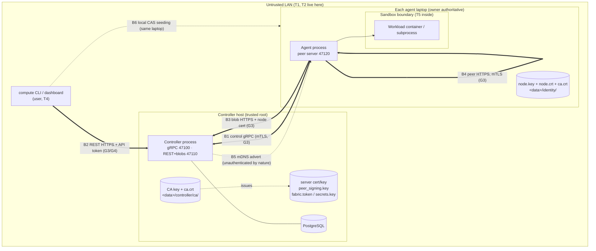

# THREAT MODEL — MeshForge compute fabric

> **Status:** living document, created in V0.7 G1 (roadmap **0.7.1**, decision **D133**, [ADR-0016](adr/0016-v07-security-design.md)).
> Every row below names the **test that proves it** or is marked **accepted** with a reason (V0.7 brief §4 item 21).
> Task **0.7.11** (G7) reviews this file row by row; a row is only `mitigated` once its test exists and passes.
> Design sources: ARCHITECTURE §16, [ADR-0008](adr/0008-pairing-and-mtls.md), [ADR-0013](adr/0013-node-identity-storage.md),
> [ADR-0014](adr/0014-interim-execution-trust.md) (superseded), `docs/briefs/V0.7-security-pairing.md` §2 (D133–D146).

**Status values:** `open (Gn)` = known gap, the named V0.7 group closes it · `mitigated` = the named test exists and
passes today · `accepted` = deliberately not mitigated, with the reason in the row · `decision (Gn)` = needs a Lead /
team decision before that group's code.

The system is **remote code execution by design** (CLAUDE.md §9). The goal of V0.7 is: only enrolled devices take
part, every plane is authenticated and encrypted, users act under their own identity, the laptop owner keeps the final
say over their machine, and workloads are confined — each claim checked by a test, not asserted.

---

## 1. Assets

| ID | Asset | Why it matters | Where it lives |
|---|---|---|---|
| A1 | **The laptops themselves** (CPU/GPU time, the OS accounts the agent runs as) | An attacker who can start a job runs code on someone's laptop | every agent host |
| A2 | **Owners' files** outside the attempt workdir | A workload or a rogue controller must never reach them | every agent host |
| A3 | **Job code and data** (bundles/trees, named inputs, outputs, logs) | Users' intellectual property and results; integrity decides correctness | controller blob store, agent CAS, attempt workdirs, wire |
| A4 | **Secrets in transit/at rest**: fabric token (V0.4–V0.7), API tokens + passwords (G4), job secrets (G6), fetch/peer/probe tokens, upload grants, the DB password | Each grants an action; leaking one in a log or on the wire is a breach | config dirs, DB, process memory, wire, logs |
| A5 | **Keys**: fabric **CA key** (crown jewel), controller server key, node keys (ADR-0013), peer-token signing key (D98), secrets master key (G6) | The CA key can mint any node; the signing key can mint any peer token | `<data>/controller/…`, `<data>/identity/` |
| A6 | **Fabric integrity**: node registry, sessions, job/attempt state, planner decisions, telemetry (feeds the V0.15 ML planner) | Poisoned state misplaces jobs, poisoned telemetry trains a wrong model | PostgreSQL, controller memory |
| A7 | **Availability** of the controller and of each laptop for its owner | The owner's own work comes first | everywhere |

## 2. Actors (who we defend against)

| ID | Actor | Capabilities assumed | Out of scope for them |
|---|---|---|---|
| T1 | **LAN outsider** — any device on the same Wi-Fi/Ethernet, never enrolled | sniff, inject, ARP/mDNS spoof, MITM, connect to every open port, replay captured traffic | physical access to a fabric laptop |
| T2 | **Rogue controller** — a LAN host pretending to be the controller (mDNS record or address takeover) | accept agent connections, send commands, serve REST to the CLI | the real CA key |
| T3 | **Stolen, compromised or revoked laptop** — holds a valid node key + cert until revoked (and keeps them after) | everything an enrolled agent can do; lie in reports; keep using old certs/tokens | the CA key, other nodes' keys |
| T4 | **Malicious-but-enrolled user** — has an account / API token (or, before G4, the fabric token) | submit any job, read anything the API returns to them, guess IDs, brute-force others' credentials | admin role (unless granted) |
| T5 | **Malicious workload** — code inside a job | anything a process in the sandbox can do: syscalls, network if allowed, fill disk, fork, read its own secrets | — |
| T6 | **Other local OS user** on a fabric laptop (added: the private-file rules exist for this actor) | read world/group-readable files, run processes as another user | root / Administrator (root owns the machine; accepted) |

**Explicitly trusted (accepted):** the controller host's root/Administrator and its PostgreSQL superuser; the laptop
owner over their own laptop (D142: the owner is authoritative); the Python/`cryptography`/grpcio/Docker supply chain.

## 3. Trust boundaries

Boundaries: **B1** control gRPC · **B2** REST · **B3** controller blob HTTP · **B4** peer blob HTTP · **B5** mDNS ·
**B6** local files (identity, keys, CAS seeding by the CLI) · **B7** the workload sandbox · **B8** the PKI itself
(added: the CA, certificates and CSRs are an attack surface of their own).

## 4. Honest inventory of V0.6 (found in the code, 2026-10-07)

Every plaintext plane and every place that trusts a claim instead of a proof. Each line maps to a row in §5.

| # | Where | What | Row |
|---|---|---|---|
| P1 | `controller/server.py:407` `add_insecure_port` | control gRPC is plaintext | CG-T1, CG-I1 |
| P2 | `agent/session/client.py:460` `grpc.aio.insecure_channel` | the agent trusts any server at the address | CG-S3 |
| P3 | `controller/server.py` uvicorn without `ssl_*`; `cli/settings.py:44` default `http://127.0.0.1:47110`; `cli/follow.py:40` `ws://` | REST, log WebSocket and the fabric token in `Authorization` are plaintext | RE-I1, RE-S3 |
| P4 | `agent/execution/fetch.py:124` `http://{host}:{blob_port}` | bundles/trees/inputs downloaded in clear; fetch tokens and upload grants sniffable | CB-I1, CB-S1 |
| P5 | `controller/jobs/peers.py:116` `http://{peer_endpoint}`; `agent/peer/probe.py:241` | peer blob + probe traffic in clear | PB-I1 |
| P6 | `controller/session/manager.py:536` `HelloAck.peer_token_key` | the peer-token verification key arrives over plaintext gRPC: a MITM can substitute its own key | CG-T1 |
| C1 | `controller/session/admission.py:91` (marked TRUST POINT) | `Hello.node_id` is a claim; node ids are public (`GET /v1/nodes`), so any LAN host can take over a node's session | CG-S1, CG-S2 |
| C2 | `agent/discovery.py:180` | the agent dials the first LAN-address mDNS record | MD-S1 |
| C3 | `controller/api/job_routes.py:497` `submitter_node_id` | the CLI names "its" node; nothing proves it | RE-T2 |
| C4 | `controller/scores.py:128` | the score fingerprint is whatever the agent reports | CG-T2 |
| C5 | `controller/api/blob_routes.py:186,499` | uploaded parts are not attributed to the sending node (V0.6 G1 follow-up 3) | CB-E1 |
| C6 | `controller/fabric_token.py`, `api/auth.py` | one shared bearer secret = "the user"; no per-user identity or audit (closed in G4: users + API tokens) | RE-S1, RE-R1 |
| C7 | `controller/store/settings.py:51` | default DB password `meshforge-dev` accepted on any controller (closed in G4: refused outside insecure-dev) | LF-T2 | T | the default DB password works on a real controller (C7) | yes | a controller outside `insecure-dev` refuses to start with `meshforge-dev` (URL or fields; typed `config_error` naming the fix), checked before anything else at start-up (D145d) | G4 | `tests/unit/controller/test_v07_g4_dev_db_password.py` (mutation checked) | mitigated |
| C8 | `cli/transfer.py:227` `seed_local` | the CLI writes into the agent's CAS; ownership when the agent runs as another user (D125) | LF-T1 |
| C9 | revoked-node state exists, no production trigger (STATUS) | a stolen laptop cannot be cut off | CG-E1 (closed in G3: `node revoke`) |
| C10 | `common/peer_token.py:76` `MAX_TTL_S = 600`; `[controller.jobs] peer_token_ttl_s` 60–600 | a peer token outlives a revocation by up to 10 min (D138 assumed ≤ 60 s) | PB-E1 (closed in G3: 60 s, re-minted per transfer, D147) |

## 5. STRIDE per plane

Columns: **ID** · **S/T/R/I/D/E** · **threat** · **today (V0.6)** · **V0.7 mitigation** · **group** · **test** (file or
"to be written" with its intended home) · **status**.

### 5.1 B1 — Control gRPC (agent ⇄ controller, TCP 47100) and enrollment

| ID | | Threat | Today (V0.6) | V0.7 mitigation | Grp | Test | Status |
|---|---|---|---|---|---|---|---|
| CG-S1 | S | T1 connects and enrolls as a new node with any `node_id` | accepted by `Hello` (C1) | session port is mutual TLS with the client certificate **required** (BoringSSL verifies chain + validity against `ca.crt`), `NodeCertInterceptor` refuses any call without an acceptable node cert (our fabric, clientAuth, valid now, not revoked); `node_id` taken from the cert SAN (D136/D137) | G3 | `tests/component/controller/test_v07_g3_mtls_session.py::test_no_client_cert_is_refused_at_the_handshake`, `::test_plaintext_client_is_refused`, `::test_cert_from_another_ca_is_refused`, `::test_expired_cert_is_refused_at_the_handshake`; `tests/unit/controller/test_v07_g3_peer_cert.py` (every `parse_peer` branch, interceptor); mutation: `require_client_auth=False` -> fails | mitigated |
| CG-S2 | S | T1 claims an **existing** node's `node_id` and supersedes its session (receives its `StartAttempt`s) | possible: node ids are public (C1) | `Hello.node_id` must equal the cert's node id, else `UNAUTHENTICATED` / `node_id_mismatch`, nothing persisted; an older certificate of a re-keyed node is `cert_superseded` (only the serial on record is the node) | G3 | `tests/component/controller/test_v07_g3_mtls_session.py::test_hello_for_another_node_is_unauthenticated`, `::test_victim_session_is_not_superseded_by_an_impostor`, `::test_an_older_certificate_of_a_rekeyed_node_is_refused`; mutation: SAN==Hello check removed -> fails | mitigated |
| CG-S3 | S | T2 rogue controller receives agent connections and sends `StartAttempt` → code runs on an execution-enabled laptop | possible (P2, C2); ADR-0014 warned, did not solve | agent trusts only `ca.crt` (pinned at join) and verifies the fixed name `meshforge-controller`; node certs carry no DNS SAN, so neither another CA nor an enrolled laptop can pose as the controller (D137) | G2, G3 | `tests/component/agent/test_v07_g3_agent_mtls.py::test_agent_never_says_hello_to_a_rogue_controller[other_ca]`, `[enrolled_node]` (server-side spy: zero streams) | mitigated |
| CG-S4 | S | T1 enrolls with a stolen/guessed join code | n/a (no enrollment yet) | 128-bit single-use token from `secrets`, stored as SHA-256 only, TTL 15 min (1 min-24 h, DB clock), redeemed by one `UPDATE … WHERE used_at IS NULL AND revoked_at IS NULL AND expires_at > now() RETURNING` inside the enrolment transaction (a refused enrolment rolls back and does not burn it); revocable; per-IP rate limit; every invite/redeem/revoke audited without the token (D135, D151) | G2 | `tests/component/controller/test_v07_g2_invites.py::test_token_is_stored_hashed_only`, `::test_single_use_under_a_16_way_race`, `::test_a_rolled_back_redeem_does_not_burn_the_code`, `::test_refusal_reasons`, `::test_ttl_bounds`, `::test_revoke_rules`; `tests/component/controller/test_v07_g2_enroll.py::test_used_expired_and_revoked_codes`, `::test_sixteen_laptops_race_one_code`, `::test_hostile_csrs_are_refused_and_do_not_burn_the_code`; mutation: each of the three `WHERE` guards removed -> tests/component/controller/test_v07_g2_invites.py fails | mitigated |
| CG-S5 | S | T1 serves a fake CA to a joining agent | n/a | the agent reads the presented chain in a verify-off TLS handshake, keeps only a self-signed CA whose SHA-256 starts with the code's 128-bit pin (constant-time) **and** that issued the server cert, and only then sends the token over a channel verifying against that CA (D136, D150); the returned cert must be issued by it, hold our key and name our node/fabric | G1, G2 | `tests/unit/common/test_pki.py::test_short_fingerprint_*`; `tests/component/controller/test_v07_g2_enroll.py::test_wrong_ca_pin_sends_nothing` (server-side spy: zero `Enroll` calls, invite unused), `::test_a_plain_tcp_server_is_not_a_controller`; `tests/unit/agent/test_enrollment_store.py::test_pin_ca_accepts_only_the_pinned_issuing_ca`, `::test_check_issued_refusals`; mutation: pin check bypassed -> tests/component/controller/test_v07_g2_enroll.py fails | mitigated |
| CG-S6 | S | T3/T4 enrolls a CSR naming another node's `node_id`, or a CSR signed by a different key | n/a | `verify_csr`: signature valid, P-256 only, exactly one SAN URI naming the node; same `node_id` with another key refused unless `invite --replace` (D136) | G1, G2 | `tests/unit/common/test_pki.py::test_verify_csr_*` (G1); to be written: replace-refused test (G2) | open (G2) |
| CG-T1 | T | MITM rewrites `StartAttempt` (manifest, runtime, digests) or substitutes `HelloAck.peer_token_key` (P6) | plaintext (P1) | TLS ≥ 1.2 on gRPC (BoringSSL negotiates 1.3), server + client cert verified (D137) | G3 | TLS: `tests/component/controller/test_v07_g3_mtls_session.py::test_grpc_client_and_server_negotiate_tls13_on_the_wire` (ServerHello read off the wire), `::test_python_client_negotiates_tls13_with_alpn_h2`; D146: `tests/cluster/test_v07_g3_plaintext_recorder.py::test_no_plaintext_marker_crosses_any_link_of_a_full_job_run` (argv marker absent on every gRPC link) | mitigated |
| CG-I1 | I | T1 sniffs fetch/peer/upload tokens, manifests, live log chunks | plaintext (P1) | TLS (D137); job secrets only inside `StartAttempt` over mTLS (D144) | G3, G6 | `tests/cluster/test_v07_g3_plaintext_recorder.py::test_no_plaintext_marker_crosses_any_link_of_a_full_job_run`: every byte of every link recorded (each agent's gRPC, REST+blobs, each peer server); the argv marker, a file-content marker (also in the job's log chunks) and the fabric token are on none, while B's stdout read back over REST proves they travelled; `tests/cluster/test_faultproxy.py::test_recorder_keeps_each_direction_of_each_connection_and_finds_split_markers` (the recorder itself) | mitigated (G3); secret-value marker joins in G6 |
| CG-T2 | T | T3 lies in reports: hardware, scores, cache contents, resources | trusted; score fingerprint is a claim (C4) | identity becomes proven (G3); score fingerprint bound to the authenticated node (D145b). **Lies about capacity remain possible**: hashes protect data integrity, a lie only costs time and shows as failed attempts | G5 | to be written: score-binding test (G5) | open (G5) / accepted (residual: an enrolled node can misreport its own capacity) |
| CG-R1 | R | actions cannot be tied to a proven node | session node = claimed node | every session is keyed by the cert-derived `node_id` (Hello must match); the cert serial is recorded on the node | G3 | covered by CG-S2 tests + `::test_first_hello_records_the_certificate` | mitigated |
| CG-D1 | D | unauthenticated connection / Hello / Enroll floods | bounded: `hello_timeout_s`, admission deadline, message size caps, outbound queue (V0.3/V0.4) | `Enroll`: token bucket per source (D152: gRPC's percent-encoded peer string is decoded; **IPv4 per address, IPv6 per /64** - one laptop can rotate privacy addresses through its /64; IPv4-mapped IPv6 = the IPv4 address; an unparseable peer goes to **one shared `unknown` bucket**, never a fresh one) (`[controller.enroll] rate_per_minute`/`rate_burst`, bounded table) checked before any DB work, 16 KiB requests, 16 concurrent RPCs (D135); TLS handshake before any session message (G3) | G2, G3 | existing: `tests/component/controller/test_session_server_tester.py` (hello timeout), `tests/unit/controller/test_admission_timeout_settings.py`; `tests/component/controller/test_v07_g2_enroll.py::test_rate_limit_is_per_source_ip` (burst+1 refused, a second source IP unaffected), `tests/unit/controller/test_v07_g2_enroll_listener.py::test_rate_key_decodes_grpc_peers_and_buckets_ipv6_per_64`, `::test_unknown_peers_exhaust_one_shared_bucket`, `tests/unit/controller/test_v07_g2_tester_ratelimit.py::test_real_ipv6_peers_collapse_to_one_key`, `tests/component/controller/test_v07_g2_tester_placeholder_ipv6.py::test_ipv6_clients_are_rate_limited_per_ip` (tester T-1, fixed); mutations: limiter bypassed, peer not URL-decoded, /64 replaced by the address, unknown peer keyed by itself -> each fails | mitigated (Enroll); open (G3, session port); **accepted** residual: a LAN host can still burn TLS handshakes and spread over many source IPs (LAN DoS is out of scope) |
| EN-S1 | S | a CSR claims another (already enrolled) `node_id`, or is signed by a key it does not contain, or names another fabric | n/a | CSR verified before any DB work (P-256, SHA-256, signature, one SAN URI for this fabric); an enrolled `node_id` with another key is refused (`node_key_conflict`) unless the invite was made with `--replace NODE_ID`, and a replace invite enrols only that node (D136) | G2 | `tests/component/controller/test_v07_g2_enroll.py::test_hostile_csrs_are_refused_and_do_not_burn_the_code`, `::test_replace_flow`; `tests/unit/common/test_pki.py::test_verify_csr_*`; mutations: key-conflict / replace-mismatch checks removed -> tests/component/controller/test_v07_g2_enroll.py fails | mitigated |
| EN-S2 | S | the CA that issued the code was replaced (`fabric create --force`) after the code was made | n/a | the code pins the old CA: the agent refuses (`pin_mismatch`) and sends nothing | G2 | `tests/component/controller/test_v07_g2_enroll.py::test_wrong_ca_pin_sends_nothing` (same mechanism) | mitigated |
| EN-S3 | S | an invite holder claims the `node_id` of a **pre-G2** node (known from `GET /v1/nodes`) that has no key on record yet | n/a | none in G2: the first enrolment of a node without `public_key_fingerprint` binds the presented key (trust on first enrolment); the real laptop's later join is then refused `node_key_conflict` (visible), and the admin can `invite --replace` | G2 | `tests/component/controller/test_v07_g2_enroll.py::test_replace_flow` (conflict + replace path) | **accepted**: invites are admin-issued, single-use and short-lived, so the claimant is someone the admin invited; G3's mTLS makes the bound key the only way in; re-joining every lab laptop before G3 (brief §6) clears all legacy rows |
| EN-I1 | I | the join code leaks via logs, shell history or the process list | n/a | the code's `mf1-…` shape is scrubbed from every log string (checklist 20); the controller prints it once on stdout, facts on stderr; never stored (hash only); `meshforge-agent join` and `compute fabric join` read it from a hidden prompt / stdin (`compute fabric join` passes it to the agent on stdin, never argv) | G2 | `tests/unit/common/test_redaction_join_code.py` (+ mutation test), `tests/unit/cli/test_v07_g2_cli_fabric.py::test_join_hands_the_code_to_the_agent_on_stdin`, `tests/cluster/test_v07_g2_join.py` (no code group in any process log) | mitigated; **accepted**: `meshforge-agent join CODE` as an argument is still allowed (visible in `ps`/history while it runs); OPERATIONS recommends the prompt |
| EN-T1 | T | a crash mid-join, or a failed `join --force`, leaves a certificate next to the wrong CA or key, or loses a working enrolment | n/a | under `identity.lock`: both new files are staged in full first (private temp files, fsynced) - a failure there keeps the old enrolment byte-identical; only then is the old `node.crt` removed and `ca.crt`, `node.crt` swapped in with `os.replace` + folder fsync, so an interruption in that last step leaves "not enrolled", never old+new mixed (D153 item 2); `load` re-verifies the pair against each other and the identity key; `identity reset` deletes the certs first | G2, G3 | `tests/unit/agent/test_enrollment_store.py::test_store_load_and_force`, `::test_load_refuses_a_cert_for_another_key_or_ca`, `::test_load_refuses_hostile_files`, `::test_reset_removes_the_enrolment`; `tests/unit/agent/test_v07_g3_item0_agent.py::test_failed_force_rejoin_keeps_the_old_enrolment`, `::test_mutation_unstaged_write_would_lose_the_old_pair`; `tests/unit/agent/test_v07_g2_tester_agent_storage.py::test_process_death_during_force_rejoin_never_pairs_old_cert_with_new_ca` (real `os._exit` at every step) | mitigated |
| EN-D2 | D | the controller's reply to `Enroll` is lost (client timeout, network cut) after the code was redeemed: the code is spent but the laptop holds no certificate | n/a | by design the code is single-use and consumed with the issue in one transaction; the controller bounds every `Enroll` server-side (10 s, then `UNAVAILABLE`, transaction rolled back = code **not** spent) and the `token_used` refusal tells the user "if your last join timed out or was interrupted, the code may have been spent on it - ask for a new code" (D153 items 1, 8) | G3 | `tests/unit/controller/test_v07_g3_item0_enroll.py::test_token_used_message_names_the_lost_reply_case`, `::test_hanging_enrolment_is_refused_unavailable_after_the_deadline` | **accepted**: replaying a lost reply would need a second, retrievable credential; a new code costs the admin one command |
| CG-E1 | E | a revoked/stolen laptop keeps (or re-opens) its live session | no production trigger (C9) | `meshforge-controller node revoke` / `POST /v1/nodes/{id}/revoke` / `compute node revoke` → one transaction: `node.state = revoked` (sticky: no session write can undo it), serial into `revoked_cert`, `node_revoked` audit row; the live stream is cut at once with `PERMISSION_DENIED` (`node_revoked`, the re-join remedy in the detail), a lingering one ended, attempts take the node-loss path; a reconnect is refused by the interceptor (`cert_revoked`) and, for a cert-less node, by the DB check at admission; a CLI revocation (other process) is enforced by the periodic sync (`[controller.revocation] poll_interval_s`, 1 s). No un-revoke: every enrolment refuses a revoked `node_id`, `invite --replace` included; the laptop comes back only under a new identity (D138) | G3 | `tests/component/controller/test_v07_g3_revocation.py::test_revoke_cuts_the_live_session_within_one_heartbeat` (measured from the request to the agent's status, asserted < the 2 s production heartbeat; DB/audit/`revoked_cert` rows; idempotent; reconnect refused; sticky state), `::test_a_cli_revocation_is_enforced_by_the_periodic_sync`, `::test_who_may_revoke`, `::test_a_revoked_node_never_comes_back_and_rekeys_supersede`; `tests/component/controller/test_v07_g2_tester_enroll.py::test_revoked_node_cannot_enrol_even_with_a_replace_code`; `tests/component/agent/test_v07_g3_revocation_agents.py::test_revoking_a_busy_node_moves_its_job_and_closes_the_peer_plane` (real agents: the revoked agent stops for good, its attempt is `lost`/`node_revoked`, the job succeeds on another node); `tests/unit/controller/test_v07_g3_revocation_unit.py`; mutations M1-M11 (G3 progress) each fail a test | mitigated |
| CG-E4 | E | a re-enrolled node's **previous** certificate (still CA-valid until it expires) keeps working on the HTTPS and peer planes | admission refuses it (`cert_superseded`), other planes did not | every re-enrolment writes the replaced serial into `revoked_cert` as `superseded` in the enrolment transaction; the set reaches the interceptor, the HTTPS policy and every agent like a revocation (D138); a **live** stream still using the superseded serial is cut by the revocation sync within its poll interval (`PERMISSION_DENIED` / `cert_superseded`, node OFFLINE at once - D155 T-1) | G3 | `tests/component/controller/test_v07_g3_revocation.py::test_a_revoked_node_never_comes_back_and_rekeys_supersede` (superseded row + the serial in the controller's set); `tests/component/controller/test_v07_g3_cert_session_ends.py::test_superseded_cert_cuts_its_live_session_within_the_poll_interval`; `tests/component/controller/test_v07_g3_tester_planes.py::test_superseding_a_cert_cuts_the_live_session_that_uses_it`; `tests/unit/controller/test_v07_g3_revocation_unit.py::test_sync_cuts_a_live_stream_whose_serial_was_superseded`; mutations: no `supersede` / sync never cuts -> fail | mitigated |
| CG-E2 | E | T3 reports status/logs for an attempt placed on another node | fencing tokens + session checks (V0.6 §17) | the reporting node is now proven (G3) | G7 | to be written: `tests/security/test_cross_node_reports.py` | open (G7) |
| CG-E3 | E | expired node cert keeps working | n/a | expiry checked at the handshake (BoringSSL + interceptor) **and** a live session is closed at its certificate's `not_after` (`UNAUTHENTICATED` / `cert_expired`, session end `cert_expired`, node OFFLINE at once - D155 T-3); renewal at ⅔ life over mTLS (`RenewCertificate`, G4) hands the session over to the new certificate days **before** `not_after` (the new certificate becomes current at the node's first Hello with it; only then is the old serial superseded); the expiry timer re-checks the wall clock before cutting (D156 d); expired → explicit re-join message (D140) | G1, G3, G4 | `tests/unit/common/test_pki.py::test_is_expired_*` (G1); `tests/component/controller/test_v07_g3_mtls_session.py` (expired cert refused at the handshake); `tests/component/controller/test_v07_g3_cert_session_ends.py::test_a_session_is_cut_at_its_certificates_not_after` + `::test_a_closed_session_cancels_its_certificate_expiry_timer`; `tests/component/controller/test_v07_g3_tester_planes.py::test_a_session_does_not_outlive_its_certificate`; G4: `tests/component/agent/test_v07_g4_renewal_agents.py::test_a_busy_node_renews_and_hands_over_before_expiry_while_the_server_cert_renews` (attempt never lost, no `cert_expired` end, old serial superseded and refused by a peer), `::test_rotate_key_on_a_running_agent_end_to_end`, `tests/component/controller/test_v07_g4_renewal.py` (pending until used, typed refusals, rate limit, racing revocation, key rotation, pending revoked with the node), `tests/unit/controller/test_v07_g4_item0.py::test_an_early_expiry_timer_rearms_and_a_due_one_cuts` | mitigated (G3 expiry, G4 renewal) |
| CG-E5 | E | a node (or a stolen node key) mints certificates: for another node, in a loop, after revocation, or keeps a renewed certificate unlisted | n/a | `RenewCertificate` only for the node named by the call's client certificate (CSR node must match), only from its current or pending certificate, per-node rate limit (`[controller.renewal] min_interval_s`), refused for a revoked node under the same row lock as the revocation (which also lists an unused pending certificate); an unused pending certificate is superseded by the next renewal; every issuance audited (`cert_renewed`) | G4 | `tests/component/controller/test_v07_g4_renewal.py::test_renew_refusals_are_typed_and_issue_nothing`, `::test_a_superseded_or_revoked_certificate_cannot_renew`, `::test_renewal_racing_revocation_never_leaves_a_live_certificate`, `::test_revoking_a_node_also_revokes_its_unused_pending_certificate`; `tests/unit/controller/test_v07_g4_activation.py` | mitigated; **accepted** residual: a stolen node key can renew that node's certificate until the node is revoked (revocation is the remedy, as for every stolen credential) |
| CG-S7 | S | `[security] mode = "insecure-dev"` (plaintext, claimed `node_id`) is switched on for a networked machine | n/a | refused at settings load unless every controller listener, the advertised URL, the agent's controller address (no mDNS) and peer bind, and the CLI URL are loopback; a `security.insecure_dev` warning banner at every start; `mtls` is the default and a controller without a CA refuses to start (D139) | G3 | `tests/unit/common/test_v07_g3_security_mode.py` (every branch; mutation: validators disabled -> fails), `tests/component/controller/test_v07_g3_mtls_session.py::test_insecure_dev_serves_plaintext_on_loopback_and_says_so`, `::test_mtls_without_a_fabric_ca_refuses_to_start` | mitigated |
| CG-D2 | D | the enrolment port stays separate from the session port (47101 next to 47100): one more unauthenticated listener | n/a | grpcio's `require_client_auth=False` never *requests* a client cert, so one port cannot serve both cert-less `Enroll` and cert-required sessions; the session port requires the cert, `Enroll` keeps its own TLS listener (rate limit, 16 KiB, 16 RPCs, 10 s server deadline, idle/age limits) | G3 | `tests/unit/controller/test_v07_g3_item0_enroll.py::test_hanging_enrolment_is_refused_unavailable_after_the_deadline`; CG-D1 tests | **accepted** pending a Lead decision (G3 hand-off): keep 47101, or move `Enroll` to the HTTPS port |

### 5.2 B2 — REST API (CLI / dashboard → controller, TCP 47110)

| ID | | Threat | Today (V0.6) | V0.7 mitigation | Grp | Test | Status |
|---|---|---|---|---|---|---|---|
| RE-S1 | S | anyone holding the shared fabric token acts as "the user" | one bearer secret (C6) | per-user accounts (`meshforge-controller user create`), opaque 256-bit API tokens (`mfat_…`, `secrets`) stored as SHA-256 only, 90 d, revocable (`compute tokens revoke`, `compute logout`, a disabled user or a password reset revokes all), one DB read per request so a revoke/expiry/disable acts on the next request; unknown/expired/revoked/disabled/malformed → one 401; fabric token refused unless `[controller.auth] legacy_fabric_token = true` (default false; then an admin with a warning + `legacy_token_used` audit), deleted V0.8 (D141) | G4 | `tests/component/controller/test_v07_g4_user_store.py::test_a_live_token_authenticates_and_nothing_else_does`, `::test_expired_revoked_and_disabled_are_refused`, `::test_a_password_reset_revokes_every_live_token`; `tests/component/agent/test_v07_g4_users_e2e.py::test_login_whoami_and_every_way_a_token_stops_working`, `::test_legacy_fabric_token_is_refused_by_default`; `tests/unit/controller/test_api_auth.py` (one 401 for every malformed/unknown form, legacy off/on, directory down = 503) | mitigated |
| RE-S2 | S | T4/T1 brute-forces a password | n/a | scrypt (n=2^15, r=8, p=1) in a worker thread (≤ 4 at once); per-source bucket (IPv4 address / IPv6 /64 / one `unknown` bucket, D152) and per-name exponential backoff after 5 failures (1 s doubling to 300 s), both answered 429 + `Retry-After` **before** any password work; unknown name, wrong password and disabled user = one 401 after the same scrypt work; `login_failed` audit rows | G4 | `tests/unit/controller/test_v07_g4_users.py::test_backoff_starts_after_the_free_failures_doubles_and_caps`, `::test_a_blocked_user_is_refused_before_any_lookup`, `::test_an_exhausted_source_is_refused_before_any_lookup`, `::test_source_bucket_shares_an_ipv6_slash_64_and_one_unknown_bucket`, `::test_unknown_user_still_costs_one_verification`; `tests/component/agent/test_v07_g4_users_e2e.py::test_login_backoff_per_user_and_audit`, `::test_login_backoff_per_source` | mitigated; **accepted**: a guesser can delay a user's *next* login (backoff), never their issued tokens |
| RE-S3 | S | T2 impersonates the controller to the CLI and collects its token or password | plaintext, unverified (P3) | HTTPS with the controller server cert; `compute login` verifies the controller **before** sending the password: `--ca`, a CA already on the laptop, or first contact = the CA read from the handshake and kept only if its **full** SHA-256 fingerprint (from `fabric show`) matches and it issued the server's certificate; the CA is stored with the token and trusted from then on (D139/D141) | G3, G4 | `tests/unit/common/test_v07_g3_fabric_tls.py::test_controller_check`, `tests/component/controller/test_v07_g3_https.py::test_cli_context_trusts_the_controller_by_name`; `tests/unit/cli/test_v07_g4_cli_login.py::test_pinned_ca_keeps_only_the_fingerprinted_issuer`, `::test_ca_and_fingerprint_must_agree`, `::test_fingerprint_must_be_the_full_form`; `tests/cluster/test_v07_g4_cli_users.py::test_a_normal_user_runs_a_job_through_the_cli` (a wrong fingerprint is refused, nothing stored) | mitigated |
| RE-I1 | I | the token or password travels in clear (`Authorization`, the WebSocket handshake, the login body) | yes (P3) | HTTPS / WSS (D139) | G3, G4 | `tests/cluster/test_v07_g3_plaintext_recorder.py::test_no_plaintext_marker_crosses_any_link_of_a_full_job_run` (G4: the job runs as the normal user; both users' passwords - sent by the harness login over the recorded link - and API tokens, and the fabric token, are on no link); `tests/cluster/test_v07_g3_tester_recorder_more_markers.py` (API token, also base64) | mitigated |
| RE-I2 | I | open GETs (`/v1/nodes`, `/sessions`, `/network`) disclose hostnames, IPs, hardware and node ids to the LAN | open by D14 | D148: every route needs a user; only `GET /healthz` and `POST /v1/auth/login` are open (an app-wide guard, so a new route cannot forget it) | G4 | `tests/component/agent/test_v07_g4_users_e2e.py::test_every_read_needs_a_user_only_healthz_is_open`; `tests/unit/controller/test_api_auth.py::test_every_route_needs_a_user`, `::test_only_healthz_and_login_are_open` | mitigated; **accepted**: `/v1/openapi.json` (the API's shape, no fabric data) stays open |
| RE-I3 | I | tokens/passwords end up in logs, URLs, errors | header-only, redaction of Bearer/PEM/key=value (existing) | API tokens have a scrubbed shape (`mfat_…` → `mfat_[REDACTED]` anywhere in text); passwords only as `SecretStr`, never logged, never echoed by a 400 (the login body is not echoed); the CLI has no `--password` option (prompt or stdin) and prints no token; the login file is private | G4 | `tests/unit/controller/test_v07_g4_users.py::test_the_scrubber_masks_an_api_token_anywhere_in_text` (fails when `_API_TOKEN_RE` is removed - mutation checked), `::test_password_and_token_fields_are_redacted_in_log_records`; `tests/component/agent/test_v07_g4_users_e2e.py::test_no_password_or_token_in_any_log_event`; `tests/unit/cli/test_v07_g4_cli_login.py::test_login_stores_the_token_privately_and_never_prints_it`, `::test_there_is_no_password_option` | mitigated |
| RE-E1 | E | T4 reads, cancels or downloads another user's jobs/logs/outputs | everyone is one identity | `job.owner_user_id` set at submit; a user lists only their jobs and gets 404 (the same body as a missing job) on detail, cancel, logs, decisions, the WebSocket follow and the output download (`GET /v1/blobs/<their output_digest>` only); another user's Idempotency-Key is a 409 that names nothing; admins see all; legacy/pre-0018 jobs are admin-only (D141) | G4 | `tests/component/agent/test_v07_g4_users_e2e.py::test_another_users_job_is_404_on_every_job_route` (real agent, real outputs) | mitigated |
| RE-E2 | E | T4 performs admin actions (revoke nodes, invites, users) | `compute` has no admin actions yet | `role=admin` for invites (create/list/revoke) and node revoke (403 for a user, D151 re-gate); users are managed only on the controller host (`meshforge-controller user …`, needs DB access) | G4 | `tests/component/agent/test_v07_g4_users_e2e.py::test_invites_and_node_revoke_are_admin_only`; `tests/unit/controller/test_api_auth.py::test_admin_route_is_403_for_a_user_and_200_for_an_admin` | mitigated |
| RE-T1 | T | hostile request bodies (manifests, ids, Idempotency-Key, paths) | bounded and validated (V0.4 §4 item 9) | unchanged | — | existing: `tests/unit/controller/test_api_g5_adversarial.py` | mitigated |
| RE-T2 | T | the CLI claims a `submitter_node_id` it does not own (C3) | trusted as a placement hint | stays a **hint only**: changes cost estimates, never authority; feasibility + owner policy still apply (D145c) | — | to be written: G7 test that a forged submitter cannot bypass feasibility/policy | accepted (the CLI holds no node cert; the hint grants nothing) |
| RE-R1 | R | who submitted/cancelled is not recorded | no | `owner_user_id` on every job; audit rows `user_created/disabled/enabled`, `password_reset`, `login`, `login_failed`, `token_revoked`, `legacy_token_used`; invites/revokes name `user:<id>`; token `last_used_at` (≤ 1/min) | G4 | `tests/component/agent/test_v07_g4_users_e2e.py::test_login_backoff_per_user_and_audit`; `tests/component/controller/test_v07_g4_user_store.py::test_last_used_is_coarse` | mitigated |
| RE-D1 | D | request floods / huge bodies | body caps (`413`), list limits, WebSocket subscriber caps | login + enroll rate limits; others stay unlimited | G4 | existing body-cap tests | accepted (authenticated LAN callers; a rate limiter per route is V0.8+ if needed) |

### 5.3 B3 — Controller blob HTTP (`/v1/blobs*` on TCP 47110)

| ID | | Threat | Today (V0.6) | V0.7 mitigation | Grp | Test | Status |
|---|---|---|---|---|---|---|---|
| CB-I1 | I | T1 sniffs job bundles, inputs and outputs | plaintext (P4) | HTTPS (D139) | G3 | `tests/cluster/test_v07_g3_plaintext_recorder.py::test_no_plaintext_marker_crosses_any_link_of_a_full_job_run` (the project file's marker is on no link while the tree is uploaded, fetched and the output uploaded) | mitigated |
| CB-S1 | S | T1 replays a sniffed fetch token or upload grant | possible while it lives | TLS + node client cert on `/v1/blobs` and the token (two locks); token bound to the cert's node (D139) | G3 | `tests/component/controller/test_v07_g3_https.py::test_fetch_token_needs_the_minted_nodes_certificate`, `::test_upload_grant_needs_the_minted_nodes_certificate` (no cert / another node's cert -> 401) | mitigated |
| CB-T1 | T | tampered or corrupt blobs | SHA-256 verified before any byte is used (V0.5 item 15) | unchanged | — | existing: `tests/unit/common/test_cas.py`, `tests/unit/common/test_tree.py` | mitigated |
| CB-E1 | E | uploaded parts not attributed to the sending node (C5) | yes | parts recorded against the authenticated node (D145a) | G5 | to be written (G5) | open (G5) |
| CB-E3 | E | a user downloads another user's blob (outputs) by digest | n/a (one identity) | a user's `GET /v1/blobs/<d>` is served only when `d` is the output archive of a job they own (admin: all); else 404; uploads and have/need stay open to every user (they reveal only whether a digest exists) | G4 | `tests/component/agent/test_v07_g4_users_e2e.py::test_another_users_job_is_404_on_every_job_route` | mitigated; **accepted**: existence of a digest (`HEAD`, `have`) is visible to every user |
| CB-E2 | E | a fetch token reads outside its tree/digests | scoped (D48/D83) | unchanged | — | existing: `tests/unit/controller/test_fetch_scope_inputs.py` | mitigated |
| CB-D1 | D | disk fill through uploads | quota, upload grant caps, free-disk floor, concurrency limit (V0.5 item 14) | unchanged | — | existing: `tests/unit/controller/test_blobs_v05.py`, `test_blob_upload_auth.py` | mitigated |

### 5.4 B4 — Peer blob HTTP (agent ⇄ agent, TCP 47120, incl. `/v1/probe`)

| ID | | Threat | Today (V0.6) | V0.7 mitigation | Grp | Test | Status |
|---|---|---|---|---|---|---|---|
| PB-I1 | I | T1 sniffs peer blob/probe traffic | plaintext (P5) | TLS with the node cert (D139) | G3 | `tests/cluster/test_v07_g3_plaintext_recorder.py::test_no_plaintext_marker_crosses_any_link_of_a_full_job_run` (B fetched most of the tree from A's recorded peer link; no marker on it) | mitigated |
| PB-S1 | S | any LAN host that captures a peer token uses it (before G3 requester binding was advisory, ARCHITECTURE §20) | possible ≤ token life | client cert required; holder checks `req == client cert node_id` (D139) | G3 | `tests/component/agent/test_v07_g3_peer_tls.py::test_peer_server_tls_rules` (no cert / another CA / plaintext -> nothing served); `tests/component/agent/test_v07_g3_peer_token_binding.py` (blob + probe token served only to its `req` node, `403 wrong_requester` / `probe_wrong_requester` before any CAS lookup, per request on a keep-alive connection); `tests/component/agent/test_v07_g3_tester_peer.py::test_peer_token_minted_for_b_is_refused_to_node_c`; `tests/unit/agent/test_v07_g3_peer_requester.py` (no client identity fails closed) | mitigated (G3 fix r1, D155 T-2): a client cert of **this** fabric is required, revoked serials are refused, and a token is useless to any node but its named requester |
| PB-S2 | S | an impostor answers at a peer's endpoint | integrity safe (hash checks), wastes time, learns digests | fetching agent checks the server cert SAN `node_id` equals the peer the controller named (D139) | G3 | `tests/unit/common/test_v07_g3_fabric_tls.py::test_peer_check_and_client_certificate`, `tests/component/agent/test_v07_g3_peer_tls.py::test_peer_server_tls_rules` (wrong node -> handshake refused, no token sent) | mitigated |
| PB-S3 | S | a node advertises another machine's address as its peer endpoint | host must match the session's source unless `trust_peer_endpoints` (D99) | unchanged; cert check above makes it moot | — | existing: `tests/unit/controller/test_peer_endpoint.py` | mitigated |
| PB-T1 | T | tampered blob bytes from a peer | per-chunk + whole-blob hash verified (V0.5) | unchanged | — | existing: `tests/unit/agent/test_multi_source_fetch.py` | mitigated |
| PB-E1 | E | a revoked node keeps fetching from peers with an unexpired token/cert | tokens live up to 600 s (C10) | `RevocationUpdate{serials}` pushed to every agent when the set changes (re-sent on a missing Ack, D113) and the whole set in every `HelloAck`; the agent keeps a bounded union; its peer server refuses those serials at the handshake **and before every request** (a keep-alive connection is cut too); a revoked node has no session, so no new fetch/peer/probe token. Peer and probe tokens live ≤ 60 s and are re-minted while an attempt stages (`RefreshPeerTokens`, D147), never a longer token | G3 | `tests/component/agent/test_v07_g3_revocation_agents.py::test_revoking_a_busy_node_moves_its_job_and_closes_the_peer_plane` (B learns A's serial, B's peer server refuses A's key+cert), `tests/component/agent/test_v07_g3_peer_tls.py::test_a_serial_revoked_mid_connection_is_refused_at_its_next_request`, `tests/component/controller/test_v07_g3_revocation.py::test_every_agent_learns_the_serial_and_new_sessions_get_the_set`; D147: `tests/unit/controller/test_v07_g3_peer_token_life.py`, `tests/component/agent/test_v07_g3_peer_token_life_tls.py`, `tests/component/agent/test_v07_g3_peer_remint_e2e.py` (a transfer longer than the token life stays on its peer); mutations: per-request check off, re-mint off -> fail | mitigated |
| PB-D1 | D | connection/slowloris floods on 47120 | `max_connections`, header cap, idle timeout, min send rate (V0.5 D97) | TLS handshake cost added | — | existing: `tests/unit/agent/test_peer_server.py` | mitigated (bounds) / accepted (LAN DoS) |
| PB-I2 | I | the TLS server name (SNI) of a peer request, `node-<ulid>.node.meshforge`, is sent in clear (TLS 1.3 without ECH) | n/a | none: the fetching agent asks for the node it expects by name | G3 | the D146 recorder finds it on purpose (positive control in `tests/cluster/test_v07_g3_plaintext_recorder.py::test_no_plaintext_marker_crosses_any_link_of_a_full_job_run`) | **accepted**: node ids are not secrets (they are in every `/v1/nodes` reply); it tells a LAN observer which node fetched from which |

### 5.5 B5 — mDNS discovery (UDP 5353)

| ID | | Threat | Today (V0.6) | V0.7 mitigation | Grp | Test | Status |
|---|---|---|---|---|---|---|---|
| MD-S1 | S | T2 publishes a `_meshforge-ctl._tcp` record → agents dial it (C2) | agent connects and trusts it | the address is no longer trusted: the server cert must chain to the pinned `ca.crt` (D137) | G3 | covered by the CG-S3 tests: whatever address the agent dials, a server without our CA's `meshforge-controller` certificate never gets a stream | mitigated |
| MD-D1 | D | spoofed records keep an agent dialling the wrong host | possible | **accepted**: mDNS is unauthenticated by nature; owners who care pin `[agent] controller_address` | — | — | accepted |
| MD-I1 | I | the advertisement discloses the controller's IP and port | yes | **accepted** (LAN-visible anyway); `[controller.discovery] advertise = false` turns it off | — | — | accepted |

### 5.6 B6 — Local files on fabric laptops

| ID | | Threat | Today (V0.6) | V0.7 mitigation | Grp | Test | Status |
|---|---|---|---|---|---|---|---|
| LF-I1 | I | T6 reads the **CA key** | n/a | `ca.key` written atomically, `0600` from creation in a `0700` folder (owner-only ACL on Windows), loaded strictly (loose mode → refuse) (D134) | G1 | `tests/unit/controller/test_fabric_ca.py::test_files_are_private`, `::test_loose_ca_key_is_refused` | mitigated (POSIX); Windows ACL path shared with ADR-0013, run on Windows by 🧑 0.7.12 |
| LF-I2 | I | T6 reads `node.key` (or tampers with `node.crt`/`ca.crt`) | ADR-0013 protection | `node.crt`/`ca.crt` stored beside it the same way (G2): `0600`/owner-only ACL, read back with `private_files.read_private` (regular file, owner, mode) | G2 | existing: `tests/unit/agent/test_identity.py`; `tests/unit/agent/test_enrollment_store.py::test_load_refuses_hostile_files` | mitigated (POSIX); Windows: LF-S2 |
| LF-I3 | I | T6 reads `fabric.token`, `peer_signing.key`, server key, CLI token (G4), `secrets.key` (G6) | `private_files` rules for the first two | same rules for every new secret file | G1–G6 | existing: `tests/unit/controller/test_fabric_token.py`; G1: `test_fabric_ca.py::test_server_key_is_private`; G4: `tests/unit/cli/test_v07_g4_cli_login.py::test_save_and_load_round_trip_private`, `::test_a_login_file_others_can_read_is_refused` (the CLI's `login.json`, 0600 in a 0700 folder) | mitigated (G1-G4) / open (G6) |
| LF-T1 | T | CLI seeding writes CAS files the agent (another OS user) cannot manage, or that another user planted | D109 seeds via `CasStore` (verified) | seeding skipped when the agent runs as another user (D145e) | G5 | to be written (G5) | open (G5) |
| LF-T2 | T | the default DB password works on a real controller (C7) | yes | non-dev controller refuses to start with the default password (D145d) | G4 | to be written (G4) | open (G4) |
| LF-T3 | T | a crash mid-write leaves a half-written key/cert/CA | atomic writes for identity/token/key | CA + server cert written atomically, pair-checked at load (G1) | G1 | `tests/unit/controller/test_fabric_ca.py::test_crash_between_files_*`, `::test_mismatched_pair_is_refused` | mitigated |
| LF-T4 | T | T6 (or a careless restore) plants a **hostile filesystem object** at `ca/` or `tls/`: a symlink (folder or key file) to an attacker/world-readable target, a FIFO (start-up hangs on `open`), `/dev/zero` (unbounded read), a plain file where a folder belongs | n/a | folders: a symlinked `ca/` is refused, never written through; installs rename the link aside, never follow it. Files: `pki._read_bounded` opens with `O_NOFOLLOW \| O_NONBLOCK`, `fstat` must be `S_ISREG`, reads at most the size cap → symlink/FIFO/device = unreadable: `ca.key` → start refused (`config_error`), `server.*` → re-issued (fix round 1, T-2) | G1 | `tests/unit/controller/test_fabric_ca_tester.py::test_force_over_a_symlinked_ca_never_writes_or_deletes_through_it`, `::test_symlinked_key_files_inside_ca_are_not_written_through_by_force`, `::test_symlinked_tls_folder_is_never_written_through`, `::test_ca_key_that_is_a_fifo_or_device_does_not_hang_and_is_refused`, `::test_fifo_in_tls_folder_does_not_hang_the_start`, `::test_dev_zero_symlinked_as_server_key_is_bounded_and_reissued`; `tests/unit/controller/test_fabric_ca.py::test_symlinked_tls_file_is_treated_as_unreadable_and_reissued`, `::test_read_private_key_refuses_a_symlink_and_a_fifo` | mitigated (POSIX); Windows has no FIFOs/`O_NOFOLLOW` - reparse points are not checked (🧑 0.7.12 only checks ACLs) |
| LF-T5 | T | two `fabric create [--force]` (or a create racing a controller start's server-cert issue) interleave and leave a CA from one run with a server cert / key from the other, or two "winners" | n/a | `ca.lock` / `tls.lock` (advisory, never deleted) serialise every create/replace/issue; the pair is installed by one folder rename; a lock that cannot be taken in 10 s, or cannot be created at all (read-only folder, full disk), is a typed `config_error` naming the folder (fix round 1, T-3) | G1 | `tests/component/controller/test_v07_g1_tester_cli.py::test_racing_creates_exactly_one_wins`, `::test_racing_forced_creates_leave_one_consistent_fabric`, `::test_racing_server_cert_issues_converge_on_one_cert`, `::test_read_only_controller_dir_is_a_typed_error`; `tests/unit/controller/test_fabric_ca.py::test_held_lock_is_a_typed_error`, `::test_unwritable_parent_is_a_typed_error_for_the_server_cert_too` | mitigated |
| LF-S1 | S | a key file or CA/TLS folder **owned by another local user** (O-2): with mode `0600` that user can still replace it, and a root-run controller would read it | not checked | POSIX: `read_private_key` refuses a key whose `fstat().st_uid != geteuid()`; the `ca/` and `tls/` folders are refused the same way (cheap: one `stat` field). For a non-root controller this mostly duplicates the mode check (another user's `0600` file is unreadable anyway); it matters when the controller runs as root | G1 | `tests/unit/controller/test_fabric_ca.py::test_key_owned_by_another_user_is_refused`, `::test_ca_folder_owned_by_another_user_is_refused`; `tests/unit/controller/test_v07_g2_item0.py::test_read_private_refuses_loose_mode_and_another_owner`, `::test_peer_signing_key_uses_the_strict_reader`, `::test_fabric_token_file_uses_the_strict_reader` | mitigated (POSIX): CA/server files (G1); `peer_signing.key`, `fabric.token` and the agent's `node.crt` too since G2 item 0 (D149a: one reader, `common/private_files.read_private`); Windows: LF-S2 |
| LF-S2 | S | on **Windows**, a key/token/cert file whose ACL was loosened (or replaced by another local account) after MeshForge wrote it is read without a re-check (N-4) | owner-only ACL applied at write time (`icacls`, ADR-0013), never re-read | unchanged: re-reading an ACL needs a second tool and parsing localised output (or `pywin32`, a new dependency); there are no FIFOs/`O_NOFOLLOW` either, so reparse points are not refused | — | — | **accepted**: changing another file's ACL on Windows needs that file's owner or an administrator, who already controls the account (T6 with admin = the owner, LF-E1). Re-checked by hand in 🧑 0.7.12 (`icacls` on each file); revisit if `pywin32` is ever added |
| LF-D1 | D | `icacls` / `whoami` hang (a stuck domain lookup) and wedge the agent or controller start while it protects a key/cert file | no timeout | both run with a 30 s timeout; a hang is a typed `PrivateFileError` / `IdentityError` naming the tool (D153 item 3) | G3 | `tests/unit/agent/test_v07_g3_item0_agent.py::test_private_files_icacls_and_whoami_hangs_are_typed`, `::test_identity_icacls_and_whoami_hangs_are_typed` | mitigated (logic tested on every OS; the real tools only on Windows, 🧑 0.7.12) |
| LF-E1 | E | someone who can edit the user's `config.toml` redirects `data_dir` | — | **accepted**: write access to the owner's config = the owner | — | — | accepted |
| LF-I4 | I | key material / tokens / secrets reach log files | redaction of PEM blocks, Bearer tokens, sensitive keys (existing) | exact-value secret redaction incl. encoded forms (D144) | G6 | existing: `tests/unit/common/test_common_logging_redaction.py`; to be written: secret mutation tests (G6) | mitigated (keys/tokens) / open (G6) |

### 5.7 B7 — Workload sandbox

| ID | | Threat | Today (V0.6) | V0.7 mitigation | Grp | Test | Status |
|---|---|---|---|---|---|---|---|
| WS-E1 | E | T5 escapes the container (capabilities, mount, `ptrace`, `/proc/sysrq-trigger`) | non-root, `cap_drop ALL`, no-new-privileges, read-only rootfs (V0.4 G3) | + default seccomp never `unconfined`; escape-attempt tests in a real container (D143) | G5 | to be written: `tests/security/test_sandbox_escape.py` | open (G5) |
| WS-E2 | E | Docker socket or host paths mounted into a job | workdir-only mount by construction | asserted at container create (D143) | G5 | to be written | open (G5) |
| WS-D1 | D | fork bomb, memory, disk fill, `/tmp` fill, output flood | memory/CPU limits; log caps (V0.4) | `--pids-limit`, tmpfs `/tmp` size cap, output dir cap enforced while running (D143) | G5 | to be written | open (G5) |
| WS-I1 | I | T5 reaches the controller, peers or the LAN | `--network none` default | network only if manifest `network: true` **and** owner `allow_network` (D143) | G5 | to be written: reach controller/peer ports with `network none` → fails | open (G5) |
| WS-I2 | I | T5 reads other attempts' workdirs or the agent's files | per-attempt workdir `0700`, only that dir mounted (D63) | unchanged; covered by escape tests | G5 | existing: `tests/unit/agent/test_docker_runtime_g4.py` (workdir mode + mount) | mitigated (Docker) |
| WS-E3 | E | subprocess runtime is unsandboxed (incl. Windows) | needs `enabled` + `allow_unsandboxed` | folded into owner policy (two opt-ins kept) (D142, Q3) | G5 | to be written: policy refuses subprocess without both | **accepted** (team Q3: "unsandboxed, owner opt-in"; labelled in every surface) |
| WS-E4 | E | a compromised/rogue controller sends work violating the owner's limits | agent opt-in only (D45) | agent re-checks `StartAttempt` against `[agent.policy]`; caps enforced by runtime limits (D142) | G5 | to be written | open (G5) |
| WS-I3 | I | T5 deliberately leaks its own secret (reversed, split, encoded oddly) | n/a | redaction catches accidents only (D144) | G6 | — | **accepted** (a workload that owns a secret can always exfiltrate it through its outputs; documented limit) |
| WS-T1 | T | workload output injects terminal escapes into operators' terminals | CLI flattens control characters (`_cell`) | unchanged | — | existing: `tests/unit/cli/test_cli_render.py` | mitigated |

### 5.8 B8 — The PKI itself (fabric CA, certificates, CSRs)

| ID | | Threat | Today (V0.6) | V0.7 mitigation | Grp | Test | Status |
|---|---|---|---|---|---|---|---|
| PK-S1 | S | a cert signed by **another** CA (another fabric, a test CA) is accepted | n/a | `verify_issued_by` checks the issuer name **and** the signature against our CA key; TLS stacks are given only our `ca.crt` (G3) | G1 | `tests/unit/common/test_pki.py::test_cert_from_another_ca_is_refused` | mitigated (helper); TLS use in G3 |
| PK-T1 | T | hostile CSR: wrong curve, RSA, Ed25519, bad signature, two SANs, no SAN, wrong fabric, oversized, garbage | n/a | `verify_csr` refuses each with a typed `PkiError` and a reason code | G1 | `tests/unit/common/test_pki.py::test_verify_csr_*` | mitigated |
| PK-E1 | E | a node cert used as a CA to mint more certs | n/a | node/server certs carry `BasicConstraints(ca=False)`, `KeyUsage` without `keyCertSign`; CA has `path_length=0` | G1 | `tests/unit/common/test_pki.py::test_leaf_certs_are_not_cas`, `::test_ca_path_length_zero` | mitigated |
| PK-D1 | D | expired / not-yet-valid certs used or refused at the wrong time | n/a | `is_expired`/validity checks with an injected clock; server cert renewed at ⅔ life on controller start (D134); node renewal G4 | G1 | `tests/unit/common/test_pki.py::test_is_expired_*`, `tests/unit/controller/test_fabric_ca.py::test_server_cert_renewed_*` | mitigated (helpers + server cert) / open (G4 node renewal) |
| PK-T2 | T | `fabric create` silently overwrites the CA (every node orphaned) | n/a | refuses without `--force`; `--force` prints that every node must re-join; atomic replace | G1 | `tests/unit/controller/test_controller_fabric_cli.py::test_create_refuses_overwrite_without_force`, `::test_force_replaces_and_warns` | mitigated |
| PK-T3 | T | a **stale server cert from a superseded CA** (after `fabric create --force`, or a `tls/` pair copied from another fabric whose CA has the same subject text) keeps being served | n/a | `ensure_server_cert` verifies the server cert's signature against the *current* CA key (not just the issuer name) at every start → `other_ca` → fresh key + cert; SANs compared canonically (an IPv6 zone id is dropped from bind hosts and refused in `extra_sans`, so no reissue loop - fix round 1, T-1) | G1 | `tests/unit/controller/test_fabric_ca.py::test_server_cert_from_old_ca_reissued_after_force`, `tests/unit/controller/test_fabric_ca_tester.py::test_server_cert_from_a_same_subject_foreign_ca_is_reissued`, `::test_scoped_ipv6_host_does_not_reissue_forever`, `tests/unit/controller/test_fabric_ca.py::test_scoped_ipv6_is_refused_in_extra_sans_but_stripped_from_binds` | mitigated |
| PK-I1 | I | the CA key leaks (controller host compromised) | n/a | key never leaves the controller host; no CA rotation in V0.7 | — | — | **accepted** (Q2: CA rotation is V0.17; recovery = `fabric create --force` + every laptop re-joins; documented in OPERATIONS) |
| PK-S2 | S | the controller serves a cert whose SANs do not cover the address the agent dialled | n/a | server cert SANs = configured bind/advertise hosts + `meshforge-controller`; agents may verify against that fixed name (D137) | G1, G3 | `tests/unit/controller/test_fabric_ca.py::test_server_cert_sans_*`  + `tests/component/agent/test_v07_g3_agent_mtls.py::test_agent_verifies_the_name_not_the_dialled_address` | mitigated |

## 6. Cross-cutting rules (V0.7 brief §4 items 19–22)

- **Fail closed** — every auth check rejects missing/unknown/expired/malformed input, one test per branch; no "warn and continue" in a security path.
- **No secret in logs, errors, URLs, telemetry, `plan_decision` or test output** — each new secret type gets a redaction test that fails if the scrubber is removed.
- **Every security claim names its test** — this file is the index; a row without a test is `accepted` with a reason.
- **Constant-time compares, hashed tokens, `secrets` randomness** — `hmac.compare_digest` everywhere a token or hash is compared.
- **Criterion 3 (no plaintext)** is proven by the D146 byte recorder on every cluster-harness link in CI, and by a real `tcpdump`/Wireshark capture in the 🧑 0.7.12 lab run.

## 7. Accepted risks (summary)

| Risk | Why accepted | Revisit |
|---|---|---|
| CA key compromise = re-join everyone | one controller, CA never leaves its host; rotation planned V0.17 (Q2) | V0.17 |
| Subprocess runtime (incl. Windows) unsandboxed | two explicit owner opt-ins; AppContainer is a large Windows-only effort (Q3) | if Windows sandboxing becomes a requirement |
| A workload can leak its own secrets on purpose | inherent; redaction stops accidents | — |
| First enrolment of a pre-G2 node binds whichever key the invitee presents (EN-S3) | invites are admin-issued, single-use, 15 min; re-joining all lab laptops before G3 clears legacy rows | G3 |
| A lost `Enroll` reply spends the code (EN-D2) | single-use is the point; the refusal says so; a new code is one admin command | — |
| A join code typed as a command-line argument is visible in `ps`/history while it runs (EN-I1) | single-use, short-lived, pinned; the prompt/stdin form is documented as the default | — |
| An enrolled node can misreport its own capacity | integrity is hash-protected; lies cost time and show as failures | V0.15 ML anomaly signals |
| A guesser can delay a user's next login (per-name backoff, RE-S2) | issued tokens keep working; the per-source bucket limits the guesser | if accounts are attacked in practice |
| Named inputs, `node prepare`/`gc` are shared by every user (any user may register, pin or delete a named input) | a lab fabric of cooperating users; ownership of shared data is V0.8+ | V0.8 (dashboard roles) |
| `submitter_node_id` is unproven | placement hint only, grants nothing | if the CLI ever holds a node credential |
| Peer TLS server names (node ids) visible on the LAN (PB-I2) | node ids are public inside the fabric; ECH is not in our TLS stacks | if node ids ever become sensitive |
| A CLI revocation reaches the running controller only at its next sync (≤ `poll_interval_s`, 1 s) | the REST path is immediate; the CLI path writes the database directly and works with the controller down | — |
| LAN-level DoS (handshake floods, mDNS spoof loops, Wi-Fi jamming) | out of scope for a LAN fabric; bounds exist on every listener | if the fabric spans untrusted networks |
| Root/Administrator on a fabric laptop | owns the machine by definition | — |
