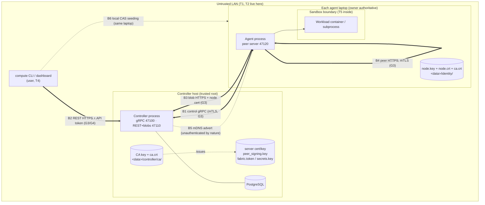

# THREAT MODEL — MeshForge compute fabric

> **Status:** living document, created in V0.7 G1 (roadmap **0.7.1**, decision **D133**, [ADR-0016](adr/0016-v07-security-design.md)).
> Every row below names the **test that proves it** or is marked **accepted** with a reason (V0.7 brief §4 item 21).
> Task **0.7.11** (G7) closed every open row and made the rule a check: `scripts/threat_model_check.py` (§9) fails unless
> every row is `mitigated` with tests that pytest collects under the `security` marker, or `accepted` with its ID in §7.
> The row-by-row review is the G7 reviewer's (D166 (3)); the implementer does not certify rows.
> Design sources: ARCHITECTURE §16, [ADR-0008](adr/0008-pairing-and-mtls.md), [ADR-0013](adr/0013-node-identity-storage.md),
> [ADR-0014](adr/0014-interim-execution-trust.md) (superseded), `docs/briefs/V0.7-security-pairing.md` §2 (D133–D146).

**Status values:** `mitigated` = the named test exists, carries `@pytest.mark.security` and passes · `accepted` =
deliberately not mitigated, the reason in the row and the row's ID in §7. (`open (Gn)` / `decision (Gn)` were used while
V0.7 was built; since G7 the check refuses them.) A status may combine both: `mitigated; **accepted**: <residual>`.

The system is **remote code execution by design** (CLAUDE.md §9). The goal of V0.7 is: only enrolled devices take
part, every plane is authenticated and encrypted, users act under their own identity, the laptop owner keeps the final
say over their machine, and workloads are confined — each claim checked by a test, not asserted.

---

## 1. Assets

| ID | Asset | Why it matters | Where it lives |
|---|---|---|---|
| A1 | **The laptops themselves** (CPU/GPU time, the OS accounts the agent runs as) | An attacker who can start a job runs code on someone's laptop | every agent host |
| A2 | **Owners' files** outside the attempt workdir | A workload or a rogue controller must never reach them | every agent host |
| A3 | **Job code and data** (bundles/trees, named inputs, outputs, logs) | Users' intellectual property and results; integrity decides correctness | controller blob store, agent CAS, attempt workdirs, wire |
| A4 | **Secrets in transit/at rest**: fabric token (V0.4–V0.7), API tokens + passwords (G4), job secrets (G6), fetch/peer/probe tokens, upload grants, the DB password | Each grants an action; leaking one in a log or on the wire is a breach | config dirs, DB, process memory, wire, logs |
| A5 | **Keys**: fabric **CA key** (crown jewel), controller server key, node keys (ADR-0013), peer-token signing key (D98), secrets master key (G6) | The CA key can mint any node; the signing key can mint any peer token | `<data>/controller/…`, `<data>/identity/` |
| A6 | **Fabric integrity**: node registry, sessions, job/attempt state, planner decisions, telemetry (feeds the V0.15 ML planner) | Poisoned state misplaces jobs, poisoned telemetry trains a wrong model | PostgreSQL, controller memory |
| A7 | **Availability** of the controller and of each laptop for its owner | The owner's own work comes first | everywhere |

## 2. Actors (who we defend against)

| ID | Actor | Capabilities assumed | Out of scope for them |
|---|---|---|---|
| T1 | **LAN outsider** — any device on the same Wi-Fi/Ethernet, never enrolled | sniff, inject, ARP/mDNS spoof, MITM, connect to every open port, replay captured traffic | physical access to a fabric laptop |
| T2 | **Rogue controller** — a LAN host pretending to be the controller (mDNS record or address takeover) | accept agent connections, send commands, serve REST to the CLI | the real CA key |
| T3 | **Stolen, compromised or revoked laptop** — holds a valid node key + cert until revoked (and keeps them after) | everything an enrolled agent can do; lie in reports; keep using old certs/tokens | the CA key, other nodes' keys |
| T4 | **Malicious-but-enrolled user** — has an account / API token (or, before G4, the fabric token) | submit any job, read anything the API returns to them, guess IDs, brute-force others' credentials | admin role (unless granted) |
| T5 | **Malicious workload** — code inside a job | anything a process in the sandbox can do: syscalls, network if allowed, fill disk, fork, read its own secrets | — |
| T6 | **Other local OS user** on a fabric laptop (added: the private-file rules exist for this actor) | read world/group-readable files, run processes as another user | root / Administrator (root owns the machine; accepted) |

**Explicitly trusted (accepted):** the controller host's root/Administrator and its PostgreSQL superuser; the laptop
owner over their own laptop (D142: the owner is authoritative); the Python/`cryptography`/grpcio/Docker supply chain.

## 3. Trust boundaries



Boundaries: **B1** control gRPC · **B2** REST · **B3** controller blob HTTP · **B4** peer blob HTTP · **B5** mDNS ·
**B6** local files (identity, keys, CAS seeding by the CLI) · **B7** the workload sandbox · **B8** the PKI itself
(added: the CA, certificates and CSRs are an attack surface of their own).

## 4. Honest inventory of V0.6 (found in the code, 2026-10-07) — historical

> **Historical (kept as the record of where V0.7 started).** Every item below is closed by the §5 row it names; the
> line numbers point at V0.6 code that no longer exists in that form. Nothing in this table is current state.

Every plaintext plane and every place that trusts a claim instead of a proof. Each line maps to a row in §5.

| # | Where | What | Row |
|---|---|---|---|
| P1 | `controller/server.py:407` `add_insecure_port` | control gRPC is plaintext | CG-T1, CG-I1 |
| P2 | `agent/session/client.py:460` `grpc.aio.insecure_channel` | the agent trusts any server at the address | CG-S3 |
| P3 | `controller/server.py` uvicorn without `ssl_*`; `cli/settings.py:44` default `http://127.0.0.1:47110`; `cli/follow.py:40` `ws://` | REST, log WebSocket and the fabric token in `Authorization` are plaintext | RE-I1, RE-S3 |
| P4 | `agent/execution/fetch.py:124` `http://{host}:{blob_port}` | bundles/trees/inputs downloaded in clear; fetch tokens and upload grants sniffable | CB-I1, CB-S1 |
| P5 | `controller/jobs/peers.py:116` `http://{peer_endpoint}`; `agent/peer/probe.py:241` | peer blob + probe traffic in clear | PB-I1 |
| P6 | `controller/session/manager.py:536` `HelloAck.peer_token_key` | the peer-token verification key arrives over plaintext gRPC: a MITM can substitute its own key | CG-T1 |
| C1 | `controller/session/admission.py:91` (marked TRUST POINT) | `Hello.node_id` is a claim; node ids are public (`GET /v1/nodes`), so any LAN host can take over a node's session | CG-S1, CG-S2 |
| C2 | `agent/discovery.py:180` | the agent dials the first LAN-address mDNS record | MD-S1 |
| C3 | `controller/api/job_routes.py:497` `submitter_node_id` | the CLI names "its" node; nothing proves it | RE-T2 |
| C4 | `controller/scores.py:128` | the score fingerprint is whatever the agent reports | CG-T2 |
| C5 | `controller/api/blob_routes.py:186,499` | uploaded parts are not attributed to the sending node (V0.6 G1 follow-up 3) | CB-E1 |
| C6 | `controller/fabric_token.py`, `api/auth.py` | one shared bearer secret = "the user"; no per-user identity or audit (closed in G4: users + API tokens) | RE-S1, RE-R1 |
| C7 | `controller/store/settings.py:51` | default DB password `meshforge-dev` accepted on any controller (closed in G4: refused outside insecure-dev) | LF-T2 |
| C8 | `cli/transfer.py:227` `seed_local` | the CLI writes into the agent's CAS; ownership when the agent runs as another user (D125) | LF-T1 |
| C9 | revoked-node state exists, no production trigger (STATUS) | a stolen laptop cannot be cut off | CG-E1 (closed in G3: `node revoke`) |
| C10 | `common/peer_token.py:76` `MAX_TTL_S = 600`; `[controller.jobs] peer_token_ttl_s` 60–600 | a peer token outlives a revocation by up to 10 min (D138 assumed ≤ 60 s) | PB-E1 (closed in G3: 60 s, re-minted per transfer, D147) |

## 5. STRIDE per plane

Columns: **ID** · **S/T/R/I/D/E** · **threat** · **today (V0.6)** · **V0.7 mitigation** · **group** · **test** (file or
"to be written" with its intended home) · **status**.

### 5.1 B1 — Control gRPC (agent ⇄ controller, TCP 47100) and enrollment

| ID | | Threat | Today (V0.6) | V0.7 mitigation | Grp | Test | Status |
|---|---|---|---|---|---|---|---|
| CG-S1 | S | T1 connects and enrolls as a new node with any `node_id` | accepted by `Hello` (C1) | session port is mutual TLS with the client certificate **required** (BoringSSL verifies chain + validity against `ca.crt`), `NodeCertInterceptor` refuses any call without an acceptable node cert (our fabric, clientAuth, valid now, not revoked); `node_id` taken from the cert SAN (D136/D137) | G3 | `tests/component/controller/test_v07_g3_mtls_session.py::test_no_client_cert_is_refused_at_the_handshake`, `::test_plaintext_client_is_refused`, `::test_cert_from_another_ca_is_refused`, `::test_expired_cert_is_refused_at_the_handshake`; `tests/unit/controller/test_v07_g3_peer_cert.py` (every `parse_peer` branch, interceptor); mutation: `require_client_auth=False` -> fails | mitigated |
| CG-S2 | S | T1 claims an **existing** node's `node_id` and supersedes its session (receives its `StartAttempt`s) | possible: node ids are public (C1) | `Hello.node_id` must equal the cert's node id, else `UNAUTHENTICATED` / `node_id_mismatch`, nothing persisted; an older certificate of a re-keyed node is `cert_superseded` (only the serial on record is the node) | G3 | `tests/component/controller/test_v07_g3_mtls_session.py::test_hello_for_another_node_is_unauthenticated`, `::test_victim_session_is_not_superseded_by_an_impostor`, `::test_an_older_certificate_of_a_rekeyed_node_is_refused`; mutation: SAN==Hello check removed -> fails | mitigated |
| CG-S3 | S | T2 rogue controller receives agent connections and sends `StartAttempt` → code runs on an execution-enabled laptop | possible (P2, C2); ADR-0014 warned, did not solve | agent trusts only `ca.crt` (pinned at join) and verifies the fixed name `meshforge-controller`; node certs carry no DNS SAN, so neither another CA nor an enrolled laptop can pose as the controller (D137) | G2, G3 | `tests/component/agent/test_v07_g3_agent_mtls.py::test_agent_never_says_hello_to_a_rogue_controller[other_ca]`, `[enrolled_node]` (server-side spy: zero streams) | mitigated |
| CG-S4 | S | T1 enrolls with a stolen/guessed join code | n/a (no enrollment yet) | 128-bit single-use token from `secrets`, stored as SHA-256 only, TTL 15 min (1 min-24 h, DB clock), redeemed by one `UPDATE … WHERE used_at IS NULL AND revoked_at IS NULL AND expires_at > now() RETURNING` inside the enrolment transaction (a refused enrolment rolls back and does not burn it); revocable; per-IP rate limit; every invite/redeem/revoke audited without the token (D135, D151) | G2 | `tests/component/controller/test_v07_g2_invites.py::test_token_is_stored_hashed_only`, `::test_single_use_under_a_16_way_race`, `::test_a_rolled_back_redeem_does_not_burn_the_code`, `::test_refusal_reasons`, `::test_ttl_bounds`, `::test_revoke_rules`; `tests/component/controller/test_v07_g2_enroll.py::test_used_expired_and_revoked_codes`, `::test_sixteen_laptops_race_one_code`, `::test_hostile_csrs_are_refused_and_do_not_burn_the_code`; mutation: each of the three `WHERE` guards removed -> tests/component/controller/test_v07_g2_invites.py fails; **G7 (criterion 2):** TTL edge on the database clock `tests/component/controller/test_v07_g2_tester_enroll.py::test_expiry_is_the_database_clock_and_strict`, revoke vs redeem `::test_revoke_and_redeem_race_has_exactly_one_winner` | mitigated |
| CG-S5 | S | T1 serves a fake CA to a joining agent | n/a | the agent reads the presented chain in a verify-off TLS handshake, keeps only a self-signed CA whose SHA-256 starts with the code's 128-bit pin (constant-time) **and** that issued the server cert, and only then sends the token over a channel verifying against that CA (D136, D150); the returned cert must be issued by it, hold our key and name our node/fabric | G1, G2 | `tests/unit/common/test_pki.py::test_short_fingerprint_is_128_bits_of_sha256`, `::test_short_fingerprint_matches_forms`; constant time: `tests/unit/agent/test_v07_g7_fix1_pin_constant_time.py::test_the_pin_is_compared_with_compare_digest`, `::test_the_compare_digest_answer_decides` (a spy `compare_digest` in `common.pki` decides `pin_ca`; mutation: `==` -> fails); `tests/component/controller/test_v07_g2_enroll.py::test_wrong_ca_pin_sends_nothing` (server-side spy: zero `Enroll` calls, invite unused), `::test_a_plain_tcp_server_is_not_a_controller`; `tests/unit/agent/test_enrollment_store.py::test_pin_ca_accepts_only_the_pinned_issuing_ca`, `::test_check_issued_refusals`; mutation: pin check bypassed -> tests/component/controller/test_v07_g2_enroll.py fails | mitigated |
| CG-S6 | S | T3/T4 enrolls a CSR naming another node's `node_id`, or a CSR signed by a different key | n/a | `verify_csr`: signature valid, P-256 only, exactly one SAN URI naming the node; an enrolled `node_id` with another key is refused `node_key_conflict` unless the code was made with `invite --replace <node_id>`, and a replace code for another node is `replace_mismatch`; refusals burn no code (D136) | G1, G2 | `tests/unit/common/test_pki.py::test_verify_csr_*` (G1); `tests/component/controller/test_v07_g2_enroll.py::test_replace_flow` (conflict, mismatch, the replace path, codes not burned, audit `key_replaced`), `::test_hostile_csrs_are_refused_and_do_not_burn_the_code`; `tests/component/controller/test_v07_g2_tester_enroll.py::test_revoked_node_cannot_enrol_even_with_a_replace_code` | mitigated |
| CG-T1 | T | MITM rewrites `StartAttempt` (manifest, runtime, digests) or substitutes `HelloAck.peer_token_key` (P6) | plaintext (P1) | TLS ≥ 1.2 on gRPC (BoringSSL negotiates 1.3), server + client cert verified (D137) | G3 | TLS: `tests/component/controller/test_v07_g3_mtls_session.py::test_grpc_client_and_server_negotiate_tls13_on_the_wire` (ServerHello read off the wire), `::test_python_client_negotiates_tls13_with_alpn_h2`; D146: `tests/cluster/test_v07_g3_plaintext_recorder.py::test_no_plaintext_marker_crosses_any_link_of_a_full_job_run` (argv marker absent on every gRPC link); **G7 (criterion 3):** `tests/cluster/test_v07_g7_criterion3_recorder.py::test_no_marker_of_a_full_run_crosses_any_link_in_mtls` (adds outputs uploaded + downloaded, a join code, a cancelled job, the `Bearer ` header and the peer-token prefix as markers) with its control `::test_control_run_in_insecure_dev_the_recorder_sees_every_marker` (the same recorder finds them in plaintext) | mitigated |
| CG-I1 | I | T1 sniffs fetch/peer/upload tokens, manifests, live log chunks | plaintext (P1) | TLS (D137); job secrets only inside `StartAttempt` over mTLS (D144) | G3, G6 | `tests/cluster/test_v07_g3_plaintext_recorder.py::test_no_plaintext_marker_crosses_any_link_of_a_full_job_run`: every byte of every link recorded (each agent's gRPC, REST+blobs, each peer server); the argv marker, a file-content marker (also in the job's log chunks) and the fabric token are on none, while B's stdout read back over REST proves they travelled; `tests/cluster/test_faultproxy.py::test_recorder_keeps_each_direction_of_each_connection_and_finds_split_markers` (the recorder itself) ; **G6**: the same test stores a job secret over the recorded rest link, both jobs read it (they write its SHA-256, asserted) and its value, base64 and hex are on no link; not sniffing tests but the guard that keeps secrets off a plaintext session in the first place (insecure-dev): `tests/unit/controller/test_v07_g6_dispatch_secrets.py::test_insecure_dev_is_refused_without_the_flag` (a session without a client certificate never gets a value; mutation checked), `tests/unit/agent/test_v07_g6_secret_files.py::test_insecure_dev_refuses_unless_allowed`; **G7 (criterion 3):** `tests/cluster/test_v07_g7_criterion3_recorder.py::test_no_marker_of_a_full_run_crosses_any_link_in_mtls` (adds outputs uploaded + downloaded, a join code, a cancelled job, the `Bearer ` header and the peer-token prefix as markers; fix round 1: the enrolment listener 47101 is recorded too and a real `meshforge-agent join` redeems the code through it - its join token (raw, hex), CSR/cert PEM armour and node id are on no link and every byte on that link parses as whole TLS records; no insecure-dev control there: `Enroll` exists only over TLS) with its control `::test_control_run_in_insecure_dev_the_recorder_sees_every_marker` (the same recorder finds them in plaintext) | mitigated (G3, G6) |
| CG-T2 | T | T3 lies in reports: hardware, scores, cache contents, resources | trusted; score fingerprint is a claim (C4) | identity proven (G3: `Hello.node_id` = the certificate's node); **score documents bound to the authenticated node (D145b)**: `scores_document(..., node_id)` stores the node whose certificate-authenticated session reported the set (Hello and report paths), and the planner snapshot and `GET /v1/nodes` never use a document bound to another node (a pre-G5 document without a binding is accepted until the node's next Hello re-binds it, and **expires** after `[controller.planner] unbound_scores_max_age_s` (7 d; cleared at controller start and every `unbound_scores_check_s`, D161 N3) so a node that never returns cannot keep one forever). **Lies about capacity remain possible**: hashes protect data integrity, a lie only costs time and shows as failed attempts | G5 | `tests/unit/controller/test_v07_g5_score_binding.py` (`::test_hello_and_report_scores_are_bound_to_the_session_node`, `::test_the_planner_never_uses_another_nodes_scores`, `::test_the_api_never_shows_another_nodes_scores`, `::test_bound_to`; mutation checked: binding check off, planner filter off, report bound to a constant); expiry: `tests/component/controller/test_v07_g6_unbound_scores_pg.py` (`::test_only_old_unbound_documents_are_cleared`, `::test_the_boundary_is_strictly_older`, `::test_the_controller_expires_them_at_start`; D162 T-7: a document whose `measured_at` is missing or unparseable never blocks the others and is cleared itself - `tests/component/controller/test_v07_g6_fix1_unbound_scores.py::test_garbage_never_blocks_the_others_and_is_cleared_itself`; mutation checked: binding filter off, `<` -> `<=`, start call removed) | mitigated (binding); **accepted** (residual: an enrolled node can misreport its own capacity, and the fingerprint inputs are its own claim) |
| CG-R1 | R | actions cannot be tied to a proven node | session node = claimed node | every session is keyed by the cert-derived `node_id` (Hello must match); the cert serial is recorded on the node | G3 | `tests/component/controller/test_v07_g3_mtls_session.py::test_first_hello_records_the_certificate`, `::test_hello_for_another_node_is_unauthenticated` (the CG-S2 tests) | mitigated |
| CG-D1 | D | unauthenticated connection / Hello / Enroll floods | bounded: `hello_timeout_s`, admission deadline, message size caps, outbound queue (V0.3/V0.4) | `Enroll`: token bucket per source (D152: gRPC's percent-encoded peer string is decoded; **IPv4 per address, IPv6 per /64** - one laptop can rotate privacy addresses through its /64; IPv4-mapped IPv6 = the IPv4 address; an unparseable peer goes to **one shared `unknown` bucket**, never a fresh one) (`[controller.enroll] rate_per_minute`/`rate_burst`, bounded table) checked before any DB work, 16 KiB requests, 16 concurrent RPCs (D135); TLS handshake before any session message (G3) | G2, G3 | existing: `tests/component/controller/test_session_server.py::test_missing_hello_is_closed_failed_precondition` (Hello timeout), `tests/component/controller/test_session_server_tester.py::test_message_larger_than_default_grpc_max_ends_cleanly`, `::test_burst_of_2000_heartbeats_never_hangs_the_server`, `tests/unit/controller/test_admission_timeout_settings.py`; `tests/component/controller/test_v07_g2_enroll.py::test_rate_limit_is_per_source_ip` (burst+1 refused, a second source IP unaffected), `tests/unit/controller/test_v07_g2_enroll_listener.py::test_rate_key_decodes_grpc_peers_and_buckets_ipv6_per_64`, `::test_unknown_peers_exhaust_one_shared_bucket`, `tests/unit/controller/test_v07_g2_tester_ratelimit.py::test_real_ipv6_peers_collapse_to_one_key`, `tests/component/controller/test_v07_g2_tester_placeholder_ipv6.py::test_ipv6_clients_are_rate_limited_per_ip` (tester T-1, fixed); mutations: limiter bypassed, peer not URL-decoded, /64 replaced by the address, unknown peer keyed by itself -> each fails; session port (G3): `tests/component/controller/test_v07_g3_mtls_session.py::test_no_client_cert_is_refused_at_the_handshake`, `::test_plaintext_client_is_refused` (no session message is read before a verified client certificate) | mitigated (Enroll: rate limit per source; session port: nothing before a verified client certificate, then the Hello timeout and size caps); **accepted** residual: a LAN host can still burn TLS handshakes and spread over many source IPs (LAN DoS is out of scope, §7) |
| EN-S1 | S | a CSR claims another (already enrolled) `node_id`, or is signed by a key it does not contain, or names another fabric | n/a | CSR verified before any DB work (P-256, SHA-256, signature, one SAN URI for this fabric); an enrolled `node_id` with another key is refused (`node_key_conflict`) unless the invite was made with `--replace NODE_ID`, and a replace invite enrols only that node (D136) | G2 | `tests/component/controller/test_v07_g2_enroll.py::test_hostile_csrs_are_refused_and_do_not_burn_the_code`, `::test_replace_flow`; `tests/unit/common/test_pki.py::test_verify_csr_*`; mutations: key-conflict / replace-mismatch checks removed -> tests/component/controller/test_v07_g2_enroll.py fails | mitigated |
| EN-S2 | S | the CA that issued the code was replaced (`fabric create --force`) after the code was made | n/a | the code pins the old CA: the agent refuses (`pin_mismatch`) and sends nothing | G2 | `tests/component/controller/test_v07_g7_fix1_ca_rotation_join.py::test_a_code_from_before_fabric_create_force_is_refused_and_sends_nothing` (the real rotation: `fabric create`, a code, the real `fabric create --force` CLI, the controller back on the same enrolment address: `pin_mismatch`, zero `Enroll` calls, invite unused, no file; a new code then joins; mutation: pin check bypassed -> fails), `tests/component/controller/test_v07_g2_enroll.py::test_wrong_ca_pin_sends_nothing` (a forged pin, same mechanism) | mitigated |
| EN-S3 | S | an invite holder claims the `node_id` of a **pre-G2** node (known from `GET /v1/nodes`) that has no key on record yet | n/a | none in G2: the first enrolment of a node without `public_key_fingerprint` binds the presented key (trust on first enrolment); the real laptop's later join is then refused `node_key_conflict` (visible), and the admin can `invite --replace` | G2 | `tests/component/controller/test_v07_g2_enroll.py::test_replace_flow` (conflict + replace path) | **accepted**: invites are admin-issued, single-use and short-lived, so the claimant is someone the admin invited; G3's mTLS makes the bound key the only way in; re-joining every lab laptop before G3 (brief §6) clears all legacy rows |
| EN-I1 | I | the join code leaks via logs, shell history or the process list | n/a | the code's `mf1-…` shape is scrubbed from every log string (checklist 20); the controller prints it once on stdout, facts on stderr; never stored (hash only); `meshforge-agent join` and `compute fabric join` read it from a hidden prompt / stdin (`compute fabric join` passes it to the agent on stdin, never argv) | G2 | `tests/unit/common/test_redaction_join_code.py` (+ mutation test), `tests/unit/cli/test_v07_g2_cli_fabric.py::test_join_hands_the_code_to_the_agent_on_stdin`, `tests/cluster/test_v07_g2_join.py` (no code group in any process log) | mitigated; **accepted**: `meshforge-agent join CODE` as an argument is still allowed (visible in `ps`/history while it runs); OPERATIONS recommends the prompt |
| EN-T1 | T | a crash mid-join, or a failed `join --force`, leaves a certificate next to the wrong CA or key, or loses a working enrolment | n/a | under `identity.lock`: both new files are staged in full first (private temp files, fsynced) - a failure there keeps the old enrolment byte-identical; only then is the old `node.crt` removed and `ca.crt`, `node.crt` swapped in with `os.replace` + folder fsync, so an interruption in that last step leaves "not enrolled", never old+new mixed (D153 item 2); `load` re-verifies the pair against each other and the identity key; `identity reset` deletes the certs first | G2, G3 | `tests/unit/agent/test_enrollment_store.py::test_store_load_and_force`, `::test_load_refuses_a_cert_for_another_key_or_ca`, `::test_load_refuses_hostile_files`, `::test_reset_removes_the_enrolment`; `tests/unit/agent/test_v07_g3_item0_agent.py::test_failed_force_rejoin_keeps_the_old_enrolment`, `::test_mutation_unstaged_write_would_lose_the_old_pair`; `tests/unit/agent/test_v07_g2_tester_agent_storage.py::test_process_death_during_force_rejoin_never_pairs_old_cert_with_new_ca` (real `os._exit` at every step) | mitigated |
| EN-D2 | D | the controller's reply to `Enroll` is lost (client timeout, network cut) after the code was redeemed: the code is spent but the laptop holds no certificate | n/a | by design the code is single-use and consumed with the issue in one transaction; the controller bounds every `Enroll` server-side (10 s, then `UNAVAILABLE`, transaction rolled back = code **not** spent) and the `token_used` refusal tells the user "if your last join timed out or was interrupted, the code may have been spent on it - ask for a new code" (D153 items 1, 8) | G3 | `tests/unit/controller/test_v07_g3_item0_enroll.py::test_token_used_message_names_the_lost_reply_case`, `::test_hanging_enrolment_is_refused_unavailable_after_the_deadline` | **accepted**: replaying a lost reply would need a second, retrievable credential; a new code costs the admin one command |
| CG-E1 | E | a revoked/stolen laptop keeps (or re-opens) its live session | no production trigger (C9) | `meshforge-controller node revoke` / `POST /v1/nodes/{id}/revoke` / `compute node revoke` → one transaction: `node.state = revoked` (sticky: no session write can undo it), serial into `revoked_cert`, `node_revoked` audit row; the live stream is cut at once with `PERMISSION_DENIED` (`node_revoked`, the re-join remedy in the detail), a lingering one ended, attempts take the node-loss path; a reconnect is refused by the interceptor (`cert_revoked`) and, for a cert-less node, by the DB check at admission; a CLI revocation (other process) is enforced by the periodic sync (`[controller.revocation] poll_interval_s`, 1 s). No un-revoke: every enrolment refuses a revoked `node_id`, `invite --replace` included; the laptop comes back only under a new identity (D138) | G3 | `tests/component/controller/test_v07_g3_revocation.py::test_revoke_cuts_the_live_session_within_one_heartbeat` (measured from the request to the agent's status, asserted < the 2 s production heartbeat; DB/audit/`revoked_cert` rows; idempotent; reconnect refused; sticky state), `::test_a_cli_revocation_is_enforced_by_the_periodic_sync`, `::test_who_may_revoke`, `::test_a_revoked_node_never_comes_back_and_rekeys_supersede`; `tests/component/controller/test_v07_g2_tester_enroll.py::test_revoked_node_cannot_enrol_even_with_a_replace_code`; `tests/component/agent/test_v07_g3_revocation_agents.py::test_revoking_a_busy_node_moves_its_job_and_closes_the_peer_plane` (real agents: the revoked agent stops for good, its attempt is `lost`/`node_revoked`, the job succeeds on another node); `tests/unit/controller/test_v07_g3_revocation_unit.py`; mutations M1-M11 (G3 progress) each fail a test | mitigated |
| CG-E4 | E | a re-enrolled node's **previous** certificate (still CA-valid until it expires) keeps working on the HTTPS and peer planes | admission refuses it (`cert_superseded`), other planes did not | every re-enrolment writes the replaced serial into `revoked_cert` as `superseded` in the enrolment transaction; the set reaches the interceptor, the HTTPS policy and every agent like a revocation (D138); a **live** stream still using the superseded serial is cut by the revocation sync within its poll interval (`PERMISSION_DENIED` / `cert_superseded`, node OFFLINE at once - D155 T-1) | G3 | `tests/component/controller/test_v07_g3_revocation.py::test_a_revoked_node_never_comes_back_and_rekeys_supersede` (superseded row + the serial in the controller's set); `tests/component/controller/test_v07_g3_cert_session_ends.py::test_superseded_cert_cuts_its_live_session_within_the_poll_interval`; `tests/component/controller/test_v07_g3_tester_planes.py::test_superseding_a_cert_cuts_the_live_session_that_uses_it`; `tests/unit/controller/test_v07_g3_revocation_unit.py::test_sync_cuts_a_live_stream_whose_serial_was_superseded`; mutations: no `supersede` / sync never cuts -> fail | mitigated |
| CG-E2 | E | T3 reports status/logs for an attempt placed on another node | fencing tokens + session checks (V0.6 §17); **found in G7:** the store applied an `AttemptStatus` from any node that knew the attempt id and its fencing token (a small epoch number) | the reporting node is the one its session's client certificate proves (G3); `ExecutionStore.apply_status(report, node_id=...)` refuses a report whose node is not the attempt's (`WRONG_NODE`, checked before the token or the state, so the outcome tells B nothing), the dispatcher acks it (no replay), counts `statuses_wrong_node`, logs `controller.jobs.status_wrong_node` `reason=wrong_node` and does nothing else (no cancel, retry or scrub); **V0.8 G1 (D168 N1/N3):** counted on its own per-session counter `attempt_status_wrong_node` (never the fencing one) and recorded as an `attempt_wrong_node` audit row in the refusing transaction (the operator alert, D180); a `LogChunk` from the wrong node is dropped (`chunks_fenced`); an output upload needs the grant's node certificate (CB-S1); Reconcile only ever reads the reporting node's own attempts | G7 (fix `0e670a5`) | `tests/component/controller/test_v07_g7_cross_node_reports.py::test_the_store_refuses_every_report_from_another_node_and_changes_nothing`, `::test_node_b_cannot_report_status_or_logs_for_node_as_attempt` (real mTLS controller, two agents: B's FAILED(integrity_error)/UPLOADING/DONE+digest/DONE and a log chunk for A's attempt refused, B gets only acks, job/attempt/log unchanged, A then finishes the job); `tests/component/controller/test_v07_g3_https.py::test_upload_grant_needs_the_minted_nodes_certificate` (outputs); mutations: store node check off, log-chunk node check off -> fail; V0.8 G1: `tests/component/controller/test_v08_g1_wrong_node_audit.py::test_each_wrong_node_refusal_is_audited_and_an_accepted_report_is_not`, `tests/unit/controller/test_v08_g1_wrong_node_counter.py::test_a_wrong_node_report_counts_on_its_own_counter_only` | mitigated |
| CG-E3 | E | expired node cert keeps working | n/a | expiry checked at the handshake (BoringSSL + interceptor) **and** a live session is closed at its certificate's `not_after` (`UNAUTHENTICATED` / `cert_expired`, session end `cert_expired`, node OFFLINE at once - D155 T-3); renewal at ⅔ life over mTLS (`RenewCertificate`, G4) hands the session over to the new certificate days **before** `not_after` (the new certificate becomes current at the node's first Hello with it; only then is the old serial superseded); the expiry timer re-checks the wall clock before cutting (D156 d); expired → explicit re-join message (D140) | G1, G3, G4 | `tests/unit/common/test_pki.py::test_is_expired_*` (G1); `tests/component/controller/test_v07_g3_mtls_session.py` (expired cert refused at the handshake); `tests/component/controller/test_v07_g3_cert_session_ends.py::test_a_session_is_cut_at_its_certificates_not_after` + `::test_a_closed_session_cancels_its_certificate_expiry_timer`; `tests/component/controller/test_v07_g3_tester_planes.py::test_a_session_does_not_outlive_its_certificate`; G4: `tests/component/agent/test_v07_g4_renewal_agents.py::test_a_busy_node_renews_and_hands_over_before_expiry_while_the_server_cert_renews` (attempt never lost, no `cert_expired` end, old serial superseded and refused by a peer), `::test_rotate_key_on_a_running_agent_end_to_end`, `tests/component/controller/test_v07_g4_renewal.py` (pending until used, typed refusals, rate limit, racing revocation, key rotation, pending revoked with the node), `tests/unit/controller/test_v07_g4_item0.py::test_an_early_expiry_timer_rearms_and_a_due_one_cuts` | mitigated (G3 expiry, G4 renewal) |
| CG-E5 | E | a node (or a stolen node key) mints certificates: for another node, in a loop, after revocation, or keeps a renewed certificate unlisted | n/a | `RenewCertificate` only for the node named by the call's client certificate (CSR node must match), only from its current or pending certificate, per-node rate limit (`[controller.renewal] min_interval_s`), refused for a revoked node under the same row lock as the revocation (which also lists an unused pending certificate); an unused pending certificate is superseded by the next renewal; every issuance audited (`cert_renewed`) | G4 | `tests/component/controller/test_v07_g4_renewal.py::test_renew_refusals_are_typed_and_issue_nothing`, `::test_a_superseded_or_revoked_certificate_cannot_renew`, `::test_renewal_racing_revocation_never_leaves_a_live_certificate`, `::test_revoking_a_node_also_revokes_its_unused_pending_certificate`; `tests/unit/controller/test_v07_g4_activation.py`; a renewal presented on the node's **pending** certificate activates it first (D159 N2: the live certificate is never superseded behind a newer pending one): `tests/component/controller/test_v07_g5_renew_on_pending.py` (mutation checked) | mitigated; **accepted** residual: a stolen node key can renew that node's certificate until the node is revoked (revocation is the remedy, as for every stolen credential) |
| CG-S7 | S | `[security] mode = "insecure-dev"` (plaintext, claimed `node_id`) is switched on for a networked machine | n/a | refused at settings load unless every controller listener, the advertised URL, the agent's controller address (no mDNS) and peer bind, and the CLI URL are loopback; a `security.insecure_dev` warning banner at every start; `mtls` is the default and a controller without a CA refuses to start (D139) | G3 | `tests/unit/common/test_v07_g3_security_mode.py` (every branch; mutation: validators disabled -> fails), `tests/component/controller/test_v07_g3_mtls_session.py::test_insecure_dev_serves_plaintext_on_loopback_and_says_so`, `::test_mtls_without_a_fabric_ca_refuses_to_start`; G7: an insecure-dev controller that also holds a fabric CA serves fetch tokens without a client certificate (plain HTTP cannot carry one; fixed `2aa2caa`): `tests/component/controller/test_v07_g7_insecure_dev_blobs.py`; V0.8 G1 (D168 N2): one `blob_port_is_tls` value drives the listener's TLS, the URL scheme (a mismatching `advertise_url` refuses to start) and the node-cert lock: `tests/unit/controller/test_v08_g1_blob_port_tls.py`, `tests/component/controller/test_v07_g7_insecure_dev_blobs.py::test_insecure_dev_refuses_an_https_advertise_url_at_start` | mitigated |
| CG-D2 | D | the enrolment port stays separate from the session port (47101 next to 47100): one more unauthenticated listener | n/a | grpcio's `require_client_auth=False` never *requests* a client cert, so one port cannot serve both cert-less `Enroll` and cert-required sessions; the session port requires the cert, `Enroll` keeps its own TLS listener (rate limit, 16 KiB, 16 RPCs, 10 s server deadline, idle/age limits) - decided in D154 (1) | G3 | `tests/unit/controller/test_v07_g3_item0_enroll.py::test_hanging_enrolment_is_refused_unavailable_after_the_deadline`; CG-D1 tests | **accepted** (D154 (1)): two TLS ports, both bounded; the second listener serves only `Enroll` and `GetFabricCa` (§7) |

### 5.2 B2 — REST API (CLI / dashboard → controller, TCP 47110)

| ID | | Threat | Today (V0.6) | V0.7 mitigation | Grp | Test | Status |
|---|---|---|---|---|---|---|---|
| RE-S1 | S | anyone holding the shared fabric token acts as "the user" | one bearer secret (C6) | per-user accounts (`meshforge-controller user create`), opaque 256-bit API tokens (`mfat_…`, `secrets`) stored as SHA-256 only, 90 d, revocable (`compute tokens revoke`, `compute logout`, a disabled user or a password reset revokes all), one DB read per request so a revoke/expiry/disable acts on the next request; an **open log WebSocket** re-checks its token every `[controller.auth] stream_recheck_interval_s` (1 s, one query for all open streams) and a REST token revoke wakes the check at once, so a revoke/expiry/disable closes the stream `4401 unauthorized` within ~1 s (a user database that cannot answer 5 checks in a row closes them `4503`, fail closed) (D157 T-1); unknown/expired/revoked/disabled/malformed → one 401; fabric token refused unless `[controller.auth] legacy_fabric_token = true` (default false; then an admin with a warning + `legacy_token_used` audit), deleted V0.8 (D141) | G4 | `tests/component/controller/test_v07_g4_user_store.py::test_a_live_token_authenticates_and_nothing_else_does`, `::test_expired_revoked_and_disabled_are_refused`, `::test_a_password_reset_revokes_every_live_token`; `tests/component/agent/test_v07_g4_users_e2e.py::test_login_whoami_and_every_way_a_token_stops_working`, `::test_legacy_fabric_token_is_refused_by_default`; `tests/unit/controller/test_api_auth.py` (one 401 for every malformed/unknown form, legacy off/on, directory down = 503); streams (D157): `tests/component/agent/test_v07_g4_fix1_stream_auth.py` (REST revoke closes at once with the tick parked, expiry, a disabled row without revoked tokens, other streams unaffected), `tests/component/agent/test_v07_g4_tester_r1_users.py::test_disabling_a_user_closes_their_open_log_follow` (`user disable` from another process: 4401 in < 3 s), `tests/unit/controller/test_v07_g4_fix1_live_streams.py` (mutation checked); the re-check loop is **supervised** (D159 N4: a crash is logged, retried with backoff; 5 in a row close every checked stream `auth_unavailable` and `/healthz` says `degraded`): `tests/unit/controller/test_v07_g5_live_streams_supervised.py` (mutation checked) | mitigated; **accepted** (D159 N3): streams opened with the legacy fabric token are never re-checked (no token row; the switch is off by default and leaves in V0.8) |
| RE-S2 | S | T4/T1 brute-forces a password | n/a | scrypt (n=2^15, r=8, p=1) in a worker thread (≤ 4 at once); per-source bucket (IPv4 address / IPv6 /64 / one `unknown` bucket, D152) and per-(name, source bucket) exponential backoff after 5 failures (1 s doubling to 300 s; keyed by the name **and** the IPv4 address / IPv6 /64, so a stranger elsewhere cannot lock a known user out - D159 N1), both answered 429 + `Retry-After` **before** any password work; unknown name, wrong password and disabled user = one 401 after the same scrypt work; a name that cannot be a user name (NUL or other control characters, look-alikes; since D158 T-5 any non-ASCII spelling, checked on the raw text before case folding - NFKC is not applied because it would map U+212A to `K`) is that same unknown-user 401 without a database query, never a 503 (D157 T-3); `login_failed` audit rows | G4 | `tests/unit/controller/test_v07_g4_users.py::test_backoff_starts_after_the_free_failures_doubles_and_caps`, `::test_a_blocked_user_is_refused_before_any_lookup`, `::test_an_exhausted_source_is_refused_before_any_lookup`, `::test_source_bucket_shares_an_ipv6_slash_64_and_one_unknown_bucket`, `::test_unknown_user_still_costs_one_verification`; `tests/component/agent/test_v07_g4_users_e2e.py::test_login_backoff_per_user_and_audit`, `::test_login_backoff_per_source`; hostile names: `tests/component/agent/test_v07_g4_tester_r1_users.py::test_control_characters_in_the_name_get_the_unknown_user_401`, `::test_hostile_login_bodies_get_a_clean_4xx_and_never_a_token`, `tests/unit/controller/test_v07_g4_users.py::test_login_record_answers_none_for_impossible_names_without_a_query` ; G5: `tests/unit/controller/test_v07_g5_login_names.py` (`::test_a_stranger_elsewhere_cannot_lock_out_a_known_user`, `::test_the_backoff_is_shared_inside_one_ipv6_slash_64`, `::test_a_look_alike_is_the_unknown_user_answer_without_a_lookup`, `::test_user_creation_refuses_non_ascii_names`; mutation checked), `tests/component/agent/test_v07_g4_tester_r2_names.py::test_a_non_ascii_look_alike_is_not_an_alias_of_the_ascii_name` (was a strict xfail) | mitigated; **accepted**: a guesser can delay a user's *next* login **from the guesser's own address bucket** (backoff), never their issued tokens; a guesser with many /64s gets 5 free tries per bucket (each also rate limited) |
| RE-S3 | S | T2 impersonates the controller to the CLI and collects its token or password | plaintext, unverified (P3) | HTTPS with the controller server cert; `compute login` verifies the controller **before** sending the password: `--ca`, a CA already on the laptop, or first contact = the CA read from the handshake and kept only if its **full** SHA-256 fingerprint (from `fabric show`) matches and it issued the server's certificate; the CA is stored with the token and trusted from then on (D139/D141) | G3, G4 | `tests/unit/common/test_v07_g3_fabric_tls.py::test_controller_check`, `tests/component/controller/test_v07_g3_https.py::test_cli_context_trusts_the_controller_by_name`; `tests/unit/cli/test_v07_g4_cli_login.py::test_pinned_ca_keeps_only_the_fingerprinted_issuer`, `::test_ca_and_fingerprint_must_agree`, `::test_fingerprint_must_be_the_full_form`; `tests/cluster/test_v07_g4_cli_users.py::test_a_normal_user_runs_a_job_through_the_cli` (a wrong fingerprint is refused, nothing stored) | mitigated |
| RE-I1 | I | the token or password travels in clear (`Authorization`, the WebSocket handshake, the login body) | yes (P3) | HTTPS / WSS (D139) | G3, G4 | `tests/cluster/test_v07_g3_plaintext_recorder.py::test_no_plaintext_marker_crosses_any_link_of_a_full_job_run` (G4: the job runs as the normal user; both users' passwords - sent by the harness login over the recorded link - and API tokens, and the fabric token, are on no link); `tests/cluster/test_v07_g3_tester_recorder_more_markers.py` (API token, also base64); **G7 (criterion 3):** `tests/cluster/test_v07_g7_criterion3_recorder.py::test_no_marker_of_a_full_run_crosses_any_link_in_mtls` (adds outputs uploaded + downloaded, a join code, a cancelled job, the `Bearer ` header and the peer-token prefix as markers) with its control `::test_control_run_in_insecure_dev_the_recorder_sees_every_marker` (the same recorder finds them in plaintext) | mitigated |
| RE-I2 | I | open GETs (`/v1/nodes`, `/sessions`, `/network`) disclose hostnames, IPs, hardware and node ids to the LAN | open by D14 | D148: every route needs a user; only `GET /healthz` and `POST /v1/auth/login` are open (an app-wide guard, so a new route cannot forget it) | G4 | `tests/component/agent/test_v07_g4_users_e2e.py::test_every_read_needs_a_user_only_healthz_is_open`; `tests/unit/controller/test_api_auth.py::test_every_route_needs_a_user`, `::test_only_healthz_and_login_are_open` | mitigated; **accepted**: `/v1/openapi.json` (the API's shape, no fabric data) stays open |
| RE-I3 | I | tokens/passwords end up in logs, URLs, errors | header-only, redaction of Bearer/PEM/key=value (existing) | API tokens have a scrubbed shape (`mfat_…` → `mfat_[REDACTED]` anywhere in text); passwords only as `SecretStr`, never logged, never echoed by a 400 (the login body is not echoed); the CLI has no `--password` option (prompt or stdin) and prints no token; the login file is private | G4 | `tests/unit/controller/test_v07_g4_users.py::test_the_scrubber_masks_an_api_token_anywhere_in_text` (fails when `_API_TOKEN_RE` is removed - mutation checked), `::test_password_and_token_fields_are_redacted_in_log_records`; `tests/component/agent/test_v07_g4_users_e2e.py::test_no_password_or_token_in_any_log_event`; `tests/unit/cli/test_v07_g4_cli_login.py::test_login_stores_the_token_privately_and_never_prints_it`, `::test_there_is_no_password_option` | mitigated |
| RE-E1 | E | T4 reads, cancels or downloads another user's jobs/logs/outputs | everyone is one identity | `job.owner_user_id` set at submit; a user lists only their jobs and gets 404 (the same body as a missing job) on detail, cancel, logs, decisions, the WebSocket follow and the output download (`GET /v1/blobs/<their output_digest>` only); another user's Idempotency-Key is a 409 that names nothing; admins see all; legacy/pre-0018 jobs are admin-only (D141) | G4 | `tests/component/agent/test_v07_g4_users_e2e.py::test_another_users_job_is_404_on_every_job_route` (real agent, real outputs) | mitigated |
| RE-E2 | E | T4 performs admin actions (revoke nodes, invites, users) | `compute` has no admin actions yet | `role=admin` for invites (create/list/revoke) and node revoke (403 for a user, D151 re-gate); users are managed only on the controller host (`meshforge-controller user …`, needs DB access) | G4 | `tests/component/agent/test_v07_g4_users_e2e.py::test_invites_and_node_revoke_are_admin_only`; `tests/unit/controller/test_api_auth.py::test_admin_route_is_403_for_a_user_and_200_for_an_admin` | mitigated |
| RE-T1 | T | hostile request bodies (manifests, ids, Idempotency-Key, paths) | bounded and validated (V0.4 §4 item 9) | unchanged | — | existing: `tests/unit/controller/test_api_g5_adversarial.py` | mitigated |
| RE-T2 | T | the CLI claims a `submitter_node_id` it does not own (C3) | trusted as a placement hint | stays a **hint only** (D145c): it makes the named node the Local candidate and lets the estimator drop the tree transfer; every static, owner-policy and live rule still applies to that node, and the agent re-checks its policy (WS-E4) | G7 | `tests/unit/controller/test_v07_g7_forged_submitter.py::test_a_forged_submitter_cannot_lift_a_static_or_policy_rejection` (every static + policy code, every placement policy), `::test_a_forged_submitter_cannot_lift_a_live_rejection`, `::test_a_forged_submitter_never_beats_a_feasible_node_onto_an_infeasible_one`, `::test_the_one_rule_the_hint_changes_is_the_seeded_tree_disk_check`; mutation: rejection skipped for a seeded local -> fails | mitigated (the hint grants nothing); **accepted**: the claim itself is unproven (the CLI holds no node cert) and a *seeded* claim skips the planner's tree-disk check for that node - the agent's own staging floor (`disk_full`) then decides: cost and time, never authority (§7) |
| RE-R1 | R | who submitted/cancelled is not recorded | no | `owner_user_id` on every job; audit rows `user_created/disabled/enabled`, `password_reset`, `login`, `login_failed`, `token_revoked`, `legacy_token_used`; invites/revokes name `user:<id>`; token `last_used_at` (≤ 1/min) | G4 | `tests/component/agent/test_v07_g4_users_e2e.py::test_login_backoff_per_user_and_audit`; `tests/component/controller/test_v07_g4_user_store.py::test_last_used_is_coarse` | mitigated |
| RE-I4 | I | a user reads another user's secrets, or any value at all, over REST | n/a | `/v1/secrets` acts only on the caller's own secrets (no admin view); `GET` lists names + timestamps only; **no route ever returns a value**; a job may name only its owner's secrets (submit `secret_missing:<NAME>` for another user's name; dispatch resolves by `owner_user_id`; a row copied to another owner/name does not decrypt - AES-GCM AAD) | G6 | `tests/component/agent/test_v07_g6_secret_api.py::test_per_user_and_never_a_value` (every response body searched for the value, base64, hex), `tests/component/agent/test_v07_g6_secret_jobs.py::test_submit_refuses_a_secret_the_owner_lacks`, `::test_a_secret_deleted_while_queued_fails_the_job_before_the_node`, `tests/component/controller/test_v07_g6_secret_store.py::test_owner_scoping`, `::test_a_copied_or_renamed_row_does_not_decrypt`; D162 T-1: `put` is atomic per owner in PostgreSQL (advisory transaction lock; `created` from the upsert), the 256-per-user limit exact under concurrent writers - `tests/component/controller/test_v07_g6_fix1_secret_put.py::test_the_limit_is_exact_under_a_burst_from_two_stores`, `::test_created_is_true_exactly_once_across_two_stores`; T-9: `as_env` refuses every `LD_*` name - `tests/unit/common/test_v07_g6_fix1_as_env_names.py::test_every_ld_name_is_refused_as_an_environment_variable`; mutation checked: list shape, owner filter, AAD, submit/dispatch checks, owner lock, `LD_` prefix | mitigated |
| RE-D1 | D | request floods / huge bodies | body caps (`413`), list limits, WebSocket subscriber caps | login + enroll rate limits; others stay unlimited | G4 | existing body-cap tests | accepted (authenticated LAN callers; a rate limiter per route is V0.8+ if needed) |
| RE-D2 | D | an authenticated user names many large secrets in one job to stall or exhaust the controller (and the node) through log redaction (G6 tester r1 T-8: one regex over every form, built on the event loop) | n/a | per-job cap `[controller.jobs] max_job_secret_bytes` (256 KiB; refused typed at submit and at dispatch); one shared linear matcher per attempt (no regex alternation), compiled in a worker thread on the controller and the agent; streaming cost linear in the output for any values | G6 (D162) | `tests/unit/common/test_v07_g6_fix1_matcher.py::test_the_largest_allowed_job_compiles_fast_and_small`, `::test_periodic_values_stay_linear_in_the_output`, `::test_output_equals_the_brute_force_oracle_at_any_chunking`, `tests/component/agent/test_v07_g6_fix1_secret_cap.py::test_submit_refuses_a_job_over_the_cap_and_accepts_one_at_it`, `::test_a_value_grown_while_queued_fails_the_job_before_the_node`, `tests/cluster/test_v07_g6_tester_r1_big_secrets.py::test_big_secrets_do_not_freeze_the_controller_loop` | mitigated; **accepted** (debt T-12, STATUS): the matching runs on the event loop and its cost depends on the values. **Measured worst case (G6 tester r3, one 64 KiB log chunk):** 32 secrets `a*(8192-i)` printed against 64 KiB of `a` = **about 0.4 s for that one chunk (403 ms), i.e. 0.17 MB/s** - periodic secrets against periodic output; other shapes: `a*(8000-i)+b` x32 76 ms, `(ab)*` x32 43 ms, 2 x 130 KB periodic 97 ms; 32 x 8 KiB random values against normal text 3.5 ms (18 MB/s); 1 secret against normal text ~350 MB/s. The cost is linear in the output and bounded by the cap. **Controller: off the loop since V0.8 G1 (D168 T-12)** - the log writer redacts each live chunk in a worker thread (one at a time per hub, in order; output byte-for-byte unchanged), so heartbeats and other requests keep the loop: `tests/unit/controller/test_v08_g1_redaction_off_loop.py::test_a_slow_redaction_does_not_block_the_event_loop` (loop gaps < half a chunk's cost and < 100 ms while 3 worst-case chunks are redacted; mutation: redaction back on the loop -> fails), `::test_off_loop_redaction_output_is_unchanged`. Such a job still slows its **own** log stream (and the controller's other attempts' live logs, which share the one writer) by about 0.4 s per 64 KiB chunk. **Agent: still on the loop** (residual): a job owner who builds such values can hold that node's agent event loop about 0.4 s per 64 KiB chunk it prints. A matcher loop guard that fires (`RedactionStallError`) costs that attempt's log, never the loop and never a value: the streams emit `*`, **and it is visible** (D164 T-22: one warning `agent.execution.log_redaction_failed_closed` / `controller.logs.redaction_failed_closed` per attempt and stream, and the note `[meshforge: log redaction failed closed - output withheld]` in the log itself) - `tests/unit/controller/test_v07_g6_fix3_fail_closed_notice.py::test_live_streams_say_so_once_each_and_keep_their_length`, `::test_the_final_copy_carries_the_note_and_warns_once_per_stream`, `tests/component/agent/test_v07_g6_fix3_fail_closed_visible.py::test_an_agent_side_stall_is_logged_once_per_stream_and_noted_in_the_log`, `::test_a_controller_side_stall_is_logged_once_per_stream_and_noted_in_place`, `tests/unit/common/test_v07_g6_tester_r3_stall_guard.py` |

### 5.3 B3 — Controller blob HTTP (`/v1/blobs*` on TCP 47110)

| ID | | Threat | Today (V0.6) | V0.7 mitigation | Grp | Test | Status |
|---|---|---|---|---|---|---|---|
| CB-I1 | I | T1 sniffs job bundles, inputs and outputs | plaintext (P4) | HTTPS (D139) | G3 | `tests/cluster/test_v07_g3_plaintext_recorder.py::test_no_plaintext_marker_crosses_any_link_of_a_full_job_run` (the project file's marker is on no link while the tree is uploaded, fetched and the output uploaded); **G7 (criterion 3):** `tests/cluster/test_v07_g7_criterion3_recorder.py::test_no_marker_of_a_full_run_crosses_any_link_in_mtls` (adds outputs uploaded + downloaded, a join code, a cancelled job, the `Bearer ` header and the peer-token prefix as markers) with its control `::test_control_run_in_insecure_dev_the_recorder_sees_every_marker` (the same recorder finds them in plaintext) | mitigated |
| CB-S1 | S | T1 replays a sniffed fetch token or upload grant | possible while it lives | TLS + node client cert on `/v1/blobs` and the token (two locks); token bound to the cert's node (D139) | G3 | `tests/component/controller/test_v07_g3_https.py::test_fetch_token_needs_the_minted_nodes_certificate`, `::test_upload_grant_needs_the_minted_nodes_certificate` (no cert / another node's cert -> 401); **G7 (criterion 1):** a certificate of another CA, or an expired one, gets no blob: `tests/component/controller/test_v07_g7_criterion1_https.py` | mitigated |
| CB-T1 | T | tampered or corrupt blobs | SHA-256 verified before any byte is used (V0.5 item 15) | unchanged | — | existing: `tests/unit/common/test_cas.py::test_put_with_wrong_digest_keeps_nothing`, `::test_verify_detects_on_disk_corruption_and_evicts`, `::test_resumable_refuses_a_corrupt_chunk`, `::test_resumable_whole_digest_mismatch_restarts`; `tests/unit/common/test_tree.py::test_parse_refuses_hostile_manifests`, `::test_parse_checks_the_expected_id`, `::test_symlinks_inside_are_kept_and_escaping_ones_refused` | mitigated |
| CB-E1 | E | uploaded parts not attributed to the sending node (C5) | yes | every part upload is kept in its uploader's own staging - `user:<id>` or, under an upload grant, `node:<id>` of the node the grant was minted for **and** whose client certificate presents it (D139 two locks, D157) - and logged `controller.blobs.part_stored` with that owner; over mTLS the owner is always the node the client certificate proves - also for a grant minted without a node (tests only; dispatch always binds one), which is never attributed to the bare attempt (D145a) | G5 | `tests/component/controller/test_v07_g5_part_attribution.py::test_parts_are_kept_against_the_proven_node`, `::test_a_grant_bound_to_no_node_is_kept_against_the_certificates_node` (mutation checked: certificate owner off, shared owner); existing `tests/component/controller/test_v07_g3_https.py::test_upload_grant_needs_the_minted_nodes_certificate` | mitigated |
| CB-E3 | E | a user downloads another user's blob (outputs) by digest, or tampers with another user's resumable upload | n/a (one identity) | a user's `GET /v1/blobs/<d>` is served only when `d` is the output archive of a job they own (admin: all); else 404; uploads and have/need stay open to every user (they reveal only whether a digest exists). Resumable parts are **per uploader** (D157 T-2): each user (and each node under its upload grant) assembles a digest in its own staging, so a part planted by another user is never in your upload, and their part status / `complete` of your staging is 404 | G4 | `tests/component/agent/test_v07_g4_users_e2e.py::test_another_users_job_is_404_on_every_job_route`; `tests/component/agent/test_v07_g4_tester_r1_users.py::test_bob_cannot_download_alices_inputs_or_outputs_by_digest`, `::test_bob_cannot_poison_alices_resumable_upload`, `::test_after_a_poisoned_complete_the_owner_can_simply_retry`; `tests/component/agent/test_v07_g4_fix1_upload_staging.py`; `tests/unit/common/test_v07_g4_fix1_cas_owner.py` (mutation checked); **per-owner sub-cap** (D158 T-4): one uploader may hold at most `[controller.blobs] max_resumable_per_owner` (16) unfinished stagings under the store-wide 64, so it cannot starve others (`resource_busy`): `tests/component/agent/test_v07_g4_tester_r2_uploads.py::test_one_user_cannot_starve_the_resumable_cap_for_everyone_else` (was a strict xfail), `tests/unit/common/test_v07_g5_resume_subcap.py` (mutation checked) | mitigated; **accepted** (D157): existence of a digest (`HEAD`, `have`, and `GET .../parts` answering `complete` once it is stored) is visible to every user who already knows the digest - never its content |
| CB-E2 | E | a fetch token reads outside its tree/digests | scoped (D48/D83) | unchanged | — | existing: `tests/unit/controller/test_fetch_scope_inputs.py` | mitigated |
| CB-D1 | D | disk fill through uploads | quota, upload grant caps, free-disk floor, concurrency limit (V0.5 item 14) | unchanged | — | existing: `tests/unit/controller/test_blobs_v05.py::test_part_bounds`, `tests/unit/common/test_cas.py::test_quota_max_accepted_and_max_plus_one_rejected`, `::test_free_disk_floor_max_accepted_and_max_plus_one_rejected`, `::test_max_blob_bytes_max_accepted_and_max_plus_one_rejected`, `::test_resumable_transfers_are_capped_and_swept`; `tests/unit/controller/test_blob_upload_auth.py` | mitigated |

### 5.4 B4 — Peer blob HTTP (agent ⇄ agent, TCP 47120, incl. `/v1/probe`)

| ID | | Threat | Today (V0.6) | V0.7 mitigation | Grp | Test | Status |
|---|---|---|---|---|---|---|---|
| PB-I1 | I | T1 sniffs peer blob/probe traffic | plaintext (P5) | TLS with the node cert (D139) | G3 | `tests/cluster/test_v07_g3_plaintext_recorder.py::test_no_plaintext_marker_crosses_any_link_of_a_full_job_run` (B fetched most of the tree from A's recorded peer link; no marker on it); **G7 (criterion 3):** `tests/cluster/test_v07_g7_criterion3_recorder.py::test_no_marker_of_a_full_run_crosses_any_link_in_mtls` (adds outputs uploaded + downloaded, a join code, a cancelled job, the `Bearer ` header and the peer-token prefix as markers) with its control `::test_control_run_in_insecure_dev_the_recorder_sees_every_marker` (the same recorder finds them in plaintext) | mitigated |
| PB-S1 | S | any LAN host that captures a peer token uses it (before G3 requester binding was advisory, ARCHITECTURE §20) | possible ≤ token life | client cert required; holder checks `req == client cert node_id` (D139) | G3 | `tests/component/agent/test_v07_g3_peer_tls.py::test_peer_server_tls_rules` (no cert / another CA / plaintext -> nothing served); `tests/component/agent/test_v07_g3_peer_token_binding.py` (blob + probe token served only to its `req` node, `403 wrong_requester` / `probe_wrong_requester` before any CAS lookup, per request on a keep-alive connection); `tests/component/agent/test_v07_g3_tester_peer.py::test_peer_token_minted_for_b_is_refused_to_node_c`; `tests/unit/agent/test_v07_g3_peer_requester.py` (no client identity fails closed); **G7 (criterion 1):** an expired client certificate is served nothing: `tests/component/agent/test_v07_g7_criterion1_peer.py` | mitigated (G3 fix r1, D155 T-2): a client cert of **this** fabric is required, revoked serials are refused, and a token is useless to any node but its named requester |
| PB-S2 | S | an impostor answers at a peer's endpoint | integrity safe (hash checks), wastes time, learns digests | fetching agent checks the server cert SAN `node_id` equals the peer the controller named (D139) | G3 | `tests/unit/common/test_v07_g3_fabric_tls.py::test_peer_check_and_client_certificate`, `tests/component/agent/test_v07_g3_peer_tls.py::test_peer_server_tls_rules` (wrong node -> handshake refused, no token sent) | mitigated |
| PB-S3 | S | a node advertises another machine's address as its peer endpoint | host must match the session's source unless `trust_peer_endpoints` (D99) | unchanged; cert check above makes it moot | — | existing: `tests/unit/controller/test_peer_endpoint.py` | mitigated |
| PB-T1 | T | tampered blob bytes from a peer | per-chunk + whole-blob hash verified (V0.5) | unchanged | — | existing: `tests/unit/agent/test_multi_source_fetch.py::test_corrupt_peer_is_dropped_and_nothing_corrupt_is_kept` | mitigated |
| PB-E1 | E | a revoked node keeps fetching from peers with an unexpired token/cert | tokens live up to 600 s (C10) | `RevocationUpdate{serials}` pushed to every agent when the set changes (re-sent on a missing Ack, D113) and the whole set in every `HelloAck`; the agent keeps a bounded union; its peer server refuses those serials at the handshake **and before every request** (a keep-alive connection is cut too); a revoked node has no session, so no new fetch/peer/probe token. Peer and probe tokens live ≤ 60 s and are re-minted while an attempt stages (`RefreshPeerTokens`, D147), never a longer token | G3 | `tests/component/agent/test_v07_g3_revocation_agents.py::test_revoking_a_busy_node_moves_its_job_and_closes_the_peer_plane` (B learns A's serial, B's peer server refuses A's key+cert), `tests/component/agent/test_v07_g3_peer_tls.py::test_a_serial_revoked_mid_connection_is_refused_at_its_next_request`, `tests/component/controller/test_v07_g3_revocation.py::test_every_agent_learns_the_serial_and_new_sessions_get_the_set`; D147: `tests/unit/controller/test_v07_g3_peer_token_life.py`, `tests/component/agent/test_v07_g3_peer_token_life_tls.py`, `tests/component/agent/test_v07_g3_peer_remint_e2e.py` (a transfer longer than the token life stays on its peer); mutations: per-request check off, re-mint off -> fail | mitigated |
| PB-D1 | D | connection/slowloris floods on 47120 | `max_connections`, header cap, idle timeout, min send rate (V0.5 D97) | TLS handshake cost added | — | existing: `tests/unit/agent/test_peer_server.py::test_header_bytes_max_accepted_and_max_plus_one_refused`, `::test_slowloris_is_cut_at_the_idle_deadline`, `::test_connection_cap_answers_503`, `::test_requests_per_connection_bound`, `::test_request_with_a_body_is_refused` | mitigated (bounds) / accepted (LAN DoS) |
| PB-I2 | I | the TLS server name (SNI) of a peer request, `node-<ulid>.node.meshforge`, is sent in clear (TLS 1.3 without ECH) | n/a | none: the fetching agent asks for the node it expects by name | G3 | the D146 recorder finds it on purpose (positive control in `tests/cluster/test_v07_g3_plaintext_recorder.py::test_no_plaintext_marker_crosses_any_link_of_a_full_job_run`) | **accepted**: node ids are not secrets (they are in every `/v1/nodes` reply); it tells a LAN observer which node fetched from which |

### 5.5 B5 — mDNS discovery (UDP 5353)

| ID | | Threat | Today (V0.6) | V0.7 mitigation | Grp | Test | Status |
|---|---|---|---|---|---|---|---|
| MD-S1 | S | T2 publishes a `_meshforge-ctl._tcp` record → agents dial it (C2) | agent connects and trusts it | the address is no longer trusted: the server cert must chain to the pinned `ca.crt` (D137) | G3 | `tests/component/agent/test_v07_g3_agent_mtls.py::test_agent_never_says_hello_to_a_rogue_controller`, `::test_agent_verifies_the_name_not_the_dialled_address` (the CG-S3 tests: whatever address the agent dials - an mDNS answer included - a server without our CA's `meshforge-controller` certificate never gets a stream) | mitigated |
| MD-D1 | D | spoofed records keep an agent dialling the wrong host | possible | **accepted**: mDNS is unauthenticated by nature; owners who care pin `[agent] controller_address` | — | — | accepted |
| MD-I1 | I | the advertisement discloses the controller's IP and port | yes | **accepted** (LAN-visible anyway); `[controller.discovery] advertise = false` turns it off | — | — | accepted |

### 5.6 B6 — Local files on fabric laptops

| ID | | Threat | Today (V0.6) | V0.7 mitigation | Grp | Test | Status |
|---|---|---|---|---|---|---|---|
| LF-I1 | I | T6 reads the **CA key** | n/a | `ca.key` written atomically, `0600` from creation in a `0700` folder (owner-only ACL on Windows), loaded strictly (loose mode → refuse) (D134) | G1 | `tests/unit/controller/test_fabric_ca.py::test_files_are_private`, `::test_loose_ca_key_is_refused` | mitigated (POSIX); Windows ACL path shared with ADR-0013, run on Windows by 🧑 0.7.12 |
| LF-I2 | I | T6 reads `node.key` (or tampers with `node.crt`/`ca.crt`) | ADR-0013 protection | `node.crt`/`ca.crt` stored beside it the same way (G2): `0600`/owner-only ACL, read back with `private_files.read_private` (regular file, owner, mode) | G2 | existing: `tests/unit/agent/test_identity.py::test_posix_modes_are_restricted`, `::test_posix_pre_existing_loose_dir_is_tightened`, `::test_posix_loose_file_mode_is_refused`, `::test_windows_acl_grants_only_the_current_user`, `::test_swapped_key_fails_fingerprint_check`, `::test_no_key_material_in_repr_str_redact_or_logs`; `tests/unit/agent/test_enrollment_store.py::test_load_refuses_hostile_files` | mitigated (POSIX); Windows: LF-S2 |
| LF-I3 | I | T6 reads `fabric.token`, `peer_signing.key`, server key, CLI token (G4), `secrets.key` (G6) | `private_files` rules for the first two | same rules for every new secret file | G1–G6 | existing: `tests/unit/controller/test_fabric_token.py::test_created_private_from_the_start`, `::test_a_loosened_file_is_refused_at_load`, `::test_fails_closed_when_the_file_is_loosened`, `::test_secret_never_in_repr`; G1: `tests/unit/controller/test_fabric_ca.py::test_server_key_is_private`; G4: `tests/unit/cli/test_v07_g4_cli_login.py::test_save_and_load_round_trip_private`, `::test_a_login_file_others_can_read_is_refused` (the CLI's `login.json`, 0600 in a 0700 folder); G6: `tests/unit/controller/test_v07_g6_secret_box.py::test_the_key_file_is_created_private_and_reused`, `::test_a_key_readable_by_others_is_refused`, `::test_a_symlink_or_wrong_size_key_is_refused` (`secrets.key`: 32 B, 0600/0700, read with `read_private`; mutation checked), and the agent's per-attempt secret files: `tests/unit/agent/test_v07_g6_secret_files.py::test_materialise_modes`, `::test_a_planted_symlink_base_is_refused` | mitigated (G1-G6) |
| LF-T1 | T | CLI seeding writes CAS files the agent (another OS user) cannot manage, or that another user planted | D109 seeds via `CasStore` (verified) | `seed_local` seeds only when the agent's `cas/`, `cas/sha256/` and `cas/tmp/` are real directories (no symlink) owned by the CLI's effective uid; otherwise it skips with `other_user` and writes nothing (an agent run as a service account, or `compute run` as root); the job still runs and the agent downloads (D145e). Windows: no uid - the per-user data folder's ACL decides | G5 | `tests/unit/cli/test_v07_g5_seed_owner.py` (another uid, a root CLI, a symlinked cache, own cache still seeded; mutation checked) | mitigated (POSIX); Windows: accepted (per-user ACL) |
| LF-T2 | T | the default DB password works on a real controller (C7) | yes | a controller outside `insecure-dev` refuses to start with the default password `meshforge-dev` (URL or fields, percent-decoded), checked first at start-up, typed `config_error` naming the fix (D145d) | G4 | `tests/unit/controller/test_v07_g4_dev_db_password.py` (4 dev forms, 4 non-dev, insecure-dev allowed, the runtime refuses before creating anything, process exit code; mutation checked) | mitigated (closed in G4, D157) |
| LF-T3 | T | a crash mid-write leaves a half-written key/cert/CA | atomic writes for identity/token/key | CA + server cert written atomically, pair-checked at load (G1) | G1 | `tests/unit/controller/test_fabric_ca.py::test_crash_between_files_*`, `::test_mismatched_pair_is_refused` | mitigated |
| LF-T4 | T | T6 (or a careless restore) plants a **hostile filesystem object** at `ca/` or `tls/`: a symlink (folder or key file) to an attacker/world-readable target, a FIFO (start-up hangs on `open`), `/dev/zero` (unbounded read), a plain file where a folder belongs | n/a | folders: a symlinked `ca/` is refused, never written through; installs rename the link aside, never follow it. Files: `pki._read_bounded` opens with `O_NOFOLLOW \| O_NONBLOCK`, `fstat` must be `S_ISREG`, reads at most the size cap → symlink/FIFO/device = unreadable: `ca.key` → start refused (`config_error`), `server.*` → re-issued (fix round 1, T-2) | G1 | `tests/unit/controller/test_fabric_ca_tester.py::test_force_over_a_symlinked_ca_never_writes_or_deletes_through_it`, `::test_symlinked_key_files_inside_ca_are_not_written_through_by_force`, `::test_symlinked_tls_folder_is_never_written_through`, `::test_ca_key_that_is_a_fifo_or_device_does_not_hang_and_is_refused`, `::test_fifo_in_tls_folder_does_not_hang_the_start`, `::test_dev_zero_symlinked_as_server_key_is_bounded_and_reissued`; `tests/unit/controller/test_fabric_ca.py::test_symlinked_tls_file_is_treated_as_unreadable_and_reissued`, `::test_read_private_key_refuses_a_symlink_and_a_fifo` | mitigated (POSIX); Windows has no FIFOs/`O_NOFOLLOW` - reparse points are not checked (🧑 0.7.12 only checks ACLs) |
| LF-T5 | T | two `fabric create [--force]` (or a create racing a controller start's server-cert issue) interleave and leave a CA from one run with a server cert / key from the other, or two "winners" | n/a | `ca.lock` / `tls.lock` (advisory, never deleted) serialise every create/replace/issue; the pair is installed by one folder rename; a lock that cannot be taken in 10 s, or cannot be created at all (read-only folder, full disk), is a typed `config_error` naming the folder (fix round 1, T-3) | G1 | `tests/component/controller/test_v07_g1_tester_cli.py::test_racing_creates_exactly_one_wins`, `::test_racing_forced_creates_leave_one_consistent_fabric`, `::test_racing_server_cert_issues_converge_on_one_cert`, `::test_read_only_controller_dir_is_a_typed_error`; `tests/unit/controller/test_fabric_ca.py::test_held_lock_is_a_typed_error`, `::test_unwritable_parent_is_a_typed_error_for_the_server_cert_too` | mitigated |
| LF-S1 | S | a key file or CA/TLS folder **owned by another local user** (O-2): with mode `0600` that user can still replace it, and a root-run controller would read it | not checked | POSIX: `read_private_key` refuses a key whose `fstat().st_uid != geteuid()`; the `ca/` and `tls/` folders are refused the same way (cheap: one `stat` field). For a non-root controller this mostly duplicates the mode check (another user's `0600` file is unreadable anyway); it matters when the controller runs as root | G1 | `tests/unit/controller/test_fabric_ca.py::test_key_owned_by_another_user_is_refused`, `::test_ca_folder_owned_by_another_user_is_refused`; `tests/unit/controller/test_v07_g2_item0.py::test_read_private_refuses_loose_mode_and_another_owner`, `::test_peer_signing_key_uses_the_strict_reader`, `::test_fabric_token_file_uses_the_strict_reader` | mitigated (POSIX): CA/server files (G1); `peer_signing.key`, `fabric.token` and the agent's `node.crt` too since G2 item 0 (D149a: one reader, `common/private_files.read_private`); Windows: LF-S2 |
| LF-S2 | S | on **Windows**, a key/token/cert file whose ACL was loosened (or replaced by another local account) after MeshForge wrote it is read without a re-check (N-4) | owner-only ACL applied at write time (`icacls`, ADR-0013), never re-read | unchanged: re-reading an ACL needs a second tool and parsing localised output (or `pywin32`, a new dependency); there are no FIFOs/`O_NOFOLLOW` either, so reparse points are not refused | — | — | **accepted**: changing another file's ACL on Windows needs that file's owner or an administrator, who already controls the account (T6 with admin = the owner, LF-E1). Re-checked by hand in 🧑 0.7.12 (`icacls` on each file); revisit if `pywin32` is ever added |
| LF-D1 | D | `icacls` / `whoami` hang (a stuck domain lookup) and wedge the agent or controller start while it protects a key/cert file | no timeout | both run with a 30 s timeout; a hang is a typed `PrivateFileError` / `IdentityError` naming the tool (D153 item 3) | G3 | `tests/unit/agent/test_v07_g3_item0_agent.py::test_private_files_icacls_and_whoami_hangs_are_typed`, `::test_identity_icacls_and_whoami_hangs_are_typed` | mitigated (logic tested on every OS; the real tools only on Windows, 🧑 0.7.12) |
| LF-E1 | E | someone who can edit the user's `config.toml` redirects `data_dir` | — | **accepted**: write access to the owner's config = the owner | — | — | accepted |
| LF-I4 | I | key material / tokens / secrets reach log files | redaction of PEM blocks, Bearer tokens, sensitive keys (existing) | exact-value secret redaction incl. encoded forms (D144): agent capture (`[secret:NAME]`), controller log store + live streams + final copy (length-preserving, so agent offsets stay valid), our own structlog lines (`scrub_text` scrubs every value in use); raw, base64 std/url padded/unpadded, hex lower/upper, URL-encoded; split across chunks (tail buffer of max form length - 1); values < 4 B refused at `set` | G6 | existing: `tests/unit/common/test_common_logging_redaction.py`; G6: `tests/unit/common/test_v07_g6_secret_redaction.py` (every form, every split point, seeded random chunking, structlog incl. exceptions), `tests/unit/controller/test_v07_g6_log_hub_redaction.py`, `tests/component/agent/test_v07_g6_secret_delivery.py::test_logs_never_hold_a_value` (real job printing every form and a split value on both streams); mutation checked: agent redactor off, tail buffer off, each encoding, the `scrub_text` hook off, controller redactor off; **G7 (criterion 4):** `tests/cluster/test_v07_g7_criterion4_secret_surfaces.py` (a failed and a cancelled run: no form of the value in any process log file, job/attempt record, decision, DB row, `compute explain`/`compute jobs` output or error body; mutation checked) | mitigated |

| LF-I5 | I | the secrets master key `secrets.key` is lost or deleted | n/a | nothing to mitigate in code: **every stored secret is lost** (they cannot be decrypted; users `compute secret set` them again); a key of another installation is refused typed (`key_id` mismatch -> `config_error` `secret_key_mismatch`, never garbage) | G6 | `tests/unit/controller/test_v07_g6_secret_box.py::test_tampering_and_another_key_fail_typed` | **accepted**; back up `secrets.key` together with `ca/` (OPERATIONS) |
| LF-I6 | I | the database alone leaks (backup, dump, a stolen disk without the key) | n/a | the `secret` table holds AES-256-GCM ciphertext only (nonce, `key_id`); the key file lives outside the database | G6 | `tests/component/controller/test_v07_g6_secret_store.py::test_the_database_never_holds_the_value` (the value), `tests/component/controller/test_v07_g7_fix1_master_key_outside_db.py::test_the_master_key_is_not_in_the_database_and_rows_need_it` (the key: raw/hex/base64 in no row of any table and no `bytea` cell; a store with the same database and another key file gets `SecretIntegrityError`; mutation: the key written into the audit details -> fails) | mitigated (as long as `secrets.key` is not in the same backup unencrypted) |
| LF-I7 | I | a compromised controller (or its host's admin) reads every secret | n/a | none: the controller must decrypt to deliver; it holds the key and sees every value it sends | — | — | **accepted** (the controller is the fabric's root of trust, like the CA key; KMS/HSM integration is not planned) |
| LF-T6 | T | another local user plants the agent's secrets base (`/dev/shm` is world-writable and sticky; the name `meshforge-secrets-<uid>-<tag>` is predictable) as a symlink to a directory of the agent's user: the start sweep or a wipe walks into it and zeroes / deletes what is there (G6 tester r3 T-21), or secrets are written where the planter can read them | `materialise` checked the base with `lstat`; `sweep` / `wipe` did not | ONE check for materialise, wipe and sweep (`SecretVault._open_base`): the base is opened `O_NOFOLLOW\|O_DIRECTORY` and the **descriptor** must be a directory, owned by the agent's uid, mode 0700 - else `SecretsBaseRefusedError` (`config_error`, `secrets_base_refused:<reason>`), nothing read, written or removed, one warning naming the base only; everything after works relative to that descriptor (`dir_fd`), so a swap after the check redirects nothing; odd entries inside (symlink, FIFO, plain file) are unlinked, never opened. A refused base does not stop the agent: jobs without secrets run, secrets-bearing attempts fail typed until the owner repairs the folder (no restart needed) | G6 (D164) | `tests/unit/agent/test_v07_g6_fix3_base_check.py::test_a_bad_base_is_refused_by_materialise_sweep_and_wipe`, `::test_a_base_owned_by_another_user_is_refused`, `::test_a_base_swapped_for_a_symlink_after_the_check_redirects_nothing`, `::test_odd_entries_inside_a_good_base_are_unlinked_not_followed`, `::test_the_data_dir_fallback_root_goes_through_the_same_check`, `::test_without_directory_descriptors_a_symlinked_base_is_still_refused`, `tests/unit/agent/test_v07_g6_tester_r3_sweep.py::test_a_base_that_is_a_symlink_is_refused_and_never_swept_into`, `tests/component/agent/test_v07_g6_fix3_refused_base.py::test_a_planted_base_fails_secret_jobs_typed_and_nothing_else` (mutation checked: 10 branches) | mitigated; **accepted**: a planted name is a denial of secrets on that node until its owner removes it (reported, never worked around); still by name: creating the base, the path to it, `chmod` inside a verified base, the folder path handed to the runtime (reasons: `secret_files.py` "The base check"); Windows has no directory descriptors (`lstat` check only) - lab 0.7.12 |
| LF-I8 | I | a job's plaintext secret files outlive the attempt because the thread that writes them hangs (a stale mount under `secrets_root`) while the attempt is cancelled or the agent stops (G6 tester r3 T-19) | the wipe waited for the write without a limit; an agent stop could return with the wipe orphaned | the wait is bounded (`[agent.execution] secret_write_wait_s`, 10 s); past it the wipe is handed to the write thread itself, which wipes the moment the write returns (`SecretWrite`), with one warning `agent.execution.secret_write_pending`; `Executor.close()` joins the pending wipes; a killed agent's leftovers are removed by the next start's sweep | G6 (D164) | `tests/component/agent/test_v07_g6_fix3_bounded_write.py::test_a_cancel_waits_for_a_hung_write_only_for_the_bound`, `::test_agent_stop_does_not_wait_for_a_hung_write_and_it_is_still_wiped`, `::test_agent_stop_joins_a_write_that_ends_within_the_bound`, `tests/unit/agent/test_v07_g6_fix3_secret_write.py::test_finish_during_the_write_hands_the_wipe_to_the_write_thread`, `tests/component/agent/test_v07_g6_tester_r3_cancel_subprocess.py::test_agent_shutdown_with_a_write_blocked_for_a_long_time_returns` (mutation checked: 7 branches) | mitigated; **accepted**: while a write hangs, the files it already wrote exist (0600 in a 0700 folder, RAM on Linux) - nothing can remove a file a hung filesystem call is still writing; if the process is killed in that window they stay until the next agent start |

### 5.7 B7 — Workload sandbox

| ID | | Threat | Today (V0.6) | V0.7 mitigation | Grp | Test | Status |
|---|---|---|---|---|---|---|---|
| WS-E1 | E | T5 escapes the container (capabilities, mount, `ptrace`, `/proc/sysrq-trigger`) | non-root, `cap_drop ALL`, no-new-privileges, read-only rootfs (V0.4 G3) | + the daemon must confine with a seccomp profile by default (probe: `SecurityOptions` without seccomp or with `profile=unconfined` -> Docker unavailable, `docker_seccomp_off`/`_unconfined`); every container's inspected `HostConfig` is checked **before start** against an **allow-list** (fix r1, D160: no privileged, no CapAdd, CapDrop ALL; `SecurityOpt` = no-new-privileges only, so no custom `seccomp=` profile and no apparmor/label/systempaths option; `/proc` masked + `/proc/sysrq-trigger` read-only; PID/UTS/userns the container's own, IPC private, cgroupns private (set explicitly); `NetworkMode` only `none` or the default bridge; `Memory` = `MemorySwap` = the planned cap; `/tmp` the only tmpfs with the planned options; no Sysctls/PortBindings/GroupAdd/devices; `OomKillDisable` off; the create request holds only the runtime's own options, as cgroup v2 hides `oom_kill_disable`) - else removed unstarted, `config_error`/`sandbox_violation` (D143); escape attempts in a real container | G5 | `tests/component/agent/test_v07_g5_sandbox_escape.py` (`::test_mount_and_new_namespaces_are_refused`, `::test_sysrq_trigger_cannot_be_written`, `::test_raw_and_packet_sockets_are_refused`, `::test_ptrace_cannot_reach_a_host_process`); `tests/component/agent/test_v07_g5_sandbox_assert.py` (7 tampered containers never start); `tests/unit/agent/test_v07_g5_sandbox_check.py` (every check, the probe; mutation checked); allow-list: `tests/unit/agent/test_v07_g5_fix_r1_sandbox_allowlist.py`, `tests/unit/controller/test_v07_g5_tester_r1_unit.py::test_a_tampered_field_the_assertion_does_not_read_is_refused`, `tests/component/agent/test_v07_g5_tester_r1_docker_tamper.py` (real containers; mutation checked) | mitigated (Docker, Linux daemon; Docker Desktop on Windows by 🧑 0.7.12) |
| WS-E2 | E | Docker socket or host paths mounted into a job | workdir-only mount by construction | asserted on the created container before start: exactly the expected binds (run/setup: the attempt workdir at `/work`; envbuild: the agent's requirements staging and wheelhouse, read-only), no legacy `Binds`, no `VolumesFrom`, no volumes, no devices - a Docker socket or any other host path refuses the run (D143) | G5 | `tests/component/agent/test_v07_g5_sandbox_assert.py::test_a_tampered_container_is_never_started` (socket mount, `/etc` mount); `tests/component/agent/test_v07_g5_sandbox_escape.py::test_the_agent_key_cannot_be_read`, `::test_nothing_outside_the_workdir_can_be_written` | mitigated |
| WS-D1 | D | fork bomb, memory, disk fill, `/tmp` fill, output flood | memory/CPU limits; log caps (V0.4) | `--pids-limit`, memory limit and a size-capped `/tmp` tmpfs asserted on every container; **output folder cap enforced while running**: the agent measures the attempt folder every `[agent.execution] output_check_interval_s` (allocated blocks, inode once, a `chmod 000` folder re-opened, an unlistable one counts as over) and stops a job past `max_written_bytes` -> `output_error` `output_limit`, not retried (D143); unsandboxed runtimes: `RLIMIT_NPROC` on Linux, job-object process limit on Windows | G5 | `tests/component/agent/test_v07_g5_sandbox_escape.py::test_a_fork_bomb_is_contained`, `::test_filling_tmp_stops_at_its_size_cap`, `::test_filling_the_output_folder_is_stopped_by_the_agent`; `tests/unit/agent/test_v07_g5_output_cap.py`; `tests/component/agent/test_v07_g5_runtime_caps_real.py::test_the_task_limit_contains_a_fork_bomb` (mutation checked) | mitigated; **accepted**: the output cap is a poll - a writer can overshoot by one interval's writes. The same poll checks free disk on the workdir's filesystem: below the agent's staging floor (1 GiB) the job is stopped -> `disk_full` `disk_floor: ...` (G5 fix r2, `tests/unit/agent/test_v07_g5_fix_r2_disk_floor.py`); it too can be overshot by one (possibly stretched) interval, after which an `ENOSPC` write fails the attempt `disk_full` (D116) |
| WS-I1 | I | T5 reaches the controller, peers or the LAN | `--network none` default | the job container gets a network only for manifest `limits.network: on` **and** owner `allow_network` (D143; `default` = none); asserted on the created container (`NetworkMode` must be `none` otherwise) | G5 | `tests/component/agent/test_v07_g5_sandbox_escape.py::test_controller_and_peer_ports_are_unreachable_without_a_network` (controller/REST/peer ports and a real listener on the bridge gateway unreachable, only `lo`; positive control with a network); `tests/unit/agent/test_v07_g5_agent_policy.py::test_network_only_when_asked_and_allowed` | mitigated (job containers); **accepted**: environment **build** containers (`envbuild`) use the network to reach the package index whatever `allow_network` says - they mount only the requirements (no job code, no workdir), run non-root without capabilities, but an sdist's build code runs there; owners who want none set `[agent.envs] no_index` + `find_links` (WS-I4) |
| WS-I4 | I | an env build (pip, sdist build code) reaches the LAN while the owner disallows job networks | n/a | `envbuild` has a network only for the package index; no job files mounted; **V0.7 G6: every build is wheels-only by default** (`[agent.envs] only_binary = true` -> `--only-binary :all:` for uv venv/target and the Docker `envbuild` pip), so no package build code runs at all; **the job's own requirements file cannot opt out** (D162 T-5: with `only_binary` on, the normaliser refuses every option line, every per-requirement option but `--hash`, and every direct reference that is not the `https://` URL of a `.whl` file (D163) **pinned with a strong `--hash`** (D164 T-18, row WS-T2) - real pip builds `--no-binary NAME` packages and sdist URLs even under `--only-binary :all:`; typed `requirements_rejected` naming the line, before any install or build container); the owner's escape hatch `only_binary = false` re-allows source builds | G6 | `tests/component/envs/test_v07_g6_only_binary_real.py::test_the_default_never_runs_a_packages_build_code` (real uv: an sdist's in-tree backend never runs, failure names the escape hatch), `::test_the_escape_hatch_builds_from_source`; `tests/unit/agent/test_v07_g6_only_binary.py::test_the_docker_envbuild_command`, `::test_uv_installs_carry_the_option` (mutation checked: option dropped from the builder, from the Docker command); T-5: `tests/component/envs/test_v07_g6_tester_r1_only_binary.py::test_option_lines_in_the_job_requirements_cannot_disable_wheels_only` (real uv), `tests/component/envs/test_v07_g6_fix1_only_binary_docker.py::test_docker_pip_refuses_what_could_build_from_source` (real Docker pip; no build container, no image), `::test_positive_control_this_pip_builds_the_sdist_when_the_owner_allows`, `tests/unit/agent/test_v07_g6_fix1_requirements_wheels_only.py::test_refused_on_a_wheels_only_node_naming_the_line` | mitigated (no build code runs by default); **accepted**: the index network itself stays (pip downloads wheels; `[agent.envs] no_index` + `find_links` = no network at all), and an owner who sets `only_binary = false` accepts source builds. **Accepted coverage loss (D164):** the pip inside the Docker build container is no longer shown a URL *lookalike* (`.../x.tar.gz/.whl` and the like) by any test - the twin `tests/component/envs/test_v07_g6_tester_r2_only_binary_docker.py` serves over `http://`, and such lines are refused at the gate (https only, D163) before a build container exists, which is what it now proves; an https server the container trusts cannot be built here. Still covered: real uv with https lookalikes pinned to the sdist's own digest (`tests/component/envs/test_v07_g6_tester_r2_requirements.py::test_no_accepted_line_runs_build_code_on_real_uv`), Docker pip refusing sdist / `--no-binary` / per-requirement options and installing a hash-pinned wheel (`tests/component/envs/test_v07_g6_fix1_only_binary_docker.py`), and `--only-binary :all:` on the Docker command itself |
| WS-T2 | T | a wheel named by URL in a job's requirements is replaced on the way: the `https://` URL redirects to plain `http://` (real uv follows it - G6 tester r3 T-18), a MITM on that leg, or the host serves other bytes later | n/a | on a wheels-only node a wheel URL line is accepted only with `--hash=sha256:` / `sha384:` / `sha512:` and a full digest on every `--hash` (`md5:`/`sha1:`, truncated or empty values and a `#sha256=` fragment alone do not count): `requirements_rejected` naming the line otherwise; the installer then refuses any file but the pinned one, and the env hash (which contains the line) names one file | G6 (D164) | `tests/unit/agent/test_v07_g6_fix3_wheel_url_hash.py::test_a_wheel_url_without_a_strong_pin_is_refused_naming_the_line`, `::test_a_pinned_wheel_url_is_accepted_and_hashes_as_before`; real uv: `tests/component/envs/test_v07_g6_fix3_wheel_url_real_uv.py::test_an_unhashed_wheel_url_is_refused_before_anything_is_fetched`, `::test_a_redirect_to_http_installs_only_the_pinned_bytes`, `::test_bytes_swapped_on_the_http_leg_are_not_installed`, `tests/component/envs/test_v07_g6_tester_r3_https_uv.py::test_an_https_url_that_redirects_to_plain_http_is_not_followed` (mutation checked: rule off, any `--hash` counts, one strong next to a weak one) | mitigated; **accepted**: the digest is the job author's own statement (it pins what they chose, it does not vouch for it), and with `only_binary = false` the owner has switched the gate off |
| WS-D2 | D | a job leaves directories it made unreadable (`chmod 000`) in its workdir so the agent cannot delete it (disk fills until the next agent start), or makes a cleanup raise an error that replaces a cancellation (G6 tester r3 T-20) | workdir removed by `remove_tree`, whose retry hook raised `TypeError` on such a tree | the hook makes entry and parent writable and re-walks the directory (once per entry); `remove_tree` raises only `OSError`; cleanups under an exception in flight never raise (`_discard`, `remove_tree_quietly`: logged, removed by path later) | G6 (D164) | `tests/unit/agent/test_v07_g6_fix3_remove_tree.py::test_a_tree_with_locked_directories_at_two_levels_is_removed`, `::test_a_tree_that_cannot_be_removed_raises_oserror_and_ends`, `::test_a_shielded_discard_never_replaces_the_cancel`, `tests/component/agent/test_v07_g6_fix3_refused_base.py::test_a_job_cannot_make_its_workdir_undeletable`, `tests/component/agent/test_v07_g6_tester_r3_unreadable_dir.py` | mitigated for files the agent's user owns; **accepted**: files a Docker job wrote as another uid follow the existing workdir ownership rules |
| WS-I2 | I | T5 reads other attempts' workdirs or the agent's files | per-attempt workdir `0700`, only that dir mounted (D63) | unchanged; covered by escape tests | G5 | existing: `tests/unit/agent/test_docker_runtime_g4.py::test_owner_agent_gets_an_owner_only_workdir`, `::test_root_agent_chowns_to_the_workload_user_and_stays_owner_only`, `::test_a_non_root_agent_never_opens_the_workdir_for_another_uid` (workdir mode + mount) | mitigated (Docker) |
| WS-E3 | E | subprocess runtime is unsandboxed (incl. Windows) | needs `enabled` + `allow_unsandboxed` | two owner opt-ins kept in `[agent.policy]` (`accept_jobs` + `allow_unsandboxed`, D142); turned off live, the agent never selects an unsandboxed runtime (a job only one could run is `policy_unsandboxed`); the planner refuses `policy_unsandboxed` for a node without Docker (Q3) | G5 | `tests/unit/agent/test_v07_g5_agent_policy.py::test_the_agent_refuses_every_policy_violation` (`policy_unsandboxed` cases), `::test_gpu_preferred_falls_back_to_the_sandbox_rather_than_unsandboxed`, `tests/unit/controller/test_v07_g5_policy_intake.py::test_docker_makes_a_job_sandboxable_even_when_unsandboxed_is_off` (mutation checked) | **accepted** (team Q3: "unsandboxed, owner opt-in"; labelled in every surface) |
| WS-E4 | E | a compromised/rogue/stale controller sends work violating the owner's limits | agent opt-in only (D45) | the agent re-checks every `StartAttempt` against its **current** `[agent.policy]` (`plan_attempt`, `common/owner_policy.refusal` - the planner's rule) and refuses `FAILED(unauthorized)` `policy_denied:<code>` (not retried); owner limits cap the run (memory, CPUs, network). Residual: the job owner's name is the controller's claim (`ExecutionSpec.owner_name`) - a compromised controller could lie about it (it is authenticated by mTLS, so this needs the controller itself) | G5 | `tests/component/agent/test_v07_g5_owner_policy_e2e.py::test_the_agent_refuses_what_a_stale_controller_sends`, `tests/unit/agent/test_v07_g5_agent_policy.py::test_the_agent_refuses_every_policy_violation` (every code), `::test_the_owner_limits_cap_the_run`, `::test_network_only_when_asked_and_allowed` (mutation checked). Runtime limits per OS (D142 item 5, part 2): Docker `--memory`/`--cpus`/`--pids-limit` from policy ∩ manifest (`tests/component/agent/test_v07_g5_runtime_caps_real.py::test_docker_gets_the_owner_caps_in_its_cgroup`); Linux unsandboxed: owner RAM cap = `RLIMIT_AS`, tasks = `RLIMIT_NPROC` (`::test_an_owner_ram_cap_is_the_address_space_limit`, `::test_allocating_past_the_owner_cap_fails_inside`); Windows unsandboxed: job-object memory/process/CPU-rate limits, a required cap that cannot be applied refuses the run; caps no runtime enforces are advertised in `not_enforced` (`tests/unit/agent/test_v07_g5_runtime_caps.py`; mutation checked) | mitigated; **accepted**: `owner_name` is trusted from the (mTLS-authenticated) controller; VRAM is never runtime-capped and the Linux unsandboxed CPU share is not enforced - both advertised in `not_enforced` (WS-E7) |
| WS-E5 | E | the owner's policy is loosened by someone else or silently bypassed: another local user writes the live policy file, a broken file falls back to something looser, a malformed policy on the wire is half-trusted | n/a | the live file (`<data_dir>/policy.toml`) is read only when private (POSIX `0600`, owned by the agent's user, regular file, no symlink); a broken/unreadable/non-private file makes the agent accept **nothing** (`DENY_ALL`) until fixed; `meshforge-agent policy set` validates the whole new policy before writing (atomic, owner-only); on the controller a malformed/oversized `Hello.policy` / `PolicyUpdate` is refused as a whole -> `DENY_ALL` (`session.policy_refused`) | G5 | `tests/unit/agent/test_v07_g5_agent_policy.py::test_a_broken_live_file_fails_closed`, `::test_a_live_file_others_can_write_is_refused`, `::test_a_symlinked_live_file_is_refused`; `tests/unit/agent/test_v07_g5_policy_cli.py::test_set_refuses_an_invalid_policy_and_writes_nothing`; `tests/unit/controller/test_v07_g5_policy_intake.py::test_hello_with_a_malformed_policy_fails_closed`, `::test_a_bad_update_fails_closed_and_is_counted`; `tests/unit/common/test_v07_g5_owner_policy.py` (mutation checked) | mitigated |
| WS-E6 | E | a job runs on a laptop whose owner does not allow it (user, network, RAM/CPU/VRAM, not accepting) because the controller planned on stale data | n/a | the policy is advertised in every Hello and pushed live (`PolicyUpdate`, within `reload_interval_s`); the planner's `policy_*` codes are **static**: a job no node allows is refused at submit (409 with every node's code) or failed `no_feasible_plan` while queued - never hangs; the agent's re-check (WS-E4) catches the remaining race | G5 | `tests/component/agent/test_v07_g5_owner_policy_e2e.py::test_hello_policy_live_change_and_submit_codes`, `tests/unit/controller/test_v06_g2_planner.py::test_every_static_rejection` (`policy_*` cases), `tests/unit/controller/test_v07_g5_policy_intake.py::test_submit_refuses_when_every_policy_refuses_the_submitter` | mitigated; a tightened policy does not stop attempts already running (documented, OPERATIONS 0b0) |
| WS-E7 | E | an owner cap is claimed but not enforced (VRAM; CPU share and GPU-job RAM on the unsandboxed runtimes; RAM/CPU on an OS with no mechanism) | n/a | the agent computes `not_enforced` (`<field>:<why>`) from its effective policy, platform and GPUs and advertises it in every Hello/PolicyUpdate; `GET /v1/nodes/{id}` shows it (`owner_policy.not_enforced`) | G5 | `tests/unit/agent/test_v07_g5_runtime_caps.py::test_not_enforced_caps_per_os`, `::test_the_live_policy_recomputes_not_enforced`, `::test_the_node_view_shows_the_policy_and_counts_users`; **V0.7 G6:** a delegated Linux agent (systemd `Delegate=yes` + `DelegateSubgroup=agent`) gives each unsandboxed job a cgroup `cpu.max` and stops advertising `max_cpu_percent:unsandboxed_linux` - `tests/component/agent/test_v07_g6_cpu_cgroup_real.py::test_a_delegated_agent_holds_jobs_to_their_cpu_share` (real kernel: 0.2 CPUs held < 0.45, setsid escapee killed, cgroup removed, create failure -> `limits_not_applied`; mutation checked: shim join removed), `tests/unit/agent/test_v07_g6_cpu_cgroup.py` (typed probe reasons; mutation checked: flag ignores the cgroup); `compute nodes` shows the list (`tests/unit/cli/test_v07_g6_nodes_not_enforced.py`) | mitigated (said, never claimed); the caps themselves: **accepted** (no runtime limits VRAM; a Linux agent not running delegated - e.g. started from a terminal - has no CPU share and says so) |
| WS-E8 | D | a job unlinks a file it keeps open, so the output-folder cap (a walk of paths) never sees the space it holds | n/a | none in the cap: the space is freed when the job exits; the job's timeout bounds how long it is held; the running-job free-disk poll (G5 fix r2: free space of the workdir's filesystem below the agent's staging floor -> stopped, `disk_full`) does see it, at most one poll interval late | G5 fix r1 | `tests/component/agent/test_v07_g5_tester_r1_output_cap.py::test_a_deleted_but_open_file_is_not_counted_documented_limit` (pins the limit) | **accepted** (D160; no unprivileged per-attempt quota on Linux/Windows) |
| WS-I3 | I | T5 leaks its own secret in a form the scrubber does not list - deliberately (reversed, split, encoded oddly) or **by accident** (D162 T-4) | n/a | redaction (D144) replaces the exact value and its base64 (std/url, padded/unpadded), hex and URL-encoded forms only - found at any chunk split, overlapping matches redacted as their union (D162 T-2). **NOT redacted, by design:** a JSON- or `repr`-escaped secret (a multi-line or quoted value such as a PEM key through `json.dumps`, a bytes `repr`: the escapes change the bytes); a secret embedded in a larger base64 blob (HTTP Basic `user:secret`); any other transformation (reversed, split, base32, double encoding); outputs (files) are not scanned | G6 | `tests/unit/common/test_v07_g6_secret_redaction.py`, `tests/unit/common/test_v07_g6_fix1_matcher.py::test_output_equals_the_brute_force_oracle_at_any_chunking` (what is caught); `tests/unit/common/test_v07_g6_tester_r1_redaction.py::test_json_or_repr_escaped_values_are_not_redacted_today`, `::test_not_claimed_transformations_are_documented_as_not_covered`, `tests/unit/common/test_v07_g6_fix1_matcher.py::test_a_secret_inside_a_larger_base64_blob_is_not_redacted` (pin what is NOT caught) | **accepted** (a workload that owns a secret can always exfiltrate it through its outputs, a network it was allowed, or a form we do not list; documented limit in OPERATIONS 0a1b) |
| WS-I5 | I | another job, or the same user's other job, reads an attempt's secret files | n/a | per attempt folder `0500`, files `0400` (Docker, read-only bind at `/run/secrets` for the run container only, never setup/envbuild) / `0600` (unsandboxed), under a per-agent `0700` base in `/dev/shm` (RAM; **off Linux or without `/dev/shm` the base is `<data dir>/secrets`, on disk for the attempt's lifetime** - zeroed before unlink, but journals / SSD remapping / backups can keep copies: accepted, OPERATIONS 0a1b says so prominently, 🧑 lab S.5 checks the Windows folder); wiped (zeroed, unlinked) when the attempt ends on every path and swept at agent start; only the job owner's own secrets are ever resolved | G6 | `tests/component/agent/test_v07_g6_secret_delivery.py::test_delivered_then_wiped_on_success_and_failure`, `::test_wiped_on_cancel_and_agent_stop`, `::test_a_crashed_agents_files_are_swept_at_start`, `tests/component/agent/test_v07_g6_secret_docker.py::test_docker_gets_a_read_only_secret_file`, `tests/unit/agent/test_v07_g6_secret_files.py::test_wipe_zeroes_before_unlinking`; mutation checked: wipe off, sweep off. **Test limit:** the isolation from other jobs is shown by the modes, paths and the Docker read-only bind; a read attempt by *another local account* is not run in CI (it needs a second uid / root) - the kernel enforces the modes, and 🧑 0.7.12 S.5 checks the Windows folder | mitigated (Docker); **accepted** for the unsandboxed runtimes: any process of the agent's user can read the files while the attempt runs (as with everything else that user owns, WS-E3) |
| WS-T1 | T | workload output injects terminal escapes into operators' terminals | CLI flattens control characters (`_cell`) | unchanged | — | existing: `tests/unit/cli/test_cli_render_injection.py` (every hostile string, control character and Rich markup in table cells, detail views and `compute status`) | mitigated |

### 5.8 B8 — The PKI itself (fabric CA, certificates, CSRs)

| ID | | Threat | Today (V0.6) | V0.7 mitigation | Grp | Test | Status |
|---|---|---|---|---|---|---|---|
| PK-S1 | S | a cert signed by **another** CA (another fabric, a test CA) is accepted | n/a | `verify_issued_by` checks the issuer name **and** the signature against our CA key; TLS stacks are given only our `ca.crt` (G3) | G1 | `tests/unit/common/test_pki.py::test_cert_from_another_ca_is_refused` | mitigated (helper); TLS use in G3 |
| PK-T1 | T | hostile CSR: wrong curve, RSA, Ed25519, bad signature, two SANs, no SAN, wrong fabric, oversized, garbage | n/a | `verify_csr` refuses each with a typed `PkiError` and a reason code | G1 | `tests/unit/common/test_pki.py::test_verify_csr_*` | mitigated |
| PK-E1 | E | a node cert used as a CA to mint more certs | n/a | node/server certs carry `BasicConstraints(ca=False)`, `KeyUsage` without `keyCertSign`; CA has `path_length=0` | G1 | `tests/unit/common/test_pki.py::test_leaf_certs_are_not_cas`, `::test_ca_path_length_zero` | mitigated |
| PK-D1 | D | expired / not-yet-valid certs used or refused at the wrong time | n/a | `is_expired`/validity checks with an injected clock; server cert renewed at ⅔ life at start and while running (D134, G3); node certificates renewed at ⅔ of their life over mTLS (`RenewCertificate`, D140, G4) - pending until the node's first Hello with it | G1, G3, G4 | `tests/unit/common/test_pki.py::test_is_expired_*`, `tests/unit/controller/test_fabric_ca.py::test_server_cert_renewed_*`; G4: `tests/unit/agent/test_v07_g4_rotation.py::test_renewal_due_at_is_two_thirds_of_the_window`, `tests/component/controller/test_v07_g4_renewal.py::test_renew_is_pending_until_the_first_hello_with_it`, `::test_an_expired_certificate_cannot_even_reach_renewal`, `tests/component/agent/test_v07_g4_renewal_agents.py::test_a_busy_node_renews_and_hands_over_before_expiry_while_the_server_cert_renews`; real handshakes with back-dated (expired) certificates: `tests/component/controller/test_v07_g3_mtls_session.py::test_expired_cert_is_refused_at_the_handshake`, `tests/component/controller/test_v07_g7_criterion1_https.py::test_an_expired_certificate_gets_nothing_on_the_blob_port`, `tests/component/agent/test_v07_g7_criterion1_peer.py::test_an_expired_client_certificate_gets_nothing_from_the_peer_server`. **Test limit:** renewal timing is proven with injected clocks and back-dated certificates only; a 30-day certificate expiring in wall time is never run (the lab checks the dates it shows) | mitigated (helpers, server cert, node renewal) |
| PK-T2 | T | `fabric create` silently overwrites the CA (every node orphaned) | n/a | refuses without `--force`; `--force` prints that every node must re-join; atomic replace | G1 | `tests/unit/controller/test_controller_fabric_cli.py::test_create_refuses_overwrite_without_force`, `::test_force_replaces_and_warns` | mitigated |
| PK-T3 | T | a **stale server cert from a superseded CA** (after `fabric create --force`, or a `tls/` pair copied from another fabric whose CA has the same subject text) keeps being served | n/a | `ensure_server_cert` verifies the server cert's signature against the *current* CA key (not just the issuer name) at every start → `other_ca` → fresh key + cert; SANs compared canonically (an IPv6 zone id is dropped from bind hosts and refused in `extra_sans`, so no reissue loop - fix round 1, T-1) | G1 | `tests/unit/controller/test_fabric_ca.py::test_server_cert_from_old_ca_reissued_after_force`, `tests/unit/controller/test_fabric_ca_tester.py::test_server_cert_from_a_same_subject_foreign_ca_is_reissued`, `::test_scoped_ipv6_host_does_not_reissue_forever`, `tests/unit/controller/test_fabric_ca.py::test_scoped_ipv6_is_refused_in_extra_sans_but_stripped_from_binds` | mitigated |
| PK-I1 | I | the CA key leaks (controller host compromised) | n/a | key never leaves the controller host; no CA rotation in V0.7 | — | — | **accepted** (Q2: CA rotation is V0.17; recovery = `fabric create --force` + every laptop re-joins; documented in OPERATIONS) |
| PK-S2 | S | the controller serves a cert whose SANs do not cover the address the agent dialled | n/a | server cert SANs = configured bind/advertise hosts + `meshforge-controller`; agents may verify against that fixed name (D137) | G1, G3 | `tests/unit/controller/test_fabric_ca.py::test_server_cert_sans_*`  + `tests/component/agent/test_v07_g3_agent_mtls.py::test_agent_verifies_the_name_not_the_dialled_address` | mitigated |

### 5.9 B9 — Browser dashboard (V0.8: cookie session on TCP 47110, ADR-0017)

| ID | | Threat | Today (V0.6) | V0.7 mitigation | Grp | Test | Status |
|---|---|---|---|---|---|---|---|
| DB-S1 | S | **cookie theft**: script on the page (XSS), a log line or another site reads the dashboard's credential and replays it | n/a | V0.8 G1 (D170): the browser never holds an API token; the session token (`mfbs_`, 256 bit, SHA-256 stored) lives only in an `HttpOnly; Secure; SameSite=Strict; Path=/v1` cookie; it is accepted **only** from that cookie (as `Bearer` it is unknown; an API token in the cookie is unknown); scrubbed from logs by shape; 12 h idle / 7 d absolute; listed and revocable with the API tokens | V0.8 G1 | `tests/component/agent/test_v08_g1_browser_session.py::test_login_sets_httponly_secure_strict_cookies_and_no_token_in_the_body`, `::test_credentials_never_cross_between_header_and_cookie`, `tests/unit/controller/test_v08_g1_browser_rules.py::test_cookie_flags`, `::test_a_session_token_is_scrubbed_from_log_text` (mutation: `bs` dropped from the scrubber -> fails), `::test_token_kinds_have_disjoint_shapes` | mitigated; **accepted**: a stolen cookie (malware on the user's machine) works until idle/absolute expiry or revoke - same as any bearer credential |
| DB-T1 | T | **CSRF**: a hostile page makes the logged-in browser send a mutating request (cancel a job, revoke a node) | n/a | `SameSite=Strict` + double submit: every cookie-authenticated mutation needs header `X-MeshForge-CSRF` equal to the `mf_csrf` cookie **and** to HMAC-SHA256(session token) (constant time - a tossed or stale cookie never matches), and an `Origin`, if sent, equal to the controller's own; else 403 `csrf` before the route runs | V0.8 G1 | `tests/component/agent/test_v08_g1_browser_session.py::test_a_cookie_mutation_needs_the_csrf_header_bound_to_the_session` (no header, wrong, tossed, missing cookie, foreign Origin; mutation: CSRF check off -> fails), `::test_logout_revokes_server_side_and_clears_both_cookies`, `tests/unit/controller/test_v08_g1_browser_rules.py::test_csrf_double_submit`, `::test_two_csrf_headers_are_refused`, `::test_csrf_value_is_bound_to_the_session` | mitigated |
| DB-S2 | S | **session fixation**: an attacker plants a session id in the victim's browser and uses it after the victim logs in | n/a | every `POST /v1/session` mints a fresh random token; a cookie the browser brings is never adopted or extended | V0.8 G1 | `tests/component/agent/test_v08_g1_browser_session.py::test_session_fixation_a_planted_cookie_is_never_adopted` | mitigated |
| DB-S3 | S | **login CSRF / brute force through the second door**: a hostile page logs the browser into the attacker's account, or a guesser alternates `/v1/session` and `/v1/auth/login` | n/a | `POST /v1/session` takes only `application/json` (an HTML form cannot), refuses a foreign `Origin` or `Sec-Fetch-Site: cross-site`; the D159 per-source and per-(name, source) backoff is the same object for both doors | V0.8 G1 | `tests/component/agent/test_v08_g1_browser_session.py::test_login_csrf_form_post_and_cross_origin_are_refused`, `::test_the_login_backoff_is_shared_with_the_api_token_login`, `::test_wrong_password_unknown_user_and_garbage_are_refused` | mitigated |
| DB-E1 | E | **cross-site WebSocket hijacking**: a page on another port of the same host (same *site*, so `SameSite` sends the cookie) opens `/v1/.../ws` as the user | n/a | a cookie-authenticated WebSocket handshake needs an `Origin` equal to the controller's own (missing or foreign = no user, 403) | V0.8 G1 | `tests/component/agent/test_v08_g1_browser_session.py::test_websocket_with_the_cookie_needs_our_own_origin_and_is_rechecked`, `tests/unit/controller/test_v08_g1_browser_rules.py::test_origin_rules`, `::test_websocket_origin_maps_wss_to_https` | mitigated |
| DB-S4 | S | a session outlives its user's intent: left open on a shared screen, user disabled, logged out | n/a | idle expiry from `last_used_at` (12 h) and absolute (`expires_at`, 7 d) in the authentication query **and** in the D157 stream re-check; logout revokes server-side and expires both cookies (also for a dead session); token revoke / user disable / password reset end it on the next request | V0.8 G1 | `tests/component/agent/test_v08_g1_browser_session.py::test_idle_and_absolute_expiry`, `::test_sessions_are_listed_and_revoked_with_the_api_tokens`, `::test_logout_revokes_server_side_and_clears_both_cookies` | mitigated |
| DB-I1 | I | the live event stream shows a user another user's jobs (ids, states, nodes) | n/a | V0.8 G1 (D172): every bus event carries an audience - node events all users, job/attempt events the owner (and admins; a job with no owner admins only), alerts admins only - and the WebSocket filters before sending, the D141 rule of the REST routes | V0.8 G1 | `tests/unit/controller/test_v08_g1_event_bus.py::test_visibility`, `tests/component/agent/test_v08_g1_event_stream.py::test_users_see_only_their_own_jobs_and_admins_see_all` | mitigated |
| DB-D1 | D | a client that never reads (or opens many streams) grows the controller's memory without bound | n/a | ring of `[controller.events] ring_size` events + a bounded queue per follower; a full queue or a send blocked 10 s closes it `4008 slow_consumer` (the publisher never waits); at most `max_subscribers` streams (`4029`) | V0.8 G1 | `tests/unit/controller/test_v08_g1_event_bus.py::test_a_slow_subscriber_is_dropped_and_memory_stays_bounded`, `::test_too_many_subscribers_is_refused`, `tests/unit/controller/test_v08_g1_event_ws_next.py::test_a_revoked_token_ends_the_wait` | mitigated |
| DB-S5 | S | an event stream outlives its credential (revoked token, ended session, disabled user) | n/a | the stream registers with the D157 re-check like a log follow: closed `4401` within `stream_recheck_interval_s` (at once for a revoke through this controller), `4503` when the database cannot confirm it; no credential or a foreign-Origin cookie = refused handshake | V0.8 G1 | `tests/component/agent/test_v08_g1_event_stream.py::test_a_revoked_token_closes_the_stream_4401`, `::test_no_credential_or_a_foreign_origin_cookie_is_refused`, `tests/unit/controller/test_v08_g1_event_ws_next.py::test_a_revoked_token_ends_the_wait` | mitigated |
| DB-I2 | I | the optional plain-HTTP listener (Q1) exposes API traffic, cookies or the dashboard to the LAN | n/a | `[controller.http] loopback_plain` accepts only `127.0.0.1` or `[::1]` (settings refuse wildcard, LAN, host names, other 127/8 addresses) and the bound socket is checked to be loopback before serving; same auth, CSRF and headers as the TLS port; off by default | V0.8 G1 | `tests/unit/controller/test_v08_g1_loopback_and_ca_helper.py::test_loopback_plain_refuses_every_other_bind`, `tests/component/agent/test_v08_g1_loopback_plain.py::test_loopback_plain_serves_the_same_api_and_auth` | mitigated; **accepted**: another local OS user on the controller host can connect to the loopback port (as to the HTTPS port) - they still need a password or token |
| DB-S6 | S | **DNS rebinding** against the plain loopback listener (Q1): a page on `http://evil.example:<port>` rebinds its name to `127.0.0.1` and talks to the loopback port as a same-origin page of `evil.example` (its own cookie jar, its own Origin) | n/a | the `loopback_plain` server is wrapped in `LoopbackHostGuard`: every HTTP request and WebSocket handshake whose single `Host` is not `localhost`, `127.0.0.1` or `[::1]` (case-insensitive; no port or exactly the listener's port) is refused before the app - 400 `invalid_input` with the security headers, WebSocket closed 1008 before accept; a missing, repeated or non-ASCII `Host` is refused too; the value is never logged or echoed. The TLS port needs no guard: a rebound name fails the certificate check | V0.8 G1 (D182 O-1) | `tests/component/agent/test_v08_g1_loopback_plain.py::test_loopback_plain_refuses_a_rebound_host_name`, `tests/unit/controller/test_v08_g1_loopback_host_guard.py::test_a_rebound_name_gets_the_error_envelope_with_security_headers`, `::test_missing_repeated_or_foreign_host_fails_closed_for_http_and_ws` | mitigated |
| DB-T2 | T | the dashboard's origin runs injected script (XSS from a job name, a log line) or is framed (clickjacking), or the SPA serves a file from outside its build folder | n/a | CSP `default-src 'self'` with no inline/eval script and `frame-ancestors 'none'`, `nosniff`, `X-Frame-Options: DENY` on every response; static files resolved strictly inside `web/dist` (no `..`, hidden files, symlinks out, NUL, backslash); the SPA never answers under `/v1` or `/healthz`; the session cookie is `HttpOnly`, so even an XSS cannot read it (DB-S1) | V0.8 G1 | `tests/unit/controller/test_v08_g1_spa.py::test_security_headers_on_spa_and_api_responses`, `::test_files_outside_dist_and_hidden_files_are_never_served` | mitigated; **accepted**: rendering untrusted text safely is the frontend's job (React escaping, G2 review checklist) |

**Note — the dashboard leak gate's lower bound (V0.8 G7; recorded V0.9 G0, D210 item 2).** The e2e
leak gate (`tests/_support/mf_leaks.py`, run over every e2e page by `tests/e2e/test_v08_g7_zz_leak_gate.py`;
V0.8 checklist item 25: no credential in the browser beyond the HttpOnly cookie) searches the pages,
storage, console and network for two kinds of needle. **Credential shapes** (`mfat_…`, `mfbs_…`,
`mf1-…`) are searched at any length, always. **Known values** (the passwords, tokens and job-secret
values a test used, with their escaped/base64 forms and the lines of a multi-line value) are searched
only from `MIN_KNOWN_CHARS = 8` characters up: a shorter needle such as a 4-byte test secret `abcd`
matches ordinary page text, so the gate would fail on noise and its findings would stop meaning
anything. What this leaves out, and why that is acceptable: passwords are already ≥ 8 characters
(`auth/passwords.py` `MIN_PASSWORD_CHARS = 8`) and every token has a shape, so for them the bound
loses nothing; a job secret may be 4–7 bytes (`common/secret_names.py` `MIN_SECRET_BYTES = 4`) and
such a value, if the dashboard ever showed it, would **not** be caught by this gate by value (only
the product's design covers it: secret values are write-only - `GET /v1/secrets` answers names and
timestamps, never a value - so the dashboard never receives one). The gate itself is proven to catch
a real leak with a value above the bound (`tests/e2e/test_v08_g7_tester_r2_order.py`).
The bound is a property of the test oracle, not of the product's redaction (LF-I4, WS-I3 are
unaffected: they match exact values of any allowed length).

## 6. Cross-cutting rules (V0.7 brief §4 items 19–22)

- **Fail closed** — every auth check rejects missing/unknown/expired/malformed input, one test per branch; no "warn and continue" in a security path.
- **No secret in logs, errors, URLs, telemetry, `plan_decision` or test output** — each new secret type gets a redaction test that fails if the scrubber is removed.
- **Every security claim names its test** — this file is the index; a row without a test is `accepted` with a reason.
- **Constant-time compares, hashed tokens, `secrets` randomness** — `hmac.compare_digest` everywhere a token or hash is compared; checked over all of `src/` by `tests/unit/test_v07_g7_constant_time_scan.py` (an `==`/`!=`/`in`/`not in` where either side is a name, attribute or call result matching token, secret, password, pin, fingerprint, hash, `digest()`, mac, sig, expected, presented, bearer, credential, cookie or code - or a credential name against a non-empty string literal - fails unless allow-listed with a reason; widened in G7 fix round 1, D167 TQ-6; mutation checked: `hmac.compare_digest(checksum, expected)` in `common/join_code.py` turned into `==` is caught).
- **Criterion 3 (no plaintext)** is proven by the D146 byte recorder on every cluster-harness link in CI (with an insecure-dev control run that shows the recorder does see plaintext), and by a real `tcpdump`/Wireshark capture in the 🧑 0.7.12 lab run (`lab/checklists/V0.7-security.md`).

## 7. Accepted risks (summary)

| Risk | Why accepted | Revisit |
|---|---|---|
| CA key compromise = re-join everyone (PK-I1) | one controller, CA never leaves its host; rotation planned V0.17 (Q2) | V0.17 |
| Subprocess runtime (incl. Windows) unsandboxed (WS-E3) | two explicit owner opt-ins; AppContainer is a large Windows-only effort (Q3) | if Windows sandboxing becomes a requirement |
| A workload can leak its own secrets on purpose (WS-I3) | inherent; redaction stops accidents | — |
| The plain loopback listener is reachable by other local OS users of the controller host (DB-I2); safe rendering of untrusted text is the frontend's job (DB-T2) | loopback never leaves the machine and still needs a credential; React escapes by default and G2 reviews it | if the controller host is shared with untrusted users; G2 frontend review |
| A dashboard session cookie stolen by malware on the user's own machine works until it expires or is revoked (DB-S1) | any bearer credential has this property; HttpOnly + SameSite + 12 h idle bound it; listed and revocable | if the dashboard is ever exposed beyond the LAN (ADR-0017) |
| Losing `secrets.key` loses every stored secret (LF-I5) | the price of encryption at rest; users re-set them; documented backup | master-key rotation (V0.17, with CA rotation) |
| A compromised controller sees every secret (LF-I7) | it must decrypt to deliver; it is the root of trust | if a KMS/HSM is ever introduced |
| On the unsandboxed runtimes, any process of the agent's user can read a running attempt's secret files (WS-I5) | that user already owns everything the job touches (WS-E3) | — |
| Without `/dev/shm` (Windows, macOS) secret files sit on disk (`<data dir>/secrets`, 0600) for the attempt's lifetime | zeroed and removed at the end, swept at start | if a RAM-backed path is available there |
| First enrolment of a pre-G2 node binds whichever key the invitee presents (EN-S3) | invites are admin-issued, single-use, 15 min; re-joining all lab laptops before G3 clears legacy rows | G3 |
| A lost `Enroll` reply spends the code (EN-D2) | single-use is the point; the refusal says so; a new code is one admin command | — |
| A join code typed as a command-line argument is visible in `ps`/history while it runs (EN-I1) | single-use, short-lived, pinned; the prompt/stdin form is documented as the default | — |
| An enrolled node can misreport its own capacity (CG-T2) | integrity is hash-protected; lies cost time and show as failures | V0.15 ML anomaly signals |
| A guesser can delay a user's next login (per-name backoff, RE-S2) | issued tokens keep working; the per-source bucket limits the guesser | if accounts are attacked in practice |
| Named inputs, `node prepare`/`gc` are shared by every user (any user may register, pin or delete a named input) | a lab fabric of cooperating users; ownership of shared data is V0.8+ | V0.8 (dashboard roles) |
| Any user who knows a digest learns whether it is stored (`HEAD`, `have`, `GET .../parts`; CB-E3, D157) | the digest is needed first; content stays owner-only; dedupe needs it | if digests themselves become sensitive |
| Four uploaders at their part-upload sub-cap (16 each) together fill the store-wide 64 (CB-E3, D158 T-4) | authenticated users only; stagings expire in 24 h; both caps are configurable | if the fabric has many concurrent uploaders |
| Environment builds reach the package index even where the owner allows jobs no network (WS-I4, WS-I1) | packages need an index; nothing of the job but its requirements is in the build container; since V0.7 G6 no package build code runs (wheels only by default) | `[agent.envs] no_index` + `find_links` for no network at all |
| The output-folder cap is a poll (WS-D1) | a writer overshoots by at most one interval's writes; the same poll stops the job `disk_full` when free disk falls below the staging floor (also a poll: overshoot bounded by one interval, then `ENOSPC` -> `disk_full`) | if a cheap kernel quota becomes available unprivileged |
| A deleted-but-open file escapes the output-folder cap (WS-E8) | the space is freed at exit, the timeout bounds it, and the free-disk poll stops the job `disk_full` once free disk falls below the staging floor (one interval late); only a filesystem quota would attribute it to the cap | if a cheap kernel quota becomes available unprivileged |
| VRAM, and the Linux unsandboxed CPU share of an agent not running delegated, are not runtime-capped (WS-E7) | no runtime mechanism without privileges; advertised in `not_enforced` | run the agent from the systemd user unit (V0.7 G6: delegated cgroup per job) |
| A tightened owner policy does not stop attempts already running (WS-E6) | killing work on a policy edit would surprise owners; `compute cancel` stops them | — |
| The job owner's name reaching the agent is the controller's claim (WS-E4) | the controller is authenticated by mTLS; a compromised controller is out of scope for user attribution | if agents ever verify user identity themselves |
| `submitter_node_id` is unproven (RE-T2); a seeded claim skips the planner's tree-disk check for the named node | placement hint only, grants nothing | if the CLI ever holds a node credential |
| Peer TLS server names (node ids) visible on the LAN (PB-I2) | node ids are public inside the fabric; ECH is not in our TLS stacks | if node ids ever become sensitive |
| A CLI revocation reaches the running controller only at its next sync (≤ `poll_interval_s`, 1 s) | the REST path is immediate; the CLI path writes the database directly and works with the controller down | — |
| A connect / TLS handshake still running when the agent's event loop shuts down can leave its socket open until the process exits (D165 (2), `agent/http_connect.py`) | only at agent exit, and the OS closes every socket of an ending process; every cancel while the loop runs is leak-free (`tests/component/agent/test_v07_g6_tester_r4_https_storm.py`) | if the agent ever stops its loop without exiting |
| LAN-level DoS (handshake floods, mDNS spoof loops, Wi-Fi jamming; CG-D1, MD-D1, PB-D1, RE-D1 for authenticated request floods) | out of scope for a LAN fabric; bounds exist on every listener | if the fabric spans untrusted networks |
| `Enroll` keeps its own TLS port 47101 next to the session port (CG-D2) | grpcio cannot request a client certificate optionally; both listeners are TLS and bounded (D154 (1)) | if grpcio gains optional client auth, or `Enroll` moves to HTTPS |
| A stolen node key can renew that node's certificate until the node is revoked (CG-E5) | revocation is the remedy for every stolen credential; renewal is rate-limited and audited | — |
| Log streams opened with the legacy fabric token are never re-checked (RE-S1, D159 N3) | no token row to re-check; the switch is off by default and the token leaves in V0.8 | V0.8 |
| `/v1/openapi.json` stays open (RE-I2) | the API's shape, no fabric data | — |
| Periodic secrets against periodic output cost about 0.4 s per 64 KiB chunk (RE-D2, debt T-12): off the controller's loop since V0.8 G1, still on the agent's | bounded by the per-job secret cap; only the job's owner can build such values; on the controller it delays only the shared log writer | move the agent's `feed` off its loop too |
| The agent's predictable `/dev/shm` secrets base can be planted by another local user: a denial of secrets on that node (LF-T6) | reported and refused, never worked around; jobs without secrets still run | if a per-user RAM directory is available |
| A hung secret-file write leaves the files it wrote until it returns or the next agent start (LF-I8) | nothing can remove a file a hung filesystem call is still writing | — |
| A wheel URL's `--hash` is the job author's own statement (WS-T2) | it pins the bytes the author chose; it does not vouch for them; owners can switch wheels-only off | — |
| Files a Docker job wrote as another uid follow the existing workdir ownership rules (WS-D2) | the agent removes what its user owns; root-owned leftovers need the owner | — |
| A Windows key/token file's ACL is not re-checked on read (LF-S2) | changing it needs the file's owner or an administrator, who already controls the account; checked by hand in the 🧑 0.7.12 lab | if `pywin32` is added |
| Whoever can edit the owner's `config.toml` can redirect `data_dir` (LF-E1) | write access to the owner's config is the owner | — |
| The mDNS advertisement shows the controller's address and port (MD-I1) | LAN-visible anyway; `[controller.discovery] advertise = false` turns it off | — |
| Root/Administrator on a fabric laptop | owns the machine by definition | — |

## 8. V0.7 success criteria → tests

**Criterion 1 — a revoked (or otherwise unacceptable) node is refused on every listener; a live revoked node is cut within
one heartbeat.** One cell = the test that proves it (paths under `tests/component/`):

| Listener | No cert / plaintext | Another CA | Expired | Revoked | Superseded |
|---|---|---|---|---|---|
| session 47100 | `controller/test_v07_g3_mtls_session.py::test_no_client_cert_is_refused_at_the_handshake`, `::test_plaintext_client_is_refused` | `::test_cert_from_another_ca_is_refused` | `::test_expired_cert_is_refused_at_the_handshake`; live: `controller/test_v07_g3_cert_session_ends.py::test_a_session_is_cut_at_its_certificates_not_after` | `controller/test_v07_g3_revocation.py::test_revoke_cuts_the_live_session_within_one_heartbeat` (the measured cut is asserted < 2 s, the production heartbeat; reconnect refused `cert_revoked`) | `controller/test_v07_g3_tester_planes.py::test_superseded_serial_is_refused_on_session_and_blob_planes`, `::test_superseding_a_cert_cuts_the_live_session_that_uses_it` |
| REST + blobs 47110 | `controller/test_v07_g3_https.py::test_fetch_token_needs_the_minted_nodes_certificate`, `::test_plaintext_and_tls12_are_refused_tls13_negotiated` | `controller/test_v07_g7_criterion1_https.py::test_a_certificate_from_another_ca_gets_nothing_on_the_blob_port` | `::test_an_expired_certificate_gets_nothing_on_the_blob_port` | `controller/test_v07_g3_revocation.py::test_the_https_plane_refuses_the_revoked_certificate` | `controller/test_v07_g3_tester_planes.py::test_superseded_serial_is_refused_on_session_and_blob_planes` |
| peer 47120 | `agent/test_v07_g3_peer_tls.py::test_peer_server_tls_rules` | same test | `agent/test_v07_g7_criterion1_peer.py` | `agent/test_v07_g3_peer_tls.py::test_a_serial_revoked_mid_connection_is_refused_at_its_next_request`, `agent/test_v07_g3_revocation_agents.py` | the same set (superseded serials travel with revocations): `agent/test_v07_g4_renewal_agents.py::test_a_busy_node_renews_and_hands_over_before_expiry_while_the_server_cert_renews` |
| enroll 47101 | no client certificate by design: the join token + CA pin are the credential (CG-S4, CG-S5) | — | — | a revoked node never re-enrols: `controller/test_v07_g2_tester_enroll.py::test_revoked_node_cannot_enrol_even_with_a_replace_code` | re-enrolment supersedes: `controller/test_v07_g3_revocation.py::test_a_revoked_node_never_comes_back_and_rekeys_supersede` |

Cross-node reports (an enrolled node acting on another node's attempt): CG-E2.

**Criterion 2 — a join code is single-use, expires, can be revoked.** CG-S4: 16-way races on one code
(`controller/test_v07_g2_invites.py::test_single_use_under_a_16_way_race`, `controller/test_v07_g2_enroll.py::test_sixteen_laptops_race_one_code`),
the TTL edge on the database clock (`controller/test_v07_g2_tester_enroll.py::test_expiry_is_the_database_clock_and_strict`),
revoked codes (`controller/test_v07_g2_enroll.py::test_used_expired_and_revoked_codes`, `controller/test_v07_g2_tester_enroll.py::test_revoke_and_redeem_race_has_exactly_one_winner`).

**Criterion 3 — no plaintext on any plane.** CG-I1/RE-I1/CB-I1/PB-I1: `tests/cluster/test_v07_g7_criterion3_recorder.py`
(full run, every link recorded - each agent's gRPC, REST + blobs, each peer server and, since fix round 1, the
enrolment listener 47101 with a real join redeemed through it (TLS records only); zero hits; insecure-dev control run finds them) and
`tests/cluster/test_v07_g3_plaintext_recorder.py`. Real LAN capture: 🧑 0.7.12.

**Criterion 4 — secrets never in logs.** LF-I4, WS-I3 (what is not covered), RE-I4:
`tests/cluster/test_v07_g7_criterion4_secret_surfaces.py` plus the G6 redaction tests.

**Criterion 5 — every row mitigated or accepted.** `scripts/threat_model_check.py` (§9), run by
`tests/unit/test_threat_model_check.py`.

## 9. How to run the security suite

`security` is a pytest **capability marker**, not a tier (D166): each security test lives in its tier's directory
(`tests/unit`, `tests/component`, `tests/cluster`) and carries `@pytest.mark.security`; every test a §5 row names must
carry it.

```bash
# the whole security suite (unit + component + cluster; component/cluster need Docker for PostgreSQL)
uv run python scripts/pytest_exit_guard.py -m security -q
# the fast part only (no Docker)
uv run python scripts/pytest_exit_guard.py -m "security and unit" -q
# criterion 5: every row closed, every named test collected with the marker (no DB/Docker; ~5 s)
uv run python scripts/threat_model_check.py
```

`threat_model_check` prints one line per row (ID, status, test references, how many are collected under
`-m security`, problems) and exits non-zero when a row is `open`/`decision`/`to be written`, a `mitigated` row names no
test or a test that is missing or unmarked, or an `accepted` row has no reason or is not named in §7. When you add a
row: name its tests by full path (`tests/<tier>/.../test_x.py::test_name`; `::test_other` repeats the previous file),
mark them `@pytest.mark.security`, and run the check.

