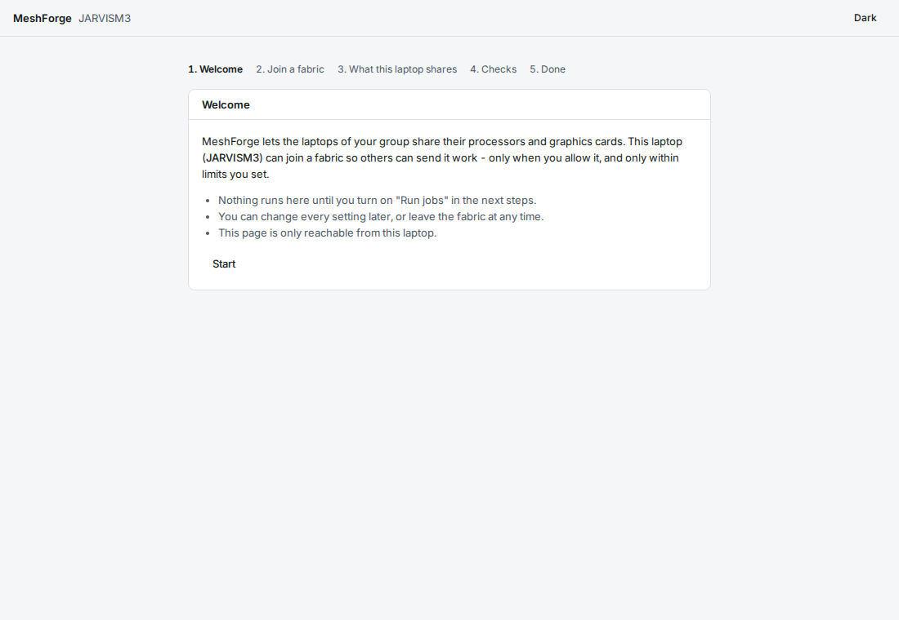
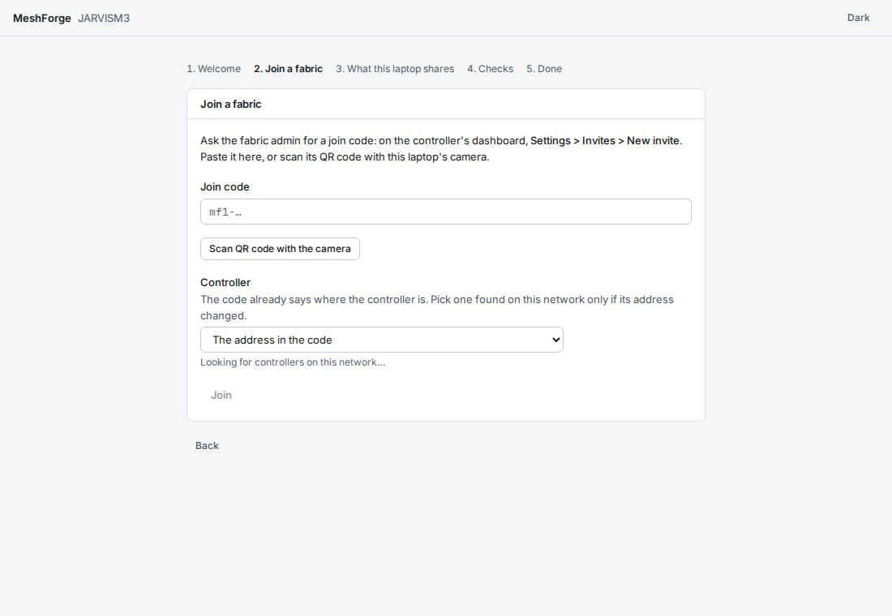
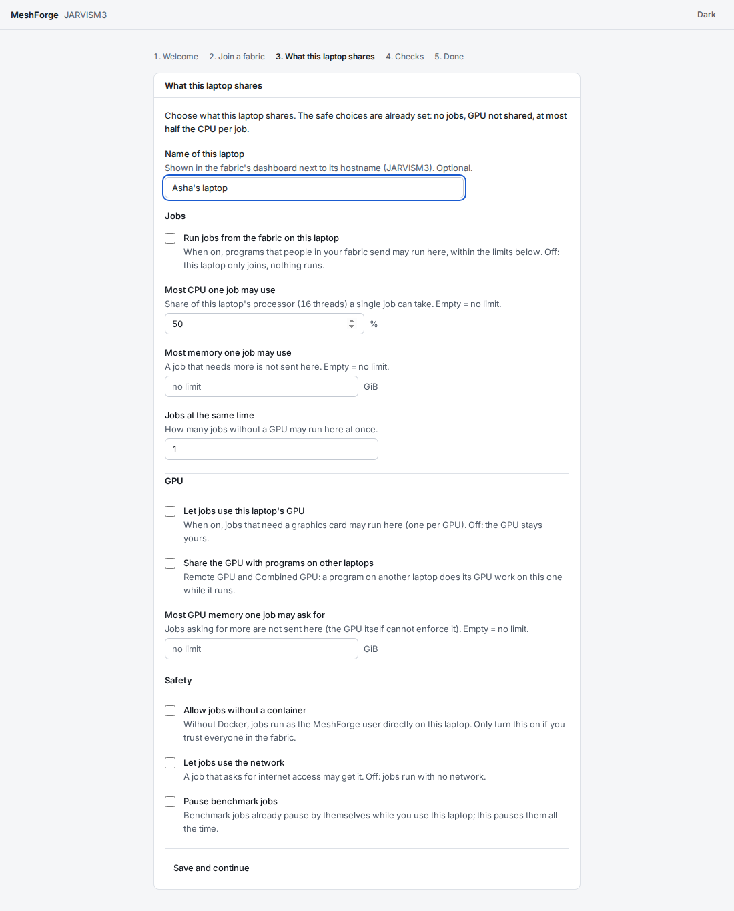
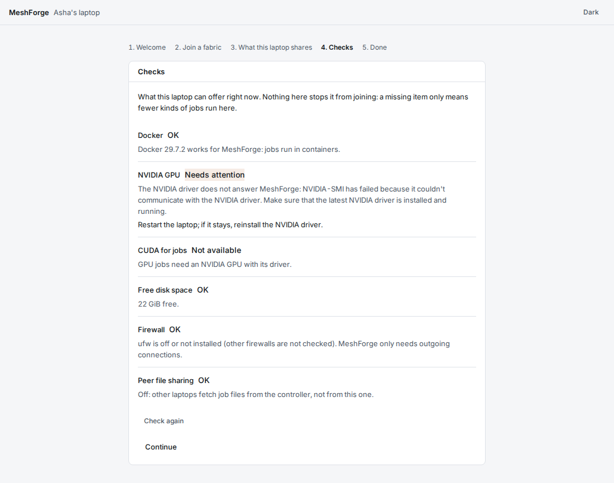
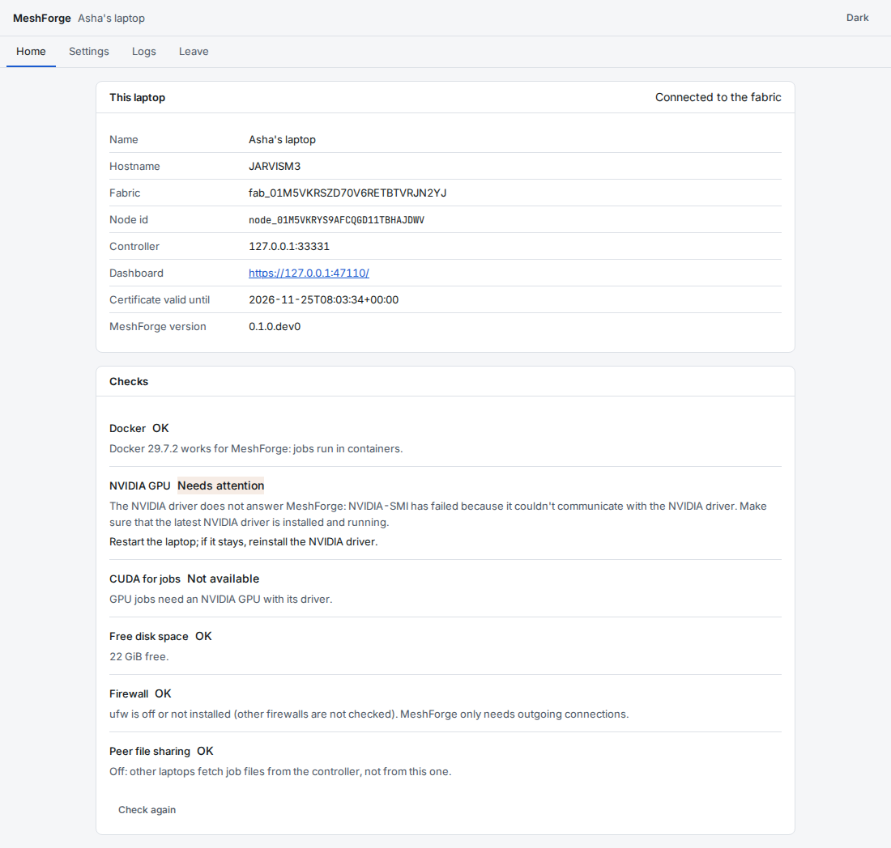
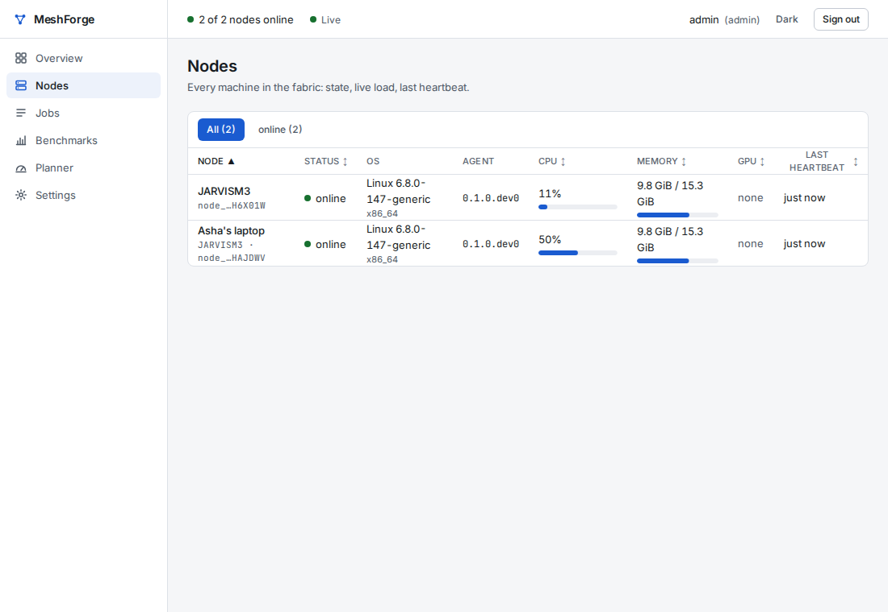

# Join a laptop to your MeshForge fabric

Install first: [install-windows.md](install-windows.md) or [install-linux.md](install-linux.md).

You need: the MeshForge agent installed on the laptop (Linux: `sudo apt install ./meshforge-agent_<version>_amd64.deb`;
Windows: `MeshForge-Agent-Setup-<version>.exe`, see [install-windows.md](install-windows.md)),
and a **join code** from whoever runs the fabric's controller.

1. **Get a join code.** The fabric admin opens the dashboard, goes to **Settings > Invites > New invite**, and
   either reads you the code (it starts with `mf1-`) or leaves the QR code on screen. A code works once, and only
   for a limited time (15 minutes by default).
2. **Open MeshForge on the laptop.** Find **MeshForge** in the app menu (Windows: the Start menu). A browser page opens - it is served by the
   laptop itself and cannot be reached from the network.

   
3. **Join.** Click *Start*, paste the code (or click *Scan QR code with the camera* and hold the dashboard's QR
   code up to the webcam), then *Join*. If something is wrong the page says what and what to do, for example
   "This code has expired - ask for a new code" (all messages: [troubleshooting.md](troubleshooting.md)).

   
4. **Choose what the laptop shares.** The safe choices are already set: no jobs run, the GPU is not shared, a job may
   use at most half the processor. Read each line, change what you want, optionally give the laptop a name, and
   click *Save and continue*. See [owner-settings.md](owner-settings.md).

   
5. **Look at the checks.** They show what the laptop can offer (Docker, NVIDIA GPU, CUDA, disk space, firewall).
   Nothing here blocks joining; a missing item only means fewer kinds of jobs run here.

   
6. **Done.** The laptop appears in the fabric's dashboard within a few seconds, under the name you gave it.
   The page's **Home** says *Connected to the fabric*.

   
   

A join code works **once**. If two laptops use the same code at the same moment, only one joins; the other gets
"This code was already used" and needs a new code. The same happens if the join reached the controller but the
answer was lost on the way back (for example the network dropped): ask the admin for a new code.

To open the page again later, use the same app-menu entry. To leave the fabric: **Leave** in the page's menu.
