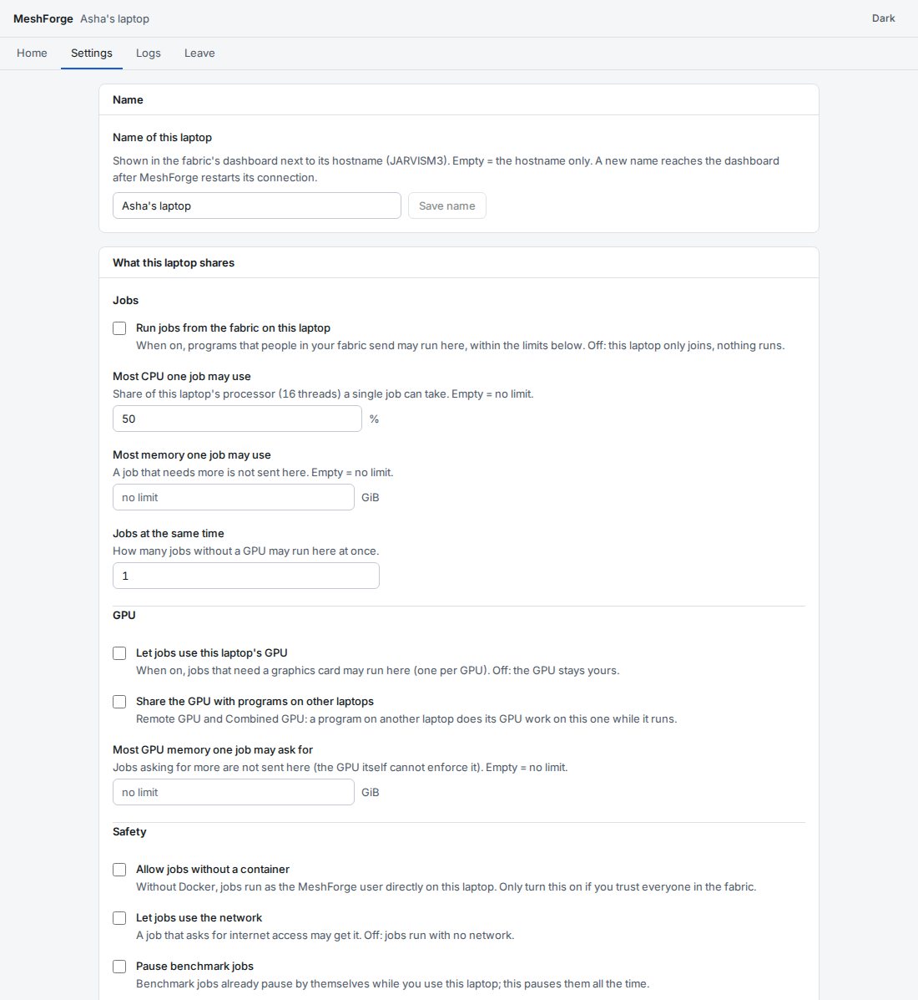

# What your laptop shares - the owner settings

You, the laptop's owner, decide what other people's work may do on it - not the fabric's admin. Open
**MeshForge** from the app menu and go to **Settings**. Changes apply within seconds - no restart needed.

| Setting | What it means | After install |
|---|---|---|
| Run jobs from the fabric on this laptop | Programs people in your fabric send may run here, within the limits below. Off: the laptop only joins. | off |
| Most CPU one job may use | Share of the processor a single job may take. | 50 % |
| Most memory one job may use | A job that needs more is not sent here. | no limit |
| Jobs at the same time | How many jobs without a GPU may run at once. | 1 |
| Let jobs use this laptop's GPU | Jobs that need a graphics card may run here (one per GPU). | off |
| Share the GPU with programs on other laptops | Remote GPU / Combined GPU: another laptop's program does its GPU work here while it runs. | off |
| Most GPU memory one job may ask for | Jobs asking for more are not sent here (the GPU itself cannot enforce it). | no limit |
| Allow jobs without a container | Without Docker, jobs run directly as the MeshForge user. Only if you trust everyone in the fabric. | off |
| Let jobs use the network | A job that asks for internet access may get it. | off |
| Pause benchmark jobs | No benchmark job starts here; a running one stops. Benchmark jobs also pause by themselves while you use the laptop. | off |
| Name of this laptop | Shown in the dashboard next to its hostname. | none |

A job that is already running is not stopped when you tighten a limit; the next one follows the new rules.

**Run jobs off** means: your laptop is part of the fabric and says what it *could* run, but nobody's job is
downloaded, prepared or run on it, and MeshForge only looks - it checks whether Docker and a graphics card are there,
without starting anything in Docker and without changing system settings. (At start it does clean up what MeshForge
itself may have left behind after a crash, such as a benchmark's network setting - nothing else.) **The first time you turn Run jobs on**,
MeshForge finishes setting up (this can start one short check in Docker and set up its CPU limit) and reconnects to
the fabric by itself within seconds. If that setup fails (for example Docker hangs), MeshForge keeps trying on its
own for as long as Run jobs stays on. After that, turning Run jobs off and on takes effect at once.

**Docker.** Jobs run safest in Docker containers. Docker access is the same as full admin rights on the laptop, so
MeshForge never takes it by itself: right-click **MeshForge** in the app menu and choose **Give Docker access**
(asks for your password), or run `sudo usermod -aG docker meshforge && sudo systemctl restart meshforge-agent`.
