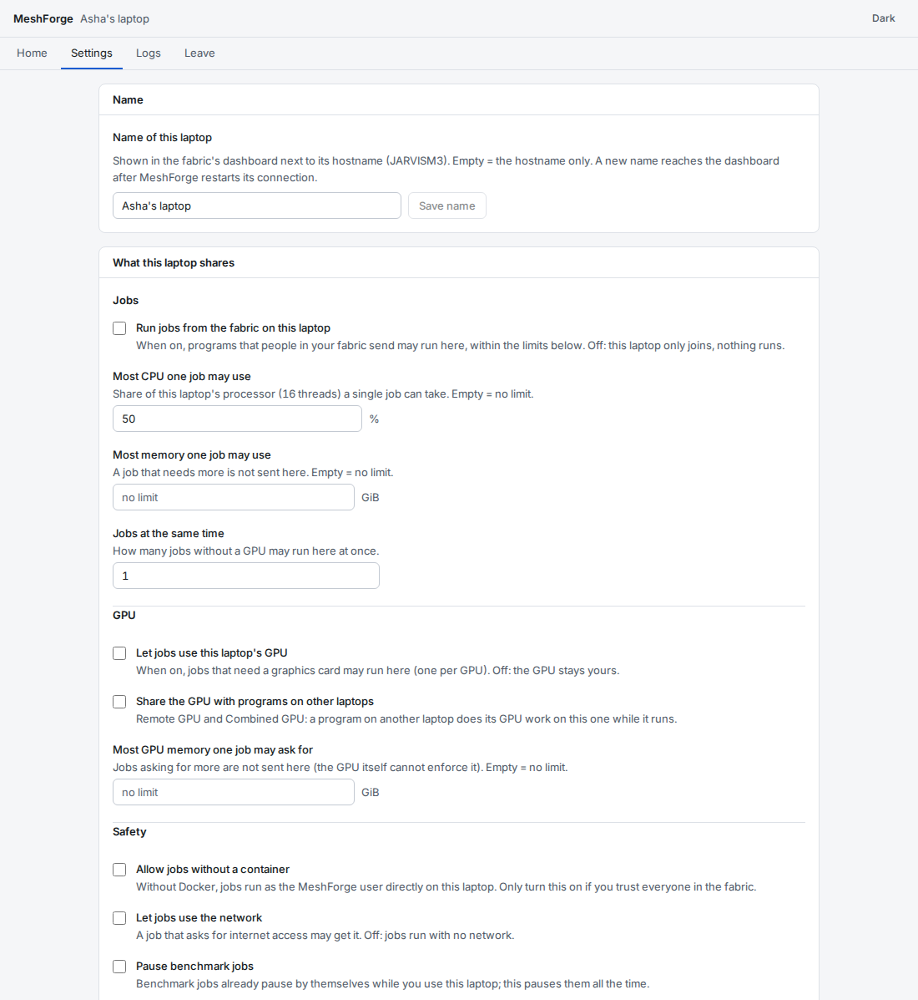

# What your laptop shares - the owner settings

You, the laptop's owner, decide what other people's work may do on it - not the fabric's admin. Open
**MeshForge** from the app menu and go to **Settings**. Changes apply within seconds; when one needs a restart the
page says so and offers a *Restart now* button.

| Setting | What it means | After install |
|---|---|---|
| Run jobs from the fabric on this laptop | Programs people in your fabric send may run here, within the limits below. Off: the laptop only joins. | off |
| Most CPU one job may use | Share of the processor a single job may take. | 50 % |
| Most memory one job may use | A job that needs more is not sent here. | no limit |
| Jobs at the same time | How many jobs without a GPU may run at once. | 1 |
| Let jobs use this laptop's GPU | Jobs that need a graphics card may run here (one per GPU). | off |
| Share the GPU with programs on other laptops | Remote GPU / Combined GPU: another laptop's program does its GPU work here while it runs. | off |
| Most GPU memory one job may ask for | Jobs asking for more are not sent here (the GPU itself cannot enforce it). | no limit |
| Allow jobs without a container | Without Docker, jobs run directly as the MeshForge user. Only if you trust everyone in the fabric. | off |
| Let jobs use the network | A job that asks for internet access may get it. | off |
| Pause benchmark jobs | No benchmark job starts here; a running one stops. Benchmark jobs also pause by themselves while you use the laptop. | off |
| Name of this laptop | Shown in the dashboard next to its hostname. | none |

A job that is already running is not stopped when you tighten a limit; the next one follows the new rules.

**Docker.** Jobs run safest in Docker containers. Docker access is the same as full admin rights on the laptop, so
MeshForge never takes it by itself: right-click **MeshForge** in the app menu and choose **Give Docker access**
(asks for your password), or run `sudo usermod -aG docker meshforge && sudo systemctl restart meshforge-agent`.
