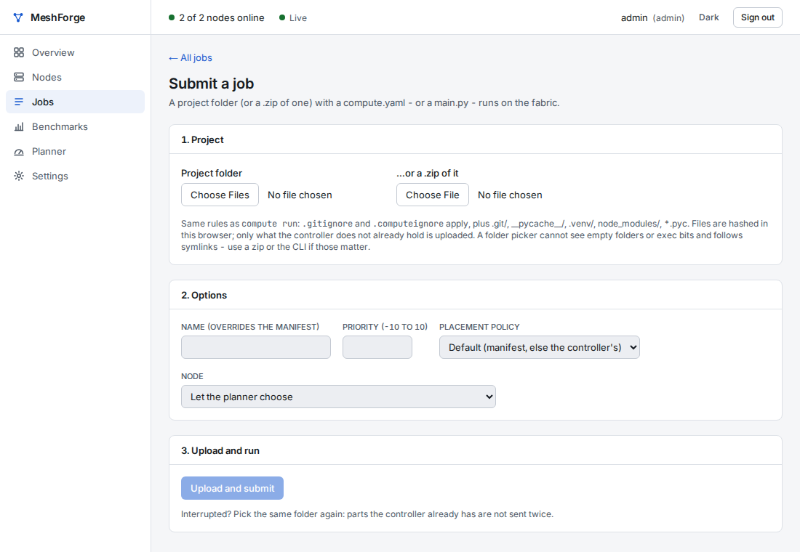

# Run a program on the fabric

A **job** is a folder (your "project") with your program and a small file, `compute.yaml`, that says how to run
it. You send the folder; MeshForge picks where it runs (your laptop, another laptop, or several at once) and
brings the results back.

Before you start: at least one laptop has joined ([join-a-laptop.md](join-a-laptop.md)) and its owner turned
on **Run jobs from the fabric on this laptop** ([owner-settings.md](owner-settings.md)). Without Docker on that
laptop, its owner must also allow **jobs without a container**.

> The examples on this page are run automatically by MeshForge's test suite against a real fabric, exactly as
> written here (`tests/cluster/test_v017_g5_user_docs.py`).

## 1. A first job

Make a folder `hello` with two files:

<!-- ci:file project=hello path=compute.yaml -->
```yaml
name: hello
entrypoint: [python, hello.py]
outputs: [results/]
```

<!-- ci:file project=hello path=hello.py -->
```python
import os
import platform

os.makedirs("results", exist_ok=True)
with open("results/where.txt", "w") as f:
    f.write(f"hello from {platform.node()}\n")
print("hello from the fabric")
```

`compute.yaml` says: run `python hello.py`, and bring back the `results/` folder.

## 2. Send it from the dashboard

Open the dashboard, go to **Jobs → Submit job**, choose the **Project folder** `hello` (or a `.zip` of it) and
click **Upload and submit**. The job page opens: its state (queued → running → succeeded), where it ran, and its
log. When it has finished, download the outputs from the job page.



## 3. Or send it from a terminal

Once per computer, log in (the controller's address and fingerprint are on the dashboard):

```bash
compute login --controller https://<controller address>:47110 --fingerprint <CA fingerprint> -u <your name>
```

Then:

<!-- ci:commands project=hello -->
```bash
compute run ./hello -f
```

`compute run` prints the job's id (`job_...`), uploads only files the controller does not have yet, and with
`-f` follows the log until the job ends. Then fetch the results:

```bash
compute get <JOB_ID>            # unpacks into ./outputs/<JOB_ID>/
compute jobs                    # your recent jobs
compute explain <JOB_ID>        # why MeshForge placed it where it did
```

`--node <NODE_ID>` sends the job to one particular laptop; `--local` runs it on your own laptop.

## 4. Split one big job across laptops (task splitting)

When a job is a list of independent pieces - files to convert, numbers to try, rows to process - MeshForge can
split it: each laptop runs your program on some of the pieces, and the results are joined in order. Add a
`split:` section and two placeholders: `{items_file}` (a JSON list of this piece's items) and `{out}` (the
folder to write this piece's result to).

<!-- ci:file project=squares path=compute.yaml -->
```yaml
name: squares
entrypoint: [python, square.py, "{items_file}", "{out}"]
split:
  over: {range: {stop: 20}}
  chunk: {items: 5}
  combine: concat
```

<!-- ci:file project=squares path=square.py -->
```python
import json
import sys
from pathlib import Path

items = json.loads(Path(sys.argv[1]).read_text())
out = Path(sys.argv[2])
out.mkdir(parents=True, exist_ok=True)
lines = "".join(f"{n} {n * n}\n" for n in items)
(out / "squares.txt").write_text(lines)
```

<!-- ci:commands project=squares -->
```bash
compute run ./squares -f
```

The numbers 0-19 are cut into 4 pieces of 5; laptops pull pieces until all are done; `combine: concat` glues
the four `squares.txt` files together in order, so `compute get <JOB_ID>` gives one `squares.txt` with 20 lines.
`compute watch <JOB_ID>` shows which laptop did which piece. If splitting would be slower than one laptop
(small jobs, a slow network), MeshForge runs it on one laptop and `compute explain` says why.

Other ways to name the pieces: `over: {glob: "images/*.jpg"}` (files of the project), `over: {lines: data.csv,
header: true}` (rows of a file). Other ways to join them: `merge-csv`, `merge-json`, or your own script. All
options: `src/meshforge/common/manifest.py` (the manifest reference) and [../OPERATIONS.md](../OPERATIONS.md).

## More in compute.yaml

```yaml
env:
  requirements: requirements.txt   # Python packages, installed once per laptop and reused
resources:
  gpu: required                    # required | preferred | none
  ram_gb: 8
limits:
  timeout: 30m
```

A job that needs a GPU runs only on a laptop whose owner shares the GPU.
